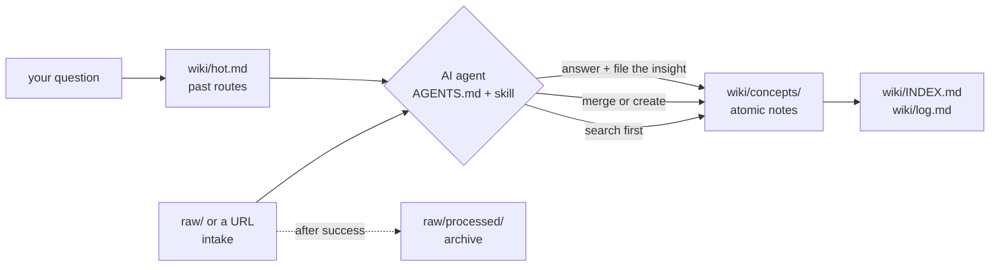

# Knowledge Base

A personal, agent-maintained wiki of **compiled** knowledge — plain markdown, no database, no build step, no plugins.

Raw material (articles, notes, transcripts, web pages) goes in. An AI agent reads it, merges it into the right atomic note, links it to related concepts, and updates the index and activity log. What comes out is a wiki you can read start to finish, not a pile of clippings you have to re-read.

Inspired by [Andrej Karpathy's `llm-wiki` concept](https://gist.github.com/karpathy/442a6bf555914893e9891c11519de94f) and the "AI second brain" pattern.

---

## The core idea: compile, don't retrieve

Most note systems *accumulate*. You save an article, tag it, and hope to find it again. The knowledge stays scattered across the sources it arrived in.

This vault *compiles*. Every new source is merged into existing pages rather than filed beside them. There is exactly one page per concept, it is rewritten as understanding deepens, and it links to every concept it depends on.

| | Typical note vault | This vault |
| --- | --- | --- |
| New source | Becomes a new note | Merged into the existing concept note |
| Same topic twice | Two notes, slowly diverging | One note, improved |
| Organization | Folders + tags + search | Wikilinks + a curated index |
| Raw text | Kept verbatim | Discarded after it is compiled |
| Maintainer | You, manually | An AI agent, by procedure |

---

## How it works



**[`AGENTS.md`](AGENTS.md) and the skills in [`.skill/`](.skill/) are the entire runtime.** There is no code in this repository — no scripts, no CI, no indexer. The agent reads `AGENTS.md`, opens the skill for the task at hand, and the file system is the only state. To change how the vault behaves, you edit a rule, not a program. In Claude Code every skill is also a slash command (`/wiki-create`, `/wiki-query`, …).

### Workflows

| Workflow | Skill | What happens |
| --- | --- | --- |
| **Ingest** | `wiki-ingest` | A file in `raw/` or a URL → read it in full → split into concepts → **search the vault first** → merge or create → link both ways → archive the source → update index and log |
| **Create** | `wiki-create` | Same, for a note you ask for directly with no source file |
| **Answer** | `wiki-query` | Check `hot.md` for a route from a past question, else read `INDEX.md` → read only the sections needed → answer **with citations** → file anything new back |
| **Maintain** | `wiki-maintain` | Rename, move, merge, split, or delete — every inbound link repointed, index and log kept in sync |
| **Lint** | `wiki-lint` | Structural and semantic audit of the whole vault, reported before anything is fixed |
| **Resolve** | `wiki-resolve` | Close open questions, fact-check stale claims, and expand stubs from cited sources |

The answer workflow is the one most systems skip. Here, answering is a *write* operation: if the answer synthesized two pages into something neither contained, that synthesis becomes a page. An insight left in chat history is an insight lost.

---

## Repository structure

```text
.
├── AGENTS.md          # The constitution: rules, structure, note format, skill routing
├── .claude/skills/    # Local symlink to .skill/ (git-ignored; see Setup)
├── .skill/            # The procedures, one folder per skill
├── raw/               # Intake queue: drop sources here
│   ├── assets/        # Images and PDFs embedded in notes
│   └── processed/     # Archive of what has been compiled
└── wiki/
    ├── INDEX.md       # Every page, grouped by folder, with one-line summaries
    ├── hot.md         # Routes from answered questions to the sections that answered them
    ├── log.md         # Append-only activity log
    └── concepts/      # One folder per domain tag — see wiki/INDEX.md
```

The folder rules and the note format are defined once, in [`AGENTS.md`](AGENTS.md) §2 and §3. Three details of the note format carry most of the weight:

- **`sources`** is an append-only provenance trail. Every fact on the page can be traced back to where it came from — or, if the list is empty, to general knowledge stated as such.
- **`## Open Questions & Disagreements`** is where conflicts go. When two sources disagree, the agent is forbidden from silently picking a winner; both positions are recorded and the note is tagged `needs-review`.
- **`## Related Concepts`** explains *why* each link matters. A page with no links is treated as a defect.

---

## The audit trail

**[`wiki/INDEX.md`](wiki/INDEX.md)** — every page, grouped exactly as the folders are, with a short summary written so the agent can shortlist candidates without opening files. It is checked against the directory listing after every write.

**[`wiki/log.md`](wiki/log.md)** — one append-only line per request, newest first, tagged with its operation so it stays greppable:

```text
- **2026-10-22 13:14:46** · maintain · Created `[[concepts/data_governance/data_sanity_check]]` — cheap
  assertions that prove data is not obviously broken. Two open questions recorded; tagged `needs-review`.
```

`grep ' · query · ' wiki/log.md` shows every question asked of the vault, and what each one filed back.

**[`wiki/hot.md`](wiki/hot.md)** — the vault's memory of answered questions: each line routes a question to the note sections that answered it, so asking again skips the index and the unread parts of long notes. It is a router, never a source; answers still read and cite the notes.

---

## Using it

### Setup

`.claude/` is git-ignored, so after cloning, link the skills into it to get them as Claude Code slash commands (`/wiki-create`, `/wiki-query`, …). Run from the repository root:

```bash
# macOS / Linux / WSL
mkdir -p .claude && ln -s ../.skill .claude/skills
```

```powershell
# Windows PowerShell (needs Developer Mode or an elevated shell)
New-Item -ItemType Directory -Force .claude | Out-Null
New-Item -ItemType SymbolicLink -Path .claude\skills -Target ..\.skill
```

Other agents need no setup; they read `AGENTS.md` directly.

**As a reader.** Open [`wiki/INDEX.md`](wiki/INDEX.md) and start from a summary that interests you. The vault is an [Obsidian](https://obsidian.md) vault — open the repository folder directly for graph view and working wikilinks — but every file is plain markdown and reads fine on GitHub or in any editor.

**To add knowledge.** Drop a file into `raw/`, or give the agent a URL, and ask it to ingest. Or just ask for a note on a topic directly — no source required.

**To ask a question.** Ask it. The agent cites the pages it used, tells you explicitly when the vault does not cover something, and files any new synthesis back.

**To keep it healthy.** Ask for a lint pass: the agent runs the structural and semantic checks in `AGENTS.md` §9 and reports before touching anything. Then ask it to resolve the open questions and stubs the pass surfaced.

Any agent that reads `AGENTS.md` can operate the vault: Claude, GitHub Copilot, Gemini, and anything else that honours an instructions file.

---

## Design rules worth knowing

A handful of constraints in `AGENTS.md` do the real work:

- **Markdown native.** No build scripts, no database, no plugin dependencies — ever.
- **Single source of truth.** One page per concept. Duplicates get merged, not tolerated.
- **Never fabricate.** Only what the source or the user states, or well-established general knowledge. Inference is labelled as inference; ambiguity gets a question, not a guess.
- **Idempotent ingestion.** Processing the same source twice must not change the vault the second time.
- **Atomic transactions.** A task is done when the note, its wikilinks, the index, *and* the log are all consistent. Never a half-updated trail.
- **Guardrails.** Deleting notes, wholesale overwrites, bulk edits across more than ~10 notes, rewriting log history, and `git push` all require explicit approval.

---

## Current contents

See [`wiki/INDEX.md`](wiki/INDEX.md) for the full, current list of notes and domains.

---

## License

Personal knowledge base. Notes synthesize publicly available material; sources are credited in each page's `sources` frontmatter and `## References` section.
