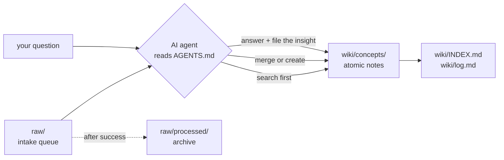

# Knowledge Base

A personal, agent-maintained wiki of **compiled** knowledge — plain markdown, no database, no build step, no plugins.

Raw material (articles, notes, transcripts, conversations) goes in. An AI agent reads it, merges it into the right atomic note, links it to related concepts, and updates the index and activity log. What comes out is a wiki you can read start to finish, not a pile of clippings you have to re-read.

Inspired by [Andrej Karpathy's `llm-wiki` concept](https://gist.github.com/karpathy/442a6bf555914893e9891c11519de94f) and the "AI second brain" pattern.

---

## The core idea: compile, don't retrieve

Most note systems *accumulate*. You save an article, tag it, and hope to find it again. The knowledge stays scattered across the sources it arrived in.

This vault *compiles*. Every new source is merged into existing pages rather than filed beside them. There is exactly one page per concept, it is rewritten as understanding deepens, and it links to every concept it depends on.

| | Typical note vault | This vault |
| --- | --- | --- |
| New source | Becomes a new note | Merged into the existing concept note |
| Same topic twice | Two notes, slowly diverging | One note, improved |
| Organization | Folders + tags + search | Wikilinks + a curated index |
| Raw text | Kept verbatim | Discarded after it is compiled |
| Maintainer | You, manually | An AI agent, by procedure |

---

## How it works

The whole system is three directories and one rulebook.



**[`AGENTS.md`](AGENTS.md) is the entire runtime.** There is no code in this repository — no scripts, no CI, no indexer. The agent reads that file, follows its procedures, and the file system is the only state. If you want to change how the vault behaves, you edit a rule, not a program.

### Three workflows

| Workflow | Trigger | What happens |
| --- | --- | --- |
| **Ingest** | A file lands in `raw/`, or you ask for a note directly | Read the source → split it into concepts → **search the vault first** → merge into the existing page or create a new one → link both ways → archive the source → update index and log |
| **Answer** | You ask a question about the subject matter | Read `INDEX.md` → shortlist pages → read them in full → answer **with citations to the pages used** → file anything new back into the vault |
| **Maintain** | Rename, merge duplicates, delete, or a full lint pass | Repoint every inbound link, keep the index in sync, log the operation |

The answer workflow is the one most systems skip. Here, answering is a *write* operation: if the answer synthesized two pages into something neither contained, that synthesis becomes a page. An insight left in chat history is an insight lost.

---

## Repository structure

```text
.
├── AGENTS.md                  # The constitution — rules, formats, workflows
├── .skill/                    # Reusable procedures the agent reads on demand
│   ├── git-commit-helper/     #   Conventional Commits message generation
│   ├── obsidian-markdown/     #   Wikilinks, callouts, embeds, properties
│   └── tag-taxonomy/          #   The six tag facets and their vocabularies
├── raw/                       # Intake queue: drop sources here
│   └── processed/             # Archive of what has been compiled
└── wiki/
    ├── INDEX.md               # Every page, grouped by domain, one-line summaries
    ├── log.md                 # Append-only activity log
    ├── assets/                # Images and binaries linked from notes
    └── concepts/              # The knowledge — one file per concept
        ├── data_architecture/
        ├── data_engineering/
        │   ├── dbt/
        │   ├── kafka/
        │   └── spark/
        ├── data_governance/
        ├── data_structures/
        ├── databases/
        ├── devops/
        ├── software_architecture/
        └── version_control/
```

A note's folder always matches its `domain` tag. One level of technology subfolder is allowed, and only once a family reaches three notes.

---

## What a note looks like

```markdown
---
title: Data Quality
tags: [data-governance, data-quality]
sources: [raw/processed/dama_dmbok_ch11.md, "https://example.org/article"]
created: 2026-09-22 09:11:46
updated: 2026-09-23 10:25:15
---

# Data Quality

A standalone definition that links its parent concept, such as
[[concepts/data_governance/data_governance|Data Governance]].

## Why It Matters

## <Topic-specific sections>

## Open Questions & Disagreements

- <Claim A> (source X) conflicts with <claim B> (source Y). Unresolved because …

## Related Concepts

- [[concepts/data_governance/data_stewardship|Data Stewardship]] — who is accountable for quality
```

Three details carry most of the weight:

- **`sources`** is an append-only provenance trail. Every fact on the page can be traced back to where it came from — or, if the list is empty, to general knowledge stated as such.
- **`## Open Questions & Disagreements`** is where conflicts go. When two sources disagree, the agent is forbidden from silently picking a winner; both positions are recorded and the note is tagged `needs-review`.
- **`## Related Concepts`** explains *why* each link matters. A page with no links is treated as a defect.

---

## The audit trail

Two files make the vault's history inspectable.

**[`wiki/INDEX.md`](wiki/INDEX.md)** — every page, grouped exactly as the folders are, with a one-line summary written so the agent can shortlist candidates without opening files. It is verified against the directory listing after every write.

**[`wiki/log.md`](wiki/log.md)** — one append-only line per request, newest first, tagged with its operation so it stays greppable:

```text
- **2026-10-22 13:14:46** · maintain · Created `[[concepts/data_governance/data_sanity_check]]` — cheap
  assertions that prove data is not obviously broken. Two open questions recorded; tagged `needs-review`.
```

`grep ' · query · ' wiki/log.md` shows every question ever asked of the vault, and what each one filed back.

---

## Using it

**As a reader.** Open [`wiki/INDEX.md`](wiki/INDEX.md) and start from a summary that interests you. The vault is an [Obsidian](https://obsidian.md) vault — open the repository folder directly for graph view and working wikilinks — but every file is plain markdown and reads fine on GitHub or in any editor.

**To add knowledge.** Drop a file into `raw/` and ask your agent to ingest it. Or just ask for a note on a topic directly — no source file required.

**To ask a question.** Ask it. The agent reads the index, cites the pages it used, tells you explicitly when the vault does not cover something, and files any new synthesis back.

**To keep it healthy.** Ask for a lint pass. The agent runs both checklists in `AGENTS.md` §9 — structural (missing frontmatter, broken links, orphans, index drift) and semantic (contradictions, stale claims, hollow hubs, unsourced figures) — and reports findings before touching anything.

Any agent that reads `AGENTS.md` can operate the vault. It is written for GitHub Copilot, Claude, Gemini, and anything else that honours an instructions file.

---

## Design rules worth knowing

A handful of constraints in `AGENTS.md` do the real work:

- **Markdown native.** No build scripts, no database, no plugin dependencies — ever.
- **Single source of truth.** One page per concept. Duplicates get merged, not tolerated.
- **Never fabricate.** Only what the source or the user states, or well-established general knowledge. Inference is labelled as inference; ambiguity gets a question, not a guess.
- **Idempotent ingestion.** Processing the same source twice must not change the vault the second time.
- **Atomic transactions.** A task is done when the note, its wikilinks, the index, *and* the log are all consistent. Never a half-updated trail.
- **Guardrails.** Deleting notes, wholesale overwrites, bulk edits across more than ~10 notes, rewriting log history, and `git push` all require explicit approval.

---

## Current contents

Around forty notes across data architecture, data engineering, data governance, data structures, databases, DevOps, software architecture, and version control. See [`wiki/INDEX.md`](wiki/INDEX.md) for the full, current list.

---

## License

Personal knowledge base. Notes synthesize publicly available material; sources are credited in each page's `sources` frontmatter and `## References` section.
