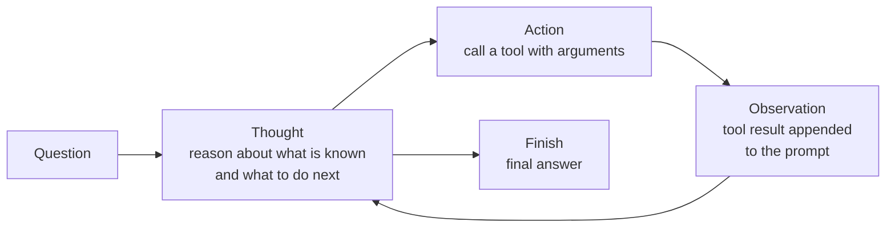
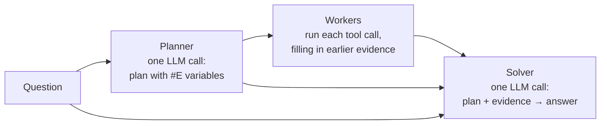

# Agent Reasoning Patterns (ReAct and ReWOO)

An agent reasoning pattern is the control structure that decides how a language model combines its own reasoning with calls to external tools. There are two foundational designs. **ReAct** (Reasoning and Acting) interleaves the two, thinking again after every tool result. **ReWOO** (Reasoning Without Observation) plans every tool call up front and reasons over the results only at the end. Both extend [[concepts/ai_engineering/chain_of_thought|Chain-of-Thought (CoT) Prompting]] from reasoning alone to reasoning with tools.

## Why It Matters

Reasoning alone and acting alone each fail in a characteristic way:

- **Reasoning only.** A chain of thought works entirely from the model's weights, so it can reason fluently from a hallucinated or outdated fact and has no way to check it.
- **Acting only.** A model that issues tool calls without writing down its reasoning loses track of the goal, cannot decompose the task, and handles surprises poorly.

Combining them grounds the reasoning in outside facts. *How* they are combined then decides cost, latency, and robustness. Re-reasoning after every observation adapts to anything but pays for it in tokens and sequential model calls. Planning once is cheap but cannot react to what the tools return. Most agent frameworks are a variation on one of these two patterns, or a hybrid of them.

## ReAct (Reasoning and Acting)

### The loop



The model reasons, acts, reads the result, and repeats, until a reasoning step concludes that it can answer.

1. **Thought.** The model writes free-text reasoning: what it knows, what is missing, and which action to take.
2. **Action.** The model emits a structured action, such as `Search[...]` or `Lookup[...]` in the original paper, or a function call in today's tool-calling APIs.
3. **Observation.** The application runs the action and appends its result to the prompt. The model never executes tools itself.
4. **Repeat or finish.** The model either continues with another thought or emits a final-answer action.

Because each step is written out, the trace shows *why* the agent did what it did, which makes failures easier to diagnose than an opaque sequence of tool calls.

### An example trace

This illustrative trace shows the format on a two-hop question:

```text
Question: Which country is the author of "The Name of the Rose" from?
Thought 1: I need the author of the novel, then that author's nationality.
Action 1: Search["The Name of the Rose"]
Observation 1: The Name of the Rose is a 1980 novel by Umberto Eco ...
Thought 2: The author is Umberto Eco. Now I need his nationality.
Action 2: Search["Umberto Eco"]
Observation 2: Umberto Eco was an Italian novelist and philosopher ...
Thought 3: Umberto Eco was Italian, so the answer is Italy.
Action 3: Finish["Italy"]
```

### Original results

Yao et al. introduced ReAct in 2022, and it was published at ICLR 2023. They prompted a frozen model with a few hand-written example traces.

- **Knowledge tasks (HotpotQA, Fever).** Interacting with a simple Wikipedia API reduced the hallucination and error propagation seen in chain-of-thought reasoning, and produced more interpretable trajectories.
- **Interactive decision-making (ALFWorld, WebShop).** ReAct beat imitation-learning and reinforcement-learning baselines by an absolute success rate of 34% and 10% respectively, prompted with only one or two in-context examples.

### ReAct today

Modern APIs build the loop in. The model returns a structured tool call instead of text to be parsed, the application runs it and sends the result back as a tool message, and many models reason before each call natively. Agent frameworks, coding agents, and agentic RAG are mostly ReAct loops with better tools, and the [[concepts/ai_engineering/model_context_protocol|Model Context Protocol (MCP)]] standardizes how the tools are offered. Retrieval-as-reasoning in [[concepts/ai_engineering/retrieval_as_reasoning_self_evolving_agent_native_retrieval_via_llm_wiki|Retrieval-Augmented Generation (RAG)]] is a ReAct agent whose tools traverse a compiled wiki.

### Costs and failure modes

- **Token growth.** Every step resends the whole trace so far, so the prompt grows with each thought and observation and the total tokens processed rise faster than the number of steps. Long tool outputs fill the [[concepts/ai_engineering/context_window|Context Window]] quickly.
- **Latency.** Each step is a separate model call, run in sequence.
- **Loops and repetition.** The agent can repeat the same search, or wander, without a step limit or a check for repeated actions.
- **Bad observations derail it.** An irrelevant search result can send the reasoning down a wrong path, and the agent may not notice.
- **Observations are untrusted input.** A web page or document returned by a tool can carry prompt injection. Limit what the tools are allowed to do instead of relying on instructions.

## ReWOO (Reasoning Without Observation)

ReWOO's authors observed that, for many tasks, the whole sequence of tool calls can be decided before any tool runs. Planning once removes the repeated re-reading of the trace that makes ReAct expensive. Xu et al. report **5× token efficiency and a 4% accuracy improvement on HotpotQA** compared with the ReAct-style baseline, across an evaluation of six public NLP benchmarks and a curated dataset.

### The three modules



The planner and the solver are the only model calls. Tool calls run between them without the model looking at intermediate results.

1. **Planner.** Given the question, one model call writes a numbered plan. Each step pairs a short reasoning note with a tool call whose result is bound to a variable, `#E1`, `#E2`, and so on. A later step can use an earlier result by referring to its variable.
2. **Workers.** The application runs each tool call in order, substituting the actual evidence for any variable it references. No model call is needed to decide what to do next.
3. **Solver.** One more model call receives the question, the plan, and all the evidence, and writes the final answer.

An illustrative plan for the same two-hop question:

```text
Plan: Find the author of the novel.
#E1 = Search["The Name of the Rose"]
Plan: Find the nationality of the author found in #E1.
#E2 = LLM["What is the nationality of the author named in: #E1"]
```

### Smaller planners

Because the planner never reads tool outputs, it does a narrow, well-defined job. The paper shows that this planning ability can be moved from the 175B-parameter GPT-3.5 to a 7B-parameter LLaMA model through instruction fine-tuning. That suggests a cheap model can plan while a stronger one, or none at all, does the rest.

## ReAct vs. ReWOO

| | ReAct | ReWOO |
| --- | --- | --- |
| Shape | Interleaved: think, act, observe, repeat | Plan-first: plan all, execute all, then solve |
| When reasoning happens | Before every action, after reading the last observation | Once before any tool runs, plus a final solve |
| Model calls | One per step | Planner plus solver, plus any LLM-as-tool steps |
| Prompt growth | Each call resends the whole trace | The planner never sees observations; only the solver reads them |
| Token cost | Grows quickly with the number of steps | Roughly fixed; the paper reports 5× fewer tokens on HotpotQA |
| Latency | Sequential model calls | Two model calls; steps that don't depend on each other could run in parallel |
| Adapts to surprises | Yes; the next thought can react to any observation | No; the plan is fixed before the evidence exists |
| Tool failure | The agent can notice and try something else | Workers carry on; only the solver sees the gap |
| Model size | The reasoning model must read every observation | The planner can be a small fine-tuned model |
| Good fit | Exploratory tasks, unknown environments, tasks where the next step depends on what was found | Tasks whose tool sequence is predictable from the question, such as multi-hop lookup |

> [!warning] A fixed plan cannot recover from a bad observation
> If a search returns nothing useful, ReWOO's workers carry on with the plan regardless. Where tool results are unpredictable, add a replanning step or use a ReAct loop.

**Choosing.** Start from how predictable the path is. If the question alone determines which tools to call, as in structured multi-hop lookup, ReWOO's single plan saves tokens and latency. If the next step depends on what the last tool found, as in debugging, browsing, or searching an unfamiliar corpus, ReAct's adaptivity is worth its cost. Hybrid designs take a middle path: plan first, execute, and let the model replan only when a step fails or the evidence contradicts the plan.

## Related Concepts

- [[concepts/ai_engineering/chain_of_thought|Chain-of-Thought (CoT) Prompting]] — the reasoning half of both patterns; least-to-most prompting is the closest prompting analogue of ReWOO's plan-first decomposition
- [[concepts/ai_engineering/context_window|Context Window]] — the budget a ReAct trace consumes step by step, and the cost ReWOO was designed to cut
- [[concepts/ai_engineering/model_context_protocol|Model Context Protocol (MCP)]] — the standard interface for the tools both patterns call
- [[concepts/ai_engineering/retrieval_as_reasoning_self_evolving_agent_native_retrieval_via_llm_wiki|Retrieval-Augmented Generation (RAG)]] — agentic RAG and retrieval-as-reasoning are ReAct loops over retrieval tools, and multi-hop retrieval is the task ReWOO's headline result comes from
- [[concepts/ai_engineering/prompt_engineering|Prompt Engineering]] — the few-shot prompting the original ReAct traces and ReWOO planners rely on

## References

- S. Yao, J. Zhao, D. Yu, N. Du, I. Shafran, K. Narasimhan, and Y. Cao, ["ReAct: Synergizing Reasoning and Acting in Language Models,"](https://arxiv.org/abs/2210.03629) arXiv:2210.03629, ICLR 2023.
- B. Xu, Z. Peng, B. Lei, S. Mukherjee, Y. Liu, and D. Xu, ["ReWOO: Decoupling Reasoning from Observations for Efficient Augmented Language Models,"](https://arxiv.org/abs/2305.18323) arXiv:2305.18323, 2023.
