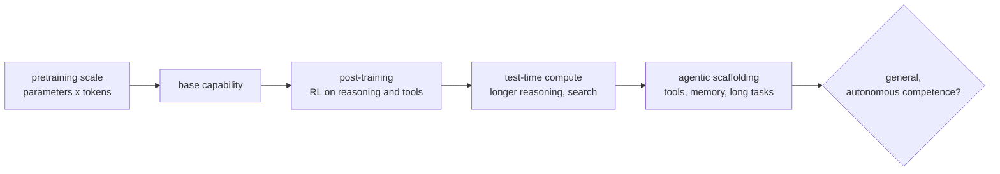

# Artificial General Intelligence (AGI)

Artificial general intelligence (AGI) is an AI system that matches or exceeds human ability across most cognitive tasks, not just one. It can learn unfamiliar tasks, transfer skills between domains, and work autonomously the way a capable human professional does. It is the middle rung of the capability ladder described in [[concepts/ai_engineering/digital_superintelligence|Digital Superintelligence]]: beyond today's narrow systems, and the expected launch point for anything beyond human level.

> [!info] Scope of this note
> This is a conceptual overview of how AGI is defined, measured, and pursued, written from widely cited literature. There is no agreed definition and no agreed test, so the note presents the main definitions side by side. Dated facts about benchmarks and labs are marked with their year.

## Why It Matters

- **It is the stated goal of the leading labs.** OpenAI's charter, Google DeepMind's mission, and several newer companies define their purpose in terms of AGI. Commercial contracts and governance structures have been written around the moment it is "achieved".
- **The definition does real work.** Whether a system counts as AGI can trigger contractual clauses, safety commitments, and regulatory attention. Vague definitions therefore have practical consequences.
- **It sets engineering expectations.** Claims that "AGI is near" shape what products are attempted, such as autonomous agents and AI employees, and how much autonomy those products are given.

## History of the Term

- **1956:** The Dartmouth workshop that founded the AI field aimed at general machine intelligence: "every aspect of learning or any other feature of intelligence" simulated by a machine.
- **1980:** John Searle distinguished *strong AI* (a machine that genuinely has a mind) from *weak AI* (a useful simulation). "Strong AI" was later used loosely to mean general AI.
- **1997–2007:** The phrase "artificial general intelligence" was used by Mark Gubrud (1997) and popularized in the early 2000s by Shane Legg and Ben Goertzel. Goertzel and Pennachin's edited volume *Artificial General Intelligence* (2007) established the field's name. It marked a split from mainstream *narrow* AI research, which had retreated to specific tasks.
- **2018 onward:** Large language models revived AGI as a mainstream engineering target, not a fringe research program.

## Competing Definitions

| Definition | Source | What it emphasises |
| --- | --- | --- |
| "Highly autonomous systems that outperform humans at most economically valuable work" | OpenAI Charter (2018) | Economic substitution |
| "An agent's ability to achieve goals in a wide range of environments" (of intelligence generally) | Legg & Hutter (2007) | Breadth of goal achievement |
| Efficiency at *acquiring* new skills, given prior knowledge and experience | Chollet, "On the Measure of Intelligence" (2019) | Learning efficiency, not stored skill |
| A matrix of performance level × generality | Morris et al., "Levels of AGI" (Google DeepMind, 2023) | Graded progress, not a single threshold |

### Levels of AGI

The DeepMind framework separates *how good* a system is from *how general* it is:

| Level | Performance relative to skilled adults | Narrow example | General example (as classified in 2023) |
| --- | --- | --- | --- |
| 0: No AI | — | A calculator | Human-in-the-loop crowdwork |
| 1: Emerging | Equal to or somewhat better than an unskilled human | Simple rule-based systems | Frontier chatbots of 2023 |
| 2: Competent | At least 50th percentile | Toxicity detectors, smart speakers | Not yet achieved |
| 3: Expert | At least 90th percentile | Grammar checkers, generative image models | Not yet achieved |
| 4: Virtuoso | At least 99th percentile | Deep Blue | Not yet achieved |
| 5: Superhuman | Outperforms all humans | AlphaFold, AlphaZero | Artificial superintelligence |

The framework's main point is that "general" and "superhuman" are separate axes. Narrow superhuman systems have existed for decades. What is missing is generality at high performance levels.

## Tests and Benchmarks

| Test | Passes if the system… | Limitation |
| --- | --- | --- |
| **Turing test** (1950) | Is indistinguishable from a human in text conversation | Measures imitation, which current chatbots largely achieve without general competence |
| **Coffee test** (attributed to Steve Wozniak) | Can enter an unfamiliar home and make coffee | Requires embodiment; mostly tests robotics |
| **Employment test** (Nils Nilsson, 2005) | Can do the work of an economically important job | Hard to administer; jobs change as AI arrives |
| **ARC-AGI** (Chollet, 2019) | Solves novel grid puzzles from a few examples | Narrow format, but specifically resistant to memorization |
| **Long-task horizon** (METR, 2025) | Completes tasks that take human experts hours or days, autonomously | Mostly software tasks; extrapolating the trend is uncertain |

Two dated data points show how fast benchmarks move:

- In December 2024, an OpenAI reasoning model reached human-level scores on the original ARC-AGI evaluation, using large amounts of test-time compute. A harder ARC-AGI-2 followed in 2025.
- METR's 2025 study reported that the length of software tasks frontier models can complete autonomously had been doubling roughly every seven months.

> [!warning] Benchmarks saturate faster than capabilities generalize
> A benchmark built to resist AI is typically solved within a few years of release, often by methods that do not transfer to everyday work. Treat any single benchmark result as evidence about that benchmark's task, not about general intelligence.

## Approaches

### The scaling hypothesis

The dominant bet today: general intelligence emerges from training ever-larger neural networks on ever more data and compute, with few hand-built mechanisms. It draws on Rich Sutton's "The Bitter Lesson" (2019): over the long run, general methods that use more computation beat approaches that encode human knowledge.

Its empirical basis is **scaling laws**: smooth, predictable improvements in model loss as resources grow. Kaplan et al. (2020) found loss falling as a power law in parameters $N$, data $D$, and compute $C$. Hoffmann et al. (2022, "Chinchilla") fitted a joint form and showed that many models were under-trained for their size:

$$L(N, D) = E + \frac{A}{N^{\alpha}} + \frac{B}{D^{\beta}}$$

Here $E$ is the irreducible loss of natural text, and the fitted exponents were roughly $\alpha \approx 0.34$ and $\beta \approx 0.28$. For a fixed compute budget, the compute-optimal recipe scales parameters and training tokens together, at about ==20 training tokens per parameter==.

Since 2024, a second scaling axis has been added: **test-time compute**. Reasoning models trained with reinforcement learning produce long internal chains of thought before answering, and accuracy keeps improving as they are allowed to think longer. See [[concepts/ai_engineering/chain_of_thought|Chain-of-Thought (CoT) Prompting]].

The current path stacks four multipliers. The open question is whether stacking them reaches general competence or levels off short of it.

### Alternative views

- **World models and new architectures.** Yann LeCun and others argue that next-token prediction lacks grounded world models, persistent memory, and planning. On this view, new architectures such as LeCun's joint-embedding predictive architectures (JEPA) are needed.
- **Neuro-symbolic AI.** Combine neural perception with symbolic reasoning, to get reliability and compositional generalization that pure neural systems lack.
- **Cognitive architectures.** Long-running research systems such as SOAR, ACT-R, and OpenCog model the components of a mind explicitly.
- **Whole-brain emulation.** Reproduce a human brain in simulation. This is far from feasible at human scale.

## What Current Systems Still Lack

The capabilities most often cited as the remaining gap, as of the mid-2020s:

| Gap | Symptom |
| --- | --- |
| **Reliability** | Confident errors (hallucination); performance varies with phrasing |
| **Long-horizon autonomy** | Agents drift, loop, or fail to recover on tasks lasting hours or days |
| **Continual learning** | Models do not update their knowledge from experience after deployment; they rely on context and retrieval |
| **Sample efficiency** | Humans learn new skills from a handful of examples; models need far more |
| **Physical grounding** | Limited understanding of the physical world and of acting in it |

Whether these gaps close with more scale and better post-training, or need a conceptual breakthrough, is the central disagreement about AGI timelines. The [[concepts/ai_engineering/digital_superintelligence|Digital Superintelligence]] note collects the positions.

## How to Think About It

The following is judgement, not fact. "Is this AGI?" is rarely a useful engineering question. Useful questions name a task, a performance level, and an autonomy level: "Can the model resolve 80% of our tier-1 support tickets without human review?" The Levels of AGI matrix is a good vocabulary for this. Rate a system per task, on both performance and autonomy, rather than with one label. For an [[concepts/ai_engineering/ai_engineer|AI Engineer]], this keeps scoping decisions tied to measured capability, not to headlines.

## Related Concepts

- [[concepts/ai_engineering/digital_superintelligence|Digital Superintelligence]] — the hub: the step beyond AGI, takeoff dynamics, and the debates about timelines and risk
- [[concepts/ai_engineering/alignment/ai_alignment|AI Alignment]] — making increasingly general systems pursue intended goals, which gets harder as generality and autonomy grow
- [[concepts/ai_engineering/chain_of_thought|Chain-of-Thought (CoT) Prompting]] — the reasoning technique behind test-time compute scaling and today's reasoning models
- [[concepts/ai_engineering/ai_engineer|AI Engineer]] — the practitioner who has to translate "AGI" claims into measured task capability

## References

- OpenAI Charter (2018)
- Shane Legg and Marcus Hutter, "Universal Intelligence: A Definition of Machine Intelligence" (2007)
- François Chollet, "On the Measure of Intelligence" (2019)
- Meredith Ringel Morris et al., "Levels of AGI: Operationalizing Progress on the Path to AGI" (2023)
- Jared Kaplan et al., "Scaling Laws for Neural Language Models" (2020)
- Jordan Hoffmann et al., "Training Compute-Optimal Large Language Models" (2022)
- Rich Sutton, "The Bitter Lesson" (2019)
- METR, "Measuring AI Ability to Complete Long Tasks" (2025)
- [ARC Prize](https://arcprize.org/) — the ARC-AGI benchmarks and results
