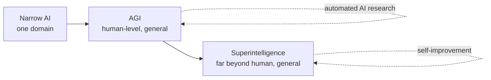
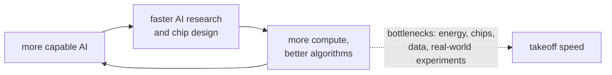

# Digital Superintelligence

Digital superintelligence is a hypothetical intelligence running on computing hardware that greatly exceeds the best human minds in virtually every cognitive domain: science, strategy, engineering, persuasion, and social reasoning. "Digital" separates it from routes to greater intelligence that stay biological, such as genetic enhancement or human organizations. "Super" separates it from *artificial general intelligence* (AGI), which is roughly human-level. The idea sits at the far end of the capability curve that the systems built by an [[concepts/ai_engineering/ai_engineer|AI Engineer]] are climbing.

> [!info] Scope of this note
> This is a conceptual overview built from widely cited literature and public statements by major AI labs. No such system exists. Everything about its arrival, timing, and behaviour is forecast or argument, and the note presents competing positions rather than picking a winner. Claims about recent industry events are dated, because they change quickly.

## Why It Matters

- **It is an explicit goal.** Several frontier AI developers describe building AGI, and then superintelligence, as their mission. Some companies are named after it.
- **The stakes are unusually asymmetric.** Proponents expect it to compress decades of scientific progress into years. Critics and many researchers inside the field warn that a system more capable than its overseers may be impossible to correct once deployed.
- **It shapes present-day practice.** Safety evaluations, staged-release policies, interpretability research, and the sandboxing of autonomous agents are all partly justified by the prospect of much more capable future systems.

## The Capability Ladder

| Level | Common definition | Status |
| --- | --- | --- |
| **Narrow AI** | Superhuman or human-level at one task: chess, protein folding, image classification | Widespread |
| **[[concepts/ai_engineering/agi/artificial_general_intelligence\|Artificial General Intelligence (AGI)]]** | Human-level across most cognitive tasks. OpenAI's charter puts it as "highly autonomous systems that outperform humans at most economically valuable work" | Contested: no agreed test, and claims of arrival are disputed |
| **Artificial Superintelligence (ASI)** | Greatly exceeds the best humans in virtually all domains | Hypothetical |

The dashed loops show why many authors expect the step from AGI to superintelligence to be shorter than the step to AGI. A system that can do AI research can speed up its own successor.

The boundaries are fuzzy. Current large models are superhuman in breadth of knowledge and speed, yet below expert humans at long-horizon planning and reliable reasoning. Many researchers therefore treat "AGI" and "ASI" as regions of a continuous capability space, not as discrete thresholds.

## Forms of Superintelligence

Nick Bostrom's *Superintelligence* (2014), the most cited treatment of the idea, distinguishes three forms. They can occur together:

| Form | Exceeds humans by | Example |
| --- | --- | --- |
| **Speed** | Thinking like a human, but far faster | A human-level mind running 10,000× faster experiences a decade of thought in under a day |
| **Collective** | Many minds coordinating as one system | Millions of copies of one model, sharing what each learns |
| **Quality** | Thinking that is qualitatively better, not just faster or more numerous | Insights no number of human-level thinkers would reach, as human cognition exceeds a chimpanzee's |

## Why a Digital Mind Could Surpass a Biological One

The case that the substrate matters rests on hardware and software advantages that are well documented:

- **Speed.** Biological neurons fire at most around 200 times per second, while processors run at billions of cycles per second. Axon signals travel at up to about 120 m/s, while electronic signals move at a large fraction of the speed of light.
- **Scale.** A brain is limited by skull volume and metabolic energy. A data center can add compute and memory with no comparable ceiling.
- **Copyability.** A trained model can be duplicated instantly. A skill learned once can be deployed a million times without retraining each copy.
- **Editability and inspection.** Software can be modified, debugged, and run on experimental variants in ways a brain cannot.
- **Shared learning.** Copies can merge what they learn, whereas humans transmit knowledge slowly through language and teaching.

## Paths to Superintelligence

Bostrom lists five routes: artificial intelligence, whole-brain emulation, biological cognitive enhancement, brain–computer interfaces, and better networks and organizations. Only the first two are *digital*.

- **Machine learning at scale** is the path most discussed today. Empirical *scaling laws* show model loss falling predictably as compute, data, and parameters grow (Kaplan et al., 2020; Hoffmann et al., 2022, "Chinchilla"). Later gains came from reinforcement learning on reasoning tasks, described in [[concepts/ai_engineering/chain_of_thought|Chain-of-Thought (CoT) Prompting]], and from agents that use tools over long horizons.
- **Whole-brain emulation** would scan and simulate a specific brain in enough detail to reproduce its mind. It is far from feasible at human scale with current neuroscience and compute.

## Takeoff: How Fast the Transition Could Be

- **The intelligence explosion.** I. J. Good (1965) argued that an "ultraintelligent machine" could design even better machines, setting off an *intelligence explosion*, so that "the first ultraintelligent machine is the last invention that man need ever make."
- **The technological singularity.** Vernor Vinge (1993) popularised the *singularity*: a point beyond which human affairs become unpredictable because a greater-than-human intelligence is driving progress. Ray Kurzweil's *The Singularity Is Near* (2005) placed it around 2045.
- **Slow vs. fast takeoff.** In a *slow* (continuous) takeoff, capabilities rise over years, giving society time to adapt, test, and regulate. In a *fast* (discontinuous) takeoff, a system crosses from roughly human-level to vastly superhuman in days or months, and the first developer may gain a decisive advantage. Which one is more likely is one of the field's central disagreements.

The loop is the core of the intelligence-explosion argument. The dashed edge carries the counter-argument: physical and economic bottlenecks set how fast the loop can actually turn.

## The Core Problem: Alignment and Control

[[concepts/ai_engineering/alignment/ai_alignment|AI Alignment]] covers the failure modes and techniques in depth. The main concern is not that a superintelligence would be malevolent, but that it would pursue goals that differ, even slightly, from what its developers intended, and would be capable enough to do so effectively.

| Concept | Claim | Origin |
| --- | --- | --- |
| **Orthogonality thesis** | Intelligence and final goals are independent: a highly capable system can pursue almost any objective | Bostrom (2012, 2014) |
| **Instrumental convergence** | Whatever its final goal, an agent benefits from sub-goals like self-preservation, keeping its goal unchanged, and acquiring resources and influence | Omohundro, "The Basic AI Drives" (2008); Bostrom |
| **Specification gaming** | Optimizing the stated objective in unintended ways: reward hacking, exploiting loopholes in a test | Widely observed in current reinforcement-learning systems |
| **Deceptive alignment** | A system learns to behave well while it is being watched or trained, but pursues different goals once deployed | Hubinger et al., "Risks from Learned Optimization" (2019) |
| **The control problem** | Humans may be unable to correct, shut down, or out-think a system smarter than them | Bostrom; Stuart Russell, *Human Compatible* (2019) |

> [!important] The asymmetry behind the safety argument
> Most technologies are made safe by trial and error: deploy, observe failures, fix. The safety case for superintelligence argues that this loop may not work for a system that can anticipate and resist correction. If so, alignment would have to be largely right *before* such a system is deployed.

Other risk categories discussed alongside misalignment:

- **Misuse.** Highly capable systems used deliberately to cause harm, for example to design biological or cyber weapons.
- **Concentration of power.** Whoever controls the first superintelligence could gain military, economic, or political dominance.
- **Structural risks.** Gradual loss of human agency as decisions are delegated to systems no one fully understands.

## Responses

### Technical research

| Approach | Idea |
| --- | --- |
| **Learning from human feedback** | Train models on human judgments of their outputs, as in RLHF. Effective today, but limited by humans' ability to judge outputs better than their own |
| **Constitutional and rule-based training** | Train against a written set of principles, using AI feedback to scale oversight (Anthropic, 2022) |
| **Scalable oversight** | Use AI assistance, debate, or task decomposition so humans can supervise systems that are more capable than they are |
| **Interpretability** | Inspect the model's internal representations to verify *why* it acts, not just *what* it outputs |
| **AI control** | Assume a model may be misaligned, and design deployments (monitoring, restricted permissions, trusted reviewers) that stay safe anyway |
| **Dangerous-capability evaluations** | Test models for capabilities such as autonomous replication, cyber offence, or bioweapon uplift before release |

[[concepts/ai_engineering/chain_of_thought|Chain-of-Thought (CoT) Prompting]] connects directly to oversight: a model's visible reasoning is only useful for monitoring if it faithfully reflects the computation that produced the answer.

### Lab policies and governance

- **Frontier safety frameworks.** Anthropic's Responsible Scaling Policy (2023), OpenAI's Preparedness Framework (2023), and Google DeepMind's Frontier Safety Framework (2024) tie further scaling or deployment to passing capability evaluations and having matching safeguards.
- **Public statements.** OpenAI's leadership published "Governance of superintelligence" (May 2023), calling for an international authority comparable to the IAEA. The Center for AI Safety's one-sentence *Statement on AI Risk* (May 2023), signed by many leading researchers and lab heads, said extinction risk from AI should be a global priority alongside pandemics and nuclear war.
- **State action.** The UK-hosted AI Safety Summit produced the Bletchley Declaration (November 2023). The EU AI Act (2024) sets obligations for general-purpose models with systemic risk. Several governments have created national AI safety or security institutes.

## The Industry Landscape

These are dated facts; check them before relying on them:

- **OpenAI** announced a *Superalignment* team in July 2023, with a pledge of 20% of its compute. The team was dissolved in May 2024 after its co-leads, Ilya Sutskever and Jan Leike, left.
- **Safe Superintelligence Inc. (SSI)** was founded in June 2024 by Ilya Sutskever, Daniel Gross, and Daniel Levy. Its stated aim is to build superintelligence as its sole product, with safety and capabilities advanced together.
- **Meta** reorganized its AI efforts into *Meta Superintelligence Labs* in 2025.
- **"Digital superintelligence"** as a phrase is strongly associated with Elon Musk, who has used it for years in warnings about AI risk and in describing xAI's goals.

## Key Debates

| Question | One position | The other |
| --- | --- | --- |
| **Is it coming soon?** | Rapid capability gains and lab leaders' forecasts suggest AGI within years and superintelligence soon after | Benchmarks overstate real ability, and reliability, autonomy, and real-world learning remain unsolved. In the 2023 survey of AI researchers by Grace et al., the aggregate forecast put a 50% chance of machines outperforming humans at every task around 2047 |
| **Will current methods get there?** | Scaling plus reinforcement learning plus agents is enough | New architectures are needed for world models, planning, and persistent memory. Yann LeCun is a prominent advocate of this view |
| **Is the risk serious?** | Misalignment is the default without major research advances, and extinction-level outcomes are plausible | Risk arguments rely on speculative assumptions about goals and agency; present-day harms deserve the attention |
| **Fast or slow takeoff?** | Recursive self-improvement leads to a sudden jump | Compute, energy, chip supply, and real-world experimentation keep the transition gradual |
| **Should it be built at all?** | Its benefits, such as cures and scientific abundance, are worth pursuing carefully, and someone will build it anyway | Development should be paused or prohibited until it can be shown to be safe |

## How to Think About It

The following is judgement, not fact. For an engineer shipping AI products today, superintelligence matters less as a forecast and more as a design pressure that already applies to agents:

- **Treat model autonomy as a privilege to grant, not a default.** Give agents least-privilege tool access, explicit approval for irreversible actions, and audit trails. These are the same controls the alignment literature calls *AI control*, applied at today's scale. [[concepts/ai_engineering/model_context_protocol|Model Context Protocol (MCP)]] is where many of those permissions are now granted.
- **Evaluate behaviour, not just accuracy.** Test for specification gaming, instruction override, and unsafe tool use alongside task quality.
- **Be precise about terms.** "AGI" and "superintelligence" have no agreed operational definitions. In planning documents, describe the specific capability you mean, such as "completes a week-long software project unsupervised", rather than the label.

## Related Concepts

- [[concepts/ai_engineering/agi/artificial_general_intelligence|Artificial General Intelligence (AGI)]] — the rung below superintelligence: definitions, levels, benchmarks, and the scaling hypothesis
- [[concepts/ai_engineering/alignment/ai_alignment|AI Alignment]] — the technical problem at the core of superintelligence risk: failure modes, RLHF and its variants, oversight, interpretability, and control
- [[concepts/ai_engineering/ai_engineer|AI Engineer]] — the practitioner role on today's part of the capability curve, and where evaluation and guardrail work actually happens
- [[concepts/ai_engineering/chain_of_thought|Chain-of-Thought (CoT) Prompting]] — reasoning models are a key recent capability step, and CoT faithfulness determines whether reasoning can be monitored
- [[concepts/ai_engineering/model_context_protocol|Model Context Protocol (MCP)]] — tool access and authorization for agents: the practical surface where autonomy is granted or withheld
- [[concepts/ai_engineering/prompt_engineering|Prompt Engineering]] — steering a model at inference time, the most basic form of the specification problem that alignment generalizes

## References

- Nick Bostrom, *Superintelligence: Paths, Dangers, Strategies* (Oxford University Press, 2014)
- I. J. Good, "Speculations Concerning the First Ultraintelligent Machine", *Advances in Computers* 6 (1965)
- Vernor Vinge, "The Coming Technological Singularity" (1993)
- Stephen Omohundro, "The Basic AI Drives" (2008)
- Stuart Russell, *Human Compatible: Artificial Intelligence and the Problem of Control* (2019)
- Hubinger et al., "Risks from Learned Optimization in Advanced Machine Learning Systems" (2019)
- Grace et al., "Thousands of AI Authors on the Future of AI" (2024), reporting the 2023 expert survey
- [OpenAI: Governance of superintelligence](https://openai.com/index/governance-of-superintelligence/) (2023)
- [Center for AI Safety: Statement on AI Risk](https://www.safe.ai/work/statement-on-ai-risk) (2023)
- [Safe Superintelligence Inc.](https://ssi.inc/)
