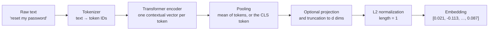
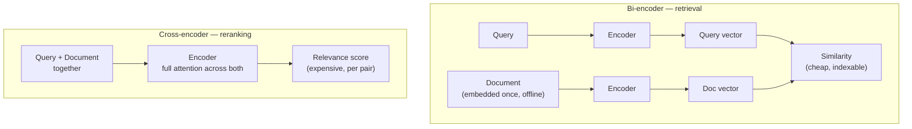

# Embeddings

An embedding is a fixed-length vector of real numbers that a trained model assigns to a piece of
content — a sentence, a passage, an image, a product, a user — such that **items with similar
meaning land close together in the vector space**. Embeddings turn "is this about the same thing?"
into a geometry question that a computer can answer with arithmetic. They are the representation
that dense retrieval in
[[concepts/ai_engineering/retrieval_as_reasoning_self_evolving_agent_native_retrieval_via_llm_wiki|Retrieval-Augmented Generation (RAG)]]
rests on, and the payload a [[concepts/databases/vector_database|Vector Database]] stores and
searches.

## Why It Matters

- **They are what makes semantic search possible.** Keyword search matches strings; an embedding
  matches meaning. "How do I reset my password" and "forgot login credentials" share no content
  words but sit next to each other in a good embedding space.
- **They are the ceiling on dense retrieval.** If the embedding model does not place the question
  near the passage that answers it, no index, reranker, or prompt downstream can recover that
  passage. Choosing and evaluating the embedding model is a retrieval-quality decision, not plumbing.
- **They are a long-lived dependency.** Every stored vector is tied to the exact model that produced
  it. Changing the model means re-embedding the whole corpus, so the choice outlives most other
  decisions in an [[concepts/ai_engineering/ai_engineer|AI Engineer]]'s stack.
- **They are a general-purpose feature.** The same vectors drive search, deduplication, clustering,
  classification, recommendation, anomaly detection, and routing a request to the right tool or
  prompt.
- **They cost storage and memory at scale.** One million 1,024-dimension `float32` vectors is about
  4 GB before any index overhead, which is why dimension and precision are cost levers.

## From Text to Vector

1. **Tokenize.** The text is split into sub-word tokens. Every embedding model has a maximum input
   length (256 word pieces for `all-MiniLM-L6-v2`, 8,192 tokens for OpenAI's `text-embedding-3`
   models, 32k for `Qwen3-Embedding-8B`); anything beyond it is
   **silently truncated**, which is one reason chunk size and embedding model must be chosen
   together.
2. **Encode.** A transformer produces one contextual vector per token — the vector for "bank"
   differs in "river bank" and "bank account".
3. **Pool.** The per-token vectors are collapsed to one vector for the whole input, usually by
   averaging them (mean pooling) or by taking a special classification token's vector.
4. **Normalize.** Most retrieval models L2-normalize the output so every vector has length 1. On
   unit vectors, cosine similarity and dot product give identical rankings and Euclidean distance
   gives the same ordering in reverse, so the metric choice stops mattering.

## How Embedding Models Learn Similarity

Retrieval embedding models are typically trained **contrastively**: shown pairs that should be close
(a question and the passage that answers it, a title and its article, two paraphrases) and pushed to
score them higher than pairs that should be far apart.

- **Positives** come from naturally paired data — search logs, question-answer sites, title/body
  pairs, citation links — plus curated labelled sets.
- **In-batch negatives.** Every other passage in the same training batch serves as a negative for a
  given query, which makes large batches valuable.
- **Hard negatives** are passages that look relevant but are not — mined with BM25 or an earlier
  model. They teach the fine distinctions that matter in production and are where much of a strong
  model's quality comes from.
- **The loss** (commonly InfoNCE, a softmax over similarity scores) rewards the positive for
  outranking every negative by a margin controlled by a temperature parameter.

The consequence for practitioners: **an embedding encodes the notion of similarity its training data
defined**. A model trained on web question-answer pairs places a question near its answer; a model
trained on paraphrase pairs places a sentence near its rewording. Using a paraphrase model for
question-to-passage retrieval is a common, silent mismatch.

### Symmetric and Asymmetric Tasks

| Task | Query vs. document | Example | What to watch |
| --- | --- | --- | --- |
| Symmetric | Same kind of text on both sides | Duplicate-question detection, clustering | Any general model works |
| Asymmetric | Short query, long document | Search, RAG | Use a retrieval-trained model; many require an instruction or prefix on the query side (for example `query:` vs. `passage:`), and omitting it degrades recall |

## Measuring Closeness

| Metric | Formula (for vectors $a$, $b$) | Range | Notes |
| --- | --- | --- | --- |
| Cosine similarity | $\frac{a \cdot b}{\lVert a \rVert \lVert b \rVert}$ | −1 to 1 | Ignores length; the default for text |
| Dot product | $a \cdot b$ | unbounded | Equals cosine on normalized vectors; cheapest to compute |
| Euclidean (L2) distance | $\lVert a - b \rVert$ | 0 to ∞ | Lower is closer; on unit vectors $\lVert a-b \rVert^2 = 2 - 2\cos\theta$ |
| Hamming distance | count of differing bits | 0 to $d$ | Used on binary-quantized vectors |

Use the metric the model was trained with. When a model emits un-normalized vectors and was trained
with dot product, vector length carries information (often a popularity or confidence signal), and
switching to cosine discards it.

> [!warning] Similarity scores are not probabilities
> A cosine of 0.82 does not mean "82% relevant", and score scales differ between models — some
> compress every pair into 0.7–0.9. A fixed relevance threshold must be calibrated per model on
> labelled data, and re-calibrated whenever the model changes.

## Kinds of Embeddings

| Kind | Representation | Strength | Weakness |
| --- | --- | --- | --- |
| **Dense** (bi-encoder) | One vector of a few hundred to a few thousand floats | Captures paraphrase and meaning; fast nearest-neighbour search | Smooths away rare identifiers, codes, part numbers, names |
| **Sparse lexical** (BM25, TF-IDF) | Vocabulary-sized vector, mostly zeros | Exact term matching; no training; transparent | No notion of synonymy |
| **Learned sparse** (e.g. SPLADE) | Vocabulary-sized, with learned term weights and expansion terms | Lexical precision plus some semantic expansion; works on an inverted index | Larger index; a model to run at ingest and query |
| **Multi-vector / late interaction** (e.g. ColBERT) | One vector per token | Fine-grained matching, often the best quality without a cross-encoder | Storage grows with document length |
| **Multimodal** (e.g. CLIP-style) | Image and text mapped into one shared space | Text-to-image and image-to-text search | Weaker on long or technical text |

This is why production search is usually **hybrid**: dense and sparse retrievers fail on different
queries, so running both and fusing the result lists recovers what either alone misses. The fusion
mechanics are in [[concepts/databases/vector_database|Vector Database]].

### Bi-Encoders and Cross-Encoders

A bi-encoder embeds query and document independently, so documents are embedded once and searched
with an index — it scales to billions of items. A cross-encoder reads the query and a candidate
together and is substantially more accurate, but it must run once per candidate at query time, so it
can only re-score a short list. The standard pipeline is therefore **bi-encoder to recall a few
hundred candidates, cross-encoder to rerank the top few dozen**.

## Dimensions, Precision, and Cost

Vector size is a direct cost lever, and three techniques shrink it:

- **Fewer dimensions.** Typical models output 384 (`all-MiniLM-L6-v2`) to 4,096
  (`Qwen3-Embedding-8B`) dimensions; OpenAI's `text-embedding-3-small` and `-large` output 1,536 and
  3,072. More dimensions can hold more distinctions, but quality gains flatten well before the
  largest sizes.
- **Matryoshka representation learning (MRL).** Some models are trained so the *first* $k$
  dimensions are themselves a usable embedding. OpenAI reports that `text-embedding-3-large`
  shortened from 3,072 to 256 dimensions still outperforms the full 1,536-dimension
  `text-embedding-ada-002`, and `Qwen3-Embedding-8B` accepts any output size from 32 to 4,096. A
  manually truncated vector must be re-normalized; truncation is useful for a cheap first-pass
  search followed by full-length rescoring.
- **Quantization.** Store each dimension in fewer bits: `float16` halves memory almost for free,
  `int8` quarters it, and **binary** (one bit per dimension, compared with Hamming distance) cuts it
  by 32× at a real quality cost that rescoring the top candidates with full-precision vectors largely
  recovers.

| Storage per vector, $d = 1{,}024$ | Bytes | 100 M vectors |
| --- | --- | --- |
| `float32` | 4,096 | ~410 GB |
| `float16` | 2,048 | ~205 GB |
| `int8` | 1,024 | ~102 GB |
| binary | 128 | ~13 GB |

These figures are raw vector payload only; the index structure adds its own overhead on top.

### What the Dimensions Mean

Each dimension is one coordinate of the vector, and the model's architecture fixes how many there are. Individual dimensions are generally not interpretable features: there is no "sports" axis or "sentiment" axis to read off. Meaning lives in directions and distances across all of them together, which is why embeddings are compared only with each other, through a similarity metric.

Two practical consequences follow. Query and corpus vectors must come from the same model at the same output size, because vectors from different models or sizes live in unrelated spaces. And a vector column or index is declared with a fixed dimension, so changing models or truncation length means a new index, not an update in place.

### High-Dimensional Geometry

- **Distance concentration.** As the number of dimensions grows, the distances from a point to its nearest and farthest neighbours in random data become nearly equal. This "curse of dimensionality" is why tree-based exact indexes stop helping at embedding sizes, and why search relies on the approximate indexes described in [[concepts/databases/vector_database|Vector Database]].
- **Low intrinsic dimension.** Learned embeddings use far fewer effective degrees of freedom than their nominal size, since real text occupies a small, structured region of the space. That is why Matryoshka truncation and principal component analysis (PCA) can drop many dimensions with little loss, and it is related to the anisotropy listed under failure modes below.
- **Reduction for storage vs. for viewing.** PCA fitted on the corpus can shrink stored vectors, but the same projection must then be applied to every query. t-SNE and UMAP are for plotting embeddings in two dimensions only: they distort global distances, so never search in their output.

## Choosing an Embedding Model

1. **Match the task.** Retrieval, clustering, classification, and similarity are scored differently;
   a model that leads on one may not lead on another.
2. **Check the domain and language.** Legal, medical, code, and non-English corpora frequently need
   a specialised or multilingual model.
3. **Check the input limit against the chunk size.** A 2,000-token chunk fed to a 512-token model
   embeds only its opening quarter.
4. **Use public leaderboards to shortlist, not to decide.** The MTEB benchmark compares models across
   many tasks, but its own maintainers rebuilt the English suite as zero-shot because common
   fine-tuning sets such as MS MARCO had leaked into it, and models trained on them scored lower once
   those were removed. A leaderboard also rarely looks like your corpus.
5. **Decide on your own labelled set.** A few hundred real queries with known relevant passages,
   scored by recall@k, settles more than any leaderboard.
6. **Weigh hosting.** An API model adds per-token cost, network latency, and data egress; a
   self-hosted open model adds GPU operations. Either way, pin the exact model version.

## Operating Embeddings in Production

- **Version the space, not just the model.** Store the model name and version alongside every
  vector. Vectors from two models — or two versions of one model — live in **incompatible spaces**;
  comparing them yields numbers that look valid and mean nothing.
- **Migrate by dual-writing.** Changing models means re-embedding everything: build the new index in
  parallel, backfill, evaluate against the old one, then switch reads. There is no in-place upgrade.
- **Embed exactly what you search.** The text that was embedded and the text shown to the model
  should be the same chunk; enriching a chunk with its document title or a short generated context
  before embedding is a cheap, well-evidenced gain (see the contextual retrieval results in
  [[concepts/ai_engineering/retrieval_as_reasoning_self_evolving_agent_native_retrieval_via_llm_wiki|Retrieval-Augmented Generation (RAG)]]).
- **Batch and cache.** Embedding is embarrassingly parallel at ingest, and identical texts produce
  identical vectors for a fixed model, so hash-keyed caching avoids paying twice.
- **Treat vectors as sensitive data.** Research on embedding inversion shows that text can be
  partially reconstructed from its embedding, so a vector of a confidential document deserves the
  same classification and access control as the document under
  [[concepts/data_governance/data_security|Data Security]].

## Known Failure Modes

- **Negation and numbers.** "Flights that are *not* refundable" and "refundable flights" often embed
  almost identically; so do "version 2.3" and "version 3.2".
- **Rare identifiers.** Error codes, SKUs, and surnames are smoothed toward common neighbours — the
  canonical reason to keep a lexical index alongside.
- **Length mismatch.** A one-line query and a page-long passage compress very different amounts of
  information into the same number of dimensions.
- **Anisotropy and hubness.** Embedding spaces are often not uniformly used: vectors crowd into a
  narrow cone, and a few "hub" vectors turn up as a nearest neighbour of a disproportionate share of
  queries, crowding out genuinely relevant results.
- **Domain shift.** A general model has never seen your internal jargon or product names and places
  them by surface form alone.

## Related Concepts

- [[concepts/ai_engineering/retrieval_as_reasoning_self_evolving_agent_native_retrieval_via_llm_wiki|Retrieval-Augmented Generation (RAG)]] — the pipeline embeddings feed; retrieval recall is bounded by embedding quality
- [[concepts/ai_engineering/retrieval_scoring|Retrieval Scoring and Ranking]] — how similarity scores are combined with BM25, fused, reranked, and cut into the list the model sees
- [[concepts/ai_engineering/chunk_overlap|Chunk Overlap]] — how the text units being embedded are cut, and the extra vectors overlap costs
- [[concepts/databases/vector_database|Vector Database]] — where embeddings are stored, indexed for approximate nearest-neighbour search, filtered, and fused with lexical results
- [[concepts/ai_engineering/ai_engineer|AI Engineer]] — the role that selects, evaluates, and migrates embedding models
- [[concepts/ai_engineering/model_context_protocol|Model Context Protocol (MCP)]] — how a semantic-search capability built on embeddings is commonly exposed to an agent as a tool
- [[concepts/data_governance/data_security|Data Security]] — embeddings can leak their source text and inherit its classification
- [[concepts/data_governance/metadata_management|Metadata Management]] — model name, version, and chunk provenance are the metadata that keeps a vector store auditable and migratable

## References

- Mikolov et al. (2013). *Efficient Estimation of Word Representations in Vector Space* (word2vec) — the start of learned dense word vectors.
- Reimers and Gurevych (2019). *Sentence-BERT.* EMNLP — bi-encoder sentence embeddings with siamese training.
- Karpukhin et al. (2020). *Dense Passage Retrieval for Open-Domain Question Answering.* EMNLP — contrastive retrieval training with in-batch and hard negatives.
- Khattab and Zaharia (2020). *ColBERT.* SIGIR — late-interaction multi-vector retrieval.
- Radford et al. (2021). *Learning Transferable Visual Models From Natural Language Supervision* (CLIP) — a shared image-text space.
- Formal et al. (2021). *SPLADE.* SIGIR — learned sparse retrieval.
- Kusupati et al. (2022). *Matryoshka Representation Learning.* NeurIPS — truncatable embeddings.
- Muennighoff et al. (2023). *MTEB: Massive Text Embedding Benchmark.* EACL.
- Morris et al. (2023). *Text Embeddings Reveal (Almost) As Much As Text.* EMNLP — embedding inversion.
