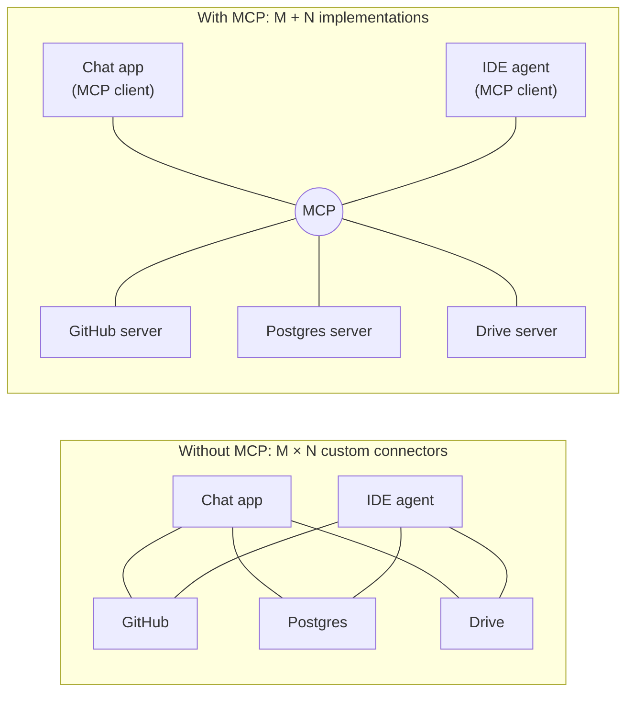
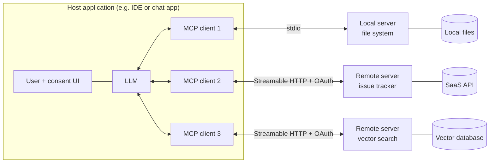
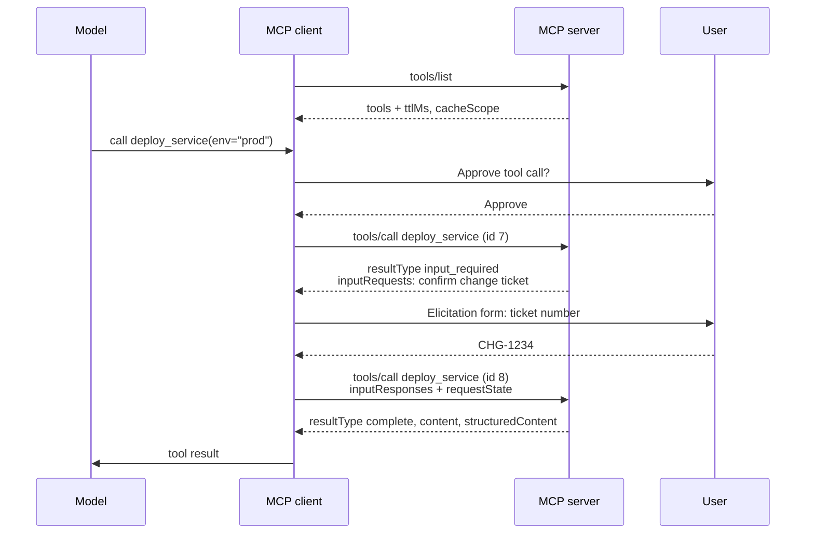
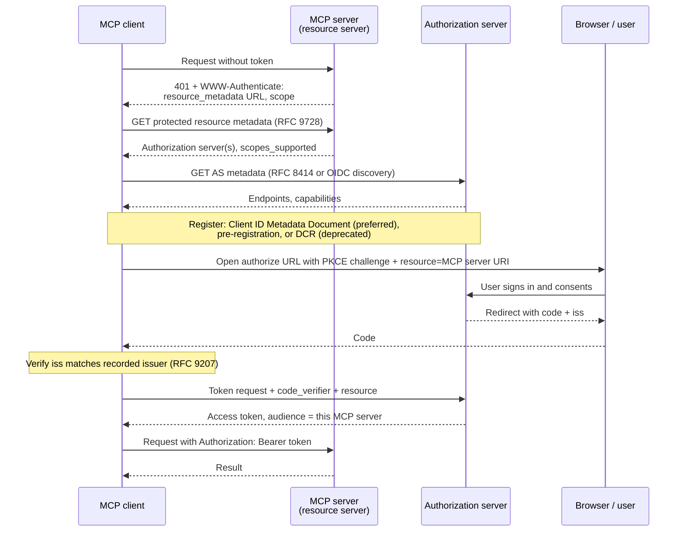

# Model Context Protocol (MCP)

The Model Context Protocol is an open, JSON-RPC-based standard for connecting AI applications to the
tools, data, and prompts they need. An application that speaks MCP can use any MCP server — a
GitHub integration, a database, a file system, a company's internal search — without custom glue
code, in the way the Language Server Protocol lets any editor use any language's tooling. It is the
standard wiring layer for the tool-use responsibilities of an
[[concepts/ai_engineering/ai_engineer|AI Engineer]], and one of the
[[concepts/software_architecture/api_integration_protocols|API and Integration Protocols]] built
specifically for model-driven clients. This note describes the protocol as of the **2026-07-28**
specification revision.

## Why It Matters

- **It turns an M×N integration problem into M+N.** Without a standard, every AI application
  writes its own connector for every system. With one, each application implements the client once
  and each system implements a server once.
- **It separates the agent from its capabilities.** The application decides *when* and *whether*
  to use a capability; the server decides *how* it works. Either side can be replaced independently.
- **It is the de facto industry standard.** Introduced by Anthropic in November 2024, it was
  donated in December 2025 to the Agentic AI Foundation, a directed fund under the Linux Foundation
  co-founded with Block and OpenAI. Anthropic reported more than 10,000 active public servers at
  that point, and adoption across the major AI assistants and developer tools.
- **It moves the security boundary.** A server's tools are arbitrary code execution, and its outputs
  flow straight into a model's context. Every MCP connection is both a capability grant and a
  prompt-injection channel, and has to be designed as one.



## Architecture

Three roles, deliberately separated:

| Role | What it is | Responsibility |
| --- | --- | --- |
| **Host** | The AI application the user runs — a chat app, an IDE, an agent runtime | Owns the model, the conversation, the user's consent, and which servers are connected |
| **Client** | A connector inside the host, one per server | Speaks the protocol to exactly one server |
| **Server** | A program exposing capabilities — local process or remote service | Implements tools, resources, and prompts over some underlying system |



The host never hands a server the conversation. A server sees only the requests its client sends,
which is what keeps one server from reading another's data.

## The Primitives

What a server offers, and who decides when each is used:

| Primitive | Controlled by | What it is | Typical surface in the host |
| --- | --- | --- | --- |
| **Tools** | The model | Functions with a JSON Schema input, which the model chooses to call | Function calling, with an approval prompt |
| **Resources** | The application | Read-only context addressed by URI — files, records, schemas, documents | An attach or "@-mention" picker, or automatic context |
| **Prompts** | The user | Parameterised message templates and workflows | Slash commands or a menu |

What a client can offer back to a server:

| Primitive | Status in 2026-07-28 | What it does |
| --- | --- | --- |
| **Elicitation** | Active | The server asks the user for input — a form validated against a JSON Schema, or a URL to visit for an out-of-band step such as a login |
| **Sampling** | Deprecated | The server asks the host's model to generate text; migrate to calling a model provider directly |
| **Roots** | Deprecated | The host tells the server which directories it may operate on; migrate to tool parameters, resource URIs, or configuration |

Deprecated features stay fully functional for at least twelve months under the protocol's feature
lifecycle policy; new implementations should not adopt them.

## The Base Protocol

Every message is **JSON-RPC 2.0**, with three kinds:

- **Requests** carry an `id` (a string or integer, never `null`), a `method`, and `params`.
- **Responses** echo the `id` and carry either a `result` or an `error`. Every result now includes a
  `resultType`: `"complete"` for a final answer, or `"input_required"` when the server needs more
  information first.
- **Notifications** carry no `id` and get no reply.

### A Stateless Protocol

The 2026-07-28 revision is the largest change since launch: **MCP no longer has sessions or a
handshake.** The `initialize` / `notifications/initialized` exchange and the `Mcp-Session-Id`
header are gone. Instead, every request is self-describing, carrying in `_meta`:

| `_meta` key | Required | Purpose |
| --- | --- | --- |
| `io.modelcontextprotocol/protocolVersion` | Yes | The protocol version for this request, e.g. `"2026-07-28"` |
| `io.modelcontextprotocol/clientCapabilities` | Yes | What the client supports, relevant to this request |
| `io.modelcontextprotocol/clientInfo` | Should | Client name and version, for display and logging only |
| `io.modelcontextprotocol/logLevel` | No | Minimum log level for this request; no logs are emitted without it |
| `traceparent`, `tracestate`, `baggage` | No | OpenTelemetry trace context, for distributed tracing across agent and server |

Servers identify themselves in each result's `_meta` (`io.modelcontextprotocol/serverInfo`) and
**must** implement `server/discover`, which advertises supported versions, capabilities, and
identity. A client may call it up front, or simply send requests and handle an
`UnsupportedProtocolVersion` error (`-32022`). State that genuinely spans calls — a shopping
basket, an open browser, a database transaction — is carried as an **explicit handle** the server
returns from a tool and the model passes back as an ordinary argument.

The design consequence: an MCP server can now sit behind an ordinary load balancer with no sticky
sessions, and an open stdio process is not a conversation — clients may interleave unrelated
requests on it.

### Message Patterns

| Pattern | How it works | Replaces |
| --- | --- | --- |
| **Request and response** | The client asks, the server answers | — |
| **Multi round-trip requests (MRTR)** | The server answers `resultType: "input_required"` with `inputRequests` (for example an elicitation); the client gathers the answers and **retries the original request** with `inputResponses` and the server's opaque `requestState`, under a new request ID | Server-initiated requests such as `elicitation/create`, `sampling/createMessage`, and `roots/list` sent mid-call |
| **Subscribe and notify** | The client opens one long-lived `subscriptions/listen` request, opting into `toolsListChanged`, `promptsListChanged`, `resourcesListChanged`, or `resourceSubscriptions`; notifications stream back tagged with a subscription ID | The HTTP GET stream and `resources/subscribe` / `resources/unsubscribe` |



Request-scoped notifications such as `notifications/progress` (opted into with a `progressToken`)
and log messages flow on the response stream of the request they belong to. Cancellation is a
notification naming the request ID. `ping` was removed in 2026-07-28.

### Errors

| Kind | Where it appears | Meant for |
| --- | --- | --- |
| **Protocol error** | A JSON-RPC `error` — unknown tool, malformed request, `-32602` invalid params, `-32020` header mismatch, `-32021` missing required client capability, `-32022` unsupported protocol version | The client; the model can rarely fix these |
| **Tool execution error** | A normal result with `isError: true` and an explanatory message | The model, so it can correct its arguments and retry |

The JSON-RPC server-error range is partitioned: `-32000` to `-32019` is legacy and
implementation-defined, `-32020` to `-32099` is reserved for the specification. A resource that is
not found is now `-32602`; clients should still accept the older `-32002`.

## Transports

| Transport | How | Use for | Auth |
| --- | --- | --- | --- |
| **stdio** | The host launches the server as a subprocess; newline-delimited JSON-RPC on [[concepts/linux/standard_streams\|stdin and stdout]]; logs go to stderr | Local tools — file system, git, a local database | Credentials from the environment, **not** the OAuth flow |
| **Streamable HTTP** | One HTTP endpoint; each request is a POST whose response is either a single JSON body or a server-sent-events stream | Remote and shared servers | OAuth 2.1, below |
| HTTP + SSE | The original two-endpoint design | Nothing new — deprecated since 2025-03-26 | — |

Streamable HTTP requests carry `Mcp-Method` and `Mcp-Name` headers, so load balancers, proxies, and
web application firewalls can route and police traffic without parsing the body. A tool can also
mark simple parameters with `x-mcp-header` to mirror them into `Mcp-Param-{name}` headers — for
example routing by region — which must never be used for secrets, since headers are visible to
intermediaries. Stream resumability was removed in 2026-07-28: if a response stream breaks, the
client re-issues the request with a new ID.

## Tools in Detail

A tool definition carries a `name` (1–128 characters of letters, digits, `_`, `-`, `.`), an optional
display `title`, a `description` the model reads to decide when to call it, an `inputSchema` (JSON
Schema, 2020-12 by default), an optional `outputSchema`, optional `icons`, and optional
`annotations`.

```json
{
  "jsonrpc": "2.0",
  "id": 2,
  "method": "tools/call",
  "params": {
    "name": "search_docs",
    "arguments": { "query": "refund policy for annual plans", "top_k": 5 },
    "_meta": {
      "io.modelcontextprotocol/protocolVersion": "2026-07-28",
      "io.modelcontextprotocol/clientCapabilities": {}
    }
  }
}
```

- **Results** hold a `content` array of typed blocks — `text`, `image`, `audio`, `resource_link`
  (a URI the client can fetch), or an embedded `resource` — and optionally `structuredContent`, any
  JSON value conforming to `outputSchema`. For compatibility a server should also serialize
  structured output into a text block.
- **Annotations** are behavioural hints introduced in earlier revisions — read-only,
  destructive, idempotent, and open-world. The specification is explicit that clients **must treat
  annotations as untrusted** unless the server itself is trusted; a malicious server can label a
  destructive tool "read-only".
- **Listing and caching.** `tools/list` is paginated, should return tools in a **deterministic
  order** (stable tool lists keep the model's prompt cache warm), and carries `ttlMs` and
  `cacheScope` (`public` or `private`) freshness hints. The list must not vary per connection, but
  may vary by the caller's authorization — returning only tools the token's scopes permit.
- **Name collisions.** Tool names are unique only within one server. A host aggregating many
  servers must disambiguate, typically by prefixing with a server identifier — not by trusting the
  self-reported server name, which is not guaranteed unique.

## Resources and Prompts

**Resources** are identified by URI (`file:///…`, `https://…`, or a custom scheme such as
`postgres://…/schema`). Clients discover them with `resources/list`, read them with
`resources/read`, and enumerate parameterised families with `resources/templates/list`, which uses
URI templates such as `logs://{service}/{date}`. Content is text or base64 binary with a MIME type,
and can carry annotations for intended `audience` (user, assistant), `priority`, and
`lastModified`, which help the host decide what to place in context.

**Prompts** are named templates with declared arguments, listed with `prompts/list` and expanded
with `prompts/get` into a sequence of messages. They exist so a server author can ship the best way
to use their server — "summarise this pull request", "triage this incident" — as a user-invoked
command rather than leaving every user to rediscover it.

## Extensions

Optional, opt-in features negotiated through an `extensions` field in client and server
capabilities:

- **Tasks** — durable handles for long-running work: the server returns a task handle, the client
  polls with `tasks/get` and sends mid-flight input with `tasks/update`.
- **MCP Apps** — interactive UI (charts, forms, players) that a server renders inline in the host's
  conversation.
- **Skills over MCP** — structured agent-workflow instructions discovered and delivered through MCP.

## Authorization

Authorization applies to HTTP transports and is built from existing OAuth standards rather than a
new scheme. The **MCP server is an OAuth 2.1 resource server**; a separate (or co-hosted)
authorization server issues tokens; the **MCP client is an OAuth client**.



| Standard | Role in MCP |
| --- | --- |
| OAuth 2.1 (draft) | The base framework; PKCE is mandatory |
| RFC 9728 Protected Resource Metadata | How a server tells the client which authorization server to use — servers **must** implement it |
| RFC 8414 / OpenID Connect Discovery | How the client learns the authorization server's endpoints; clients must support both |
| RFC 8707 Resource Indicators | The client names the MCP server's canonical URI as `resource`, binding the token's audience to that one server |
| Client ID Metadata Documents | The preferred registration: the client's `client_id` is an HTTPS URL hosting its metadata |
| RFC 7591 Dynamic Client Registration | Still allowed for older authorization servers, but deprecated |
| RFC 9207 Issuer Identification | The client checks the `iss` on the redirect to defeat authorization-server mix-up attacks |
| RFC 6750 Bearer tokens | Token in the `Authorization` header on every request, never in the query string |

Two rules carry most of the security weight:

- **Audience binding.** A server must accept only tokens issued *for it*, and must reject any
  other.
- **No token passthrough.** A server must not forward the client's token to an upstream API. If it
  needs to call GitHub, it obtains its own GitHub token. Passing the user's token through turns the
  server into a confused deputy and defeats every audit trail downstream.

When a call needs more privilege, the server answers `403` with
`WWW-Authenticate: Bearer error="insufficient_scope", scope="…"`, and the client runs a
**step-up** authorization for the union of its existing and newly required scopes — least
privilege by increments rather than by asking for everything up front. This is the same principle as
the access-control models in [[concepts/data_governance/data_security|Data Security]].

## Security Threats

MCP inherits every agent risk and adds a supply chain of third-party servers:

| Threat | What happens | Control |
| --- | --- | --- |
| **Prompt injection via tool output** | A fetched web page, email, or document contains instructions the model obeys | Treat all tool output as untrusted data; restrict what tools can do, not what the model is told |
| **Tool poisoning** | A malicious server hides instructions in a tool's `description` that the model reads but the user never sees | Show full descriptions on install; allowlist vetted servers |
| **Rug pull** | A server changes a tool's definition after the user approved it | Pin and diff tool definitions; re-prompt on change |
| **Tool shadowing / name collision** | One server's tool impersonates or overrides another's | Namespace tools per server; never resolve by bare name across servers |
| **Confused deputy and token passthrough** | A server uses one party's privileges to act for another | Audience-bound tokens; no passthrough; per-user authorization at the server |
| **Lethal combination** | One agent holds private data, reads untrusted content, and can send data out — injection then exfiltrates | Never grant all three to one context without a human approval gate |
| **Local server = local code execution** | A stdio server runs with the user's permissions | Sandbox or containerise local servers; install from trusted sources only |
| **Over-broad scopes** | A token can do far more than the task needs | Minimal `scopes_supported`, step-up for the rest |

The specification's own principles are user consent and control, data privacy, and tool safety: a
host should show which tools are exposed, show tool inputs before calling, obtain explicit consent
before invoking tools or sharing user data, and keep a human able to deny any call. These are
host-side obligations — **the protocol cannot enforce them**, so an MCP connection is only as safe as
the host that brokers it.

## MCP and Retrieval

MCP is a natural transport for [[concepts/ai_engineering/retrieval_as_reasoning_self_evolving_agent_native_retrieval_via_llm_wiki|Retrieval-Augmented Generation (RAG)]]:

- **Retrieval as a tool.** A `search` tool fronting a [[concepts/databases/vector_database|Vector Database]]
  (with [[concepts/ai_engineering/embeddings|Embeddings]] computed server-side) lets the model decide
  when to search and what to search for — the agentic, iterative retrieval that a fixed top-$k$
  pipeline cannot do.
- **Documents as resources.** The search tool returns `resource_link` blocks; the host reads only the
  ones it wants, keeping context small.
- **Permissions stay at the source.** Because the server authenticates the user with an
  audience-bound token, it can apply that user's row-level permissions inside the search — the
  correct place for them — rather than relying on the model to withhold anything.

## MCP Compared

| | Provider function calling | Plain REST / OpenAPI | MCP |
| --- | --- | --- | --- |
| What it standardises | How one model API requests a tool call | How a service exposes endpoints | How any AI host discovers and uses any capability server |
| Discovery | Tools hard-coded into each request | Spec file, read by a developer | `server/discover`, `tools/list`, list-change notifications |
| Beyond tools | No | No | Resources, prompts, elicitation, subscriptions |
| Portability | Per provider | Per integration | Any compliant host with any compliant server |

They compose rather than compete: a host converts MCP tool definitions into its model provider's
function-calling format, and many MCP servers are thin wrappers over an existing REST API.

## Building a Server

A server declares a name and registers each capability with a handler. A tool takes a name, a
description written for the model, and a JSON Schema for its arguments — most SDKs derive the
schema from the handler's type signature and the description from its documentation. A resource
takes a URI template such as `docs://{doc_id}`. The server then listens on stdio by default, or
on Streamable HTTP for remote use.

Design guidance that holds regardless of SDK:

- **Write descriptions for the model.** The tool description is the prompt that decides when the
  tool is used; say what it does, when not to use it, and what the arguments mean.
- **Prefer a few task-shaped tools to a mirror of the API.** Thirty thin endpoint wrappers flood the
  context and invite wrong choices; five tools shaped around user tasks work better.
- **Return errors the model can act on**, with `isError: true` and a concrete reason.
- **Keep outputs small and structured**, using `outputSchema` and resource links rather than dumping
  whole documents.
- **Make side-effecting tools idempotent** or accept an idempotency key, because agents retry.

## Version History

| Revision | Headline changes |
| --- | --- |
| 2024-11-05 | Initial release: tools, resources, prompts, sampling, roots; stdio and HTTP+SSE transports |
| 2025-03-26 | Streamable HTTP replaces HTTP+SSE; OAuth 2.1 authorization; tool annotations |
| 2025-06-18 | Structured tool output; elicitation; resource links; MCP servers formalised as OAuth resource servers with resource indicators; JSON-RPC batching removed |
| 2025-11-25 | Experimental tasks; URL-mode elicitation; Client ID Metadata Documents; icons |
| 2026-07-28 | Stateless core (no `initialize`, no sessions, per-request `_meta`); `server/discover`; MRTR; `subscriptions/listen`; tasks moved to an extension; Roots, Sampling, Logging, and DCR deprecated; `ping` removed; cacheable list results; a feature lifecycle policy with a twelve-month deprecation window |

## Common Pitfalls

- **Treating annotations or descriptions as trustworthy.** They are server-supplied text.
- **Connecting every available server.** Each one adds tool definitions to the context and a new
  injection surface; connect what the task needs.
- **Using MCP authorization on stdio.** Local servers should take credentials from the environment;
  the OAuth flow is for HTTP.
- **Relying on connection state.** Since 2026-07-28 there is none; anything that spans calls needs
  an explicit handle.
- **Forwarding user tokens upstream.** Forbidden, and the root of the confused-deputy problem.
- **Assuming the protocol enforces consent.** It does not; the host must.
- **Copying pre-2026 tutorials.** Many still show the `initialize` handshake, session IDs, HTTP+SSE,
  or sampling — accurate for their time, deprecated or removed now.

## Related Concepts

- [[concepts/software_architecture/api_integration_protocols|API and Integration Protocols]] — MCP is a JSON-RPC request/response protocol with server-sent-event streaming, and sits in that family
- [[concepts/ai_engineering/ai_engineer|AI Engineer]] — the role responsible for giving models tools and bounding what those tools can do; MCP is now the default mechanism
- [[concepts/ai_engineering/retrieval_as_reasoning_self_evolving_agent_native_retrieval_via_llm_wiki|Retrieval-Augmented Generation (RAG)]] — retrieval exposed as an MCP tool becomes agent-driven rather than fixed top-$k$
- [[concepts/databases/vector_database|Vector Database]] — the most common backend behind a semantic-search MCP server
- [[concepts/ai_engineering/embeddings|Embeddings]] — computed server-side so the host never needs to know which embedding model a search uses
- [[concepts/data_governance/data_security|Data Security]] — least privilege, audience-bound tokens, and permission enforcement at the source are the controls MCP authorization implements
- [[concepts/software_architecture/semantic_versioning|Semantic Versioning (SemVer)]] — MCP versions by date, not by SemVer, and relies on an explicit deprecation window instead of version-number compatibility signals

## References

- [Model Context Protocol specification, 2026-07-28](https://modelcontextprotocol.io/specification/2026-07-28) — the authoritative source for the base protocol, statelessness, tools, and authorization sections.
- [2026-07-28 changelog](https://modelcontextprotocol.io/specification/2026-07-28/changelog) — the changes from 2025-11-25.
- [Anthropic: Donating the Model Context Protocol and establishing the Agentic AI Foundation](https://www.anthropic.com/news/donating-the-model-context-protocol-and-establishing-of-the-agentic-ai-foundation) — governance and adoption figures.
- [Language Server Protocol](https://microsoft.github.io/language-server-protocol/) — the design MCP takes inspiration from.
- [JSON-RPC 2.0 specification](https://www.jsonrpc.org/specification).
