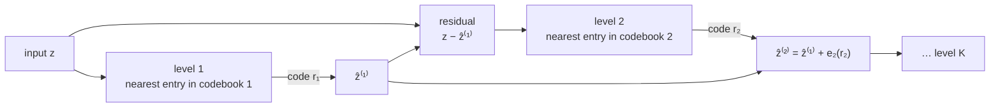

# Residual Vector Quantization (RVQ)

Residual vector quantization represents a continuous vector as a sum of codebook entries chosen in
stages. The first stage picks the nearest entry from its codebook, and each later stage quantizes the
error the earlier stages left behind. Wrapped in a learned encoder and decoder (a VQ-VAE), it turns
images, audio, or text into stacks of discrete tokens that a transformer can generate, as in
[[concepts/ai_engineering/next_concept_modeling_fast_parallel_coarse_to_fine_text_generation|Next-Concept Modeling (NCM)]].
It is a sibling of the product quantization a
[[concepts/databases/vector_database|Vector Database]] uses to compress embeddings.

## Why It Matters

- **Discrete tokens for continuous signals.** A transformer generator predicts from a finite
  vocabulary. RVQ supplies one for continuous data, which is how neural audio codecs and several image
  generators work.
- **Coarse to fine by construction.** Early stages capture most of the signal and later ones refine
  it, so a partial sum is already a usable low-detail reconstruction. Coarse-to-fine generators
  generate along exactly this ordering.
- **Capacity without huge codebooks.** $K$ codebooks of $|V|$ entries can express $|V|^K$
  combinations while storing only $K \cdot |V|$ vectors.

## Vector Quantization

Given latent vectors $z \in \mathbb{R}^{L \times d}$ and a codebook $V = \{e_1, \dots, e_{|V|}\}$,
vector quantization replaces each vector with its nearest entry, and the entry's index becomes a
discrete token:

$$z_q^i = \arg\min_{e \in V} \lVert z^i - e \rVert_2^2$$

A **VQ-VAE** (van den Oord et al., 2017) learns the encoder, the codebook, and the decoder together:
the encoder produces $z$, quantization snaps it to codebook entries, and the decoder reconstructs the
input from the quantized latent.

## Residual Quantization

A single quantization step leaves an approximation error. Residual quantization encodes that error
with additional codebooks and adds each quantized correction to the reconstruction. Starting from
$z^{(0)} = z$ and $\hat z^{(0)} = 0$, level $k$ quantizes the current residual into codes $r_k$:

$$\hat z^{(k)} = \hat z^{(k-1)} + e_k(r_k), \qquad z^{(k)} = z - \hat z^{(k)}$$

The full sum $\hat z^{(K)}$ approximates $z$, and each partial sum $\hat z^{(k)}$, the cumulative
reconstruction, approximates it using only the first $k$ levels.

## Multiscale Residual Quantization

VAR's variant for coarse-to-fine generation gives level $k$ only $\ell_k$ codes, with
$\ell_1 < \ell_2 < \dots < \ell_K = L$. Each level downsamples the residual, quantizes the shorter
sequence, and maps the result back to full length with a reconstruction operator $R_k$:

$$u_k = \mathrm{Down}_k\left(z^{(k-1)}\right) \in \mathbb{R}^{\ell_k \times d}, \qquad \hat z^{(k)} = \hat z^{(k-1)} + R_k\left(e_k(r_k)\right)$$

Level 1 can be a single code for a whole sequence. Images have a natural downsampling (lower
resolution); text has none, so its coarse levels must be learned. The NCM authors name this as the
main difficulty in porting the idea to text. Accuracy also matters more for text: one wrong token can
change the meaning, break code, or invalidate a Sudoku solution.

## Training the Tokenizer

NCM trains its text tokenizer with this loss, evaluated at a sampled cutoff level $k$:

$$\mathcal{L}_{\text{tok}} = -\frac{1}{L}\sum_{i=1}^{L} \log p_\psi\left(x_i \mid \hat z^{(k)}\right) + \beta\,\mathrm{MSE}\left(z, \mathrm{sg}[\hat z^{(k)}]\right) + \mathrm{MSE}\left(\mathrm{sg}[z], \hat z^{(k)}\right)$$

- **Reconstruction.** The cross-entropy of recovering each input token from the reconstruction.
- **Commitment loss**, weighted by $\beta$, pulls the encoder's output toward its quantized value.
- **Latent quantization loss** pulls the quantized reconstruction toward the encoder's output.
  $\mathrm{sg}$ is stop-gradient, so each term moves only one side.
- **Straight-through estimator.** The nearest-entry choice has no gradient, so reconstruction
  gradients are copied past it to the encoder.
- **Nested dropout.** Training keeps only the first $k$ levels for a random cutoff $k$, so the early
  levels must carry meaningful information rather than leave it to the fine ones. NCM drops the finest
  levels with probability 0.5 on most datasets.

NCM's text tokenizers show the typical scale:

| Setting | NCM values |
| --- | --- |
| Levels $K$ | 8 (XSum), 11 (WMT14), 12 (LM1B, TinyStories, Sudoku), 32 (OpenWebText) |
| Codebook entries per level | 4,096; 8,192 on LM1B; 16 on Sudoku |
| Latent width $d$ | 384; 256 on Sudoku |
| Transformer blocks | None in the encoder, 1–4 in the decoder |
| Codebook EMA decay | 0.95–0.99 |
| Parameters | 14.9M–144M |

## Measuring a Tokenizer

- **Reconstruction accuracy.** Exact token recovery on held-out text, from the full hierarchy or
  cumulatively after each level.
- **Codebook utilization.** The share of each codebook's entries selected at least once.
- **Codebook perplexity.** The effective number of entries in use, as a share of the codebook size.

![[raw/assets/residual_vector_quantization_reconstruction_by_level.png|600]]

The 32-level OpenWebText tokenizer, level by level. Cumulative reconstruction accuracy stays below
about 15% through the first dozen levels and reaches 99.99% only at full depth. Utilization is near
100% from level 8 on, and effective utilization (perplexity) sits around 70–85% in the middle levels.

Across NCM's six tokenizers, full-hierarchy reconstruction ranges from 98.79% (WMT14) to 100%
(Sudoku), and mean utilization from 62% to 90%.

## Failure Modes

Reconstruction errors that would be invisible in an image are consequential in text. The OpenWebText
tokenizer gets about 0.01% of tokens wrong, and the errors are usually substitutions of *related*
items rather than noise. Entity and numeral errors in the paper's examples copy the neighbouring
item:

| Category | Example (original → reconstruction) |
| --- | --- |
| Named entities | Sydney → Melbourne, in "Sydney Melbourne Brisbane…" |
| Numerals | 1956 → 1957, in "1957 1956 1955…" |
| Diacritics | takım → takäm |
| Usernames | da_lan_xiong_mao → da_op_xiong_mao |
| Markup | Angle brackets swapped around a tag |
| Word boundaries | SciencesJournal → Sciences Journal |

Whether an error changes the meaning depends on the context.

## RVQ vs. Product Quantization

| | Product quantization (PQ) | Residual quantization (RVQ) |
| --- | --- | --- |
| How it splits the work | Splits the dimensions into $m$ sub-vectors, one codebook per sub-space | Quantizes the whole vector $K$ times, each stage on the remaining error |
| Code for one vector | $m$ indices, one per sub-space | $K$ indices, ordered coarse to fine |
| A prefix of the code | Covers only some dimensions | A complete, lower-fidelity approximation |
| Typical use | Compressing embeddings for nearest-neighbour search | Tokenizing signals for generative models and codecs |
| Codebook training | Clustering, offline | Usually learned end to end with the encoder and decoder |

## Where It Is Used

| System | Modality | Role |
| --- | --- | --- |
| RQ-VAE (Lee et al., 2022) | Images | Residual codes for autoregressive image generation |
| SoundStream (Zeghidour et al., 2021); EnCodec (Défossez et al., 2023) | Audio | Neural audio codecs |
| VAR (Tian et al., 2024); HMAR (Kumbong et al., 2025) | Images | Multiscale codes generated by next-scale prediction |
| NCM (Kumbong, Khare, et al., 2026) | Text | Multiscale codes generated coarse to fine, one level per step |

## Related Concepts

- [[concepts/ai_engineering/next_concept_modeling_fast_parallel_coarse_to_fine_text_generation|Next-Concept Modeling (NCM)]] —
  generates a multiscale RVQ hierarchy of text, one level per step
- [[concepts/databases/vector_database|Vector Database]] — product quantization, the sub-space
  alternative used to compress embeddings for search
- [[concepts/ai_engineering/embeddings|Embeddings]] — scalar and binary quantization, which shrink
  vectors without a codebook
- [[concepts/ai_engineering/diffusion_language_model|Diffusion Language Model (DLM)]] — the other
  route to parallel text generation, noising tokens or embeddings instead of quantizing them

## References

- van den Oord, Vinyals, and Kavukcuoglu (2017). *Neural Discrete Representation Learning.* arXiv
  1711.00937.
- Zeghidour et al. (2021). *SoundStream: An End-to-End Neural Audio Codec.* arXiv 2107.03312.
- Lee et al. (2022). *Autoregressive Image Generation using Residual Quantization.* CVPR.
- Défossez et al. (2023). *High Fidelity Neural Audio Compression.* TMLR.
- Tian et al. (2024). *Visual Autoregressive Modeling: Scalable Image Generation via Next-Scale
  Prediction.* NeurIPS.
- Kumbong, Khare, et al. (2026). [Next-Concept Modeling: Fast, Parallel Coarse-to-Fine Text
  Generation](https://arxiv.org/abs/2610.14162). arXiv 2610.14162.
