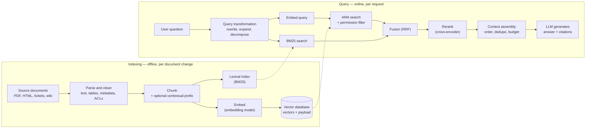

# Retrieval-Augmented Generation (RAG)

Retrieval-augmented generation grounds a model's answer in knowledge fetched at request time rather
than knowledge frozen into its weights. It is the default way an
[[concepts/ai_engineering/ai_engineer|AI Engineer]] makes a general model useful on private or
current data, and the lever that moves answer quality most. This note covers the whole span of the
technique: the classic **chunk-embed-top-k** pipeline, the structural limits that pipeline hits on
multi-step questions, and the **retrieval-as-reasoning** alternative that hands the retrieval
decisions to the agent itself.

## Why It Matters

- **It is where most answer defects originate.** A fluent wrong answer is far more often a context
  failure — the right passage was never retrieved — than a reasoning failure. Measuring which stage
  failed is the first move in any debugging session.
- **It is the cheapest way to add knowledge.** Fine-tuning teaches style and format; retrieval
  teaches facts, and it updates the moment the document does.
- **It is an access path.** Whatever retrieval can reach, the model can disclose. Retrieval must
  enforce the same row- and column-level rules as any other query path, or it becomes a bypass
  around [[concepts/data_governance/data_security|Data Security]].
- **It is where the token budget goes.** Context length drives both cost and latency, so what gets
  retrieved is an economic decision as much as a quality one.
- **The organization of the knowledge, not the ranking function, sets the ceiling.** This is the
  central claim of the retrieval-as-reasoning work below, and the one most teams discover late.

## Two Contracts: Lookup and Reasoning

The useful distinction is not *which retriever* but **what contract the knowledge base offers the
agent**.

| | Retrieval-as-lookup | Retrieval-as-reasoning |
| --- | --- | --- |
| Who decides what to fetch | The retriever, once, before reasoning starts | The agent, repeatedly, as evidence accumulates |
| Unit returned | Top-$k$ passages ranked by similarity | Pages, indices, and the links between them |
| Adapts to intermediate findings | No — the context is fixed before generation | Yes — an observation triggers the next fetch |
| Stopping condition | Fixed $k$ | An explicit sufficiency check by the agent |
| Failure mode | A needed passage is semantically distant from the query, so it is never seen | Traversal wanders, or the compiled structure is wrong |
| Cost profile | Cheap to index, cheap per query | Expensive one-time compilation, cheap per query |

Lookup is sufficient when the answer sits in one passage that resembles the question. It degrades
as the question requires following a relation, comparing attributes across entities, or aggregating
evidence that no single passage contains.

## The Classic Pipeline

The standard implementation splits into an offline **indexing** path and an online **query** path:

Each stage is a design decision rather than a default:

1. **Parse.** Extract clean text, tables, headings, and access-control metadata. Garbage here —
   page headers repeated into every chunk, tables flattened into word soup — caps everything
   downstream.
2. **Chunk.** Split source documents into retrievable units. Chunk size trades recall against
   precision; splitting mid-argument is the most common silent defect. Strategies are compared
   below.
3. **Embed and index.** Encode each chunk with an [[concepts/ai_engineering/embeddings|embedding model]]
   and store it in a [[concepts/databases/vector_database|Vector Database]]. Hybrid setups keep a
   lexical index (BM25) alongside it, because sparse retrieval still wins on rare proper nouns,
   codes, and identifiers that embeddings smooth away.
4. **Transform the query** (optional). Rewrite the raw question into something closer to what the
   answer looks like — techniques below.
5. **Retrieve.** Encode the query, take the top $k$ nearest chunks, apply the user's permission
   filter inside the search, and fuse with the lexical results, typically by reciprocal rank
   fusion.
6. **Rerank** (optional). Re-score the candidates with a cross-encoder that sees query and passage
   together, then keep the best few. This is usually the highest-value addition to a weak pipeline.
7. **Assemble and generate.** Order, deduplicate, and trim the surviving chunks to a token budget,
   then call the model, ideally requiring citations so the answer can be checked against what was
   actually retrieved.

### Chunking Strategies

| Strategy | How it splits | Good for | Watch for |
| --- | --- | --- | --- |
| Fixed-size with overlap | Every $n$ tokens, overlapping by 10–20% | A fast baseline on uniform prose | Cuts sentences, tables, and arguments in half |
| Recursive / separator-based | Tries paragraph, then sentence, then word boundaries until under the size limit | General documents; the usual default | Still blind to meaning |
| Structure-aware | Along headings, sections, list items, code blocks, table rows | Docs, manuals, Markdown, HTML, code | Sections vary wildly in size; very long ones still need splitting |
| Semantic | Splits where embedding similarity between adjacent sentences drops | Long unstructured prose | Extra embedding cost at ingest; gains are inconsistent |
| Parent–child (small-to-big) | Index small chunks for precise matching, return the larger parent section to the model | Precise retrieval with enough surrounding context | Two levels to keep in sync |
| Sentence window | Index single sentences, expand to $\pm n$ neighbours at retrieval | Fact lookup in dense text | Window may still miss the needed context |
| Propositional | An LLM rewrites text into atomic, self-contained statements | High-precision factual QA | Expensive; may drop nuance |

Whatever the strategy, attach metadata to every chunk — source document, section path, date, and
access-control fields — so it can be filtered, cited, and deleted when its source is.

### Contextual Retrieval

A chunk often loses the context that made it findable: "Revenue grew 3% over the previous quarter"
does not say which company or which quarter. **Contextual retrieval** has an LLM write a short
(typically 50–100 token) context situating each chunk within its whole document, and prepends it
before both embedding and BM25 indexing. Anthropic reported, measured as top-20 retrieval failure
rate (1 − recall@20):

| Configuration | Failure rate | Reduction |
| --- | --- | --- |
| Standard embeddings | 5.7% | — |
| Contextual embeddings | 3.7% | 35% |
| Contextual embeddings + contextual BM25 | 2.9% | 49% |
| … + reranking | 1.9% | 67% |

Prompt caching makes the per-chunk generation affordable, because the full document is cached once
and reused for each of its chunks. The same post notes the simpler alternative for small corpora:
**below roughly 200,000 tokens (about 500 pages), put the whole knowledge base in the prompt** and
skip retrieval entirely.

### Query Transformation

| Technique | What it does | When it helps |
| --- | --- | --- |
| Rewriting | Turns a conversational follow-up ("what about for Europe?") into a standalone query | Multi-turn chat — almost always needed |
| Multi-query | Generates several paraphrases, retrieves for each, fuses the lists | Ambiguous or vocabulary-mismatched questions |
| HyDE | Generates a *hypothetical answer* and embeds that instead of the question | Short questions whose answers look nothing like them |
| Decomposition | Splits a compound question into sub-questions retrieved separately | Multi-part and comparison questions |
| Step-back | Asks a more general question first to retrieve background principles | Questions that need conceptual context |
| Routing | Classifies the question and sends it to the right index, tool, or a [[concepts/data_architecture/semantic_layer|Semantic Layer]] | Mixed corpora, or numeric questions that should not be retrieved at all |

Every transformation adds a model call to the critical path, so add them only where evaluation shows
they pay.

### Context Assembly

- **Position matters.** Models attend best to the beginning and end of a long context and worst to
  the middle (the "lost in the middle" effect), so put the strongest evidence first or last.
- **Deduplicate.** Overlapping chunks and near-identical documents waste budget and over-weight one
  source.
- **Label sources** in the prompt so the model can cite them, and instruct it to say when the
  context does not contain the answer rather than filling the gap from its weights.
- **Keep instructions out of retrieved text's reach.** Retrieved content goes in a clearly delimited
  data section; it is untrusted input.

### Agentic and Corrective Variants

Between fixed pipelines and full retrieval-as-reasoning sits a family of control loops: **agentic
RAG** exposes retrieval as a tool the model may call repeatedly — commonly over the
[[concepts/ai_engineering/model_context_protocol|Model Context Protocol (MCP)]] — and **corrective
RAG** grades the retrieved documents and falls back to another source, such as web search, when they
are judged irrelevant. Both trade latency and cost for robustness on questions a single retrieval
round misses.

### Evaluating a RAG System

Measure the stages separately, because each fails differently:

| Stage | Metric | Question it answers |
| --- | --- | --- |
| Retrieval | Recall@k | Was the needed evidence retrieved at all? |
| Retrieval | Precision@k, MRR, nDCG | How high did it rank, and how much noise came with it? |
| Generation | Faithfulness (groundedness) | Is every claim in the answer supported by the retrieved context? |
| Generation | Answer relevance | Does the answer address the question asked? |
| Context | Context precision / context recall | Is the assembled context relevant, and does it cover the reference answer? |
| End to end | Answer correctness against a reference | Is it right? |

Frameworks such as RAGAS compute the generation- and context-level metrics with an LLM judge; those
judges need spot-checking against human labels before their numbers are trusted.

> [!tip] Evaluate retrieval separately from generation
> Recall@k over a labelled query set tells you whether the needed evidence was present at all. Run
> that before touching the prompt — a generation metric cannot distinguish a model that reasoned
> badly from a model that was handed nothing to reason over.

## Where Flat Chunks Break Down

Ming et al. identify three limits that a better ranking function alone cannot fix.

**Matching is not reasoning.** Selecting the $k$ chunks nearest a query embedding works for local
fact lookup and grows brittle the moment the agent must follow relations, compare attributes, or
combine evidence across documents.

**Retrieval is a single-shot black box.** The context is fixed before reasoning begins, so the agent
cannot choose which entity to inspect next, follow a relation it has just discovered, or revise the
plan on partial evidence.

**Compiled knowledge bases decay without self-correction.** Once an LLM is used to build the
knowledge structure, it introduces dangling links, index inconsistencies, unsupported facts, and
cross-page contradictions — and ordinary pipelines have no persistent loop for finding and
repairing them.

> [!example] The question flat retrieval cannot reach
> *"Which film has the director who is older, The Gamecock or Monster A Go-Go?"* A dense retriever
> returns both film pages, because they resemble the query. Its other three hits are *The Mask of
> the Gorilla*, *The Capture of Bigfoot*, and *Monster from the Ocean Floor* — **three of five
> slots spent on films that merely sound similar**. What it never returns is the two **director
> biographies** holding the birth dates, because those are semantically distant from the question
> as asked. Forced to infer from plot descriptions, it answers wrongly.
>
> The agent resolves it in three steps: search both titles in parallel; batch-read the two film
> pages and read the directors out of structured fields; follow the compiled links to both
> biographies and compare 1926 against 1927. The evidence that decides the question was never a
> retrieval candidate in the first system and is two hops away in the second.

## How Competing Systems Organize Knowledge

The paradigms differ less in their retriever than in what their offline stage *produces*, and what
that artifact can and cannot support.

| System | Index product | Knowledge form | Core bottleneck |
| --- | --- | --- | --- |
| Vanilla RAG | Flat chunks | Embedding-indexed passages | Cannot traverse intermediate nodes |
| RAPTOR / MemWalker | Summary tree | Text compression | Tree has no lateral associations |
| GraphRAG | Community summaries | Hierarchical compression | Summaries lose detail; high build cost |
| HippoRAG 2 | Knowledge-graph triples | Machine-readable fragments | Lossy triples; PageRank traversal is approximate |
| LightRAG | Entity/relation vectors | Vector index | Cannot discover intermediate entities |
| LLM-Wiki | Wiki pages + bidirectional links | Structured, human-auditable knowledge | One-time compilation cost |

The axis that matters is not *graph or no graph* but whether the artifact exposes **explicit,
traversable structure the agent can search, read, and follow**. Summaries and triples improve
ranking; neither gives the agent something to plan over.

A separate family sits between the two contracts: IRCoT interleaves retrieval with chain-of-thought
steps, and Self-RAG has the model decide when to retrieve and critique what comes back. These make
retrieval **iterative** without making the knowledge **traversable** — the agent gets more rounds
over the same flat index, but still no explicit link to follow. The ablations below suggest the two
are complements, and that neither alone closes the gap.

## Retrieval as Reasoning

The paradigm holds that retrieval should itself be a compositional reasoning activity: planning
which knowledge units to visit, reading evidence, following links, reissuing searches when evidence
is thin, and deciding when to stop. Three principles define it:

- **Compilability** — raw documents are transformed into structured, explicitly linked units
  maintained as a persistent knowledge base, not chunked into a disposable index.
- **Composability** — retrieval decomposes into atomic operations (search, read, follow) that the
  agent composes inside its own reasoning loop.
- **Evolvability** — the knowledge structure self-corrects over time instead of silently degrading.

Together these change the contract between knowledge base and agent: compilation makes the search
space explicit, compositional tools let an observation drive the next fetch, and self-correction
keeps the structure trustworthy. Organization is **front-loaded to compile time**, which is why
query latency falls rather than rises.

### Index-Time Compilation

Compilation is incremental and runs per source passage against the **current** state of the wiki,
so pages, links, and indices evolve without a full rebuild:

1. **Select pages.** Given the passage and the directory indices, choose the existing pages it
   plausibly touches (capped at five in the paper's configuration). This is the step that makes
   compilation a merge rather than an append.
2. **Compile.** Generate the new and updated pages, their links, and the index entries — with every
   open Error Book constraint appended to the prompt.
3. **Validate twice.** Deterministic structural validation against the wiki, then content
   validation against the source archives.
4. **Record and auto-fix.** Any detected error updates the Error Book, refreshes the active
   constraint set, and triggers a deterministic code fix on the structural subset.
5. **Apply** the surviving updates to the wiki.

Periodically — every $N$ articles, and on a 10-batch re-validation cycle in the paper's
configuration — an LLM repair pass runs over the accumulated Error Book and closes entries whose
errors no longer reproduce. At finalization a three-round code-fix ↔ LLM-fix loop catches errors
introduced by the repairs themselves and drives the wiki toward a fixed point.

> [!warning] Step 1 is the step that prevents duplication
> Without page selection, every passage compiles into a fresh page and the knowledge base becomes
> an archive of near-duplicates — the exact failure the compilation was meant to avoid. The paper
> names its inverse as an error category: *unseen overwrite*, where the model edits a page that was
> never selected.

### What a Compiled Wiki Looks Like

The artifact is a self-contained Markdown file tree, not a database. Three structures carry it:

| Structure | Role |
| --- | --- |
| Global `index.md` | A knowledge-overview paragraph stating the wiki's scope, then a directory catalog naming what each folder holds |
| Per-directory `_index.md` | A browsable listing that groups pages under **semantic headings** ("German Nobility", "Chinese Film Directors") with each entry's aliases, tags, and one-line summary |
| `sources/` tree | A parallel archive of paragraph-level `digests/` and full original `articles/`, so provenance survives compilation |

The largest evaluated instance compiled the 2WikiMultiHopQA corpus into **5,825 knowledge pages**
across six thematic directories (concepts, geography, history, media, organizations, people) plus
**6,840 source pages**.

Each knowledge page follows a fixed schema: YAML frontmatter with type, timestamps, **aliases**,
and tags; a one-line blockquote summary; a `## Key Facts` list; `## Related Pages` wikilinks
annotated with the relationship; and `## Related Sources` pointing into the archive. A biography
page, for instance, states the subject's dates in Key Facts and then links the father's page
annotated *"father of John V"* and the son's annotated *"eldest son and successor"*.

The schema is doing three specific jobs:

- **Aliases and tags make a page findable under any surface form** — *John V of Anhalt-Zerbst*,
  *Johann V von Anhalt-Zerbst*, *Prince John V* all resolve to one page, which is why search
  prioritizes structured fields over page content.
- **Annotated bidirectional links are the traversal affordance.** The annotation is what makes a
  hop *planned* rather than exploratory: the agent reads "father of" and knows the link answers a
  question about parentage before opening the target.
- **Source references preserve provenance**, so a claim can be checked against the original
  paragraph by the agent or a human auditor.

### The Tool Interface

LLM-Wiki exposes exactly two tools through ordinary function calling, which is what makes the
approach portable to any ReAct-style agent:

- `wiki_search(query)` — searches the index by **structured signals first** (page names, aliases,
  tags, descriptions), falling back to page content. Returns candidate pages with metadata.
- `wiki_read(paths)` — batch-reads directory indices or full pages. The returned content carries
  inter-page links, which are the traversal affordances for the next hop.

Search quality matters less here than in single-shot RAG: the agent judges a page's usefulness
*after* reading it, so an imperfect ranking is recoverable through another round.

### Traversal Strategies

| Query shape | Route |
| --- | --- |
| Known entity | Direct access — read the page, or search then read the top hits |
| Bridge (A → B → answer) | Read page A, find entity B in its links, traverse to B. Multi-hop reasoning collapses into iterative link-following |
| Open-ended or enumeration | Browse directory indices for a structured overview, then selectively read promising pages |

Termination is explicit: after each read the agent assesses whether the evidence is sufficient, and
stops when every reasoning chain is traced, a tool-call budget is exhausted, or consecutive empty
searches exceed a patience threshold. At least one read is required before answering. The paper
runs with a budget of **15** tool calls and a patience of **3** consecutive empty searches — a far
larger query-time allowance than the baselines get, which matters when reading the results.

### A Worked Traversal

*"When did John V, Prince of Anhalt-Zerbst's father die?"*

Dense retrieval must find a single passage mentioning both John V **and** his father's death date.
The embedding query surfaces John V's own biography and other Anhalt princes; the death date lives
in a passage about Ernest I that may never mention John V at all.

The agent resolves it in three tool calls with no ambiguity: search "John V, Prince of
Anhalt-Zerbst" → read the page and find the link annotated *"father of John V"* → follow it and
read that Ernest I died on 12 June 1516. Each hop is guided by an explicit structural pointer
instead of a probabilistic match, which is the whole claim in miniature.

> [!note] This vault is the same pattern
> `AGENTS.md` builds this repository on Karpathy's `llm-wiki` concept — compiled atomic notes,
> piped wikilinks, a browsable `INDEX.md`, `sources` frontmatter for provenance, and a prohibition
> on pasting raw source text. The paper is an empirical evaluation of the architecture this
> knowledge base already runs on.

## The Error Book

Evolvability is implemented as a persistent self-correction mechanism. Seven error categories span
two layers:

| Error type | Detection |
| --- | --- |
| **Dangling links** — a link targets a non-existent page | Cross-validated against the filesystem |
| **Incomplete pages** — a required section is missing | Template completeness check |
| **Malformed references** — a citation violates the format spec | Regex validation |
| **Unseen overwrite** — the model edited a page it was never given | Set comparison against the selected pages |
| **Index inconsistency** — index and filesystem disagree | Bidirectional diff |
| **Unsupported facts** — a claim is not grounded in the cited source | Source-grounded LLM verification |
| **Cross-page contradictions** — related pages disagree on a date, attribute, or relation | Sampling-based consistency checks |

The first five are structural and deterministic validators catch them; the last two need an LLM to
judge. The distribution is lopsided, and consistently so — percentages of all detected errors per
compiled corpus:

| Error type | HotpotQA | MuSiQue | 2WikiMHQA | AuthTrace |
| --- | --- | --- | --- | --- |
| Dangling links | 63.8% | 62.5% | 55.8% | 29.1% |
| Malformed references | 20.5% | 18.9% | 22.3% | 28.5% |
| Unsupported facts | 5.8% | 7.2% | 6.4% | 12.7% |
| Unseen overwrite | 3.5% | 3.6% | 2.6% | 2.4% |
| Incomplete pages | 2.3% | 2.3% | 2.1% | 9.1% |
| Index inconsistency | 2.2% | 2.5% | 8.2% | 10.9% |
| Cross-page contradictions | 1.9% | 3.1% | 2.6% | 7.3% |

Two readings follow. **Link and citation hygiene carry 75–84% of the load on the encyclopedic
corpora**, and both are detectable by a regex and a filesystem check — the cheapest possible
validators guard the most common failures. And the shift on AuthTrace, a thematically dense
single-author corpus, is informative: dangling links halve while unsupported facts, contradictions,
and incomplete pages all roughly double. Where sources overlap heavily, the hard problem stops
being *does this page exist* and becomes *do these pages agree*.

The loop runs in five stages: **discover** errors after each batch, **attribute** each to a root
cause ("assumed a linked page existed without checking the index"; "over-generalized from a source
passage"), **constrain** by formalizing that cause as a natural-language rule, **inject** every
open rule into the next compilation prompt, and periodically **verify and close** entries whose
error no longer reappears. The book persists as a YAML file in which each entry carries the
phenomenon, the root-cause analysis, the generated rule, its verification method, and an
open/closed status.

Constraints are plain instructions — *"never create a link to a page not present in the index"*,
*"do not add entity attributes unless the cited source digest supports them"* — which is what lets
the mechanism work on any instruction-following model with no architectural change.

Repair is two-layer and deliberately split by what each layer can do reliably: **code auto-fix**
runs after every batch and deterministically repairs dangling links, formatting noise, and index
drift; **LLM periodic fix** runs every $N$ articles and handles the semantic work — missing pages,
thin digests, unsupported facts, contradictions.

> [!important] This is not the same thing as model self-correction
> Reflexion, Self-Refine, and Self-RAG all correct **within a single inference episode or at query
> time** — the model critiques its own answer and retries. The Error Book targets persistent error
> patterns in **knowledge construction**, accumulating constraints *across ingestion batches* so a
> mistake made on batch 3 stops recurring on batch 40. The unit of learning is the corpus, not the
> conversation.

## What the Evidence Shows

Read the setup before the numbers. Three public benchmarks are used, 500 questions each, and the
corpus is the **union of those questions' own context paragraphs** — 3,440 passages for
2WikiMultiHopQA — not an open-domain Wikipedia dump. Every method runs on the same corpus, with
GLM-5.1 as both the answer model and the indexing/compilation model, and Qwen3-Embedding-8B
wherever embeddings are needed, so differences should reflect knowledge organization rather than
model choice.

| Benchmark | Shape |
| --- | --- |
| HotpotQA | 2-hop bridge and comparison questions over Wikipedia paragraphs |
| MuSiQue | 2–4-hop compositional questions, built with an anti-shortcut design that defeats single-hop answering |
| 2WikiMultiHopQA | 2- and 4-hop questions across bridge, comparison, compositional, and inference types |

### Headline Results

| Method | HotpotQA | MuSiQue | 2WikiMHQA |
| --- | --- | --- | --- |
| None (closed-book) | 0.551 | 0.456 | 0.638 |
| Vanilla RAG (BM25) | 0.717 | 0.545 | 0.790 |
| Vanilla RAG (dense) | 0.764 | 0.611 | 0.815 |
| RAPTOR | 0.801 | 0.522 | 0.707 |
| GraphRAG | 0.771 | 0.582 | 0.720 |
| HippoRAG 2 | 0.805 | 0.624 | 0.831 |
| LightRAG | 0.819 | 0.659 | 0.847 |
| **LLM-Wiki** | **0.839** | **0.739** | **0.911** |

Answer F1. The gain over the strongest baseline is +2.0 on 2-hop HotpotQA but +8.1 on MuSiQue, and
on 2WikiMHQA the gap over LightRAG widens from 5.7 points at 2 hops to **8.3 points at 4 hops**,
where LLM-Wiki reaches 0.983 against dense RAG's 0.924. The advantage is a function of reasoning
depth, not a constant offset.

Two baselines are worth noting for what they say about compression. RAPTOR and GraphRAG both
*underperform plain dense retrieval* on MuSiQue and 2WikiMHQA despite more elaborate indexing:
recursive summarization loses the specific entity names a later hop needs, and community detection
groups entities by co-occurrence rather than by explicit relation. Summarizing a corpus and
structuring a corpus are not the same move.

### The Ablations

| Removed | HotpotQA | MuSiQue | 2WikiMHQA |
| --- | --- | --- | --- |
| Nothing (full system) | 0.839 | 0.739 | 0.911 |
| Wiki structure (flat chunks, same agent) | 0.778 | 0.669 | 0.844 |
| Progressive traversal (compiled wiki, one shot) | 0.722 | 0.601 | 0.789 |
| Error Book | 0.801 | 0.699 | 0.877 |

Disabling iterative traversal costs **more** than discarding the compiled structure entirely
(−11.7 to −13.8 F1 versus −6.1 to −7.0). The structure is worth little unless something actually
walks it; conversely, multi-round retrieval over flat chunks is not enough on its own. The two
components are complements, not alternatives, and the Error Book is worth a further 3.4–4.0 points
by keeping the structure it walks correct.

### The Result Survives a Different Answer Model

Holding the GLM-5.1-compiled wiki fixed and swapping only the query-time answer model to GPT-4o
preserves the advantage, and on the harder sets widens it:

| Answer model | HotpotQA | MuSiQue | 2WikiMHQA |
| --- | --- | --- | --- |
| Dense RAG, GLM-5.1 | 0.764 | 0.611 | 0.815 |
| LLM-Wiki, GLM-5.1 | 0.839 | 0.739 | 0.911 |
| Dense RAG, GPT-4o | 0.741 | 0.503 | 0.636 |
| LLM-Wiki, GPT-4o | 0.792 | 0.608 | 0.805 |

Both systems drop under GPT-4o, but the gap grows to +5.1, +10.5, and +16.9 F1. This is the result
that most supports the knowledge-organization claim: the benefit survives a change of reasoning
engine, so it is not an artifact of one model's habits.

### Which Question Types Move

On 2WikiMultiHopQA, broken out by question type:

| Method | Bridge-comparison | Comparison | Compositional | Inference |
| --- | --- | --- | --- | --- |
| Vanilla RAG (dense) | 0.924 | 0.981 | 0.677 | 0.804 |
| RAPTOR | 0.858 | 0.934 | 0.532 | 0.642 |
| GraphRAG | 0.798 | 0.860 | 0.659 | 0.558 |
| LightRAG | 0.900 | 0.960 | 0.760 | 0.857 |
| HippoRAG 2 | 0.958 | 0.981 | 0.680 | 0.856 |
| **LLM-Wiki** | **0.983** | **0.989** | **0.833** | **0.909** |

Comparison questions sit at the ceiling for everyone, because pre-compiled entity pages put the
attributes being compared side by side. **Compositional questions show the largest gain** —
+15.6 F1 over dense RAG — and also the lowest absolute score at 0.833, so chained reasoning remains
the open frontier rather than a solved problem.

### Fan-In on AuthTrace

AuthTrace grades judged accuracy on 2,099 questions over 860 public-domain writings by five modern
Chinese prose writers — a thematically dense corpus where every document resembles every other, and
instances are labelled by how many documents the answer requires:

| Method | Single-doc | Low multi-doc (2–3) | High multi-doc (≥4) | All |
| --- | --- | --- | --- | --- |
| Vanilla RAG (BM25) | **75.4** | 48.5 | 30.4 | 62.7 |
| Vanilla RAG (dense) | 72.9 | 49.0 | 35.0 | 61.9 |
| RAPTOR | 69.5 | 44.0 | 33.9 | 58.6 |
| GraphRAG | 55.8 | 35.1 | 26.7 | 46.8 |
| LightRAG | 73.4 | 34.2 | 14.5 | 55.7 |
| HippoRAG 2 | **78.3** | 59.6 | 46.5 | 68.3 |
| **LLM-Wiki** | 76.0 | **64.6** | **55.4** | **70.4** |

The crossover is the point. HippoRAG 2 leads by 2.3 on single-document questions and trails by 8.9
on high-fan-in ones. Note also how badly LightRAG degrades here — 73.4 down to 14.5 — despite being
the strongest baseline on the multi-hop benchmarks; a method's rank is not stable across corpus
shapes.

### Latency Moves the Other Way

Seconds per question:

| Method | HotpotQA | MuSiQue | 2WikiMHQA |
| --- | --- | --- | --- |
| None (closed-book) | 24.7 | 30.0 | 21.6 |
| Vanilla RAG (BM25) | 18.1 | 30.2 | 16.7 |
| Vanilla RAG (dense) | 16.3 | 26.9 | 15.6 |
| RAPTOR | 19.9 | 40.2 | 28.0 |
| GraphRAG | **14.0** | **13.9** | **10.8** |
| LightRAG | 41.4 | 51.3 | 39.7 |
| HippoRAG 2 | 33.5 | 38.2 | 32.4 |
| LLM-Wiki | 14.9 | 27.1 | 15.9 |

An agentic loop being *faster* than a one-shot pipeline looks wrong until you count LLM calls
rather than rounds. Pre-compiled links mean the agent reads **2.5–3.9 pages per query** against
RAG's fixed five, so there is less context to process; HippoRAG 2 pays for a four-stage pipeline
(entity extraction, entity linking, PageRank, QA) on every question. GraphRAG is fastest because it
does a single community-summary lookup with no iteration at all — and it is also the least
accurate, which is the trade being made.

MuSiQue is where the agentic cost shows, at 27.1s and an average of **8.2 traversal steps** per
question. Still below RAPTOR, HippoRAG 2, and LightRAG.

> [!tip] The closed-book baseline is the slowest thing in the table
> No retrieval at all costs 21.6–30.0s per question, because a model reasoning from parametric
> memory generates far more before committing. Supplying direct evidence makes generation short and
> confident. Retrieval latency is not a tax paid on top of generation — it partly replaces it.

## Choosing Between Them

| Reach for | When |
| --- | --- |
| No retrieval — the whole corpus in the prompt | The knowledge base is small (Anthropic's guidance: under ~200,000 tokens) and prompt caching is available |
| Flat RAG with reranking | Answers live in one passage; the corpus turns over fast; the budget will not absorb a compilation pass; you need a working baseline this week |
| Compiled, traversable knowledge | Questions require relation-following, enumeration, cross-document aggregation, or comparison; the corpus is stable enough to amortize compilation; answers must be auditable by a human |

Note the one place lookup wins outright: questions answerable from a local detail in a single
source document. Compiled pages reorganize source content into summarized facts, which helps
synthesis and can drop exactly the fine-grained detail a single-document question needs. Keeping
source archives alongside the compiled pages — as LLM-Wiki's `sources/` tree does — is the hedge.

## Common Pitfalls

- **Tuning the retriever when the problem is the representation.** If the needed evidence is
  semantically distant from the question, no reranker recovers it. Change what is indexed.
- **Treating $k$ as a quality dial.** A larger context window admits more distractors and raises
  cost; precision usually falls faster than recall rises.
- **No retrieval-level metric.** Without recall@k over a labelled set, every improvement is
  anecdote.
- **Trusting a compiled knowledge base you never validate.** Link and reference errors dominate,
  they are cheap to detect deterministically, and they silently break exactly the traversal the
  structure was built for.
- **Compiling a corpus that changes daily.** Compilation is a one-time cost only if the knowledge
  is one-time. Stale-fact handling is unsolved here.
- **Forgetting retrieved text is untrusted input.** A retrieved document can carry prompt
  injection. The control is privilege restriction at the tool boundary, not an instruction in the
  system prompt.

## Open Questions & Disagreements

- **The evidence is a single preprint reporting on its own system.** Every number above is
  self-reported by Ming et al. (arXiv:2605.25480v2) with no independent replication, and the
  comparison is explicitly end-to-end rather than component-matched — LLM-Wiki is granted a larger
  query-time tool-call budget than the baselines. The *direction* of the result is consistent
  across four benchmarks and survives an answer-model swap to GPT-4o, which is the stronger signal;
  treat the specific margins as unverified.
- **Every benchmark uses dataset-provided context, not open-domain retrieval.** The corpus is the
  union of the evaluated questions' own gold paragraphs — a few thousand passages, every one of
  them relevant to some question in the set. This is the setting most favourable to compilation,
  because there is nothing to compile that is not worth compiling. Nothing here establishes how the
  approach behaves against a noisy web-scale corpus, which is the setting most production systems
  actually face.
- **Compilation cost is acknowledged but not quantified.** The paper states that building the wiki
  is more expensive than chunk-and-embed and argues the cost amortizes over later queries, but
  gives no figure for the break-even query volume. Without it, "amortizes" is an assertion, not a
  planning input.
- **Scalability is an open limitation, by the authors' own account.** The largest evaluated wiki is
  5,825 pages. At tens of thousands, directory indices become unwieldy and page selection is
  expected to degrade; hierarchical indexing, sharding, and stale-fact handling are named as
  unsolved future work.
- **The AuthTrace judging is partly automated.** Scores come from GPT-4o-mini against a 0–3 rubric.
  A 240-sample blind human audit by three annotators found 89.6% agreement (Cohen's
  $\kappa = 0.79$, "substantial" by the Landis–Koch bands) and preserved the per-column method
  ranking, but human scores ran 1.6–2.2 points lower throughout, so the automatic judge is
  measurably permissive. Agreement also decays with difficulty — 91.2% on single-document
  questions down to 87.9% on high-fan-in ones — which is exactly where the headline claim lives.

## Related Concepts

- [[concepts/ai_engineering/ai_engineer|AI Engineer]] — the role that builds and operates this pipeline; retrieval is the grounding responsibility it leans on hardest
- [[concepts/ai_engineering/embeddings|Embeddings]] — the representation dense retrieval runs on; its quality caps retrieval recall
- [[concepts/databases/vector_database|Vector Database]] — the ANN index, filtering, and hybrid fusion behind the retrieve stage
- [[concepts/ai_engineering/model_context_protocol|Model Context Protocol (MCP)]] — the standard way to expose retrieval to an agent as a tool, which is what makes agentic RAG portable
- [[concepts/data_architecture/ontology_layer|Ontology Layer]] — the formal, typed vocabulary a knowledge graph encodes; the structural alternative to compiling prose into linked pages
- [[concepts/data_architecture/semantic_layer|Semantic Layer]] — where numeric questions should be routed instead of retrieved, because a governed metric beats a passage about a metric
- [[concepts/data_governance/data_security|Data Security]] — retrieval is an access path and inherits the same classification and permission obligations
- [[concepts/data_governance/metadata_management|Metadata Management]] — aliases, tags, and source references are metadata, and they are what makes a compiled page findable and auditable
- [[concepts/data_governance/data_sanity_check|Data Sanity Check]] — the Error Book's deterministic validators are the same idea applied to a knowledge base: cheap assertions that prove the structure is not obviously broken
- [[concepts/data_governance/data_quality|Data Quality]] — a compiled knowledge base is a dataset, and the Error Book's seven categories are its quality dimensions

## References

- Ming, Li, Wu, and Que (2026). *Retrieval as Reasoning: Self-Evolving Agent-Native Retrieval via LLM-Wiki.* arXiv:2605.25480v2, WeChat, Tencent Inc. — the source for everything in the retrieval-as-reasoning, Error Book, and evidence sections.
- Lewis et al. (2020). *Retrieval-Augmented Generation for Knowledge-Intensive NLP Tasks.* NeurIPS 33 — the paper that named RAG.
- Karpukhin et al. (2020). *Dense Passage Retrieval for Open-Domain Question Answering.* EMNLP — the dense retriever the flat-chunk pipeline rests on.
- Yao et al. (2023). *ReAct: Synergizing Reasoning and Acting in Language Models.* ICLR — the tool-calling loop that retrieval-as-reasoning plugs into.
- Asai et al. (2024). *Self-RAG.* ICLR; Shinn et al. (2023). *Reflexion.* NeurIPS 36; Madaan et al. (2023). *Self-Refine.* NeurIPS 36 — query-time self-correction, the contrast class for the Error Book.
- Sarthi et al. (2024). *RAPTOR.* ICLR; Edge et al. (2024). *GraphRAG.* arXiv:2404.16130; Guo et al. (2025). *LightRAG.* EMNLP Findings; Gutiérrez et al. (2025). *From RAG to Memory* (HippoRAG 2). ICML — the baselines compared above.
- Wu, Li, Ming, and Que (2026). *AuthTrace: Diagnosing Evidence Construction in Thematically Dense Single-Author Corpora.* arXiv:2605.25382 — the fan-in benchmark, by overlapping authors.
- Karpathy (2026). *LLM Wiki.* GitHub Gist — the design pattern LLM-Wiki operationalizes, and the one this vault is built on.
- [Anthropic (2024). *Introducing Contextual Retrieval.*](https://www.anthropic.com/news/contextual-retrieval) — the contextual-retrieval failure-rate figures and the 200k-token whole-corpus threshold.
- Liu et al. (2024). *Lost in the Middle: How Language Models Use Long Contexts.* TACL — position effects in context assembly.
- Gao et al. (2023). *Precise Zero-Shot Dense Retrieval without Relevance Labels* (HyDE). ACL.
- Yan et al. (2024). *Corrective Retrieval Augmented Generation.* arXiv:2401.15884.
- Es et al. (2024). *RAGAS: Automated Evaluation of Retrieval Augmented Generation.* EACL demos.
