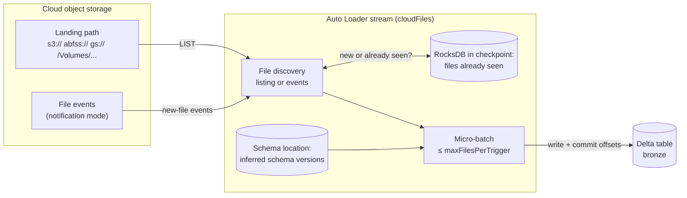
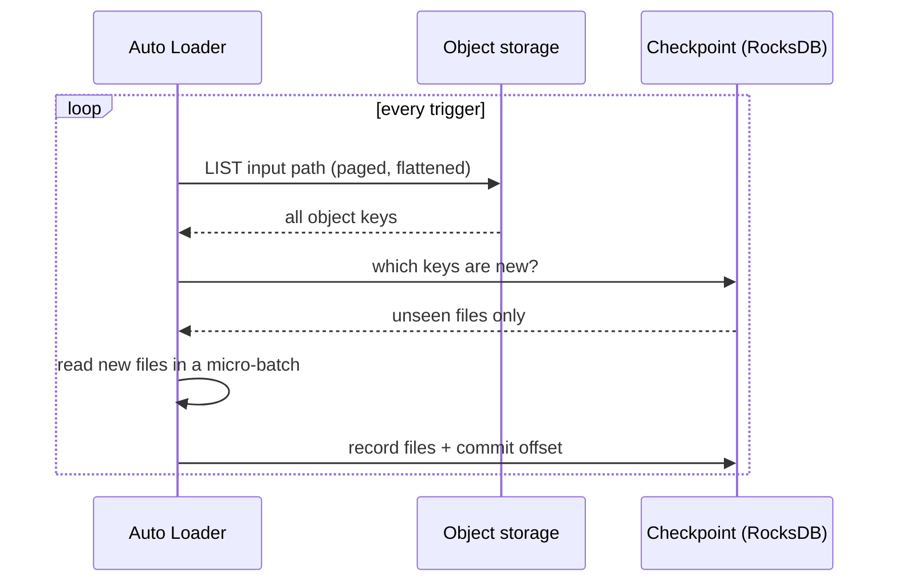
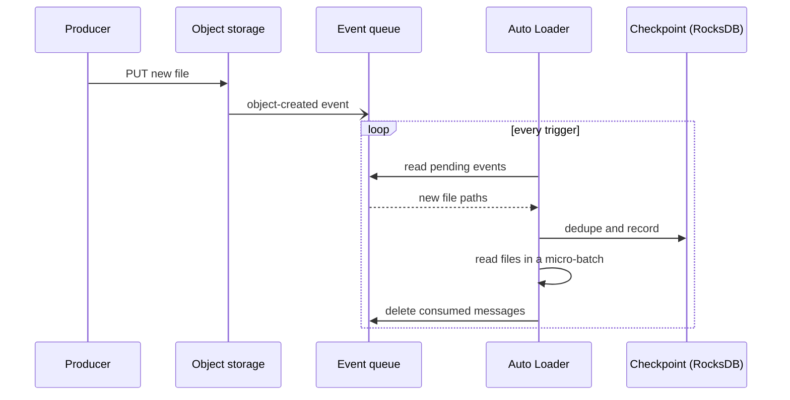
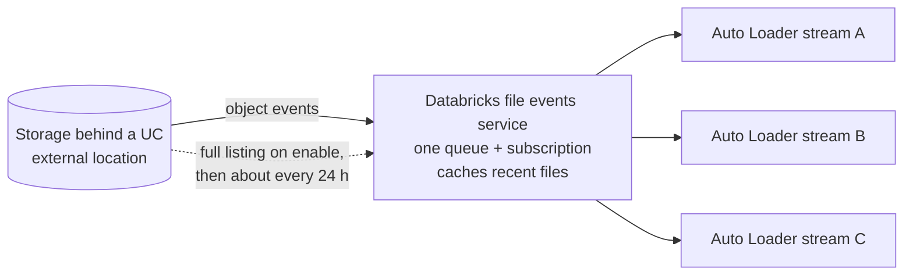
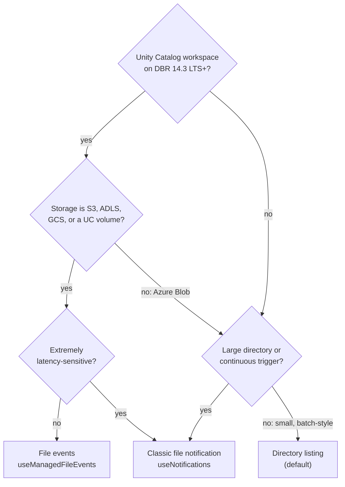
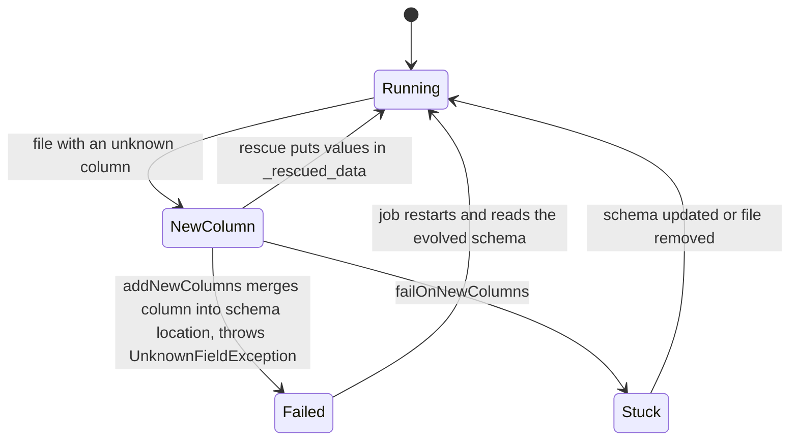

# Auto Loader

Auto Loader is the [[concepts/data_engineering/databricks/databricks|Databricks]] Structured Streaming source, `cloudFiles`, that incrementally ingests new files as they land in cloud object storage. It discovers files by listing a directory or by consuming cloud file events, and it records every file it has seen in its checkpoint, so each file is processed exactly once. Along the way, it can infer the schema and evolve it as new columns appear. It is the usual way to load the bronze layer of a lakehouse.

## Why It Matters

- **It finds only new files.** Without a source that tracks state, a scheduled job either re-reads the whole landing directory or depends on hand-written bookkeeping. Auto Loader keeps that state for you in the checkpoint.
- **Exactly-once into Delta.** "In case of failures, Auto Loader can resume from where it left off by information stored in the checkpoint location and continue to provide exactly-once guarantees when writing data into Delta Lake."
- **Schema drift doesn't break ingestion silently.** New columns are detected, added to a stored schema, or rescued into a dedicated column, instead of being lost or crashing the pipeline for good.
- **Discovery cost decides the bill at scale.** The two file detection modes have very different storage API costs and latency once directories hold millions of files.
- **It is the recommended path.** Databricks recommends Auto Loader "whenever you use Apache Spark Structured Streaming to ingest data from cloud object storage", and recommends it over the legacy `COPY INTO` for most ingestion scenarios.

## How It Works



1. **Discover.** Find candidate files by directory listing or from file events.
2. **Deduplicate.** "As files are discovered, their metadata is persisted in a scalable key-value store (RocksDB) in the checkpoint location of your Auto Loader pipeline. This key-value store ensures that data is processed exactly once."
3. **Batch.** Group new files into micro-batches, by default "a maximum of 1000 files every micro-batch".
4. **Parse and write.** Apply the stored or inferred schema, then write to the target, usually a Delta table, committing progress to the checkpoint.

**Formats:** `JSON`, `CSV`, `XML`, `PARQUET`, `AVRO`, `ORC`, `TEXT`, and `BINARYFILE`, including pre-compressed files. **Sources:** S3, ADLS, GCS, Unity Catalog volumes, and Azure Blob Storage. The WASB driver Azure Blob Storage relies on is deprecated.

> [!info] No ordering guarantee
> "Auto Loader does not guarantee the order in which files are discovered or processed, regardless of file detection mode." A pipeline that depends on file order needs ordering logic downstream, for example on an event timestamp.

## File Detection Modes

Auto Loader has two ways to discover new files: **directory listing** (the default) and **file notification**. File notification mode itself comes in two variants: **file events** on Unity Catalog external locations, which Databricks recommends, and **classic** per-stream notifications. "You can switch file discovery modes across stream restarts and still obtain exactly-once data processing guarantees."

### Directory listing mode

**Mechanism.** "Auto Loader identifies new files by listing the input directory." On every trigger, it lists the path and checks each file against the RocksDB store in the checkpoint, so only files it has not seen go into the micro-batch.



**Simplicity.** It is the default and needs nothing beyond read access to the input path: no queues, subscriptions, or extra cloud permissions.

**Cost.** Storage returns a flattened listing, so the number of `LIST` calls is roughly the number of files divided by the page size of each call:

| Storage | Results per `LIST` call |
| --- | --- |
| Amazon S3 | 1,000 |
| ADLS | 5,000 |
| Google Cloud Storage | 1,024 |

Each listing covers the *whole* input path, including files ingested long ago, so cost and discovery time grow with the total number of files in the directory, not with the number of new ones. Databricks warns that with continuous triggers such as `Trigger.ProcessingTime`, "directory listing mode continuously lists the entire directory and can significantly increase `LIST` API costs."

**Incremental listing (deprecated).** For lexically ordered paths such as `YYYY/MM/DD/HH/file`, `cloudFiles.useIncrementalListing` let Auto Loader list only from the most recently ingested key instead of rescanning everything. In `auto` mode, it ran a full listing after every 7 consecutive incremental ones to stay complete. The docs now say: "Incremental listing is deprecated. Databricks recommends using file notification mode with file events instead. Incremental listing does not guarantee file processing order."

**Backfills.** `cloudFiles.backfillInterval` takes a duration such as `1 day` or `1 week` and schedules an asynchronous full listing that "Auto Loader runs alongside normal file discovery to catch files that discovery missed". There is no default. In directory listing and classic notification modes, backfills run only when the interval is set. A backfill does not cause duplicates, because the checkpoint already knows every file.

**Changing the path.** In Databricks Runtime 11.3 LTS and above, the input path of a directory listing stream can be changed without a new checkpoint.

**Use when:**

- Directories are small to medium, or files arrive infrequently and the stream runs as a batch with `availableNow`.
- You want to get started without setting up cloud eventing.
- File notifications are unavailable or not permitted in your storage setup.

### File notification mode

**Mechanism.** Instead of listing, Auto Loader reads messages that the cloud's event service publishes when an object is created. Discovery cost then scales with the number of new files, not the size of the directory, and latency drops because there is nothing to scan.



The queue messages are deleted "after the corresponding file is read". Cloud providers "do not guarantee 100% delivery of all file events under very rare conditions", which is why backfills still exist in this mode.

#### Classic file notification mode

Each stream gets its own notification resources. Auto Loader creates them "when you set the option `cloudFiles.useNotifications` to `true` and provide the necessary permissions to create cloud resources", or you configure them yourself.

| Storage | Subscription | Queue | Resource prefix | Limit |
| --- | --- | --- | --- | --- |
| Amazon S3 | AWS SNS | AWS SQS | `databricks-auto-ingest` | 100 per bucket |
| ADLS | Azure Event Grid | Azure Queue Storage | `databricks` | 500 per storage account |
| Azure Blob Storage | Azure Event Grid | Azure Queue Storage | `databricks` | 500 per storage account |
| Google Cloud Storage | Google Pub/Sub | Google Pub/Sub | `databricks-auto-ingest` | 100 per bucket |

**Permissions** go beyond read access to the data:

- **AWS:** an IAM policy allowing actions such as `s3:PutBucketNotification`, `sns:CreateTopic`, `sqs:CreateQueue`, and `sqs:DeleteMessage`.
- **Azure:** Contributor on the storage account and EventGrid EventSubscription Contributor on the resource group.
- **GCS:** Pub/Sub roles for the storage and Pub/Sub service accounts.
- **Service credentials:** on Databricks Runtime 16.1 and above, a Databricks service credential can supply the identity.
- **Reduced permissions after setup:** because the resources are created on the stream's first run, a reduced policy is possible afterwards, but then the stream can't start new queries or recreate resources after failures.

Databricks still recommends classic mode for "very latency-sensitive applications".

#### File events on Unity Catalog external locations (recommended)

With **file events** enabled on a Unity Catalog external location, Databricks runs *one* managed queue and storage event subscription for the whole location. Every Auto Loader stream reading from that location shares it instead of creating its own resources. A stream opts in with `cloudFiles.useManagedFileEvents = true`.



- **Requirements:** a Unity Catalog-enabled workspace, permission to create storage credentials and external locations, and Databricks Runtime 14.3 LTS or above.
- **Storage support:** S3, ADLS, GCS, and Unity Catalog volumes. Azure Blob Storage is unsupported.
- **Backfills are automatic.** Databricks does a full listing when file events are first enabled, then "continues to backfill about every 24 hours while a stream is ingesting". `cloudFiles.backfillInterval` is therefore not supported.
- **Unsupported options:** `cloudFiles.useNotifications`, `cloudFiles.useIncrementalListing`, `cloudFiles.fetchParallelism`, `cloudFiles.backfillInterval`, `cloudFiles.pathRewrites`, and `resourceTags`.
- **Migrating:** switch off existing notification-based streams on the location and delete their notification resources.

> [!warning] Run file-event streams at least every seven days
> "The file events service optimizes file discovery by caching the most recently created files. If Auto Loader runs infrequently, this cache can expire, and Auto Loader falls back to directory listing to discover files and update the cache. To avoid this scenario, invoke Auto Loader at least once every seven days."

### Comparison

| Feature | Directory listing | Classic file notification | File events (UC) |
| --- | --- | --- | --- |
| Detection | Lists the input path every trigger | Per-stream cloud queue | One Databricks-managed queue per external location |
| Enable with | Default, no option | `cloudFiles.useNotifications = true` | File events on the external location + `cloudFiles.useManagedFileEvents = true` |
| Setup | Simplest | Cloud resources per stream | One-time setup per external location |
| Permissions | Read on the input path | Create and manage event and queue resources | Create Unity Catalog storage credentials and external locations |
| Discovery cost scales with | Total files in the directory | Number of new files | Number of new files |
| Latency | Higher; bounded by listing time | Lowest; recommended for very latency-sensitive apps | Low |
| Backfill | Only with `cloudFiles.backfillInterval` | Only with `cloudFiles.backfillInterval` | Automatic, about every 24 hours |
| Runtime | Any | Any; service credentials from 16.1 | 14.3 LTS+ |
| Caveat | `LIST` cost explodes with continuous triggers on big directories | Per-bucket and per-account resource limits; rare lost events | Cache expires if not run for seven days; no Azure Blob |
| Databricks recommendation | Migrate away for most workloads | Very latency-sensitive applications | **Recommended for most workloads** |
| Exactly-once | Yes, through the checkpoint | Yes, through the checkpoint | Yes, through the checkpoint |

### Choosing a mode



## Schema Inference and Evolution

Setting `cloudFiles.schemaLocation` "enables schema inference and evolution". Auto Loader stores each version of the inferred schema there, and the docs allow it to be the same directory as the `checkpointLocation`.

- **Sampling.** "Auto Loader samples the first 50 GB or 1000 files that it discovers, whichever limit is crossed first." The limits can be changed with `spark.databricks.cloudFiles.schemaInference.sampleSize.numBytes` and `.numFiles`.
- **Types.** For formats that don't encode types (JSON, CSV, XML), Auto Loader "infers all columns as strings (including nested fields in JSON files)" unless `cloudFiles.inferColumnTypes` is `true`.
- **Hints.** `cloudFiles.schemaHints` pins specific columns, for example `"tags map<string,string>, version int"`, and applies only when you do not provide a full schema.
- **Rescued data.** When it infers the schema, Auto Loader adds `_rescued_data`, a column holding "a JSON blob with the rescued columns and the source file path of the record". It captures values that don't fit: unexpected columns, type mismatches, or case mismatches.

### `cloudFiles.schemaEvolutionMode`

| Mode | Behaviour on a new column |
| --- | --- |
| `addNewColumns` (default without a schema) | Stream fails with `UnknownFieldException` after adding the columns to the stored schema; a restart continues with the new schema. Existing column types don't change |
| `addNewColumnsWithTypeWidening` | As above, and also widens supported types such as `int` to `long` (Public Preview, DBR 16.4+) |
| `rescue` | Schema never evolves and the stream doesn't fail; new columns go to `_rescued_data` |
| `failOnNewColumns` | Stream fails and stays failed until the schema is updated or the offending file removed |
| `none` (default with a provided schema) | Schema doesn't evolve; new columns are ignored and not rescued unless `rescuedDataColumn` is set |



The failure in the default mode is deliberate: the stream stops so that the new schema is picked up cleanly on restart. Databricks recommends running Auto Loader streams in Lakeflow Jobs configured to restart automatically after such schema changes.

## Key Options

| Option | Purpose |
| --- | --- |
| `cloudFiles.format` | Source file format: `json`, `csv`, `xml`, `parquet`, `avro`, `orc`, `text`, `binaryFile` |
| `cloudFiles.schemaLocation` | Where inferred schemas are stored; enables inference and evolution |
| `cloudFiles.schemaEvolutionMode` | How new columns are handled (table above) |
| `cloudFiles.inferColumnTypes` | Infer real types for JSON, CSV, and XML instead of strings |
| `cloudFiles.schemaHints` | Force the types of specific columns |
| `cloudFiles.includeExistingFiles` | Whether files already in the path when the stream first starts are ingested |
| `cloudFiles.maxFilesPerTrigger` | Hard cap on files per micro-batch, 1,000 by default |
| `cloudFiles.maxBytesPerTrigger` | Soft cap on bytes per micro-batch |
| `cloudFiles.useNotifications` | Classic file notification mode |
| `cloudFiles.useManagedFileEvents` | File events on a Unity Catalog external location |
| `cloudFiles.backfillInterval` | Periodic asynchronous full listing; no default |
| `cloudFiles.maxFileAge` | How long file state is kept in the checkpoint; minimum `"14 days"` |
| `cloudFiles.cleanSource` | Move or delete source files after processing (`MOVE`, `DELETE`); DBR 16.4 LTS+ |

## Example

A bronze ingestion stream using file events, schema inference, and an `availableNow` trigger, run as a scheduled job:

```python
(spark.readStream
    .format("cloudFiles")
    .option("cloudFiles.format", "json")
    .option("cloudFiles.useManagedFileEvents", True)
    .option("cloudFiles.schemaLocation", "/Volumes/main/raw/_meta/orders/schema")
    .option("cloudFiles.inferColumnTypes", True)
    .option("cloudFiles.schemaHints", "order_id bigint, amount decimal(18,2)")
    .load("s3://acme-landing/orders/")
    .writeStream
    .option("checkpointLocation", "/Volumes/main/raw/_meta/orders/checkpoint")
    .option("mergeSchema", True)
    .trigger(availableNow=True)
    .toTable("main.bronze.orders"))
```

"The `AvailableNow` trigger instructs Auto Loader to process all files that arrived before the query start time." Files arriving later wait for the next run. This gives batch-style scheduling with streaming's incremental state. The same source is available in SQL through `read_files`, which takes the same options without the `cloudFiles.` prefix, and in Lakeflow Declarative Pipelines.

## Operating It in Production

- **Protect the checkpoint.** Put it "in a location without a cloud object lifecycle policy". If the policy deletes checkpoint files, "the stream state is corrupted" and must be rebuilt from scratch.
- **One checkpoint per source.** Each Auto Loader workload loading into the same table needs its own checkpoint.
- **Don't over-tune `maxFileAge`.** Setting it too aggressively "can cause data quality issues such as duplicate ingestion or missing files".
- **Watch `LIST` costs.** A directory listing stream on a continuous trigger over a large path is the classic cost surprise. Move it to file events.
- **Handle schema-change restarts.** Use job retries so that the deliberate `UnknownFieldException` restarts the stream, then check `_rescued_data` for values that did not fit.
- **`cleanSource` deletes data.** It moves or removes files in the source directory, so make sure no other consumer needs them.

## Open Questions & Disagreements

- **What drives directory listing cost.** The user's draft says discovery cost "scales with the number of directories scanned". The current directory listing page says Auto Loader uses a flattened listing, so `LIST` calls scale with the number of files divided by the results per call. *Inference:* the directories claim describes a non-flattened, per-directory listing. Unresolved until checked against the older documentation it came from.

## Related Concepts

- [[concepts/data_engineering/databricks/databricks|Databricks]] — the platform overview: the medallion layers Auto Loader feeds, Unity Catalog external locations and volumes, and Lakeflow
- [[concepts/data_engineering/spark/apache_spark|Apache Spark]] — Structured Streaming, the micro-batch engine Auto Loader runs on as a source
- [[concepts/software_architecture/exactly_once_delivery_and_processing|Exactly-Once Delivery and Processing]] — why the checkpoint plus Delta's transactional sink gives effectively-once ingestion even though discovery can see a file twice
- [[concepts/data_engineering/databricks/delta_merge_performance|Delta MERGE Performance (Low-Shuffle MERGE and Photon)]] — the usual next step: merging bronze rows into silver tables
- [[concepts/data_engineering/stateful_vs_stateless_stream_processing|Stateful vs. Stateless Stream Processing]] — checkpointed source state like Auto Loader's RocksDB file log, in the wider streaming model

## References

- [What is Auto Loader?](https://docs.databricks.com/aws/en/ingestion/cloud-object-storage/auto-loader/)
- [Auto Loader file detection modes](https://docs.databricks.com/aws/en/ingestion/cloud-object-storage/auto-loader/file-detection-modes)
- [Directory listing mode](https://docs.databricks.com/aws/en/ingestion/cloud-object-storage/auto-loader/directory-listing-mode)
- [File notification mode](https://docs.databricks.com/aws/en/ingestion/cloud-object-storage/auto-loader/file-notification-mode)
- [Schema inference and evolution](https://docs.databricks.com/aws/en/ingestion/cloud-object-storage/auto-loader/schema)
- [Configure Auto Loader for production](https://docs.databricks.com/aws/en/ingestion/cloud-object-storage/auto-loader/production)
