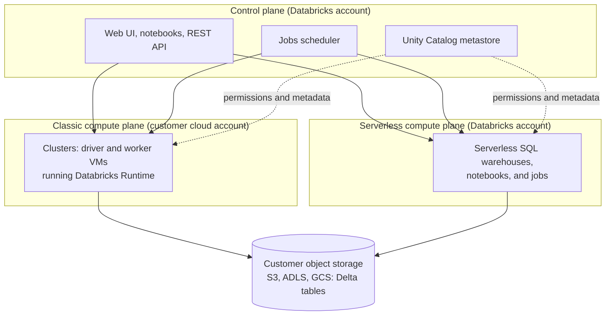

# Databricks

Databricks is a managed data and AI platform, built around [[concepts/data_engineering/spark/apache_spark|Apache Spark]], that runs on AWS, Azure, and Google Cloud. It combines notebooks, managed compute, the Delta Lake table format, and the Unity Catalog governance layer into one workspace, so that data engineering, SQL analytics, and machine learning run against the same tables in the customer's own object storage. Databricks markets this design as the *lakehouse*, one of the reference patterns in [[concepts/data_architecture/data_architecture|Data Architecture]].

## Why It Matters

- **One copy of the data.** Tables are open-format files in the customer's cloud storage, not data loaded into a proprietary warehouse. Spark jobs, SQL dashboards, and ML training all read the same Delta tables.
- **Spark without running Spark.** Databricks was founded in 2013 by the creators of Spark and manages the clusters, runtime versions, autoscaling, and termination that self-hosted Spark leaves to the operator.
- **Governance in one place.** Unity Catalog applies permissions, lineage, and auditing across every workspace and every type of compute, instead of in each tool separately.
- **Cost is a design concern.** Compute is billed in Databricks Units (DBUs) on top of the cloud provider's VM charges. Choosing the type of compute is the main cost lever, and idle clusters are the usual waste.

## Architecture



- **Control plane.** Databricks runs the web application, notebooks, the job scheduler, cluster management, and the Unity Catalog metastore in its own cloud account.
- **Compute plane.** This is where data is processed. *Classic* compute runs as VMs in the customer's cloud account and network. *Serverless* compute runs in Databricks' account and starts in seconds, with no VMs for the customer to manage.
- **Storage.** Table data stays in the customer's object storage: S3, Azure Data Lake Storage, or Google Cloud Storage.
- **Workspace.** The unit users log into. It holds notebooks, Git folders, jobs, compute, and SQL objects. One Unity Catalog metastore per region can serve many workspaces.

## Compute

| Compute type | Runs | Lifecycle | Typical use |
| --- | --- | --- | --- |
| **All-purpose cluster** | Notebooks, interactive Spark, Python | Started by hand and shared; terminates after an idle timeout | Development and exploration |
| **Job cluster** | One scheduled job | Created for the run and terminated after it | Production pipelines; billed at a lower DBU rate than all-purpose |
| **SQL warehouse** | SQL only: queries, dashboards, BI tools, dbt | Classic, pro, or serverless; scales by adding clusters | Analytics and SQL transformations |
| **Serverless compute** | Notebooks, jobs, and pipelines | Managed by Databricks, near-instant start | Avoiding cluster tuning and startup time |

- **Databricks Runtime (DBR)** is the versioned image a cluster runs: Spark plus Databricks' patches, libraries, and connectors. LTS releases are supported for longer, and an ML variant adds common ML libraries.
- **Photon** is Databricks' vectorized query engine, written in C++. It replaces parts of Spark's execution for SQL and DataFrame operations, transparently to user code.
- **Cluster policies** restrict which instance types, sizes, and settings users may choose, which is the main guard against runaway cost.

## Delta Lake

Delta Lake is the default table format on Databricks, open source since 2019. A Delta table is a directory of Parquet files plus a `_delta_log/` transaction log. Every write adds a JSON commit to the log that lists the files added and removed, which gives object storage the [[concepts/databases/acid|ACID]] guarantees that plain Parquet lacks.

| Feature | What it does |
| --- | --- |
| ACID transactions | Readers see a consistent snapshot; a failed write leaves no partial files in the table |
| `MERGE INTO` | Upserts and deletes in one statement, the basis of change-data-capture pipelines; see [[concepts/data_engineering/databricks/delta_merge_performance\|Delta MERGE Performance (Low-Shuffle MERGE and Photon)]] |
| Time travel | Query an older version with `VERSION AS OF` or `TIMESTAMP AS OF`; `RESTORE` rolls a table back |
| Schema enforcement and evolution | Rejects writes that don't match the schema unless evolution is enabled |
| `OPTIMIZE` | Compacts many small files into fewer large ones |
| Z-ordering and liquid clustering | Co-locate related rows so queries skip files; liquid clustering replaces fixed partitioning and Z-order for new tables |
| `VACUUM` | Deletes files no longer referenced by the log, after a retention period (7 days by default), which also limits time travel |
| Change data feed | Exposes row-level changes between versions to downstream consumers |

```sql
MERGE INTO silver.customers AS t
USING bronze.customer_updates AS s
  ON t.customer_id = s.customer_id
WHEN MATCHED THEN UPDATE SET *
WHEN NOT MATCHED THEN INSERT *;

SELECT * FROM silver.customers VERSION AS OF 42;
OPTIMIZE silver.customers;
```

## Unity Catalog

Unity Catalog is the governance layer. It names every table, view, volume, function, and model in a three-level namespace, `catalog.schema.object`, above which sits a metastore. The older per-workspace Hive metastore is still visible as the `hive_metastore` catalog.

- **Access control.** `GRANT` and `REVOKE` on catalogs, schemas, and objects, inherited downwards, plus row filters and column masks.
- **Managed and external tables.** Dropping a managed table deletes its data. An external table points at a storage location registered as an *external location*, and dropping it leaves the files.
- **Volumes** govern non-tabular files, such as CSV drops, images, and libraries, under the same permissions.
- **Lineage** is captured automatically at table and column level from queries run on Unity Catalog compute.
- **Delta Sharing** shares tables with other organizations, on Databricks or not, without copying them.

```sql
GRANT USE CATALOG ON CATALOG analytics TO `data-analysts`;
GRANT USE SCHEMA, SELECT ON SCHEMA analytics.gold TO `data-analysts`;
```

## Data Engineering on Databricks

### The medallion architecture

Databricks popularized naming lakehouse layers by refinement:

- **Bronze**: raw data as ingested, append-only, kept for replay.
- **Silver**: cleaned, deduplicated, conformed tables.
- **Gold**: business-level aggregates and models for consumers.

This is the same staging-to-marts layering that [[concepts/data_engineering/dbt/dbt|dbt (Data Build Tool)]] projects use, under different names.

### Ingestion and pipelines

- **[[concepts/data_engineering/databricks/auto_loader|Auto Loader]]** (`cloudFiles` source) incrementally picks up new files from cloud storage. It tracks which files are processed and can infer and evolve the schema.
- **Lakeflow Declarative Pipelines**, formerly Delta Live Tables, define tables as queries with data-quality *expectations*. Databricks works out the dependency order and manages the infrastructure, retries, and incremental processing.
- **Structured Streaming** runs on Databricks unchanged, with Delta tables as both source and sink.
- **Lakeflow Jobs**, formerly Workflows, schedules multi-task DAGs of notebooks, scripts, SQL, pipelines, and dbt tasks, which covers much of what an external [[concepts/data_engineering/workflow_orchestration|Workflow Orchestration]] tool would do.

```python
(spark.readStream.format("cloudFiles")
    .option("cloudFiles.format", "json")
    .option("cloudFiles.schemaLocation", "/Volumes/main/raw/_schemas/orders")
    .load("/Volumes/main/raw/orders/")
    .writeStream
    .option("checkpointLocation", "/Volumes/main/raw/_checkpoints/orders")
    .trigger(availableNow=True)
    .toTable("main.bronze.orders"))
```

### SQL and dbt

**Databricks SQL** runs SQL warehouses, a SQL editor, and dashboards, and serves BI tools over JDBC and ODBC. dbt connects to SQL warehouses through the [[concepts/data_engineering/dbt/dbt_databricks_adapter|dbt-databricks Adapter]].

## Machine Learning and AI

- **MLflow**, an open-source project Databricks created, tracks experiments and packages models. Models are registered in Unity Catalog.
- **Model Serving** hosts registered models and foundation models behind REST endpoints.
- **Vector Search** indexes Delta tables for retrieval in AI applications.

These sit on the same governed tables as the data pipelines, which is the platform's main argument against a separate ML stack.

## Development and Deployment

- **Notebooks** mix Python, SQL, Scala, and R cells (`%sql`, `%python`), and `dbutils` helps with files, secrets, and widgets.
- **Git folders**, formerly Repos, sync notebooks and code with a Git provider.
- **Databricks Asset Bundles** describe jobs, pipelines, and their settings as YAML in the repository, deployed per environment with the Databricks CLI. This is the supported way to run CI/CD:

```bash
databricks bundle validate
databricks bundle deploy -t prod
databricks bundle run nightly_job -t prod
```

- **Authentication** for automation uses personal access tokens or OAuth with service principals, the same flows described for the dbt adapter.

## Common Pitfalls

- **Idle all-purpose clusters.** A cluster left running without an auto-termination timeout bills DBUs and VM time all night.
- **Production on all-purpose compute.** Scheduled jobs belong on job clusters or serverless compute, which cost less per DBU.
- **Small files.** Frequent small appends or streaming writes slow down reads until the table is compacted with `OPTIMIZE` or auto-compaction.
- **`VACUUM` versus time travel.** Shortening the retention period deletes the files older versions need, so time travel and long-running readers fail.
- **Staying on `hive_metastore`.** New work outside Unity Catalog misses lineage and central permissions, and must be migrated later.

## Related Concepts

- [[concepts/data_engineering/spark/apache_spark|Apache Spark]] — the engine underneath every Databricks cluster; its execution model, shuffles, and tuning apply unchanged
- [[concepts/data_engineering/dbt/dbt_databricks_adapter|dbt-databricks Adapter]] — how dbt connects to SQL warehouses and clusters, with PAT and OAuth authentication
- [[concepts/data_engineering/databricks/auto_loader|Auto Loader]] — the file ingestion source: directory listing vs. file events, RocksDB checkpoint state, and schema evolution
- [[concepts/data_engineering/databricks/delta_merge_performance|Delta MERGE Performance (Low-Shuffle MERGE and Photon)]] — how Low-Shuffle MERGE, Photon, and deletion vectors make Delta `MERGE` fast and keep table layout intact
- [[concepts/data_architecture/data_architecture|Data Architecture]] — the lakehouse pattern Databricks implements, and the table formats that make it possible
- [[concepts/databases/acid|ACID (Atomicity, Consistency, Isolation, Durability)]] — the guarantees the Delta transaction log brings to object storage
- [[concepts/data_engineering/workflow_orchestration|Workflow Orchestration]] — the general problem Lakeflow Jobs solves inside the platform
- [[concepts/identity_and_access/oauth|OAuth (Open Authorization)]] — the machine-to-machine flow used by service principals for automation

## References

- [Databricks documentation](https://docs.databricks.com/)
- [Databricks architecture overview](https://docs.databricks.com/aws/en/getting-started/overview)
- [Delta Lake documentation](https://docs.delta.io/)
- [Unity Catalog](https://docs.databricks.com/aws/en/data-governance/unity-catalog/)
