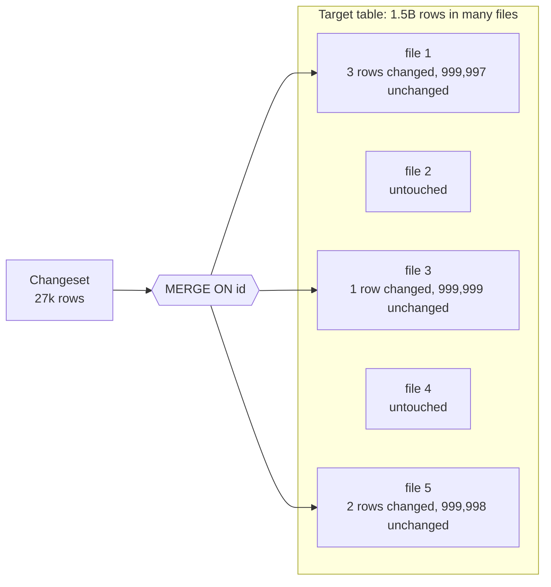
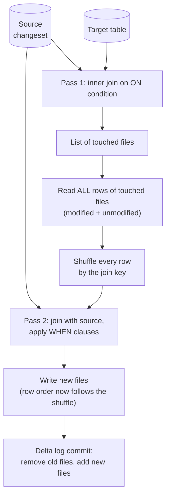
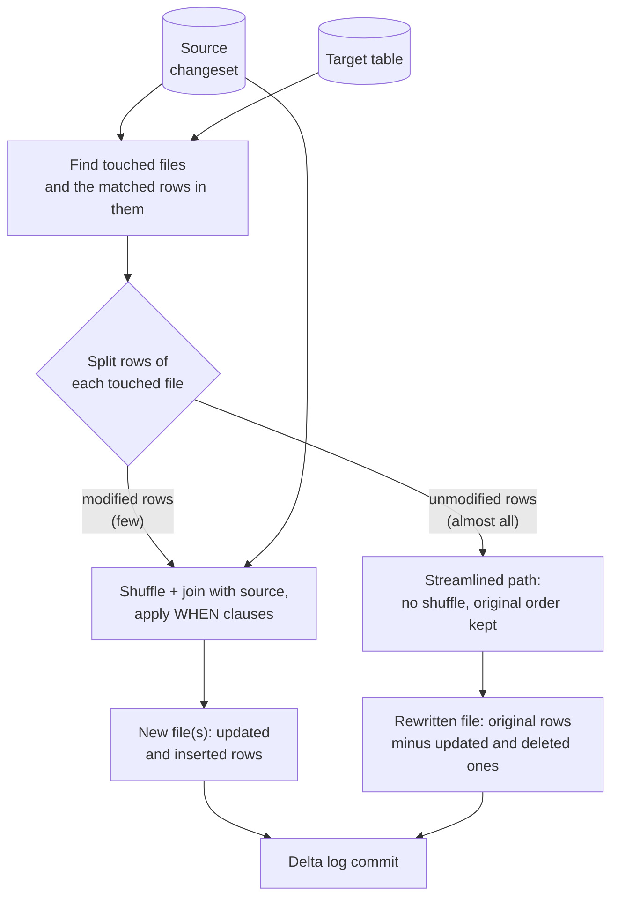
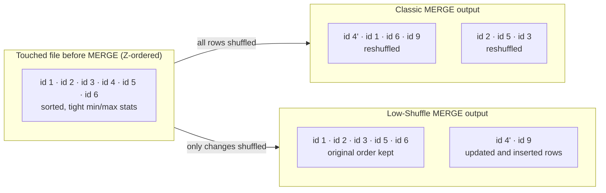
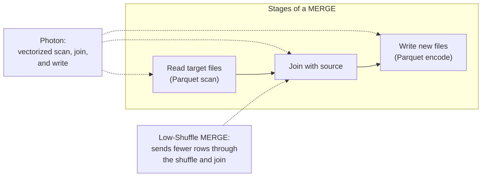
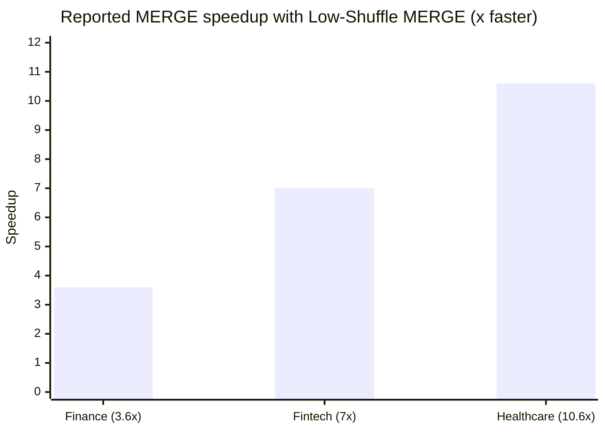
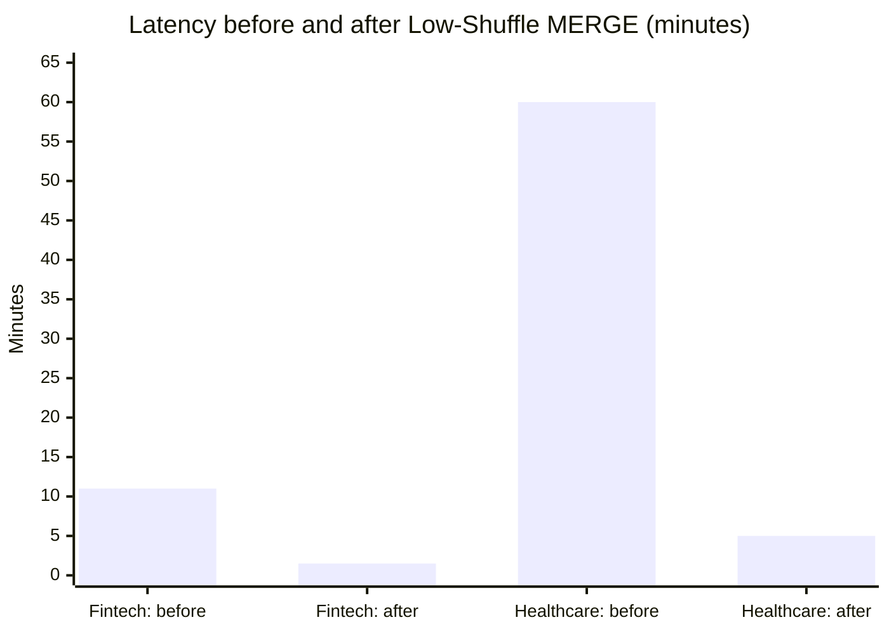
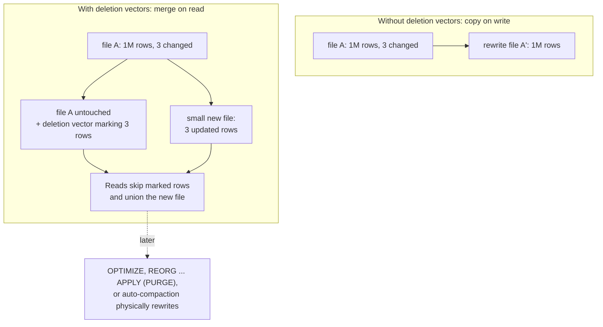

# Delta MERGE Performance (Low-Shuffle MERGE and Photon)

A Delta Lake `MERGE INTO` on [[concepts/data_engineering/databricks/databricks|Databricks]] is made faster by three complementary mechanisms:

- **Low-Shuffle MERGE** keeps the unmodified rows of a rewritten file out of the expensive shuffle.
- **Photon**, Databricks' vectorized engine, speeds up the joins, reads, and writes that dominate a MERGE.
- **Deletion vectors**, with Photon's predictive I/O, avoid rewriting the file at all.

Together they target the most common MERGE shape: a small changeset scattered across a large table.

## Why It Matters

- **MERGE is the dominant write.** Databricks reported in 2022 that MERGE makes up "about half the time spent out of all write operations in Databricks". It is the standard tool for change data capture (CDC), upserts, deduplication, and slowly changing dimensions.
- **Small changes used to cost large rewrites.** Delta files are immutable. Changing one row means rewriting its whole file, and before Low-Shuffle MERGE, every unmodified row in that file also went through the shuffle.
- **Layout damage outlived the MERGE.** The shuffle scrambled Z-order clustering, so later queries skipped fewer files until someone re-ran `OPTIMIZE ZORDER BY`. A slow MERGE also made every subsequent read slower.

## The Problem: Small Changes Spread Across a Large Table

The blog describes the workload that motivated the work: "a significant number of MERGE operations made small changes across various distributed parts of their tables". CDC ingestion is the typical case, where a MERGE "would only be updating a relatively small number of rows per file".



The table and changeset sizes are from the finance benchmark in the blog. The per-file counts are illustrative. Files 1, 3, and 5 are *touched* and must be rewritten, almost entirely made of rows the MERGE does not change.

## How a Classic MERGE Executes

The blog summarizes the original implementation in two steps. The operation "joins the source and destination … which, in Apache Spark, shuffles the rows in the table, breaking the existing ordering of the table. MERGE then executes the changeset against the joined table, writing the resulting set of rows into a new file."

In more detail, as open-source Delta Lake implements it (general knowledge, not from the blog), the command runs in two passes:

1. **Find touched files.** An inner join of the source with the target, using the `ON` condition, identifies which target files contain at least one matching row. Data skipping on file statistics, and any target predicates in the `ON` clause, limit the files this join scans.
2. **Rewrite touched files.** The source is joined again with *all* rows of the touched files: an outer join when the MERGE has `WHEN NOT MATCHED` clauses, so unmatched source rows can be inserted. Each joined row goes through the `WHEN` clauses and is written out. The Delta log then atomically removes the old files and adds the new ones.



The cost is in pass 2. Every unmodified row in a touched file is read, serialized, sent across the network in the shuffle, joined, and written, only to come out unchanged. Because the shuffle redistributes rows by join key, the new files no longer follow the table's Z-order. The blog: "for tables that were clustered using Delta Lake's ZORDER, the MERGE implementation would break the intended clustering of unmodified data by doing the expensive shuffle process."

## Low-Shuffle MERGE

Low-Shuffle MERGE (LSM) is Databricks' optimized MERGE implementation. Its documentation states: "It processes unmodified rows separately from modified rows, without shuffles or other expensive calculations. As a result, MERGE shuffles much less data and runs faster."

The 2022 blog describes the result at the file level: Low-Shuffle MERGE works "by removing any updated and deleted rows … from the original file while writing any new and updated rows … in a separate file, removing the need to process and shuffle the rest of the rows in the original file".



### Classic vs. Low-Shuffle MERGE, file by file



In the example, `id 4` is updated to `id 4'` and `id 9` is inserted. The row layout is illustrative.

| Aspect | Classic MERGE | Low-Shuffle MERGE |
| --- | --- | --- |
| Rows that pass through the shuffle | Every row of every touched file | Only modified and inserted rows |
| Unmodified rows | Joined and rewritten in shuffle order | Rewritten in a streamlined path, original order kept |
| Z-order and liquid clustering layout | Destroyed for unmodified data | Preserved for unmodified rows |
| Layout of updated and inserted rows | Unclustered | Still not optimal; may need `OPTIMIZE` |
| Need to re-run `OPTIMIZE ZORDER BY` | After every MERGE to restore skipping | Less often |
| Files rewritten | Still whole touched files | Still whole touched files, which deletion vectors address (below) |

### What it preserves, and what it doesn't

- **Clustering of unmodified rows.** The docs say Low-Shuffle MERGE "tries to preserve the existing layout of unmodified rows, including liquid clustering layout", and the existing Z-order layout. The 2021 announcement says it "maintains that sorting for all records that are not being modified".
- **Slower degradation.** As a result, "performance degrades more slowly after one or more MERGE commands, and you need to run OPTIMIZE less often."
- **Not the new rows.** "The layout of updated or newly inserted rows might not be optimal", so `OPTIMIZE`, or `OPTIMIZE ZORDER BY` on Z-ordered tables, is still needed eventually.
- **When it helps most.** It "helps most when a MERGE updates a relatively small number of rows in a large table". A MERGE that rewrites most rows in each file has little unmodified data to protect.

### Availability

| Date | Status |
| --- | --- |
| September 2021 | Public preview on AWS, Azure, and Google Cloud, on Databricks Runtime 9.0 with `spark.databricks.delta.merge.enableLowShuffle = true` |
| October 2022 | "Enabled by default for all MERGEs in Databricks Runtime 10.4+ and also in the current Databricks SQL warehouse compute version" |
| Current docs | "Enabled by default, so you don't need to change your MERGE statements to benefit from it" |

On older runtimes, the preview flag can be set in a notebook or at the cluster level:

```sql
SET spark.databricks.delta.merge.enableLowShuffle = true;
```

Low-Shuffle MERGE is a Databricks feature, and the sources do not say it is part of open-source Delta Lake.

## Photon

Photon is Databricks' native, vectorized query engine. It processes data in columnar batches instead of Spark's row-at-a-time JVM execution. The blog explains why it fits MERGE: "Photon's vectorized implementation speeds up many operations, including aggregations, joins, reads and writes. Joins, reads and writes are typical bottlenecks for MERGE workloads, therefore making Photon and LSM a perfect match."



The two optimizations attack different costs. Low-Shuffle MERGE reduces how much data goes through the join. Photon makes each stage process its data faster. The 2021 announcement "strongly recommend[s] using Photon with Low Shuffle Merge".

## Benchmarks and Reported Results

All figures are Databricks' own, from the 2022 blog. The blog does not give cluster sizes, run counts, or table sizes beyond those listed.

| Claim | Figure | Setup given |
| --- | --- | --- |
| Low-Shuffle MERGE, general | Up to 5x, "average on the order of 2-3x" | MERGE-based workloads |
| Photon + Low-Shuffle MERGE | "Up to a 4x performance increase" | None |
| Large finance company | 3.6x | 1.5B-row table, 27k-row changeset |
| Large healthcare retailer | 10.6x average batch MERGE speedup, LSM without Photon | Streaming MERGE of sensor data, production workload |
| Large fintech firm | 7x: average MERGE time from 11 minutes to 1.5 minutes | Fraud-detection ingestion |



The three customer cases in the blog report speedups between 3.6x and 10.6x. All exceed the 2-3x average, which suggests they were chosen as strong examples.



The fintech firm's average MERGE dropped from 11 minutes to 1.5. At the healthcare retailer, "the streaming data that used to take 1 hour of processing time is now available to query in 5 minutes".

## Beyond Low-Shuffle: Deletion Vectors and Predictive I/O

Low-Shuffle MERGE still rewrites every touched file, only more cheaply. **Deletion vectors** remove most of the rewrite. The docs: "Without deletion vectors, modifying a single row requires rewriting the entire Parquet file containing that record. Deletion vectors mark rows as modified in metadata instead, and reads apply the deletion vector entries at query time to resolve the current table state."

On Photon, this is **predictive I/O for updates**. "Rather than rewriting all records in a data file when any record is updated or deleted, predictive I/O uses deletion vectors to indicate records have been removed from the target data files. Supplemental data files are used to indicate updates."



| Point | Detail from the docs |
| --- | --- |
| Enabling | `ALTER TABLE t SET TBLPROPERTIES ('delta.enableDeletionVectors' = true);`. A workspace admin setting can auto-enable it for new tables, and defaults vary by region |
| Photon support | MERGE, UPDATE, and DELETE with deletion vectors on Databricks Runtime 12.2 LTS and above |
| Without Photon | DELETE from 12.2 LTS, UPDATE from 14.1, MERGE from 14.3 LTS |
| Automatic predictive I/O | Used automatically for tables with deletion vectors on serverless SQL warehouses, pro SQL warehouses, and Photon clusters on Databricks Runtime 14.0 and above. Support exists from 12.2 LTS, but 14.0+ is recommended |
| Physical cleanup | Only `OPTIMIZE`, `REORG TABLE … APPLY (PURGE)`, or auto-compaction rewrites the files |
| Concurrency | Row-level concurrency on Databricks Runtime 14.2 and above |
| Compatibility cost | Enabling upgrades the table protocol, and "clients without deletion vector support can't read the table" |

> [!warning] Check external readers before enabling deletion vectors
> The protocol upgrade locks out older Delta readers and some integrations. Manifest generation for external engines requires a `REORG … APPLY (PURGE)` first, and OpenSharing does not support such tables.

## Making a MERGE Fast in Practice

Most of the following is general Delta Lake tuning practice rather than content from the cited pages:

- **Let the defaults work.** Low-Shuffle MERGE is on in Databricks Runtime 10.4+ and Databricks SQL. Use Photon-enabled compute, and consider enabling deletion vectors for tables that take frequent small MERGEs.
- **Narrow the `ON` condition.** Add target-side predicates, such as a date range or partition, so the touched-file search and data skipping prune more files: `ON t.id = s.id AND t.event_date >= '2026-10-01'`.
- **Cluster on the merge key.** Liquid clustering or Z-order on the column in the `ON` clause concentrates matches in fewer files, so fewer files are touched. Low-Shuffle MERGE then keeps that clustering intact.
- **Deduplicate the source.** A MERGE fails when several source rows match the same target row, so deduplicate the changeset first.
- **Keep files right-sized.** Many small files inflate the touched-file count. Compact them with `OPTIMIZE` or auto-compaction.
- **Inspect the result.** `DESCRIBE HISTORY t` shows each MERGE's `operationMetrics`, including how many files were removed and added and how many rows were updated, inserted, and copied. Copied rows are the unmodified rows that were rewritten anyway.

```sql
MERGE INTO silver.orders AS t
USING (SELECT * FROM bronze.order_changes QUALIFY row_number() OVER (PARTITION BY order_id ORDER BY updated_at DESC) = 1) AS s
  ON t.order_id = s.order_id AND t.order_date >= current_date() - INTERVAL 7 DAYS
WHEN MATCHED AND s.op = 'D' THEN DELETE
WHEN MATCHED THEN UPDATE SET *
WHEN NOT MATCHED AND s.op != 'D' THEN INSERT *;

DESCRIBE HISTORY silver.orders LIMIT 1;
```

## Open Questions & Disagreements

- **How the speedup figures compare.** The 2022 blog reports Low-Shuffle MERGE alone at "up to 5x" but Photon plus Low-Shuffle MERGE at only "up to a 4x performance increase". It does not say what baseline each figure uses. *Inference:* the 4x may be measured against Photon-free Low-Shuffle MERGE, or against a different workload set. Unresolved until the benchmark setup is published.
- **Runtime minimum for predictive I/O updates on clusters.** The predictive I/O page lists Databricks Runtime 14.0+ clusters for automatic use but says support is present from 12.2 LTS. The deletion vectors page gives 12.2 LTS+ for Photon MERGE. These are likely "supported" vs. "recommended", but the pages don't say so outright.
- **The classic two-pass description.** It comes from general knowledge of open-source Delta Lake, not from the cited Databricks pages, which describe the old implementation only as a join followed by a rewrite.

## Related Concepts

- [[concepts/data_engineering/databricks/databricks|Databricks]] — the platform overview: Delta Lake's `MERGE`, Photon, Unity Catalog, and the compute types that enable Photon
- [[concepts/data_engineering/spark/apache_spark|Apache Spark]] — why shuffles are expensive and how joins redistribute rows, which is the cost Low-Shuffle MERGE removes
- [[concepts/databases/acid|ACID (Atomicity, Consistency, Isolation, Durability)]] — the Delta log's atomic remove-and-add commit that makes rewriting files during a MERGE safe
- [[concepts/data_engineering/dbt/dbt_databricks_adapter|dbt-databricks Adapter]] — dbt's `merge` incremental strategy, which compiles to the `MERGE INTO` statements tuned here

## References

- [Faster MERGE Performance With Low-Shuffle MERGE and Photon](https://databricks.com/blog/faster-merge-performance-low-shuffle-merge-and-photon) — Databricks blog, October 17, 2022
- [Announcing Public Preview of Low Shuffle Merge](https://www.databricks.com/blog/2021/09/08/announcing-public-preview-of-low-shuffle-merge.html) — Databricks blog, September 8, 2021
- [Low shuffle merge on Databricks](https://docs.databricks.com/aws/en/optimizations/low-shuffle-merge)
- [Use predictive I/O](https://docs.databricks.com/aws/en/optimizations/predictive-io)
- [Deletion vectors](https://docs.databricks.com/aws/en/delta/deletion-vectors)
