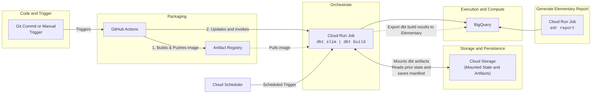
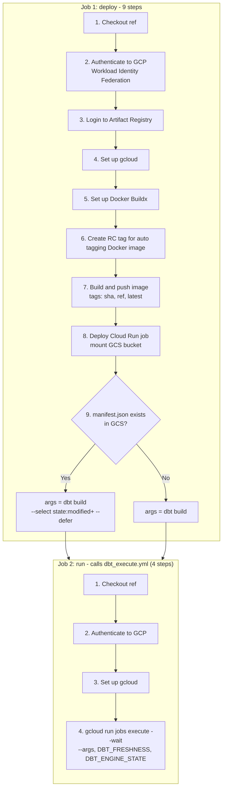
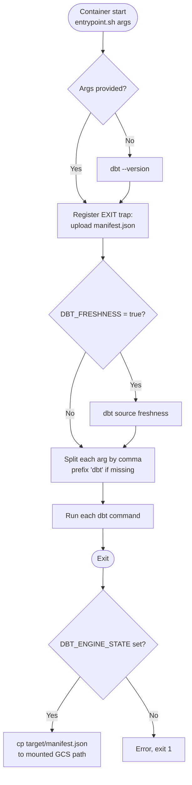

# Deploy dbt and Elementary to Cloud Run with GitHub Actions

A reference pattern for running [[concepts/data_engineering/dbt/dbt|dbt (Data Build Tool)]] as a **containerized Cloud Run job** against BigQuery, built and released entirely from GitHub Actions. The dbt project, its dependencies, and its compiled packages are baked into an immutable image in Artifact Registry; GitHub Actions deploys that image to a Cloud Run job and triggers an execution; the run's `manifest.json` is persisted to a GCS bucket mounted into the container, which turns every subsequent run into a deferred, state-aware build. The concrete example throughout is the `ghq-bpit-crehealth-df` monorepo and its `credit-health` component.

> [!info] This note is a template, not a runbook
> It is a **starting point for setting up and deploying a new dbt project to Cloud Run** — copy the Dockerfile, `profiles.yml`, entrypoint, and the two workflows, then substitute your own names. Everything specific to `ghq-bpit-crehealth-df` (the `credit-health` component, the `CRH_*` datasets, the `crehealth` profile, `asia-southeast1`) is an illustration of where a value goes, not a requirement. Treat it as a blueprint to adapt rather than a record of a running system; verify every pinned version, role, and flag against your own project before relying on it.

## Why It Matters

- **No always-on infrastructure.** A Cloud Run *job* runs to completion and stops. Unlike dbt Cloud or a Composer/Airflow deployment, there is no scheduler process, no worker pool, and no idle cost between runs.
- **The image is the release artifact.** `dbt deps` runs at build time, so package resolution cannot fail or drift at run time. Rolling back is re-deploying an older image tag.
- **Keyless CI.** Workload Identity Federation lets GitHub Actions impersonate a Google service account without a JSON key stored as a repository secret.
- **State deferral is nearly free.** Because a GCS bucket is mounted into the container, the previous `manifest.json` is just a file on disk — no separate artifact service is needed to run `--select state:modified+ --defer`.
- **One pipeline, many components.** The `COMPONENT` build argument selects which dbt project under `components/` is packaged, so a monorepo of dbt projects shares a single Dockerfile and a single pair of workflows.

## Prerequisites

### Google Cloud resources

| Resource                                    | Purpose                                                                 | Constraint                                                                 |
| ------------------------------------------- | ----------------------------------------------------------------------- | -------------------------------------------------------------------------- |
| Artifact Registry (Docker format)           | Stores the dbt runtime image                                            | Must live in the same region as `GCP_REGION`; host is `<region>-docker.pkg.dev` |
| Cloud Run **job** (not a service)           | Executes `dbt build` to completion                                      | Named `<component>-job`; must use `--execution-environment=gen2`           |
| Cloud Storage bucket                        | Holds `manifest.json` per component for state deferral                  | Mounted into the job as a Cloud Storage FUSE volume, which requires gen2   |
| BigQuery datasets                           | `CRH_SOURCES`, `CRH_INTERMEDIATE`, `CRH_OUTPUTS`, `elementary`          | Dataset location must match `location` in `profiles.yml` (`asia-southeast1`) |
| Workload Identity Federation pool + provider | Keyless GitHub → Google Cloud authentication                            | Provider's attribute condition should pin the repository and, ideally, the ref |
| Two service accounts                        | A deployer identity for CI and a runtime identity for the job           | Keep them separate — CI must not hold BigQuery write access                |
| Cloud Scheduler job                         | Optional periodic trigger for the Cloud Run job                         |                 |

### IAM

Two distinct identities, each with the narrowest role set that lets its half of the pipeline work.

**Deployer service account** — impersonated by GitHub Actions via `secrets.GCP_SERVICE_ACCOUNT`:

| Role                          | Needed for                                                              |
| ----------------------------- | ----------------------------------------------------------------------- |
| `roles/artifactregistry.writer` | Pushing the built image                                                |
| `roles/run.developer`         | Creating and updating the Cloud Run job, and executing it               |
| `roles/iam.serviceAccountUser` on the runtime SA | Deploying a job that *runs as* another service account |
| `roles/storage.objectViewer` on the bucket | The `gcloud storage ls .../manifest.json` probe in the deploy job |

**Runtime service account** — the Cloud Run job's identity, passed as `secrets.CLOUD_RUN_SERVICE_ACCOUNT`:

| Role                                         | Needed for                                                  |
| -------------------------------------------- | ------------------------------------------------------------ |
| `roles/bigquery.jobUser` on the billing project | Running query jobs                                        |
| `roles/bigquery.dataEditor` on the target datasets | Creating and writing models                            |
| `roles/bigquery.dataViewer` on every source project/dataset | Reading declared sources                        |
| `roles/storage.objectUser` on the bucket     | Reading and writing `manifest.json` through the FUSE mount   |

> [!tip] Why `method: oauth` works without a key
> The profile authenticates with Application Default Credentials. Inside Cloud Run, ADC resolves to the job's attached service account automatically, so no key file ever exists. Locally the same profile resolves to `gcloud auth application-default login`.

### GitHub repository configuration

Both workflows read configuration from a GitHub **Environment** named after the input (`dev` or `prod`), which is what makes `environment: ${{ inputs.environment }}` select a different project per target.

| Kind     | Name                             | Example / purpose                                            |
| -------- | -------------------------------- | ------------------------------------------------------------ |
| Variable | `GCP_PROJECT_ID`                 | Billing and execution project                                |
| Variable | `GCP_REGION`                     | `asia-southeast1` — Artifact Registry and Cloud Run region   |
| Variable | `AR_REPO_NAME`                   | Artifact Registry repository                                 |
| Variable | `AR_IMAGE_NAME`                  | Image name within the repository                             |
| Variable | `GCS_BUCKET`                     | Bucket holding dbt artifacts                                 |
| Variable | `CLOUD_RUN_MOUNT_PATH`           | Where the bucket is mounted, e.g. `/dbt-artifacts`           |
| Secret   | `GCP_WORKLOAD_IDENTITY_PROVIDER` | Full provider resource name                                  |
| Secret   | `GCP_SERVICE_ACCOUNT`            | Deployer service account email                               |
| Secret   | `CLOUD_RUN_SERVICE_ACCOUNT`      | Runtime service account email                                |

Every job that authenticates must declare `permissions: id-token: write` (plus `contents: read`), or the OIDC token request fails. The reusable workflow is called with `secrets: inherit` so it sees the same values.

## Project Structure
```text
ghq-bpit-crehealth-df/
├── .github/
│   └── workflows/
│       ├── dbt_deploy.yml                  # Build image, deploy Cloud Run job, trigger run
│       └── dbt_execute.yml                 # Reusable workflow to execute the dbt job
├── components/
│   └── credit-health/                      # dbt project for Credit Health
│       ├── dbt_project.yml
│       ├── packages.yml
│       ├── package-lock.yml
│       ├── requirements.txt
│       ├── macros/
│       │   ├── generate_schema_name.sql
│       │   └── materializations/
│       │       └── operation.sql
│       ├── models/
│       │   ├── _sources.yml                # Source configurations
│       │   ├── sources/                    # Source / staging layer
│       │   │   ├── _sources__models.yml
│       │   ├── intermediate/               # Transformation layer
│       │   │   ├── _intermediate__models.yml
│       │   └── outputs/                    # Final / mart layer
│       │       ├── _outputs__models.yml
│       ├── scripts/
│       │   └── entrypoint.sh               # Container entrypoint for Cloud Run job
│       └── tests/
│           └── generic/
│               ├── test_max_date_is_previous_month_end.sql
│               └── test_quantile_range.sql
├── .dockerignore
├── .gitignore
├── .sqlfluff                               # SQLFluff lint config
├── .sqlfluffignore
├── Dockerfile                              # Image for dbt runtime (COMPONENT build arg)
├── profiles.yml                            # dbt profiles (dev / prod targets)
└── README.md
```

The `COMPONENT` build argument is what makes this a monorepo pattern: `Dockerfile` and `profiles.yml` sit at the root and are shared, while everything under `components/<component>/` is specific to one dbt project. Adding a second dbt project means adding a folder and one more entry to the `component` choice list in the workflow — no new pipeline.

## Pipeline Overview

### End-to-end flow


### Steps in each job


### Runtime sequence across systems


> [!note] Correction against the source repository
> The manifest is **not** uploaded by a GitHub Actions step. The container's `entrypoint.sh` copies `target/manifest.json` into the mounted bucket path on exit, so persistence happens inside Cloud Run. Likewise, `dbt_deploy.yml` currently exposes only `workflow_dispatch` — there is no `push` trigger.

## The Container Image

A three-stage build keeps the runtime layer free of `git`, `pip` caches, and build tooling.

```dockerfile
FROM python:3.13-slim AS py_builder
ENV PATH="/opt/venv/bin:$PATH" PIP_NO_CACHE_DIR=1 PIP_DISABLE_PIP_VERSION_CHECK=1
WORKDIR /src
RUN apt-get update && apt-get install -y --no-install-recommends git \
  && rm -rf /var/lib/apt/lists/*
RUN python -m venv /opt/venv && pip install --upgrade pip

# Declared after shared layers: an ARG change busts the cache of every later RUN
ARG COMPONENT
COPY components/${COMPONENT}/requirements.txt .
RUN pip install -r requirements.txt

FROM py_builder AS dbt_builder
ARG COMPONENT
COPY components/${COMPONENT}/dbt_project.yml \
  components/${COMPONENT}/packages.yml \
  components/${COMPONENT}/package-lock.yml ./
RUN dbt deps

FROM python:3.13-slim AS production
ENV PATH="/opt/venv/bin:$PATH" PYTHONUNBUFFERED=1 PYTHONDONTWRITEBYTECODE=1
WORKDIR /src/dbt
COPY --from=py_builder /opt/venv /opt/venv
COPY --from=dbt_builder /src/dbt_packages ./dbt_packages
COPY profiles.yml .
ARG COMPONENT
COPY components/${COMPONENT}/ .
ENTRYPOINT ["/bin/bash", "./scripts/entrypoint.sh"]
```

Points worth copying into any dbt image:

- **`ARG COMPONENT` is declared late, twice.** An `ARG` invalidates the cache for every instruction after it, so the `apt-get`/`venv` layers stay shared across components. It must be re-declared in each stage that uses it, because `ARG` scope is per-stage.
- **`git` lives only in the builder.** It is required for `dbt deps` to clone Git-sourced packages, and it is a needless attack surface at run time.
- **`package-lock.yml` is copied with `packages.yml`.** Without it `dbt deps` resolves version ranges afresh at build time, which quietly breaks reproducibility of an image rebuilt from the same commit.
- **`PYTHONUNBUFFERED=1`.** Cloud Run captures stdout; without this, dbt's output arrives in Cloud Logging in bursts, or not at all when the job is killed.
- **`platforms: linux/amd64`** is set in the build step. Cloud Run jobs do not run `arm64` images, and a build on an Apple-silicon runner would otherwise produce one.
- **Layer cache lives in GitHub.** `cache-from`/`cache-to: type=gha` with `scope=${{ inputs.component }}` keeps each component's cache separate so they do not evict one another.

### Python and dbt dependencies

```text
dbt-core==1.12.5
dbt-bigquery==1.12.1
```

Both are pinned exactly. See [[concepts/data_engineering/dbt/dbt_bigquery_adapter|dbt-bigquery Adapter]] for what the adapter contributes. The dbt packages are pinned in `packages.yml`:

```yaml
packages:
  - package: dbt-labs/dbt_utils
    version: ">=1.4.0"
  - package: calogica/dbt_expectations
    version: [">=0.10.0", "<0.11.0"]
  - package: elementary-data/elementary
    version: 0.26.0
```

## Connection Profile

`profiles.yml` sits at the repository root, is copied into the image, and uses a YAML anchor so the two targets differ only in dataset:

```yaml
anchors:
  - &bigquery_config
    type: bigquery
    method: oauth
    project: "{{ env_var('GCP_PROJECT_ID') }}"
    location: asia-southeast1
    threads: 4
    job_execution_timeout_seconds: 3600
    job_retries: 1

crehealth:
  target: dev
  outputs:
    dev:
      <<: *bigquery_config
      dataset: CRH_OUTPUTS
    prod:
      <<: *bigquery_config
      dataset: CRH_OUTPUTS

elementary:
  target: dev
  outputs:
    dev:
      <<: *bigquery_config
      dataset: elementary
    prod:
      <<: *bigquery_config
      dataset: elementary
```

- **Environment separation is by project, not by dataset.** `dev` and `prod` resolve the same dataset names; what differs is `GCP_PROJECT_ID`, injected per GitHub Environment. The `anchors:` key is an arbitrary top-level block that dbt ignores — it exists purely to host the anchor.
- **`method: oauth`** means ADC, which resolves to the Cloud Run job's service account. No key material anywhere.
- **`location` must match the datasets.** A mismatch surfaces as "Not found: Dataset" even though the dataset plainly exists.
- **A second `elementary` profile is required by the Elementary CLI**, which looks for a profile of that name rather than reusing the project's.
- **`job_retries: 1` and a one-hour timeout** are the adapter's own retry and cancel behaviour, independent of Cloud Run's task retry setting — be careful not to compose them into hours of silent re-running.

`dbt_project.yml` maps folders to schemas and tags, and routes Elementary's own models to their dataset:

```yaml
name: crehealth
profile: crehealth
require-dbt-version: ">=1.10.0"

models:
  crehealth:
    +persist_docs: { relation: true, columns: true }
    sources:      { +schema: "CRH_SOURCES",      +tags: ["sources", "daily"] }
    intermediate: { +schema: "CRH_INTERMEDIATE", +tags: ["intermediate"] }
    outputs:      { +schema: "CRH_OUTPUTS",      +tags: ["outputs"] }
  elementary:
    +schema: "elementary"
```

A `generate_schema_name` macro overrides dbt's default `<target>_<custom>` concatenation and uses the configured schema verbatim, preserving the dataset names inherited from the project's Dataform origin.

## The Entrypoint

`scripts/entrypoint.sh` is the contract between `gcloud run jobs execute --args=...` and dbt:

```bash
#!/usr/bin/env bash
set -e

[[ $# -eq 0 ]] && set -- "dbt --version"

run() {
  local cmd="$1"
  [[ "$cmd" =~ ^[[:space:]]*dbt([[:space:]]|$) ]] || cmd="dbt $cmd"
  echo ">>> $cmd"
  bash -c "$cmd"
}

upload_artifact() {
  if [[ -n "${DBT_ENGINE_STATE:-}" ]]; then
    echo "Uploading manifest.json to $DBT_ENGINE_STATE"
    cp target/manifest.json "$DBT_ENGINE_STATE/manifest.json"
  else
    echo "Error: DBT_ENGINE_STATE is not defined or is empty"
    exit 1
  fi
}
trap upload_artifact EXIT

if [[ "${DBT_FRESHNESS}" == "true" ]]; then
  run "dbt source freshness"
fi

for arg in "$@"; do
  IFS=',' read -ra cmds <<< "$arg"
  for cmd in "${cmds[@]}"; do
    [[ -n "$cmd" ]] && run "$cmd"
  done
done
```

What it buys:

- **A safe default.** With no arguments the container runs `dbt --version`, so a misconfigured job fails fast and cheaply instead of rebuilding the warehouse.
- **Optional `dbt` prefix.** `build --select tag:daily` and `dbt build --select tag:daily` both work, which matters because the deploy job emits the prefixed form while a human passing `--args` usually will not.
- **Multiple commands per execution.** Arguments are split on commas, so one execution can run `dbt seed,dbt build,dbt docs generate`.
- **Artifact persistence on every exit path.** The `trap ... EXIT` copies `target/manifest.json` to the mounted bucket even when dbt fails, so a partial run still advances the state baseline.

## Environment Variables

| Variable                   | Set by                                         | Role                                                                       |
| -------------------------- | ---------------------------------------------- | -------------------------------------------------------------------------- |
| `GCP_PROJECT_ID`           | `deploy-cloudrun` `env_vars`                   | Read by `profiles.yml` through `env_var()`                                  |
| `DBT_TARGET`               | `deploy-cloudrun` `env_vars`                   | Selects the `dev` / `prod` output                                           |
| `DBT_ENGINE_PROFILES_DIR`  | `deploy-cloudrun` `env_vars` (`.`)             | Profile lookup directory — the image puts `profiles.yml` in the working dir |
| `DBT_ENGINE_PROJECT_DIR`   | `deploy-cloudrun` `env_vars` (`.`)             | Project root                                                                |
| `DBT_ENGINE_STATE`         | `gcloud run jobs execute --update-env-vars`    | `<mount>/<component>` — where the manifest is read from and written to      |
| `DBT_FRESHNESS`            | `gcloud run jobs execute --update-env-vars`    | `"true"` makes the entrypoint run `dbt source freshness` first              |

The split is deliberate: variables that belong to the **deployment** are baked into the job spec, while variables that belong to a single **execution** are passed as an override at trigger time, so the same deployed job can be re-run with different state or freshness settings.

> [!note] Inference, not repository fact
> `DBT_ENGINE_STATE` is read explicitly by `entrypoint.sh`. It is also what allows `--select state:modified+ --defer` to resolve without an explicit `--state` flag — the environment-variable equivalents of `--profiles-dir`, `--project-dir`, and `--state`. Confirm the exact variable names against the dbt version you pin before reusing this verbatim.

## Deploy Workflow

`dbt_deploy.yml` takes three inputs — `environment` (`dev`/`prod`), `ref` (the tag or branch to build), and `component` — and runs two jobs.

```yaml
jobs:
  deploy:
    runs-on: ubuntu-latest
    environment: ${{ inputs.environment }}
    permissions:
      contents: read
      id-token: write
    outputs:
      dbt_args: ${{ steps.dbt_args.outputs.args }}
    env:
      AR_IMAGE: ${{ vars.GCP_REGION }}-docker.pkg.dev/${{ vars.GCP_PROJECT_ID }}/${{ vars.AR_REPO_NAME }}/${{ vars.AR_IMAGE_NAME }}
```

The authentication chain is the part that is easy to get wrong:

```yaml
      - uses: google-github-actions/auth@v3
        id: auth
        with:
          workload_identity_provider: ${{ secrets.GCP_WORKLOAD_IDENTITY_PROVIDER }}
          service_account: ${{ secrets.GCP_SERVICE_ACCOUNT }}
          token_format: access_token      # required for the Docker login below

      - uses: docker/login-action@v3
        with:
          registry: ${{ vars.GCP_REGION }}-docker.pkg.dev
          username: oauth2accesstoken
          password: ${{ steps.auth.outputs.access_token }}
```

`token_format: access_token` is mandatory — the default OIDC-only output cannot authenticate a Docker registry, and the username is the literal string `oauth2accesstoken`.

The deployment step creates the job if it does not exist and updates it otherwise:

```yaml
      - uses: google-github-actions/deploy-cloudrun@v3
        with:
          job: ${{ inputs.component }}-job
          region: ${{ vars.GCP_REGION }}
          image: ${{ env.AR_IMAGE }}:${{ github.sha }}
          env_vars: |-
            GCP_PROJECT_ID=${{ vars.GCP_PROJECT_ID }}
            DBT_TARGET=${{ inputs.environment }}
            DBT_ENGINE_PROFILES_DIR=.
            DBT_ENGINE_PROJECT_DIR=.
          flags: >-
            --service-account=${{ secrets.CLOUD_RUN_SERVICE_ACCOUNT }}
            --execution-environment=gen2
            --add-volume=name=dbt-artifacts,type=cloud-storage,bucket=${{ vars.GCS_BUCKET }}
            --add-volume-mount=volume=dbt-artifacts,mount-path=${{ vars.CLOUD_RUN_MOUNT_PATH }}
            --cpu=2
            --memory=2Gi
```

- The image is pinned by **`github.sha`**, never `latest` — `latest` would make a redeploy non-deterministic and break rollback.
- `--add-volume type=cloud-storage` is the GCS FUSE mount, and it is the reason `--execution-environment=gen2` is required.
- 2 vCPU / 2 GiB suits `threads: 4`; BigQuery does the work, so the container is mostly waiting on network. Raise memory before CPU if `dbt parse` on a large project is slow or gets OOM-killed.

### Choosing the dbt command

```yaml
      - name: Configure dbt args
        id: dbt_args
        env:
          DBT_ARTIFACT_PATH: "gs://${{ vars.GCS_BUCKET }}/${{ inputs.component }}"
        run: |
          if gcloud storage ls "${DBT_ARTIFACT_PATH}/manifest.json"; then
            echo "args=dbt build --select state:modified+ --defer" >> "$GITHUB_OUTPUT"
          else
            echo "args=dbt build" >> "$GITHUB_OUTPUT"
          fi
```

This is the bootstrap guard. On the very first deployment there is no manifest, so a full `dbt build` runs and produces one; every run afterwards builds only modified models and their descendants, deferring unchanged upstream refs to the objects already in BigQuery.

## Execute Workflow

`dbt_execute.yml` is reusable (`workflow_call`) *and* independently triggerable (`workflow_dispatch`), so an operator can re-run the pipeline without rebuilding the image. Its whole payload is one command:

```yaml
      - name: dbt execute
        run: |
          gcloud run jobs execute "${CLOUD_RUN_JOB}" --region "${GCP_REGION}" --wait \
            --args="${ARGS}" \
            --update-env-vars="DBT_FRESHNESS=${DBT_FRESHNESS},DBT_ENGINE_STATE=${CLOUD_RUN_MOUNT_PATH}/${PROJECT_NAME}"
```

`--wait` blocks until the execution finishes and propagates the exit code, which is what makes the GitHub Actions run red when dbt fails. Without it the workflow reports success the moment the execution is *accepted*.

The caller wires the two workflows together:

```yaml
  run:
    needs: deploy
    permissions:
      contents: read
      id-token: write
    secrets: inherit
    uses: ./.github/workflows/dbt_execute.yml
    with:
      environment: ${{ inputs.environment }}
      ref: ${{ inputs.ref || github.ref }}
      component: ${{ inputs.component }}
      cloud_run_job: ${{ inputs.component }}-job
      freshness: true
      args: ${{ needs.deploy.outputs.dbt_args }}
```

A reusable workflow does not inherit the caller's `permissions` or `secrets` — both must be re-declared, and `secrets: inherit` is what passes the Workload Identity secrets down.

## State Deferral

The mounted bucket is what makes slim runs possible:

1. The job mounts `gs://<bucket>` at `CLOUD_RUN_MOUNT_PATH`.
2. The execution sets `DBT_ENGINE_STATE=<mount>/<component>`, giving each component its own prefix in a shared bucket.
3. dbt compares the current project against the manifest at that path; `state:modified+` selects changed models plus everything downstream, and `--defer` resolves unselected `ref()`s to the existing BigQuery relations instead of rebuilding them.
4. `entrypoint.sh` writes the fresh manifest back on exit, so the next run's baseline is the state this run produced.

> [!warning] The baseline advances even on failure
> Because the copy runs from an `EXIT` trap, a failed run still overwrites the manifest. The next run then treats the half-applied state as the baseline and may skip models that were never successfully built. If that matters, gate the copy on a successful exit code, or write failed-run manifests to a separate prefix.

## Elementary

What the repository actually has today:

- `packages.yml` pins `elementary-data/elementary` at `0.26.0`, so `dbt deps` bakes Elementary's models and macros into the image at build time.
- `dbt_project.yml` routes `models: elementary:` to the `elementary` schema, keeping its tables out of the analytics datasets.
- `profiles.yml` defines a separate top-level `elementary` profile pointing at the `elementary` dataset — the name the Elementary CLI looks for.
- `.dockerignore` already excludes `edr_target/`, the CLI's report output directory.

Elementary's dbt package collects run results, test results, and schema snapshots into its own tables as a side effect of `dbt build`, which means the observability data is already being produced by the pipeline above. See [[concepts/data_governance/data_quality|Data Quality]] for what those test results are measuring and [[concepts/data_governance/metadata_management|Metadata Management]] for where run artifacts fit in the wider metadata picture.

> [!warning] Report generation is not wired up yet
> `requirements.txt` contains only `dbt-core` and `dbt-bigquery`. The `edr` CLI that renders the HTML report and sends alerts is a **separate** pip package and is absent from the image, so nothing currently publishes a report. The steps below are the recommended completion, not something the repository does today.

To finish the Elementary half:

1. Add the CLI to `components/<component>/requirements.txt`, pinned to a version compatible with the dbt package:

   ```text
   elementary-data[bigquery]==0.26.0
   ```

2. Generate and publish the report as a second command in the same execution, using the comma-separated argument support already in the entrypoint:

   ```text
   --args="dbt build --select state:modified+ --defer,edr report --profiles-dir . --profile-target $DBT_TARGET --file-path $DBT_ENGINE_STATE/elementary_report.html"
   ```

   Writing through the FUSE mount publishes the report to GCS with no extra upload step. `edr send-report --gcs-bucket-name <bucket>` is the alternative if you would rather the CLI handle the transfer.
3. Grant the runtime service account `roles/bigquery.dataEditor` on the `elementary` dataset — Elementary writes its tables with the same identity as the rest of the run.
4. Check the install guide for the Elementary version you pin to see whether it requires an `on-run-end` hook in `dbt_project.yml`; the repository does not currently define one.
5. For alerting, add `edr monitor` as a further command and supply the integration token as a Cloud Run secret rather than an environment variable.

## Scheduling the Job

The repository triggers runs only from GitHub Actions. For an unattended daily run, point Cloud Scheduler at the Cloud Run Admin API's `:run` endpoint:

```bash
gcloud scheduler jobs create http credit-health-daily \
  --location="${REGION}" \
  --schedule="0 2 * * *" \
  --time-zone="Asia/Singapore" \
  --uri="https://${REGION}-run.googleapis.com/apis/run.googleapis.com/v1/namespaces/${PROJECT_ID}/jobs/credit-health-job:run" \
  --http-method=POST \
  --oauth-service-account-email="${SCHEDULER_SA}"
```

The scheduler's service account needs `roles/run.invoker` on the job. Deployment-time environment variables apply, but the execution-time overrides set by `dbt_execute.yml` do **not** — so either bake `DBT_ENGINE_STATE` and `DBT_FRESHNESS` into the job spec in the deploy step, or send an override body with the request.

## Operational Notes

- **Commas are a reserved character in `--args`.** `gcloud` splits the value on commas, and the entrypoint splits again. A selector like `--select "tag:a,tag:b"` is therefore torn into two separate commands. Use repeated `--select` flags or a union selector with spaces instead.
- **`set -e` without `set -o pipefail` or `set -u`.** A failure in the middle of a pipeline does not stop the script, and an unset variable expands to empty. Consider `set -euo pipefail` once the trap's behaviour has been reviewed.
- **The trap can mask the real failure.** If dbt dies before producing `target/manifest.json`, the `cp` fails inside the trap and replaces the original exit code with the copy's.
- **Cloud Run task timeout.** The default is well under a long full-refresh. Set `--task-timeout` explicitly, and keep it above `job_execution_timeout_seconds` in the profile so dbt's own timeout fires first and reports a usable error.
- **Set `--max-retries=0` on the job.** Cloud Run's automatic task retry would re-run `dbt build` from the start on a transient failure, which is rarely what you want for a warehouse mutation.
- **Pin the Workload Identity provider's attribute condition** to the repository (and ideally the ref), or any repository in the organization can mint tokens for the deployer service account.
- **Rolling back is a deploy, not a revert.** Re-run `dbt_deploy.yml` with an older `ref`; because the image is tagged with the ref as well as the SHA, the artifact for any release remains addressable.

## Appendix: Full Workflow Source

Both files verbatim, so the template can be copied without reassembling it from the excerpts above. Substitute the `component` choice list, and supply the `vars` and `secrets` from the table in [[#GitHub repository configuration]] above.

### `.github/workflows/dbt_deploy.yml`

```yaml
name: dbt deploy

on:
  workflow_dispatch:
    inputs:
      environment:
        description: The target environment to deploy
        required: true
        type: choice
        options:
          - dev
          - prod
        default: dev
      ref:
        description: The tag to deploy from
        required: true
        type: string
      component:
        description: Component to deploy
        required: true
        type: choice
        options: 
          - credit-health

jobs:
  deploy:
    name: "dbt deploy - ${{ inputs.environment }}"
    runs-on: ubuntu-latest
    environment: ${{ inputs.environment }}
    permissions:
      contents: read
      id-token: write
    outputs:
      dbt_args: ${{ steps.dbt_args.outputs.args }}
    env:
      AR_IMAGE: ${{ vars.GCP_REGION }}-docker.pkg.dev/${{ vars.GCP_PROJECT_ID }}/${{ vars.AR_REPO_NAME }}/${{ vars.AR_IMAGE_NAME }}

    steps:
      - name: Checkout
        uses: actions/checkout@v4
        with:
          ref: ${{ inputs.ref || github.ref }}

      ### Should add an automatic step for create rc tag used only for tagging Artifact Registry image.

      - name: Authenticate to Google Cloud
        id: auth
        uses: google-github-actions/auth@v3
        with:
          workload_identity_provider: ${{ secrets.GCP_WORKLOAD_IDENTITY_PROVIDER }}
          service_account: ${{ secrets.GCP_SERVICE_ACCOUNT }}
          token_format: access_token

      - name: Login to Artifact Registry
        uses: docker/login-action@v3
        with:
          registry: ${{ vars.GCP_REGION }}-docker.pkg.dev
          username: oauth2accesstoken
          password: ${{ steps.auth.outputs.access_token }}

      - name: Set up gcloud
        uses: google-github-actions/setup-gcloud@v2

      - name: Set up Docker
        uses: docker/setup-buildx-action@v3

      - name: Build and push image
        uses: docker/build-push-action@v6
        with:
          context: .
          platforms: linux/amd64
          push: true
          build-args: |
            COMPONENT=${{ inputs.component }}
          tags: |
            ${{ env.AR_IMAGE }}:${{ github.sha }}
            ${{ env.AR_IMAGE }}:${{ inputs.ref }}
            ${{ env.AR_IMAGE }}:latest
          cache-from: type=gha,scope=${{ inputs.component }}
          cache-to: type=gha,mode=max,scope=${{ inputs.component }}

      - name: Deploy dbt to Cloud Run
        uses: google-github-actions/deploy-cloudrun@v3
        with:
          job: ${{ inputs.component }}-job
          region: ${{ vars.GCP_REGION }}
          image: ${{ env.AR_IMAGE }}:${{ github.sha }}
          env_vars: |-
            GCP_PROJECT_ID=${{ vars.GCP_PROJECT_ID }}
            DBT_TARGET=${{ inputs.environment }}
            DBT_ENGINE_PROFILES_DIR=.
            DBT_ENGINE_PROJECT_DIR=.
          flags: >-
            --service-account=${{ secrets.CLOUD_RUN_SERVICE_ACCOUNT }}
            --execution-environment=gen2
            --add-volume=name=dbt-artifacts,type=cloud-storage,bucket=${{ vars.GCS_BUCKET }}
            --add-volume-mount=volume=dbt-artifacts,mount-path=${{ vars.CLOUD_RUN_MOUNT_PATH }}
            --cpu=2
            --memory=2Gi

      - name: Configure dbt args
        id: dbt_args
        env:
          DBT_ARTIFACT_PATH: "gs://${{ vars.GCS_BUCKET }}/${{ inputs.component }}"
        run: |
          if gcloud storage ls "${DBT_ARTIFACT_PATH}/manifest.json"; then
            echo "Artifact found in ${DBT_ARTIFACT_PATH}"
            echo "args=dbt build --select state:modified+ --defer" >> "$GITHUB_OUTPUT"
          else
            echo "Artifact does not found in ${DBT_ARTIFACT_PATH}"
            echo "args=dbt build" >> "$GITHUB_OUTPUT"
          fi

  run:
    needs: deploy
    permissions:
      contents: read
      id-token: write
    secrets: inherit
    uses: ./.github/workflows/dbt_execute.yml
    with:
      environment: ${{ inputs.environment }}
      ref: ${{ inputs.ref || github.ref }}
      component: ${{ inputs.component }}
      cloud_run_job: ${{ inputs.component }}-job
      freshness: true
      args: ${{ needs.deploy.outputs.dbt_args }}
```

### `.github/workflows/dbt_execute.yml`

```yaml
name: dbt execute

on:
  workflow_call:
    inputs:
      environment:
        description: The target environment to run against
        required: true
        type: string
      ref:
        description: The tag to deploy from
        required: true
        type: string
      component:
        description: Component to deploy
        required: true
        type: string
      cloud_run_job:
        description: The Cloud Run job to execute
        required: true
        type: string
      freshness:
        description: Whether to check dbt freshness
        required: true
        type: boolean
        default: false
      args:
        description: Comma-separated dbt args passed to the Cloud Run job
        required: false
        type: string

  workflow_dispatch:
    inputs:
      environment:
        description: The target environment to deploy
        required: true
        type: choice
        options:
          - dev
          - prod
        default: dev
      ref:
        description: The tag to deploy from
        required: true
        type: string
      component:
        description: Component to deploy
        required: true
        type: choice
        options: 
          - credit-health
      cloud_run_job:
        description: The Cloud Run job to execute
        required: true
        type: string
      freshness:
        description: Whether to check dbt freshness
        required: true
        type: boolean
        default: false
      args:
        description: Comma-separated dbt args passed to the Cloud Run job
        required: false
        type: string

jobs:
  execute:
    name: "dbt execute - ${{ inputs.environment }}"
    runs-on: ubuntu-latest
    permissions:
      contents: read
      id-token: write
    env:
      GCP_REGION: ${{ vars.GCP_REGION }}

    steps:
      - name: Checkout
        uses: actions/checkout@v4
        with:
          ref: ${{ inputs.ref || github.ref }}

      - name: Authenticate to Google Cloud
        id: auth
        uses: google-github-actions/auth@v3
        with:
          workload_identity_provider: ${{ secrets.GCP_WORKLOAD_IDENTITY_PROVIDER }}
          service_account: ${{ secrets.GCP_SERVICE_ACCOUNT }}
          token_format: access_token

      - name: Set up gcloud
        uses: google-github-actions/setup-gcloud@v2

      - name: dbt execute
        env:
          PROJECT_NAME: ${{ inputs.component }}
          ARGS: ${{ inputs.args }}
          CLOUD_RUN_MOUNT_PATH: ${{ vars.CLOUD_RUN_MOUNT_PATH }}
          CLOUD_RUN_JOB: ${{ inputs.cloud_run_job }}
          DBT_FRESHNESS: ${{ inputs.freshness }}
        run: |
          gcloud run jobs execute "${CLOUD_RUN_JOB}" --region "${GCP_REGION}" --wait \
            --args="${ARGS}" \
            --update-env-vars="DBT_FRESHNESS=${DBT_FRESHNESS},DBT_ENGINE_STATE=${CLOUD_RUN_MOUNT_PATH}/${PROJECT_NAME}"
```

> [!note] Two details the excerpts above omit
> `dbt_deploy.yml` carries an inline TODO about auto-creating an `rc` tag for the Artifact Registry image, and it tags the image a third time with `inputs.ref` alongside the SHA and `latest`. `dbt_execute.yml` requests `token_format: access_token` even though it only calls `gcloud`, where the default OIDC output would do.

## Related Concepts

- [[concepts/data_engineering/dbt/dbt|dbt (Data Build Tool)]] — the transformation framework this pipeline packages and runs
- [[concepts/data_engineering/dbt/dbt_bigquery_adapter|dbt-bigquery Adapter]] — the adapter behind `profiles.yml`, its auth methods, and BigQuery-specific model configs
- [[concepts/data_governance/data_quality|Data Quality]] — what dbt tests and Elementary's collected results actually measure
- [[concepts/data_governance/metadata_management|Metadata Management]] — `manifest.json`, `persist_docs`, and run artifacts as the project's metadata surface
- [[concepts/data_governance/data_security|Data Security]] — the least-privilege split between the deployer and runtime service accounts

## References

- [Workload Identity Federation with GitHub Actions](https://github.com/google-github-actions/auth)
- [dbt: defer and state-based selection](https://docs.getdbt.com/reference/node-selection/defer)
- [Elementary data observability](https://docs.elementary-data.com/)
