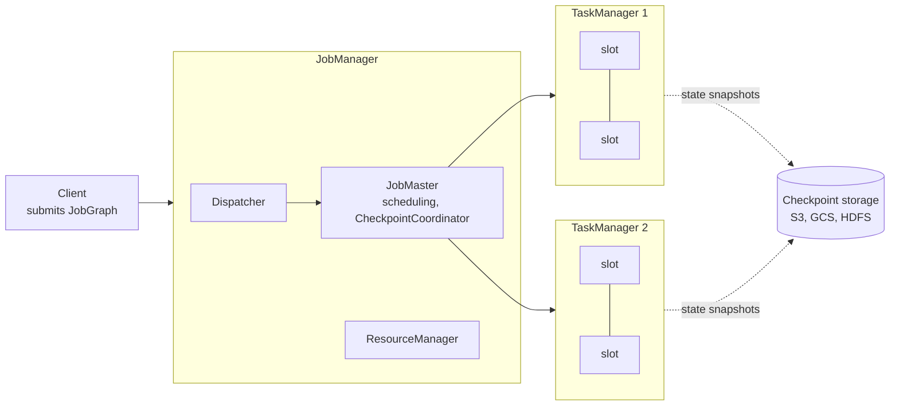

# Apache Flink

Apache Flink is an open-source, distributed engine for stateful computation over unbounded and bounded data streams. It processes events one at a time with low latency, keeps large keyed state that survives failures, and treats batch as a stream that happens to end. It is the reference engine in [[concepts/data_engineering/stateful_vs_stateless_stream_processing|Stateful vs. Stateless Stream Processing]].

## Why It Matters

Most streaming problems that matter commercially are stateful: fraud counts per card, sessionization, joins between streams, deduplication, and continuously maintained aggregates. Doing these correctly needs three things together, and Flink was designed around all three from the start:

- **Per-event processing** rather than micro-batches, so latency is milliseconds rather than the batch interval that bounds [[concepts/data_engineering/spark/apache_spark|Apache Spark]]'s Structured Streaming.
- **Managed state with consistent snapshots**, so that after a crash the job resumes as if the failure had not happened. The mechanism is described in [[concepts/data_engineering/flink/chandy_lamport_algorithm|Chandy-Lamport Algorithm in Apache Flink]].
- **Event-time semantics**, so results depend on when events happened rather than when they arrived, with watermarks to decide when a window is complete.

Flink began as the Stratosphere research project in Berlin and became a top-level Apache project in 2014.

## Architecture

The diagram shows a JobManager that schedules work into TaskManager slots and coordinates checkpoints, while TaskManagers write their state snapshots to durable storage.

| Component | Role |
| --- | --- |
| **JobManager** | The coordinator. Its JobMaster turns a job into an execution graph, schedules tasks, and runs the checkpoint coordinator; its ResourceManager acquires TaskManager slots |
| **TaskManager** | A worker JVM that runs tasks in a fixed number of **task slots**, exchanges data with other TaskManagers over the network, and holds local state |
| **Task / subtask** | One parallel instance of an operator (or a chain of operators) running in a slot |
| **Checkpoint storage** | A durable filesystem or object store where state snapshots are written |

A program becomes a dataflow graph of **operators** connected by **streams**. Each operator runs at some **parallelism**, and consecutive operators with the same parallelism and no re-partitioning are **chained** into one task, avoiding serialization between them. `keyBy` re-partitions the stream by key, so every record with the same key reaches the same subtask and its state.

### Deployment

Flink runs standalone, on YARN, or on [[concepts/devops/kubernetes/kubernetes|Kubernetes]], either natively or through the Flink Kubernetes Operator. In **application mode** each job gets its own cluster, which isolates jobs. In **session mode** several jobs share a long-running cluster, which starts faster but lets one job's failure or load affect the others. Managed offerings run Flink as a service on most clouds.

## APIs

| API | Level | Use for |
| --- | --- | --- |
| **Flink SQL / Table API** | Declarative | Filters, joins, windowed aggregations, and CDC pipelines expressed as SQL over dynamic tables |
| **DataStream API** | Programmatic (Java, Python) | Custom logic, explicit state, side outputs, and fine control over time |
| **ProcessFunction** | Lowest | Direct access to keyed state, timers, and the event-time clock for each record |

The levels interoperate: a job can start in SQL and drop to the DataStream API for one complex step. Flink 2.0 removed the legacy DataSet batch API and the Scala API. Batch jobs use the same DataStream and Table APIs with bounded sources.

## State and Fault Tolerance

State is either **keyed** (one value per key, such as `ValueState` or `MapState`) or **operator** state (one value per parallel instance, such as source offsets). A **state backend** decides where it lives:

- **`HashMapStateBackend`** keeps state as objects on the JVM heap. It is fast, but state size is bounded by memory and garbage-collection pauses grow with it.
- **`EmbeddedRocksDBStateBackend`** keeps state in local RocksDB, an LSM-tree store, and supports state far larger than memory plus **incremental checkpoints** that upload only changed files.
- **Disaggregated state** (ForSt, introduced in Flink 2.0) keeps state primarily in remote object storage with a local cache, aimed at very large state and fast rescaling.

Every checkpoint interval, Flink takes a consistent snapshot of all operator state together with every source's read position. On failure it restores the last completed snapshot and rewinds the sources, which gives **exactly-once effect on state**. End-to-end exactly-once also needs a replayable source such as [[concepts/data_engineering/kafka/apache_kafka|Apache Kafka]] and a transactional or idempotent sink. The snapshot algorithm, aligned and unaligned barriers, and the difference between checkpoints and savepoints are in [[concepts/data_engineering/flink/chandy_lamport_algorithm|Chandy-Lamport Algorithm in Apache Flink]].

> [!warning] Give every stateful operator a stable `uid`
> Savepoint state is mapped to operators by ID. Without an explicit `.uid("…")`, Flink generates one from the graph's shape, so a refactor that adds or reorders operators can leave state unreadable on restore.

## Time and Windows

- **Event time** is the timestamp inside the record. **Processing time** is the wall clock of the machine.
- **Watermarks** are markers in the stream asserting that no event older than time *t* is still expected. A window closes when the watermark passes its end, and lateness beyond that is dropped, sent to a side output, or allowed within a configured grace.
- **Windows** come in tumbling, sliding, session, and global types. **Timers** let a `ProcessFunction` schedule a callback per key at an event-time or processing-time instant.

The [[concepts/data_engineering/stateful_vs_stateless_stream_processing#Time, Windows, and Watermarks|Time, Windows, and Watermarks]] section of the stateful-processing note covers these trade-offs in depth.

## Connectors and Ecosystem

- **Sources and sinks:** Kafka, Kinesis, Pulsar, files and object storage, JDBC, Elasticsearch, and lakehouse tables such as Iceberg, Paimon, and Delta.
- **Flink CDC** reads database change logs (MySQL, PostgreSQL, and others) as streams, for replication and real-time ingestion.
- **Apache Paimon** began as Flink Table Store, a streaming lakehouse table format designed for Flink's update-heavy workloads.

## Operating Concerns

- **Backpressure.** Flink uses credit-based flow control: a slow operator stops granting buffers upstream, so the whole pipeline slows to its pace rather than dropping data. Persistent backpressure delays aligned checkpoints and is the first thing to look for when they slow down.
- **Checkpoint health.** Duration, size, and alignment time are the key signals. A checkpoint duration approaching the interval means the job is spending its time snapshotting. The [[concepts/devops/observers|Observers]] note covers the monitoring practice.
- **Max parallelism.** Keys are hashed into a fixed number of key groups, set by max parallelism, and that number caps how far the job can ever scale. It cannot be changed later without losing compatibility with existing state.
- **State growth.** Unbounded keyed state needs a TTL or a window end, or it grows until checkpoints and disks fail.

## When to Choose Flink

- **Choose Flink** for low per-event latency, large state, complex event-time logic, stream-to-stream joins, or many different sources and sinks.
- **Prefer Kafka Streams** when everything is in Kafka and the team wants a library embedded in its own service rather than a cluster to operate.
- **Prefer Spark** when the workload is mostly batch, seconds of latency are acceptable, and the team already runs Spark.

## Related Concepts

- [[concepts/data_engineering/flink/chandy_lamport_algorithm|Chandy-Lamport Algorithm in Apache Flink]] — how Flink's checkpoints achieve a consistent snapshot of a running dataflow without stopping it
- [[concepts/data_engineering/stateful_vs_stateless_stream_processing|Stateful vs. Stateless Stream Processing]] — the vendor-neutral model of state, partitioning, watermarks, and delivery semantics, with Flink compared against Kafka Streams and Spark
- [[concepts/data_engineering/kafka/apache_kafka|Apache Kafka]] — Flink's most common source and sink, whose replayable offsets make checkpoint-and-rewind recovery possible
- [[concepts/data_engineering/spark/apache_spark|Apache Spark]] — the micro-batch alternative and its latency floor
- [[concepts/data_structures/lsm_tree|Log-Structured Merge-Tree (LSM Tree)]] — the structure inside RocksDB, and so the performance profile of large Flink state
- [[concepts/devops/kubernetes/kubernetes|Kubernetes]] — the most common deployment target, through native integration or the Flink Kubernetes Operator

## References

- [Apache Flink documentation](https://nightlies.apache.org/flink/flink-docs-stable/)
