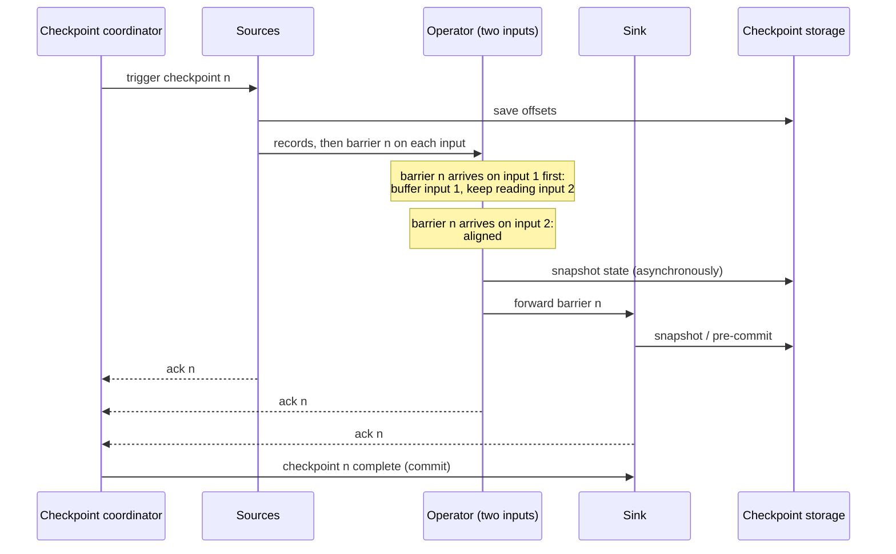

# Asynchronous Barrier Snapshotting (ABS)

Asynchronous Barrier Snapshotting is the algorithm [[concepts/data_engineering/flink/apache_flink|Apache Flink]] uses to take consistent checkpoints of a running distributed dataflow without stopping it. It adapts the [[concepts/data_engineering/flink/chandy_lamport_algorithm|Chandy-Lamport Algorithm]]: checkpoint barriers flow through the stream with the records, and each operator saves its state when a barrier has passed through it.

## Why It Matters

A streaming job needs a saved state to resume from after a crash, and that state must be a **consistent cut**: if it includes the effect of a record, it also includes the source having read it. Pausing every operator to save state at once would stall the stream, and the original Chandy-Lamport algorithm records in-flight messages on every channel, which in a high-throughput dataflow can be large. ABS gets a consistent cut while the job keeps running, and in an acyclic job it saves only operator state, not channel contents.

## Origin

P. Carbone, G. Fóra, S. Ewen, S. Haridi, and K. Tzoumas described ABS in 2015 in "Lightweight Asynchronous Snapshots for Distributed Dataflows". They implemented it on Apache Flink and contributed it to give Flink's streaming runtime exactly-once processing. In the paper's words, ABS "persists only operator states on acyclic execution topologies while keeping a minimal record log on cyclic dataflows": alignment removes the need to record channel state in acyclic graphs, and cyclic graphs record only the records in transit on their back-edges.

The evaluation compared ABS with the globally synchronised snapshotting used by Naiad, reimplemented on Flink for a like-for-like test, and with a baseline that had no fault tolerance. ABS had a much lower impact on runtime than synchronous snapshotting, and scaled linearly with the baseline on clusters of up to 40 nodes.

## Mapping From Chandy-Lamport

Markers become **checkpoint barriers**, numbered by checkpoint ID, and ABS takes advantage of the fact that a streaming job is usually an acyclic dataflow.

| Chandy-Lamport | Flink |
| --- | --- |
| Any process can initiate | The JobManager's checkpoint coordinator triggers checkpoint *n* at every source |
| Process state | Each operator's keyed and operator state, plus each source's read position (for example Kafka offsets) |
| Marker | Checkpoint barrier *n*, injected into the stream by each source |
| Recording channel state | Not needed in an acyclic graph with **alignment**; recorded as in-flight data in **unaligned** checkpoints |
| Snapshot complete when all markers are received | Checkpoint *n* is complete when every task has acknowledged it to the coordinator |
| FIFO channels | Flink's network channels preserve order between two subtasks |

## Aligned Checkpoints



The sequence shows barrier *n* travelling from the sources through an operator to the sink, each saving its state in turn, and the coordinator declaring checkpoint *n* complete once all have acknowledged.

1. **Sources** record their read positions and emit barrier *n* into every output stream, between the last record before the checkpoint and the first after it.
2. An operator with several inputs **aligns**. When barrier *n* arrives on one input, the operator stops processing that input and buffers its records, because they belong *after* the cut. It keeps processing the inputs where the barrier has not yet arrived.
3. Once barrier *n* has arrived on **all** inputs, the operator's state reflects exactly the records before the cut. It snapshots its state, forwards barrier *n* on all outputs, and resumes processing its buffered records.
4. **Sinks** snapshot or pre-commit when the barrier reaches them, then acknowledge.
5. When every task has acknowledged, the coordinator marks checkpoint *n* complete and notifies the tasks. Transactional sinks commit at this point, which is how Flink's two-phase-commit sinks give end-to-end exactly-once.

> [!important] Alignment is what removes channel state
> By waiting until a barrier has arrived on every input, an operator ensures that no record before the cut is still in flight on its input channels. In an acyclic graph, channel state is therefore always empty and never needs to be recorded. The cost is that buffered inputs stall while alignment waits for the slowest input.

## Asynchronous Snapshots

"Asynchronous" refers to how the state is written, not to the barriers. At the barrier the operator takes only a quick local snapshot: a copy-on-write view of heap state, or a RocksDB checkpoint of immutable SST files. It then continues processing while a background thread uploads that snapshot to durable storage. With RocksDB, **incremental checkpoints** upload only the files created since the last checkpoint.

## Unaligned Checkpoints

Under backpressure, barriers queue behind buffered records, so alignment can take minutes and checkpoints time out exactly when the job is struggling. **Unaligned checkpoints**, added in Flink 1.11, let barrier *n* overtake the in-flight buffers. The operator snapshots immediately and also stores the records that were in its input and output buffers as part of the checkpoint.

This is the original Chandy-Lamport idea returning: channel state is recorded instead of being drained. Checkpoints finish quickly regardless of backpressure, at the cost of larger checkpoints that include in-flight data. An aligned checkpoint can also be configured to switch to unaligned after an alignment timeout.

## Cycles

Alignment can never complete on a cycle, because the barrier would have to wait for itself on the feedback edge. For cyclic dataflows, such as iterations with feedback edges, ABS records the records arriving on the back-edges as channel state, as Chandy-Lamport does, and aligns on all other inputs.

## Delivery Modes

| Mode | Alignment | Result after recovery |
| --- | --- | --- |
| **Exactly-once** (default) | Aligned or unaligned | Each record affects state exactly once |
| **At-least-once** | None; post-barrier records are processed immediately | Records processed between barriers on different inputs are counted again on replay; lower latency, no alignment stalls |

Either mode gives exactly-once *state*, not exactly-once *output*. Output is exactly-once only with a transactional sink that commits on checkpoint completion, or an [[concepts/software_architecture/idempotency|idempotent]] sink whose replayed writes overwrite themselves.

## Recovery

When a task fails, Flink restarts the affected tasks, either the whole job or a pipelined region of it. Each task restores its state from the latest **completed** checkpoint, and every source rewinds to the offset recorded in that checkpoint. Records after the cut are then reprocessed. This only works if the source can replay them, which is why a durable log such as [[concepts/data_engineering/kafka/apache_kafka|Apache Kafka]] is the usual source.

## Checkpoints vs. Savepoints

| | Checkpoint | Savepoint |
| --- | --- | --- |
| Triggered by | Flink, every interval | A user or operator, on demand |
| Purpose | Automatic failure recovery | Upgrades, rescaling, migrating clusters, A/B tests |
| Format | May be incremental and backend-specific | Self-contained and portable (canonical format by default) |
| Lifetime | Old ones are deleted automatically, unless retained | Kept until the user deletes it |

Both use the same barrier mechanism. A savepoint is a checkpoint taken on purpose, in a format designed to outlive the job that produced it.

## Configuration

```java
StreamExecutionEnvironment env = StreamExecutionEnvironment.getExecutionEnvironment();
env.enableCheckpointing(60_000, CheckpointingMode.EXACTLY_ONCE);   // every 60 s

CheckpointConfig cfg = env.getCheckpointConfig();
cfg.setMinPauseBetweenCheckpoints(30_000);   // let processing catch up between checkpoints
cfg.setCheckpointTimeout(600_000);           // abandon a checkpoint after 10 min
cfg.setMaxConcurrentCheckpoints(1);
cfg.enableUnalignedCheckpoints();            // keep checkpoints fast under backpressure
cfg.setTolerableCheckpointFailureNumber(3);  // fail the job only after repeated failures
```

> [!tip] Size the interval from the sink, not only from recovery
> A transactional sink makes output visible only when a checkpoint completes, so the checkpoint interval is also the output latency. A one-minute interval means consumers see results in one-minute steps.

## Related Concepts

- [[concepts/data_engineering/flink/chandy_lamport_algorithm|Chandy-Lamport Algorithm]] — the 1985 snapshot algorithm ABS adapts, and why a consistent cut is needed at all
- [[concepts/data_engineering/flink/apache_flink|Apache Flink]] — the engine: architecture, APIs, state backends, and where checkpointing fits operationally
- [[concepts/data_engineering/stateful_vs_stateless_stream_processing|Stateful vs. Stateless Stream Processing]] — how Kafka Streams and Spark achieve the same guarantee differently
- [[concepts/data_engineering/kafka/apache_kafka|Apache Kafka]] — the replayable source whose offsets are the "source state" in each snapshot, and the transactional sink that commits on checkpoint completion
- [[concepts/software_architecture/exactly_once_delivery_and_processing|Exactly-Once Delivery and Processing]] — the general guarantee Flink's delivery modes are an instance of, and why it holds only inside a boundary
- [[concepts/software_architecture/idempotency|Idempotency]] — the alternative to transactional sinks for turning exactly-once state into exactly-once output

## References

- P. Carbone, G. Fóra, S. Ewen, S. Haridi, and K. Tzoumas, "Lightweight Asynchronous Snapshots for Distributed Dataflows," arXiv:1506.08603, 2015.
- [Apache Flink: Stateful Stream Processing](https://nightlies.apache.org/flink/flink-docs-stable/docs/concepts/stateful-stream-processing/) — barriers, alignment, and unaligned checkpoints
