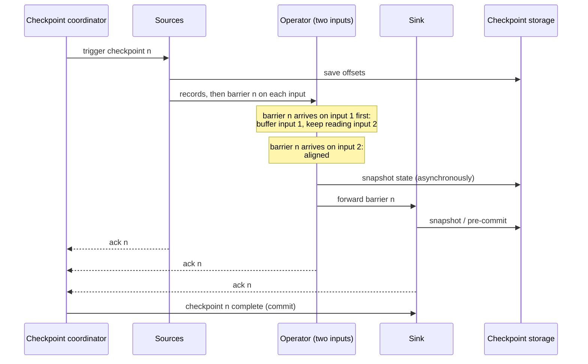

# Chandy-Lamport Algorithm in Apache Flink

The Chandy-Lamport algorithm records a consistent global snapshot of a distributed system, meaning every process's state plus the messages in flight, without stopping it. Marker messages flow along the same channels as the data. [[concepts/data_engineering/flink/apache_flink|Apache Flink]] adapts it as *asynchronous barrier snapshotting*, the mechanism behind its checkpoints and exactly-once state.

## Why It Matters

A streaming job is many parallel operators exchanging records over the network, each holding state. To recover from a crash, the job needs a saved state from which it can resume as if nothing had failed. Saving each operator's state at "the same time" is impossible without a global clock, and pausing the whole job to save it would stall the stream.

The danger of an inconsistent snapshot is concrete. Say an operator's count is saved *after* it processed a record, but the source's offset is saved *before* that record was read. On recovery the record is replayed and counted twice. The snapshot has to be a **consistent cut**: if it includes the effect of a record, it also includes that record having been sent. Chandy-Lamport produces such a cut while the system keeps running.

## The Original Algorithm

K. Mani Chandy and Leslie Lamport published the algorithm in 1985. It assumes processes connected by reliable, **FIFO** channels, so that messages on one channel arrive in order and none are lost.

1. **Initiate.** Any process records its own state, then sends a **marker** on every outgoing channel before sending anything else.
2. **First marker received.** When a process receives a marker on channel *c* and has not yet recorded its state, it records its state, records *c* as empty, and sends markers on all of its outgoing channels. It then starts recording the messages that arrive on each of its *other* incoming channels.
3. **Later markers.** When a marker arrives on a channel the process is still recording, it stops recording that channel. The channel's state is the list of messages that arrived on it between the process's own state record and this marker.
4. **Terminate.** The snapshot is complete when every process has received a marker on every incoming channel.

Because channels are FIFO, a marker separates the messages a channel carried *before* the sender's snapshot from those it carried *after*. Every message is therefore either already reflected in the receiver's recorded state, recorded as in flight on the channel, or entirely after the cut. The global state that results may never have existed at any single instant, but it is consistent, and the real execution could have passed through it.

## How Flink Adapts It

Flink's version was described by Carbone et al. in 2015 as **Asynchronous Barrier Snapshotting (ABS)**. Markers become **checkpoint barriers**, numbered by checkpoint ID, and Flink takes advantage of the fact that a streaming job is usually an acyclic dataflow.

| Chandy-Lamport | Flink |
| --- | --- |
| Any process can initiate | The JobManager's checkpoint coordinator triggers checkpoint *n* at every source |
| Process state | Each operator's keyed and operator state, plus each source's read position (for example Kafka offsets) |
| Marker | Checkpoint barrier *n*, injected into the stream by each source |
| Recording channel state | Not needed in an acyclic graph with **alignment**; recorded as in-flight data in **unaligned** checkpoints |
| Snapshot complete when all markers are received | Checkpoint *n* is complete when every task has acknowledged it to the coordinator |
| FIFO channels | Flink's network channels preserve order between two subtasks |

### Aligned checkpoints



The sequence shows barrier *n* travelling from the sources through an operator to the sink, each saving its state in turn, and the coordinator declaring checkpoint *n* complete once all have acknowledged.

1. **Sources** record their read positions and emit barrier *n* into every output stream, between the last record before the checkpoint and the first after it.
2. An operator with several inputs **aligns**. When barrier *n* arrives on one input, the operator stops processing that input and buffers its records, because they belong *after* the cut. It keeps processing the inputs where the barrier has not yet arrived.
3. Once barrier *n* has arrived on **all** inputs, the operator's state reflects exactly the records before the cut. It snapshots its state, forwards barrier *n* on all outputs, and resumes processing its buffered records.
4. **Sinks** snapshot or pre-commit when the barrier reaches them, then acknowledge.
5. When every task has acknowledged, the coordinator marks checkpoint *n* complete and notifies the tasks. Transactional sinks commit at this point, which is how Flink's two-phase-commit sinks give end-to-end exactly-once.

Alignment is the key change from the original. By waiting until a barrier has arrived on every input, an operator ensures that no record before the cut is still in flight on its input channels. In an acyclic graph, that means channel state is always empty and never needs to be recorded. The cost is that buffered inputs stall while alignment waits for the slowest input.

### Asynchronous snapshots

"Asynchronous" refers to how the state is written, not to the barriers. At the barrier the operator takes only a quick local snapshot: a copy-on-write view of heap state, or a RocksDB checkpoint of immutable SST files. It then continues processing while a background thread uploads that snapshot to durable storage. With RocksDB, **incremental checkpoints** upload only the files created since the last checkpoint.

### Unaligned checkpoints

Under backpressure, barriers queue behind buffered records, so alignment can take minutes and checkpoints time out exactly when the job is struggling. **Unaligned checkpoints**, added in Flink 1.11, let barrier *n* overtake the in-flight buffers. The operator snapshots immediately and also stores the records that were in its input and output buffers as part of the checkpoint.

This is the original Chandy-Lamport idea returning: channel state is recorded instead of being drained. Checkpoints finish quickly regardless of backpressure, at the cost of larger checkpoints that include in-flight data. An aligned checkpoint can also be configured to switch to unaligned after an alignment timeout.

### Cycles

The original algorithm handles arbitrary graphs. The ABS design extends to cyclic dataflows, such as iterations with feedback edges, by recording the records on the back-edges as channel state, as Chandy-Lamport does, since alignment can never complete on a cycle.

## Delivery Modes

| Mode | Alignment | Result after recovery |
| --- | --- | --- |
| **Exactly-once** (default) | Aligned or unaligned | Each record affects state exactly once |
| **At-least-once** | None; post-barrier records are processed immediately | Records processed between barriers on different inputs are counted again on replay; lower latency, no alignment stalls |

Either mode gives exactly-once *state*, not exactly-once *output*. Output is exactly-once only with a transactional sink that commits on checkpoint completion, or an idempotent sink whose replayed writes overwrite themselves.

## Recovery

When a task fails, Flink restarts the affected tasks, either the whole job or a pipelined region of it. Each task restores its state from the latest **completed** checkpoint, and every source rewinds to the offset recorded in that checkpoint. Records after the cut are then reprocessed. This only works if the source can replay them, which is why a durable log such as [[concepts/data_engineering/kafka/apache_kafka|Apache Kafka]] is the usual source.

## Checkpoints vs. Savepoints

| | Checkpoint | Savepoint |
| --- | --- | --- |
| Triggered by | Flink, every interval | A user or operator, on demand |
| Purpose | Automatic failure recovery | Upgrades, rescaling, migrating clusters, A/B tests |
| Format | May be incremental and backend-specific | Self-contained and portable (canonical format by default) |
| Lifetime | Old ones are deleted automatically, unless retained | Kept until the user deletes it |

Both use the same barrier mechanism. A savepoint is a checkpoint taken on purpose, in a format designed to outlive the job that produced it.

## Configuration

```java
StreamExecutionEnvironment env = StreamExecutionEnvironment.getExecutionEnvironment();
env.enableCheckpointing(60_000, CheckpointingMode.EXACTLY_ONCE);   // every 60 s

CheckpointConfig cfg = env.getCheckpointConfig();
cfg.setMinPauseBetweenCheckpoints(30_000);   // let processing catch up between checkpoints
cfg.setCheckpointTimeout(600_000);           // abandon a checkpoint after 10 min
cfg.setMaxConcurrentCheckpoints(1);
cfg.enableUnalignedCheckpoints();            // keep checkpoints fast under backpressure
cfg.setTolerableCheckpointFailureNumber(3);  // fail the job only after repeated failures
```

> [!tip] Size the interval from the sink, not only from recovery
> A transactional sink makes output visible only when a checkpoint completes, so the checkpoint interval is also the output latency. A one-minute interval means consumers see results in one-minute steps.

## Related Concepts

- [[concepts/data_engineering/flink/apache_flink|Apache Flink]] — the engine: architecture, APIs, state backends, and where checkpointing fits operationally
- [[concepts/data_engineering/stateful_vs_stateless_stream_processing|Stateful vs. Stateless Stream Processing]] — why consistent snapshots are needed at all, and how Kafka Streams and Spark achieve the same guarantee differently
- [[concepts/data_engineering/kafka/apache_kafka|Apache Kafka]] — the replayable source whose offsets are the "source state" in each snapshot, and the transactional sink that commits on checkpoint completion
- [[concepts/software_architecture/idempotency|Idempotency]] — the alternative to transactional sinks for turning exactly-once state into exactly-once output
- [[concepts/databases/write_ahead_log|Write-Ahead Log (WAL)]] — the contrasting recovery approach of logging every change, which Spark's offset log uses instead of a distributed snapshot
- [[concepts/databases/distributed_consensus|Distributed Consensus]] — another foundational distributed-systems problem: agreeing on a value, as opposed to observing a consistent global state

## References

- K. M. Chandy and L. Lamport, "Distributed Snapshots: Determining Global States of Distributed Systems," *ACM Transactions on Computer Systems*, 1985.
- P. Carbone et al., "Lightweight Asynchronous Snapshots for Distributed Dataflows," arXiv:1506.08603, 2015.
- [Apache Flink: Stateful Stream Processing](https://nightlies.apache.org/flink/flink-docs-stable/docs/concepts/stateful-stream-processing/) — barriers, alignment, and unaligned checkpoints
