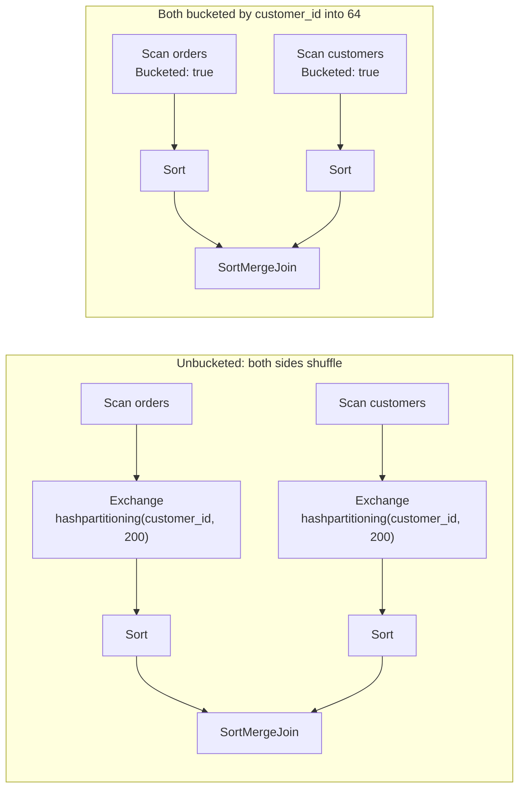

# Spark Partitioning and Bucketing

Partitioning and bucketing are the two write-time techniques [[concepts/data_engineering/spark/apache_spark|Apache Spark]] offers for laying a table out in storage so that later reads do less work. **Partitioning** (`partitionBy`, `PARTITIONED BY`) writes one directory per distinct value of a low-cardinality column, so a filter on that column skips whole directories. **Bucketing** (`bucketBy`, `CLUSTERED BY … INTO n BUCKETS`) hashes rows on a column into a fixed number of files, so joins and aggregations on that column can run without a shuffle.

> [!info] Versions
> Configuration keys, defaults, and "since" versions below are from the Spark 4.3 documentation. Older releases may lack a key or use a different default.

## Why It Matters

- **Layout is paid for once and collected on every read.** The shuffle is Spark's cost model (see [[concepts/data_engineering/spark/apache_spark#The Execution Model|the execution model]]). Partitioning cuts the bytes a scan reads; bucketing removes the shuffle a join or aggregation would otherwise need. Both move work from every query into the one write.
- **They solve different problems.** Partitioning optimizes filters on columns with few values; bucketing optimizes joins and aggregations on columns with many. Spark's docs draw the line at cardinality: partitioning "has limited applicability to columns with high cardinality", while `bucketBy` "can be used when the number of unique values is unbounded".
- **Mistakes are expensive to undo.** Both are fixed at write time. Changing a partition column or a bucket count means rewriting the table, and a bad choice (too many partitions, a skewed bucket key) slows every query until then.
- **The defaults are dangerous.** Static overwrite mode deletes partitions a write did not touch, and an unshaped write produces one file per task per partition value. These two are behind most production incidents with partitioned tables.

## Three Meanings of "Partition"

"Partition" names three different things in Spark, and conflating them is the usual source of confusion. Bucketing adds a fourth layout unit:

| Term | What it is | Lives | Controlled by |
| --- | --- | --- | --- |
| **In-memory partition** | One chunk of a DataFrame or RDD; one task processes it per stage | Executor memory, for one job | Input splits on read, `repartition`, `coalesce` |
| **Shuffle partition** | One output slice of an `Exchange`, read by the next stage | Shuffle files on executor disks | `spark.sql.shuffle.partitions` (default `200`), then AQE coalescing |
| **Storage partition** | A `column=value` directory of a table | Object storage or HDFS, permanently | `partitionBy` / `PARTITIONED BY` at write |
| **Bucket** | The files whose rows hash to the same bucket number | Inside a table or storage partition, permanently | `bucketBy` / `CLUSTERED BY` at write |

Sizing and skew for the first two are covered in [[concepts/data_engineering/spark/apache_spark#Partitions, Shuffles, and Skew|Apache Spark]]. They matter here because the in-memory partitioning of a DataFrame *at the moment it is written* decides how many files the storage layout ends up with.

## In-Memory Partitioning

### Partitioners

| Call | Scheme | Shuffles | Notes |
| --- | --- | --- | --- |
| `repartition(n)` | Round-robin | Yes | Even sizes, no key locality |
| `repartition(n, cols…)` or `repartition(cols…)` | Hash: `pmod(murmur3(cols), n)` | Yes | Without `n`, uses `spark.sql.shuffle.partitions`; equal keys always share a partition |
| `repartitionByRange(n, cols…)` | Range | Yes | Samples the data to estimate boundaries, so partitions are roughly, not exactly, equal; each holds a contiguous key range |
| `coalesce(n)` | Merges existing partitions | No | Only reduces; it also collapses the parallelism of the preceding stage |

The hash expression behind `repartition(n, cols)` is the same one bucketing uses. That identity is what makes the one-file-per-bucket write technique below work.

SQL exposes the same operations as hints:

| Hint | Effect |
| --- | --- |
| `COALESCE(n)` | Same as `coalesce(n)` |
| `REPARTITION(n, cols)` | Same as `repartition`; takes a number, columns, both, or neither |
| `REPARTITION_BY_RANGE(n, cols)` | Same as `repartitionByRange`; the number is optional |
| `REBALANCE(cols)` | Asks AQE to make output partitions a reasonable size, best-effort by the given columns, splitting skewed ones. Ignored when AQE is off |
| `REBALANCE_BY_SIZE(size, cols)` | `REBALANCE` with an explicit advisory partition size as the first argument |

`REBALANCE` is the hint designed for writes: placed on the query feeding a table insert, it avoids both too-small and too-large output files.

### Read-Side Partitions

On read, Spark packs files into in-memory partitions of at most `spark.sql.files.maxPartitionBytes` (default `128MB`, file-based sources only). It splits large splittable files and combines small ones, charging each file an estimated open cost of 4 MB so that many tiny files do not pile into one task. The storage layout feeds this directly: thousands of small files mean thousands of opens and listing calls for little data.

A bucketed scan is the exception. It creates one read partition per bucket regardless of file sizes, so the bucket count caps the scan's parallelism.

## Storage Partitioning with partitionBy

### Writing a Partitioned Table

```python
(events.write
    .partitionBy("event_date", "country")
    .mode("append")
    .parquet("s3://lake/events"))
```

```sql
CREATE TABLE events (event_id BIGINT, payload STRING, event_date DATE, country STRING)
USING parquet
PARTITIONED BY (event_date, country);
```

Either produces Hive-style `key=value` directories:

```text
s3://lake/events/
├── event_date=2026-11-01/
│   ├── country=US/
│   │   ├── part-00000-<uuid>.c000.snappy.parquet
│   │   └── part-00001-<uuid>.c000.snappy.parquet
│   └── country=VN/
│       └── part-00003-<uuid>.c000.snappy.parquet
└── event_date=2026-11-02/
    └── …
```

- **Argument order is nesting order.** The first column becomes the top-level directory.
- **Partition values live in the path, not the files.** Spark leaves partition columns out of the data files and rebuilds them from directory names on read, appending them to the end of the schema.
- **Nulls get a sentinel directory.** A null partition value is written as `__HIVE_DEFAULT_PARTITION__`.
- **Restrictions.** At least one column must remain a data column. Databricks documents that partition columns cannot be complex types or struct fields.
- **No catalog required.** Partitioning works with both `save` and `saveAsTable`; bucketing works only with `saveAsTable`.

### Partition Discovery on Read

Reading a path makes Spark list the directory tree and turn every `key=value` segment into a column.

- **Types are inferred.** Numeric, date, timestamp, and string partition values are typed automatically. A string column whose values look numeric, such as a postcode, comes back as a number unless `spark.sql.sources.partitionColumnTypeInference.enabled` (default `true`, since 1.5.0) is set to `false`, which reads every partition column as a string, or a schema is supplied.
- **`basePath` anchors discovery.** Reading `s3://lake/events/event_date=2026-11-01` alone does not produce an `event_date` column, because discovery only finds partitions *under* the given path. Setting `.option("basePath", "s3://lake/events")` restores it (since Spark 1.6.0).
- **Listing is the cost.** On object storage, listing tens of thousands of directories can take longer than reading the data. Catalog tables avoid it (below).

### Partition Pruning

**Static pruning.** A filter on a partition column is evaluated against partition values before any file is opened, so non-matching directories are never read. Spark evaluates any deterministic predicate that references only partition columns this way, so `year(event_date) = 2026` still prunes. What defeats pruning is filtering on a *different* column that merely correlates with the partition column. If the table is partitioned by `event_date` but the query filters `event_ts`, every partition is scanned. The fix is to add the redundant `event_date` predicate.

Two filter lists on the scan node are easy to confuse:

- `PartitionFilters` skip whole directories.
- `PushedFilters` are handed to the file reader, which skips row groups using min/max statistics inside the files that are read anyway.

**Dynamic partition pruning (DPP).** When a partitioned fact table is joined on its partition column to a filtered dimension, Spark turns the dimension side's result into a run-time filter on the fact table's partitions. `spark.sql.optimizer.dynamicPartitionPruning.enabled` (default `true`, since 3.0.0) controls it. The canonical case is a star schema:

```sql
SELECT f.amount
FROM sales f                         -- partitioned by date_key
JOIN dim_date d ON f.date_key = d.date_key
WHERE d.fiscal_quarter = '2026-Q3';  -- no direct filter on sales
```

Without DPP every `sales` partition is read and joined. With it, only the dates in the quarter are read. The plan shows a `dynamicpruningexpression(…)` inside the fact scan's `PartitionFilters`.

### Catalog-Managed Partitions

Since Spark 2.1, persistent datasource tables store per-partition metadata in the Hive metastore. The metastore returns only the partitions a query needs, so the first query no longer pays for full discovery, and Hive DDL such as `ALTER TABLE … PARTITION … SET LOCATION` works.

| Setting or command | Purpose |
| --- | --- |
| `spark.sql.hive.manageFilesourcePartitions` (default `true`, since 2.1.1) | Enables metastore partition management for file-source tables |
| `spark.sql.hive.metastorePartitionPruning` (default `true`, since 1.5.0) | Pushes some predicates into the metastore so non-matching partitions are eliminated before Spark sees them |
| `MSCK REPAIR TABLE t` | Syncs the metastore with directories on disk. Needed for external tables (created with a `path`), whose partitions are not gathered by default, and after files land outside Spark |
| `ALTER TABLE t ADD PARTITION (…)` / `DROP PARTITION (…)` | Registers or removes one partition explicitly |
| `SHOW PARTITIONS t` | Lists the partitions the catalog knows about |

> [!warning] Files written outside Spark are invisible to a catalog table
> A catalog-managed table answers from the metastore, not from a listing. Directories added by another tool stay unread until `MSCK REPAIR TABLE` or `ADD PARTITION` registers them.

### Overwriting Partitions

`spark.sql.sources.partitionOverwriteMode` governs `INSERT OVERWRITE` and overwrite-mode writes on partitioned datasource tables. It was added in 2.3.0 and defaults to ==`STATIC`==.

- **`STATIC`** deletes every partition that matches the write's partition spec *before* writing. With no static values in the spec, that is every partition.
- **`DYNAMIC`** deletes only the partitions that actually receive data.
- Hive SerDe tables always behave dynamically. The per-write `partitionOverwriteMode` option takes precedence over the session setting.

> [!warning] A daily backfill in static mode wipes the table
> Overwriting one day's data with `mode("overwrite").partitionBy("event_date")` under the default `STATIC` mode deletes every other date first. Set `partitionOverwriteMode` to `dynamic` for any job that rewrites a subset of partitions.

```python
(daily.write
    .mode("overwrite")
    .option("partitionOverwriteMode", "dynamic")
    .partitionBy("event_date")
    .parquet("s3://lake/events"))
```

For a catalog table, use `insertInto` or SQL `INSERT OVERWRITE`. `saveAsTable` in overwrite mode drops and recreates the whole table instead. `insertInto` also matches columns by position, not by name.

```sql
-- Static spec: replaces exactly one partition
INSERT OVERWRITE TABLE events PARTITION (event_date = DATE'2026-11-01', country = 'US')
SELECT event_id, payload FROM staging_events WHERE country = 'US';

-- Dynamic spec: partition values come from the trailing SELECT columns
INSERT OVERWRITE TABLE events PARTITION (event_date, country)
SELECT event_id, payload, event_date, country FROM staging_events;
```

On plain Parquet or ORC, an overwrite is a delete followed by a write with no transaction around it, so a job that fails midway leaves partitions missing. Table formats with a transaction log (Delta, Iceberg, Hudi) make the swap atomic; see [[concepts/databases/acid|ACID]].

### Files per Partition and the Small-File Problem

Each write task opens one file for every partition value present in its rows:

$$\text{files written} \le \text{write tasks} \times \text{partition values per task}$$

A year of daily data spread across the default 200 shuffle partitions can therefore produce up to 200 × 365 = 73,000 files, most of them tiny. The fixes trade file count against file size and write parallelism:

| Technique | Effect | Cost |
| --- | --- | --- |
| `repartition("event_date")` before the write | Each date lands in one task, so one file per date | A large date becomes one huge file and a straggler task |
| `repartition(n, "event_date", salt)` with `salt = (rand() * k).cast("int")` | Up to `k` files per date, written in parallel | `k` must suit the data volume per date |
| `maxRecordsPerFile` write option, or `spark.sql.files.maxRecordsPerFile` (default `0`, unlimited, since 2.2.0) | Caps rows per file, splitting oversized ones | Never merges small files |
| `REBALANCE(event_date)` hint | AQE sizes the output partitions and splits skewed ones | Best-effort; ignored without AQE |
| Compaction after the write (`OPTIMIZE` on Delta) | Merges small files | A second job |

> [!warning] `coalesce(1)` before a partitioned write
> It pushes the whole write, and often the stage before it, onto a single task. It produces one file per partition, but slowly and with out-of-memory risk. `repartition` on the partition column gets the same file count in parallel.

### Choosing Partition Columns

- **A good partition column** appears in the filters of most queries, has low cardinality, never changes for a given row, and spreads data roughly evenly.
- **A day-grain date column** is the canonical choice. A single `event_date` column handles range filters directly, whereas nested `year`/`month`/`day` columns turn a range crossing a month boundary into a compound predicate.
- **Size thresholds (Databricks guidance for Delta tables).** Most tables under 100 TB don't need partitioning. Don't partition below 1 TB; between 1 TB and 100 TB use liquid clustering instead; at 100 TB and above partitioning may help, but try liquid clustering first. Every partition should hold at least 1 GB.
- **Anti-patterns.**
  - High-cardinality keys (`user_id`, raw timestamps) produce millions of directories.
  - Columns that are rarely filtered add listing cost with no pruning benefit.
  - Stacked partition columns multiply: dates × countries × device types can turn a modest table into hundreds of thousands of tiny partitions.

## Bucketing with bucketBy

### How Rows Are Assigned

Every row is placed in a bucket by hashing its bucket columns:

$$\text{bucket} = \operatorname{pmod}\big(\operatorname{murmur3}(\text{bucket columns}),\ N\big)$$

- **The same hash as `repartition(N, cols)`.** It is Spark's Murmur3 expression with a seed of 42. The same key and the same `N` give the same bucket number in every table, which lets two independently written tables line up bucket by bucket.
- **Not Hive's hash.** Hive buckets with its own hash function, so Hive-bucketed and Spark-bucketed tables are not bucket-compatible with each other.
- **The bucket number is in the file name**, as a suffix such as `part-00000-<uuid>_00007.c000.snappy.parquet` for bucket 7.
- **An upper limit.** `spark.sql.sources.bucketing.maxBuckets` defaults to `100000` (since 2.4.0).

### Writing a Bucketed Table

```python
(orders.write
    .bucketBy(64, "customer_id")
    .sortBy("customer_id")
    .mode("overwrite")
    .saveAsTable("sales.orders_bucketed"))
```

```sql
CREATE TABLE sales.orders_bucketed
USING parquet
CLUSTERED BY (customer_id) SORTED BY (customer_id) INTO 64 BUCKETS
AS SELECT * FROM sales.orders;
```

- **Persistent tables only.** In the docs' words, "bucketing and sorting are applicable only to persistent tables". The bucket spec (columns, count, sort columns) lives in the catalog. `bucketBy` with `save()` or `.parquet(path)` raises an `AnalysisException`, and reading a bucketed table's files by path gives plain, unbucketed files.
- **`SORTED BY` defaults to ascending.** `sortBy` orders rows within each written file, usually on the bucket columns so that a sort-merge join can consume them.
- **Clause order is free.** In `CREATE TABLE … USING`, the clauses between `USING` and `AS SELECT` may appear in any order.

### What Bucketing Buys

- **Shuffle-free joins.** If both sides are bucketed the same way on the join keys, bucket *i* of one table can only match bucket *i* of the other, so Spark joins them directly with no `Exchange`.
- **Shuffle-free aggregation.** A `GROUP BY` or window partitioned on the bucket columns needs no shuffle, because each key is already confined to one bucket.
- **Bucket pruning.** An equality or `IN` filter on the bucket column reads only the matching buckets' files. The scan node reports this as `SelectedBucketsCount: 1 out of 64`.
- **Amortization.** The shuffle is paid once, at write, instead of on every query that joins on the key, which is the whole case for bucketing a table that is joined often.



The two plans for the same join. Bucketing removes both `Exchange` nodes, which are the network and disk cost of the join. The `Sort` nodes usually remain (see *The Sort* below).

### Conditions for a Shuffle-Free Join

The benefit is silent and fragile: if any condition fails, Spark simply shuffles, with no error.

| Condition | Why |
| --- | --- |
| Both sides are bucketed catalog tables, read through the catalog | The bucket spec exists only in the catalog |
| Both are bucketed on the join keys | The scan's partitioning must satisfy the join's required distribution |
| Both have the same bucket count, or coalescing is enabled | Bucket *i* must meet bucket *i*. `spark.sql.bucketing.coalesceBucketsInJoin.enabled` (default `false`, since 3.1.0) merges the side with more buckets down to the other's count when one count divides the other and the ratio is at most `spark.sql.bucketing.coalesceBucketsInJoin.maxBucketRatio` (default `4`). It works for sort-merge and shuffled hash joins, at the cost of parallelism and out-of-memory risk in shuffled hash joins |
| The join keys have identical types on both sides | A cast added to reconcile `INT` and `BIGINT` is a different expression from the bucket column, so the partitioning no longer matches |
| Bucketed reads are enabled and chosen | `spark.sql.sources.bucketing.enabled` (default `true`, since 2.0.0) treats bucketed tables as plain when off. `spark.sql.sources.bucketing.autoBucketedScan.enabled` (default `true`, since 3.1.0) skips the bucketed scan when no join or aggregation can use it, or when an exchange sits between them and the scan |
| The join is not broadcast | A side under `spark.sql.autoBroadcastJoinThreshold` (default `10MB`) is broadcast instead. There is no shuffle either way, so bucketing is moot |

When the bucketed scan is not used, the scan node says why: `Bucketed: false (bucket column(s) not read)`, `(disabled by configuration)`, or `(disabled by query planner)`.

### Files per Bucket

Each write task writes one file for every bucket present in its rows, so an unshaped write produces up to *tasks × N* files per table, or per storage partition. With 200 tasks and 64 buckets that is 12,800 files.

> [!tip] One file per bucket
> Call `repartition(64, "customer_id")` immediately before `bucketBy(64, "customer_id")`. Because both use the same hash, each write task then holds exactly one bucket and writes exactly one file for it: 64 files in total, or 64 per storage partition when combined with `partitionBy`.

### The Sort

`sortBy` sorts each *file*. A bucket written by several tasks consists of several files whose concatenation is not sorted, so a sort-merge join on it still inserts a `Sort`. Writing exactly one file per bucket is the precondition for Spark to treat a bucket as already sorted. Whether current releases skip the sort by default even then is not confirmed here; see Open Questions.

### Choosing the Bucket Column and Count

- **Column.** Use the key the table is most often joined or aggregated on. It should have high cardinality and be evenly distributed, and it should be the *same* key, with the same type, in every table it joins.
- **Count.** Choose a count that makes bucket files land in the low hundreds of megabytes, and that is at least the number of cores you want scanning the table, since the scan runs one task per bucket. Tables that join each other should share a count, or use multiples within a ratio of 4 so that coalescing can reconcile them.
- **Growth.** The count is fixed at write. As the table grows each bucket grows with it, and changing the count rewrites this table and, for the join to keep working, every table it joins with.

> [!note] Inference, not from the Spark docs
> AQE's skew-join handling splits oversized *shuffle* partitions. A bucketed join has no shuffle, so a hot key in a bucket column presumably stays one oversized task that AQE cannot split. Bucket on a skewed key only after checking its distribution.

### Limitations

- Only catalog tables written through Spark carry bucketing; tools that read the files directly see plain Parquet or ORC.
- Spark and Hive bucketing schemes are mutually incompatible.
- Delta Lake does not support `bucketBy`; on Delta, liquid clustering and Z-ordering fill the role (below).
- The benefit is lost silently by a type cast, a mismatched count, a path-based read, or a broadcast. Check the plan rather than assuming.

## Partitioning vs. Bucketing

| | Partitioning | Bucketing |
| --- | --- | --- |
| Physical unit | One directory per value | One set of files per hash bucket |
| Number of units | One per distinct value; grows with the data | Fixed `N`, chosen at write |
| Suited column cardinality | Low | High, even unbounded |
| Main read benefit | Static and dynamic partition pruning | Bucket pruning on equality and `IN` |
| Main join benefit | DPP when joining on the partition column | Shuffle-free sort-merge join and aggregation |
| Where the spec lives | Directory names, plus the metastore for catalog tables | The catalog only |
| Write APIs | `partitionBy`, `PARTITIONED BY`; with `save` or `saveAsTable` | `bucketBy` and `sortBy`, `CLUSTERED BY … SORTED BY … INTO N BUCKETS`; `saveAsTable` only |
| Typical column | Event date, region | Customer ID, order ID |
| Classic failure | Over-partitioning, small files, static overwrite | Silent loss of the bucketed plan, skewed key |

The two compose: the docs state "it is possible to use both partitioning and bucketing for a single table". Partition by date so queries prune to a few days, and bucket by the join key so joins within those days skip the shuffle:

```python
(orders.repartition(64, "customer_id")
    .write
    .partitionBy("order_date")
    .bucketBy(64, "customer_id")
    .sortBy("customer_id")
    .saveAsTable("sales.orders_by_day"))
```

Each date directory then holds exactly 64 bucket files.

## Beyond Hive-Style Layout

### Storage-Partitioned Join

Classic bucketing works only for Spark's own bucketed catalog tables. A **storage-partitioned join (SPJ)** generalizes the bucket join to V2 data sources partitioned by functions registered in Spark's `FunctionCatalog`, such as an Iceberg table partitioned by `bucket(8, id)`. The source reports its layout through `SupportsReportPartitioning`, and when both sides' layouts are compatible the plan has no `Exchange` before the join.

| Setting | Default | Since | Purpose |
| --- | --- | --- | --- |
| `spark.sql.sources.v2.bucketing.enabled` | `true` | 3.3.0 | Use the partitioning a compatible V2 source reports to avoid a shuffle |
| `spark.sql.sources.v2.bucketing.pushPartValues.enabled` | `true` | 3.4.0 | Push common partition values to both sides, filling missing ones with empty partitions |
| `spark.sql.requireAllClusterKeysForCoPartition` | `true` | 3.4.0 | Listed among the SPJ settings in the tuning guide |
| `spark.sql.sources.v2.bucketing.partiallyClusteredDistribution.enabled` | `false` | 3.4.0 | Group and replicate the smaller side so a skewed side can be split; needs the two settings above enabled |
| `spark.sql.sources.v2.bucketing.allowJoinKeysSubsetOfPartitionKeys.enabled` | `false` | 4.0.0 | Allow join keys to be a subset of the partition keys. Renamed in 4.3 to `…allowKeysSubsetOfPartitionKeys.enabled`, which also covers aggregates and windows; the old key remains an alias |
| `spark.sql.sources.v2.bucketing.allowCompatibleTransforms.enabled` | `false` | 4.0.0 | Allow compatible but non-identical partition transforms on the two sides |
| `spark.sql.sources.v2.bucketing.shuffle.enabled` | `false` | 4.0.0 | Shuffle only the side that lacks the layout |

Iceberg additionally needs its own `spark.sql.iceberg.planning.preserve-data-grouping` setting for SPJ.

### Table Formats

- **Iceberg hidden partitioning.** The partition spec is a set of transforms (`days(ts)`, `bucket(16, id)`, `truncate(…)`) stored in table metadata. Queries filter the source column and Iceberg maps the filter to partitions, which removes the derived-column pruning trap. The spec can evolve without rewriting old data. With the V2 writer, `df.writeTo(t).partitionedBy(…)` accepts such transforms.
- **Delta Lake and Databricks.** Delta supports `partitionBy` but not bucketing. Databricks recommends liquid clustering for all managed tables, since it works for both low- and high-cardinality columns, and liquid clustering over Z-ordering for new tables. Z-ordering requires `OPTIMIZE`, clusters only within a partition, and cannot be applied to partition columns. Unpartitioned Delta tables get ingestion-time clustering automatically.

## Reading the Physical Plan

`df.explain("formatted")` or the SQL tab of the Spark UI shows whether the layout is being used:

| Plan text | Meaning |
| --- | --- |
| `PartitionFilters: […]` on a `FileScan` | Static partition pruning applied |
| `dynamicpruningexpression(…)` inside `PartitionFilters` | Dynamic partition pruning applied |
| `PushedFilters: […]` | Predicates handed to the file reader for row-group skipping; not directory pruning |
| `Bucketed: true` | A bucketed scan is in use |
| `SelectedBucketsCount: k out of N` | Bucket pruning read only `k` buckets |
| `Exchange hashpartitioning(…)` above a bucketed scan | A shuffle the bucketing failed to remove |

## Common Failure Modes

- **A backfill deletes history:** an overwrite under the default `STATIC` mode.
- **Small-file explosion:** many write tasks × many partition values or buckets, with no `repartition` before the write.
- **Listing dominates the job:** too many partitions on object storage read by path, or a high-cardinality partition column.
- **Pruning doesn't happen:** the filter is on a correlated column rather than the partition column itself.
- **A string partition comes back as a number:** partition type inference on numeric-looking values.
- **New files are invisible:** a catalog table whose new directories were never registered (`MSCK REPAIR TABLE`).
- **The bucketed join still shuffles:** bucket counts differ, key types differ, the table was read by path, or `autoBucketedScan` judged the bucketing useless.
- **One straggler task in a bucketed join:** a skewed bucket key that AQE has no shuffle to split.

## Open Questions & Disagreements

- **Sort elision for single-file buckets is unverified.** The Spark 4.3 configuration page does not document a setting controlling whether a bucketed scan reports its sort order, so whether `sortBy` with one file per bucket removes the `Sort` before a sort-merge join by default in Spark 3.x and 4.x is not confirmed here.
- **One-sided bucketed joins are unverified for V1 tables.** Whether Spark keeps a bucketed side in place and shuffles only the unbucketed side, and under what bucket-count conditions, was not confirmed against the docs. SPJ has an explicit `spark.sql.sources.v2.bucketing.shuffle.enabled` for V2 sources.
- **Join keys as a superset of the bucket columns.** SPJ has explicit subset settings; whether a V1 bucketed join survives when the join uses more keys than the bucket columns is unverified. This note's guidance, to bucket on exactly the join keys, is the conservative reading.
- **AQE and skewed bucketed joins (inference).** The claim that AQE cannot split a skewed bucketed join, because there is no shuffle, is inferred from how skew handling works, not stated in the docs.

## Related Concepts

- [[concepts/data_engineering/spark/apache_spark|Apache Spark]] — the hub. It covers runtime partitions, shuffles, AQE, and skew, which this note's write-time layout is designed to avoid
- [[concepts/data_engineering/databricks/databricks|Databricks]] — where liquid clustering and Z-ordering replace Hive-style partitioning and bucketing for Delta tables
- [[concepts/data_engineering/databricks/delta_merge_performance|Delta MERGE Performance (Low-Shuffle MERGE and Photon)]] — how a MERGE's shuffle scrambles a clustered layout, and why clustering on the merge key reduces the files touched
- [[concepts/data_engineering/dbt/dbt_databricks_adapter|dbt-databricks Adapter]] — exposes `partition_by`, `clustered_by`/`buckets`, and `liquid_clustering` as model configs, so dbt models choose these same layouts declaratively
- [[concepts/databases/acid|ACID (Atomicity, Consistency, Isolation, Durability)]] — why a partition overwrite on plain files can leave a table half-deleted, and what a transaction log adds
- [[concepts/databases/real_time_analytics_database|Real-Time Analytics Database]] — Druid's time-first partitioning and pruning: the same layout idea inside a serving engine
- [[concepts/data_engineering/bigquery_cost_monitoring|BigQuery Usage and Cost Monitoring]] — the warehouse counterpart, where wrapping a partition column in a function defeats pruning and costs money

## References

- [Spark: Generic Load/Save Functions — Bucketing, Sorting and Partitioning](https://spark.apache.org/docs/latest/sql-data-sources-load-save-functions.html)
- [Spark: Parquet Files — Partition Discovery](https://spark.apache.org/docs/latest/sql-data-sources-parquet.html)
- [Spark SQL: CREATE TABLE USING](https://spark.apache.org/docs/latest/sql-ref-syntax-ddl-create-table-datasource.html)
- [Spark: Configuration](https://spark.apache.org/docs/latest/configuration.html)
- [Spark SQL: Performance Tuning — Storage Partition Join and AQE](https://spark.apache.org/docs/latest/sql-performance-tuning.html)
- [Spark SQL: Hints](https://spark.apache.org/docs/latest/sql-ref-syntax-qry-select-hints.html)
- [Spark SQL: Migration Guide](https://spark.apache.org/docs/latest/sql-migration-guide.html)
- [Databricks: When to partition tables](https://docs.databricks.com/aws/en/tables/partitions)
