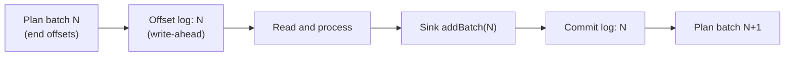

# Graceful Shutdown for Spark Structured Streaming

A graceful shutdown of a Spark Structured Streaming query stops it *between* micro-batches: after the batch in flight has written its output and committed to the checkpoint, and before the next one starts. A restart then resumes with nothing to replay. [[concepts/data_engineering/spark/apache_spark|Apache Spark]] has no built-in way to do this. `StreamingQuery.stop()` cancels the batch in flight, and a JVM shutdown stops the `SparkContext` underneath it, so every correct approach either makes an abrupt stop harmless or builds a batch-boundary stop on top of Spark. The general sequence for draining pods is in [[concepts/devops/kubernetes/graceful_shutdown|Graceful Shutdown for Streaming Pods]]; this note covers what is specific to Spark.

> [!info] Versions
> Behaviour is described as of Spark 4.3 (released 2026-11-04) and the Spark `master` branch on 2026-11-12. A native graceful stop has been requested since 2021 (SPARK-36240, still open), so check for it before building the workarounds below.

## Why It Matters

- **Every change is a stop.** A query meant to run forever is still stopped for each deploy, configuration change, cluster upgrade, node drain, and spot reclaim.
- **An aborted batch is replayed.** The batch in flight is re-run on restart with the same offsets. Whether that is harmless depends on the sink: the Kafka and `foreach` sinks are at-least-once, so a replay writes duplicates. The AWS EMR docs state it directly: interrupting a batch "can result in duplicate processing in subsequent attempts".
- **The stop looks clean.** Spark reports a cancelled batch as an ordinary stop, with status `Stopped` and no exception, so duplicates from a mid-batch stop go unnoticed.
- **A stop can hang.** `stop()` waits indefinitely by default, so a stuck stop holds a pod until the platform kills it.
- **Replays cost time.** On restart, "the micro-batch planned during the previous run processes" (Databricks), at its original size, even if the configuration was changed to shrink it.

## How a Micro-Batch Commits

The checkpoint holds two logs, and their order is what makes recovery work. The order below is read from `MicroBatchExecution.scala`:



1. **Offset log first.** The planned end offsets of batch N are written to the offset log, a [[concepts/databases/write_ahead_log|Write-Ahead Log (WAL)]], *before* any data is processed.
2. **Then the work.** The batch runs, stateful operators write a new state-store version, and the sink receives `addBatch(N, data)`.
3. **Commit log last.** Only after the sink write does Spark append N to the commit log.

On restart, if the offset log holds batch N but the commit log stops at N − 1, Spark re-runs batch N with the recorded offsets against the previous state version. So where a stop lands decides what it costs:

| The stop lands | On restart | Effect on output |
| --- | --- | --- |
| After commit N, before offset log N + 1 | Plans batch N + 1 normally | Clean: the graceful case |
| After offset log N, before the sink write starts | Re-runs N with the same offsets | No duplicates; the batch's work is lost and redone |
| During the sink write | Re-runs N | Partial output, then a full rewrite: duplicates unless the sink is idempotent or transactional |
| After the sink write, before commit N | Re-runs N | A complete duplicate unless the sink is idempotent or transactional |

The Spark guide's guarantee follows from this: "using replayable sources and idempotent sinks, Structured Streaming can ensure **end-to-end exactly-once semantics** under any failure", and recovery works the same "in case of a failure or intentional shutdown". The general model is in [[concepts/data_engineering/stateful_vs_stateless_stream_processing#Fault Tolerance|Stateful vs. Stateless Stream Processing]].

For the real-time trigger, the source moves the offset-log write to the end of the batch, after the sink write; the table above describes the default micro-batch triggers.

## Why It Is Complicated

### `stop()` Cancels; It Does Not Drain

This is the whole body of `stop()` in `MicroBatchExecution.scala` on `master`:

```scala
override def stop(): Unit = {
  // Set the state to TERMINATED so that the batching thread knows that it was interrupted
  // intentionally
  state.set(TERMINATED)
  if (queryExecutionThread.isAlive) {
    sparkSession.sparkContext.cancelJobGroup(runId.toString,
      s"Query $prettyIdString was stopped")
    interruptAndAwaitExecutionThreadTermination()
    // microBatchThread may spawn new jobs, so we need to cancel again to prevent a leak
    sparkSession.sparkContext.cancelJobGroup(runId.toString,
      s"Query $prettyIdString was stopped")
  }
  logInfo(log"Query ${MDC(LogKeys.PRETTY_ID_STRING, prettyIdString)} was stopped")
}
```

It cancels every Spark job of the running batch, interrupts the query's thread, and waits for it to exit. Nothing lets the current batch finish first. Because the state is set to `TERMINATED` before the interrupt, the resulting exceptions are recognised as a deliberate stop and swallowed; SPARK-25472 (fixed in 3.0.0) stopped the job-cancellation error of a deliberate stop from surfacing as a query failure. The query ends with status `Stopped`, whichever row of the table above it landed in. A Databricks engineer summarised the situation in 2025: "There is no built-in Spark or Databricks method to gracefully stop a Structured Streaming query… specifically at the end of the current microbatch."

### `stop()` Can Hang

- **No timeout by default.** `spark.sql.streaming.stopTimeout` (default `0`, since 3.0.0) is "how long to wait in milliseconds for the streaming execution thread to stop", and "0 or negative values wait indefinitely". SPARK-30143 added it because the thread "may block forever depending on the streaming source implementation (like in Kafka, which runs UninterruptibleThreads)".
- **On timeout.** `stop()` throws `java.util.concurrent.TimeoutException`, with the stuck thread's stack trace as its cause. The API docs say "users can retry stopping the stream. If the issue persists, it is advisable to kill the Spark application."
- **Lost interrupts.** SPARK-57963 (fixed in 4.2.0, 4.1.3, and 4.0.4) found that Hadoop's `FileContext.rename()`, used by the checkpoint file manager, cleared the interrupt flag `stop()` relies on, so stops ran into the timeout.

### Telling a Stop From a Failure Is Fragile

Spark decides that an exception "was caused by `stop()`" by matching it against a list: `InterruptedException`, `InterruptedIOException`, `ClosedByInterruptException`, and wrapped or "cancelled"-message variants. SPARK-23440, open since 2018, calls this "a whitelist of exceptions… awkward and probably fragile". PySpark adds another layer. Py4J-wrapped interrupts in `foreachBatch` needed their own fixes (3.3.0 and 4.0.0), and without pinned-thread mode the Python batch function "runs till the end even when `StreamingQuery.stop` is invoked" (PR 36589).

### SIGTERM Stops the SparkContext Under the Query

When a platform sends `SIGTERM` to the driver, the JVM runs its shutdown hooks, and Spark has registered one of its own:

- Spark keeps a private hook manager (`private[spark] object ShutdownHookManager`) and registers it as a single hook with Hadoop's `ShutdownHookManager` at priority `FileSystem.SHUTDOWN_HOOK_PRIORITY + 30`, which the Habr article puts at 40.
- Inside that runner, the `SparkContext` hook runs at priority 50 and calls `stop()`, which fails every active job of the batch in flight.
- A hook added with plain `Runtime.addShutdownHook` runs *concurrently* with Spark's and loses the race. Calling `query.stop()` from one fails with `IllegalStateException` ("Cannot call methods on a stopped SparkContext"), as waitingforcode shows on Spark 3.5.0.
- Nothing in Structured Streaming registers a hook to stop queries first.
- Hadoop gives each hook 30 seconds by default (SPARK-47383). Spark 4.0 added an internal `spark.shutdown.timeout` for its own hook, set as a Java system property.

### The DStreams Setting Does Nothing Here

`spark.streaming.stopGracefullyOnShutdown` (default `false`, since 1.4.0) shuts down "the `StreamingContext` gracefully on JVM shutdown". It belongs to the legacy DStreams API, which the Spark docs call "a legacy project". Only `StreamingContext` reads the key, so setting it has no effect on a Structured Streaming query.

### Platforms Kill Faster Than Batches Finish

| Platform | Gap between `SIGTERM` and the kill |
| --- | --- |
| Kubernetes | `terminationGracePeriodSeconds`, default 30 s |
| YARN | `yarn.nodemanager.sleep-delay-before-sigkill.ms`, default ==250 ms== |
| EMR Serverless | A configurable grace period, default 120 s, range 15–1800 s |
| Hadoop shutdown hooks | 30 s per hook by default, inside whichever window above applies |

A micro-batch that takes minutes cannot finish in any of the defaults. Some kill paths skip the signal altogether: `spark-submit --kill` on Kubernetes deletes the driver pod without calling `stop()` (waitingforcode).

### Check-Then-Act Races

Every "wait for the batch to end, then stop" approach checks first and stops second, and the next trigger can start in between. With the default trigger, the next batch starts "as soon as the previous micro-batch has completed processing", so the window is small. `StreamingQueryStatus.isTriggerActive` and `isDataAvailable` are "always false" in continuous mode, so status-polling does not work there at all. Listener callbacks are asynchronous: the API docs warn "you may find StreamingQuery is terminated when you are processing QueryProgressEvent".

### Consumer-Group Intuition Does Not Apply

The usual consumer drain of committing offsets and leaving the group (see [[concepts/devops/kubernetes/graceful_shutdown#Draining Stream Consumers|Draining Stream Consumers]]) is not how Spark tracks progress. "Structured Streaming manages which offsets are consumed internally"; the [[concepts/data_engineering/kafka/apache_kafka|Apache Kafka]] source "doesn't commit any offset" and creates a unique group ID per query. Progress lives only in the checkpoint's offset and commit logs, so the commit log, not a consumer group, defines what a restart will replay.

## How to Do It Right

The order matters. Make an abrupt stop harmless first, because no workaround fully closes the race, then add a batch-boundary stop where duplicates or replays are expensive.

### 1. Make an Abrupt Stop Harmless

- **Use a replayable source and an idempotent or transactional sink.** The Spark guide rates the file sink "exactly-once", the Kafka and `foreach` sinks "at-least-once", and `foreachBatch` "depends on the implementation". Transactional table formats such as Delta make the replayed write a no-op or an atomic replace.
- **Key `foreachBatch` writes on `batchId`.** "By default, `foreachBatch` provides only at-least-once write guarantees. However, you can use the batchId provided to the function as way to deduplicate the output and get an exactly-once guarantee." Typical forms: a `MERGE` on a natural key, or recording the last applied `batchId` in the target in the same transaction as the data. See [[concepts/software_architecture/idempotency|Idempotency]].
- **Keep batches deterministic.** A replay only reproduces the same output if processing does not depend on the wall clock, random numbers, or mutable lookups; see the pitfalls in [[concepts/software_architecture/exactly_once_delivery_and_processing|Exactly-Once Delivery and Processing]].
- **Bound `stop()`.** Set `spark.sql.streaming.stopTimeout`, so a stuck stop fails visibly instead of waiting for `SIGKILL`.

```python
from pyspark.sql import DataFrame

def upsert_orders(batch_df: DataFrame, batch_id: int) -> None:
    # Re-running batch N with the same offsets rewrites the same keys: no duplicates.
    batch_df.createOrReplaceTempView("updates")
    batch_df.sparkSession.sql("""
        MERGE INTO silver.orders AS t
        USING updates AS s
        ON t.order_id = s.order_id
        WHEN MATCHED THEN UPDATE SET *
        WHEN NOT MATCHED THEN INSERT *
    """)

spark.conf.set("spark.sql.streaming.stopTimeout", "5min")

query = (orders_stream.writeStream
    .foreachBatch(upsert_orders)
    .option("checkpointLocation", "s3://lake/_checkpoints/silver_orders")
    .start())
```

### 2. Prefer a Query That Stops Itself

If minutes of latency are acceptable, run the stream as a scheduled job with `Trigger.AvailableNow` (Spark 3.3.0+). The query processes all data available at start, in as many micro-batches as needed, "and then stop[s] on its own". There is nothing to shut down, and the scheduler, not a signal, decides when it runs. [[concepts/data_engineering/databricks/auto_loader|Auto Loader]] is commonly run this way.

- **Not `Trigger.Once`.** It is deprecated since 3.4.0 (SPARK-39805) for a reason relevant here: after an ungraceful stop, the next run "only processes the data which was built in the latest unfinished batch", whereas `AvailableNow` processes uncommitted batches first and then continues.
- **Fallback.** If any source does not support `AvailableNow`, Spark runs a single one-time batch instead.
- **Serverless.** On Databricks serverless notebooks and jobs, `AvailableNow` and `Once` are the only supported triggers.
- **Not immune.** Cancelling an `AvailableNow` run mid-batch is the same abrupt stop as any other.

### 3. For Always-On Queries, Stop at a Batch Boundary

Separate the *request* to stop from the *moment* of stopping. Something outside the query asks for a stop: a marker object in storage, a row in a control table, a message on a control topic, an HTTP call, or a `SIGTERM` handler. The driver then calls `stop()` only when no trigger is running. Call `stop()` from the driver's main thread or a hook, never from inside the query's own `foreachBatch`: `stop()` interrupts and joins the query's thread, which would be the calling thread itself. The Databricks engineer quoted above also advises stopping "outside the microbatch processing code to avoid deadlocks".

**Polling the status** is the most-cited pattern, on Stack Overflow and in the Databricks community. Stop once a request exists and `isTriggerActive` is false:

```python
import time
from pyspark.sql.streaming import StreamingQuery

def stop_requested() -> bool:
    """True once an operator has asked for a stop: a marker object, a control-table row, a flag."""
    ...

def run_until_stop_requested(query: StreamingQuery, poll_seconds: float = 1.0) -> None:
    while query.isActive:
        if stop_requested() and not query.status["isTriggerActive"]:
            query.stop()  # still racy: a trigger can start between the check and this call
            break
        time.sleep(poll_seconds)
    query.awaitTermination()  # returns at once after stop(); re-raises if the query failed
```

waitingforcode calls the result a "best effort graceful shutdown", because "there is still a tiny chance that Spark triggers the next micro-batch". SPARK-36240 calls such workarounds "naive", since the outcome "still depends on the timing of the cancellation". A variant also requires `not query.status["isDataAvailable"]`, which under constant input may never become true.

**A progress listener** reacts to the end of each batch instead of polling. `onQueryProgress` fires after a batch completes; `onQueryIdle` (Spark 3.5.0+) fires when a trigger finds no new data. The listener only *signals*; the driver thread or hook does the stopping. Listener methods run asynchronously on Spark's listener bus, so the next batch may already be starting when the signal arrives. The gist author who popularised this pattern acknowledges that race and judges it rare in practice.

> [!note] Inference, not from a source
> Two observations follow from the commit table. First, a stop that lands early in batch N + 1, before its sink write starts, costs only redone work, not duplicates, so stopping promptly after a progress event is usually safe even when it loses the race. Second, a `ProcessingTime` trigger whose interval is longer than a typical batch leaves an idle gap between batches, which widens the window in which a status check or listener signal catches the query between triggers.

### 4. Wire SIGTERM to the Boundary Stop

To turn a platform's `SIGTERM` into a boundary stop, the hook must run *before* Spark's own hook stops the `SparkContext`. Register it with Hadoop's `ShutdownHookManager` at a priority above Spark's runner (higher runs first), with an explicit timeout to replace Hadoop's 30-second default. This is the pattern in the Grigoriev gist and Habr article (priority 100, 20-minute timeout), sketched here in Scala:

```scala
import java.util.concurrent.{CountDownLatch, TimeUnit}
import java.util.concurrent.atomic.AtomicBoolean
import org.apache.hadoop.util.ShutdownHookManager
import org.apache.spark.sql.streaming.StreamingQueryListener
import org.apache.spark.sql.streaming.StreamingQueryListener._

val stopRequested = new AtomicBoolean(false)
val atBoundary    = new CountDownLatch(1)

// A batch just finished, or a trigger found nothing to do: release the hook.
spark.streams.addListener(new StreamingQueryListener {
  override def onQueryStarted(e: QueryStartedEvent): Unit = ()
  override def onQueryProgress(e: QueryProgressEvent): Unit =
    if (stopRequested.get) atBoundary.countDown()
  override def onQueryIdle(e: QueryIdleEvent): Unit =
    if (stopRequested.get) atBoundary.countDown()
  override def onQueryTerminated(e: QueryTerminatedEvent): Unit = atBoundary.countDown()
})

val query = df.writeStream
  .option("checkpointLocation", "s3://lake/_checkpoints/silver_orders")
  .toTable("silver.orders")

// Runs before Spark's hook runner, so the SparkContext is still alive here.
ShutdownHookManager.get().addShutdownHook(
  () => {
    stopRequested.set(true)
    atBoundary.await(10, TimeUnit.MINUTES) // the longest batch worth waiting for
    query.stop()
  },
  100,                    // higher than Spark's runner at FileSystem.SHUTDOWN_HOOK_PRIORITY + 30
  11, TimeUnit.MINUTES)   // must exceed the wait above

query.awaitTermination()
```

**Budget the timeouts end to end.** Each layer must outlast the one inside it:

$$t_{\text{longest batch}} + t_{\text{stop}} < t_{\text{hook timeout}} < t_{\text{platform grace period}}$$

- **Kubernetes:** set `terminationGracePeriodSeconds` on the driver pod, through a pod template, above the hook timeout. The exit-code and `PID 1` signal-forwarding rules in [[concepts/devops/docker/docker_container_techniques#Why a graceful stop can still take the full timeout|Docker Container Techniques]] apply to the driver container as to any other.
- **YARN:** at the default 250 ms there is no time for a boundary stop, so prefer an external stop request over `SIGTERM`, or raise the NodeManager setting.
- **EMR Serverless (release 7.9.0+):** the service ships this pattern built in, a streaming-query listener hook at priority 60 that lets "the current micro-batch complete". Batches longer than the grace period are still "forcefully terminated".

> [!warning] A plain JVM shutdown hook is not enough
> `Runtime.getRuntime.addShutdownHook` runs concurrently with Spark's hook, which stops the `SparkContext` and fails the batch. The hook has to go through Hadoop's `ShutdownHookManager` with a priority above Spark's.

### 5. Executors Are a Separate Problem

Graceful executor decommissioning (`spark.decommission.enabled`, default `false`, since 3.1.0) makes Spark "try its best to shut down the executor gracefully", migrating RDD and shuffle blocks when `spark.storage.decommission.enabled` is also set. `spark.executor.decommission.signal` (default `PWR`, since 3.2.0) starts it, and `spark.executor.decommission.forceKillTimeout` (since 3.2.0) bounds it. This protects the tasks of a batch when an *executor* is reclaimed, as on spot instances. The query itself runs in the driver, so decommissioning does nothing for a driver being shut down; that still needs the boundary stop above.

### 6. Restart Safely

- **Same checkpoint, compatible query.** Restarting from the checkpoint resumes after the last committed batch, but the guide forbids "any changes… to the stateful operations of a streaming query" between restarts, and `spark.sql.shuffle.partitions` cannot change once the query has run. See [[concepts/data_engineering/stateful_vs_stateless_stream_processing#Changing a Running Stateful Job|Changing a Running Stateful Job]].
- **One run per checkpoint.** With `spark.sql.streaming.stopActiveRunOnRestart` (default `true`, since 3.0.0), starting a query whose checkpoint already has an active run on the same cluster stops the old run.
- **Expect the planned batch.** After an abrupt stop, the first batch of the new run is the old planned batch, at its old size.
- **On Databricks Jobs,** don't call `awaitTermination()`: "the Jobs service automatically prevents a run from completing when a streaming query is active."

## Choosing an Approach

| Situation | Approach |
| --- | --- |
| Minutes of latency are acceptable | `Trigger.AvailableNow` on a schedule; no shutdown problem to solve |
| Always-on, with an idempotent or transactional sink | Plain `stop()` with `stopTimeout`; a replay is harmless, so a boundary stop is optional |
| Always-on, with an at-least-once sink and costly duplicates | Boundary stop (listener or status polling), a high-priority Hadoop hook for `SIGTERM`, and a grace period longer than the longest batch, plus an idempotent sink as the backstop |
| EMR Serverless 7.9.0+ | The built-in graceful shutdown, with the grace period sized to the longest batch |
| Spot or preemptible executors | Executor decommissioning, with the driver on capacity that is not reclaimed |

## Common Pitfalls

- **Assuming `stop()` waits for the batch.** It cancels the batch in flight; see Open Questions for the claims otherwise.
- **Setting `spark.streaming.stopGracefullyOnShutdown`.** It configures DStreams only.
- **Using a plain JVM shutdown hook.** It races Spark's own hook and usually finds a stopped `SparkContext`.
- **Calling `stop()` inside the query's own `foreachBatch`.** The stop waits on the thread that is calling it.
- **A grace period shorter than a batch.** The platform kills the driver mid-batch whatever the code does.
- **Leaving `stopTimeout` at 0.** A stop stuck on an uninterruptible source holds the driver until `SIGKILL`.
- **Reading `Stopped` as "batch committed".** The status is the same for a stop at a boundary and a stop mid-write.
- **Looking for progress in the Kafka consumer group.** The Spark Kafka source commits nothing there; the checkpoint is the only record.
- **Changing stateful logic across a restart.** The checkpoint will not load, or will load wrong state.

## Open Questions & Disagreements

- **Does `stop()` wait for the batch in flight?** A Stack Overflow answer says it waits until the data is written. The Spark source (`stop()` cancels the job group and interrupts the thread), SPARK-36240, the Habr article and gist, and a Databricks engineer say it cancels. The source code is the stronger evidence. One possible reconciliation, which is inference: in PySpark without pinned-thread mode the `foreachBatch` function "runs till the end even when `StreamingQuery.stop` is invoked", which looks like waiting from the outside.
- **Databricks' trigger documentation.** It says "if a Structured Streaming query stops while a micro-batch is currently processing, that micro-batch must complete before the new trigger interval applies." This note reads that as describing the replayed batch on restart, not a stop that waits; the page does not say which.
- **Databricks job cancellation.** No Databricks page found here defines what cancelling a run does to an active streaming query. A community report says cancel kills the process without waiting for the streams; unverified.
- **PySpark and `SIGTERM` (inference).** In PySpark the Python driver and the JVM are separate processes, and the JVM's own hook stops the `SparkContext` regardless of a Python signal handler. Which process receives the signal depends on how the application is launched. An external stop request polled by the driver avoids that dependency; this is inferred, not tested.
- **The two inferences in step 3** (an early stop in batch N + 1 is harmless; a `ProcessingTime` interval widens the safe window) follow from the commit order but are not stated by any source.
- **Upstream status.** SPARK-36240 proposes stopping the trigger executor from starting new batches and then waiting for the active one. If it lands, it supersedes steps 3 and 4.

## Related Concepts

- [[concepts/data_engineering/spark/apache_spark|Apache Spark]] — the hub; its Structured Streaming section covers micro-batches, watermarks, and checkpoints, the machinery a shutdown must respect
- [[concepts/devops/kubernetes/graceful_shutdown|Graceful Shutdown for Streaming Pods]] — the platform side: grace periods, `preStop`, and the five-phase drain this note specializes for a Spark driver
- [[concepts/data_engineering/stateful_vs_stateless_stream_processing|Stateful vs. Stateless Stream Processing]] — how Spark's per-batch commits compare with Flink's barrier snapshots, and which query changes a checkpoint survives
- [[concepts/software_architecture/exactly_once_delivery_and_processing|Exactly-Once Delivery and Processing]] — why a replayed batch is harmless only with idempotent or transactional sinks
- [[concepts/software_architecture/idempotency|Idempotency]] — the property that makes an abrupt stop safe, applied here to `foreachBatch` writes
- [[concepts/databases/write_ahead_log|Write-Ahead Log (WAL)]] — the log-before-apply principle behind the offset log
- [[concepts/data_engineering/kafka/apache_kafka|Apache Kafka]] — the usual source, whose offsets Spark keeps in its checkpoint rather than in a consumer group
- [[concepts/data_engineering/databricks/auto_loader|Auto Loader]] — a common `AvailableNow` workload that sidesteps the shutdown problem
- [[concepts/devops/docker/docker_container_techniques|Docker Container Techniques]] — `SIGTERM`, `SIGKILL`, and why a signal may never reach the driver process

## References

- [Spark: Structured Streaming — Getting Started, Fault Tolerance Semantics](https://spark.apache.org/docs/latest/streaming/getting-started.html)
- [Spark: Structured Streaming — APIs on DataFrames and Datasets (triggers, sinks, foreachBatch, recovery after changes)](https://spark.apache.org/docs/latest/streaming/apis-on-dataframes-and-datasets.html)
- [Spark: Structured Streaming + Kafka Integration Guide](https://spark.apache.org/docs/latest/streaming/structured-streaming-kafka-integration.html)
- [Spark: Configuration](https://spark.apache.org/docs/latest/configuration.html)
- [SPARK-36240: Graceful termination of Spark Structured Streaming queries](https://issues.apache.org/jira/browse/SPARK-36240)
- [SPARK-30143: StreamingQuery.stop() should not block indefinitely](https://issues.apache.org/jira/browse/SPARK-30143)
- [SPARK-39805: Deprecate Trigger.Once](https://issues.apache.org/jira/browse/SPARK-39805)
- [Databricks: Production considerations for Structured Streaming](https://docs.databricks.com/aws/en/structured-streaming/production)
- [AWS: EMR Serverless job cancellation grace period](https://docs.aws.amazon.com/emr/latest/EMR-Serverless-UserGuide/job-cancellation-grace-period.html)
- [waitingforcode: Stopping a Structured Streaming query](https://www.waitingforcode.com/apache-spark-structured-streaming/stopping-structured-streaming-query/read)
- [Nick Grigoriev: graceful-shutdown listener and hook (gist)](https://gist.github.com/GrigorievNick/bf920e32f70cb1cf8308cd601e415d12) and [Habr article](https://habr.com/ru/post/569898)
- [Stack Overflow: How to stop a running Structured Streaming query gracefully](https://stackoverflow.com/questions/45717433)
