# Stateful vs. Stateless Stream Processing

A stream-processing operator is **stateless** if its output for a record depends only on that record. It is **stateful** if the output also depends on information it remembers from earlier records, such as a running count, an open window, or the other side of a join. This difference decides almost everything about how a streaming job scales, recovers from failure, gets upgraded, and costs to run. The job typically reads from a replayable log such as [[concepts/data_engineering/kafka/apache_kafka|Apache Kafka]].

> [!info] Scope of this note
> The note is vendor-neutral, with Apache Flink, Kafka Streams, and Spark Structured Streaming as the concrete reference engines. It is written from general industry knowledge. Configuration names are given only where they are stable, well-known identifiers. Engine-specific tuning belongs in the engines' own documentation.

## Why It Matters

- **Stateless jobs are easy.** Any instance can process any record. Scaling means adding instances, and recovery means restarting from the last committed input offset. The worst failure outcome is a few reprocessed records.
- **Stateful jobs are where the business value usually is.** Fraud rules, sessionization, deduplication, streaming joins, and live aggregates all need memory of the past. That memory has to be partitioned, persisted, snapshotted consistently with the input position, restored after a crash, migrated when the job rescales, and kept compatible when the code changes.
- **The boundary between them is a design lever.** A pipeline that keeps as much logic stateless as possible, and makes its stateful core narrow and bounded, is cheaper to run and much easier to operate. Knowing which operators are stateful is the first step in designing a streaming system.

## Definitions

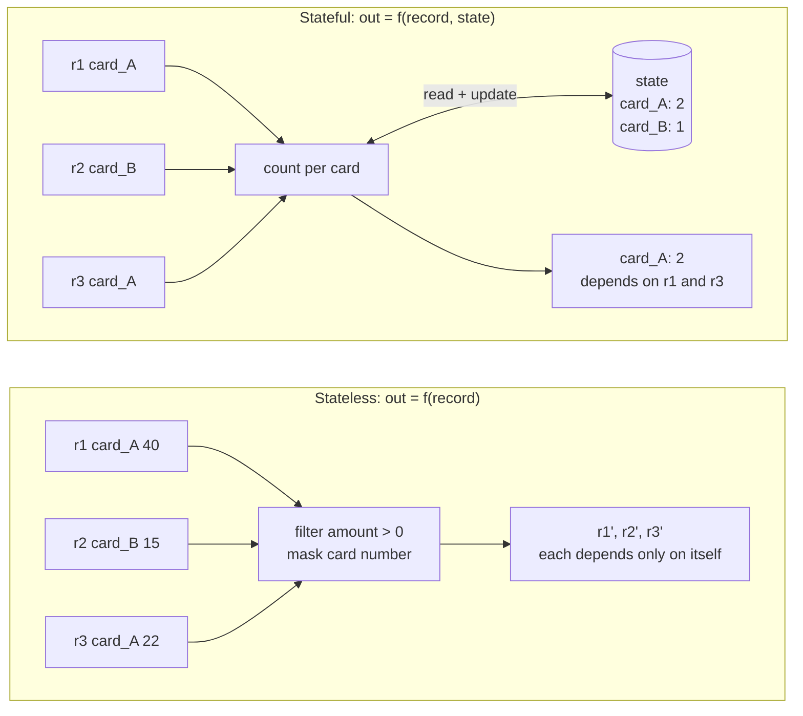

The stateless operator could process r3 on a fresh instance and give the same output. The stateful operator emits `card_A: 2` only because it remembers r1.

### Stateless operators

The output is a pure function of the current record, plus configuration or reference data that does not change while the job runs.

| Operator | Example |
| --- | --- |
| **Map / projection** | Parse JSON, rename fields, convert units, mask a PII column |
| **Filter** | Drop heartbeat events, keep only `status = 'FAILED'` |
| **FlatMap / explode** | Split an order into one record per line item |
| **Routing / branching** | Send EU events to one topic and US events to another |
| **Static enrichment** | Add a country name from a code table loaded at start-up |
| **Validation** | Reject records that fail a schema or a single-record rule |

### Stateful operators

The output depends on records seen earlier, so the operator must keep data between records.

| Operator | What it remembers | Example |
| --- | --- | --- |
| **Running aggregation** | A count, sum, min/max, or sketch per key | Total spend per customer so far |
| **Windowed aggregation** | One partial result per key per open window | Requests per endpoint per minute |
| **Deduplication** | Every ID seen within a retention horizon | Drop retried webhook deliveries |
| **Stream–stream join** | Buffered records from both sides, within a time bound | Match `order_placed` with `payment_received` within 30 min |
| **Stream–table join** | The latest value per key of a changelog | Enrich clicks with the user's current plan |
| **Sessionization** | Open sessions and their last-activity time | Group page views separated by under 30 min of inactivity |
| **Pattern detection (CEP)** | Partial matches of an event sequence | Three failed logins followed by a password reset |
| **Top-N / ranking** | A bounded ordered structure per key or window | Ten most-viewed products per hour |
| **Stateful ML features** | Rolling statistics per entity | A card's average transaction amount over 24 h |

> [!important] The test is "would a restart with empty memory change the output?"
> If an instance could lose its memory and still produce the same output for the next record, the operator is stateless. If the output would be different, such as a count that resets to zero or a join that misses its partner, the operator is stateful, and that memory must be made durable.

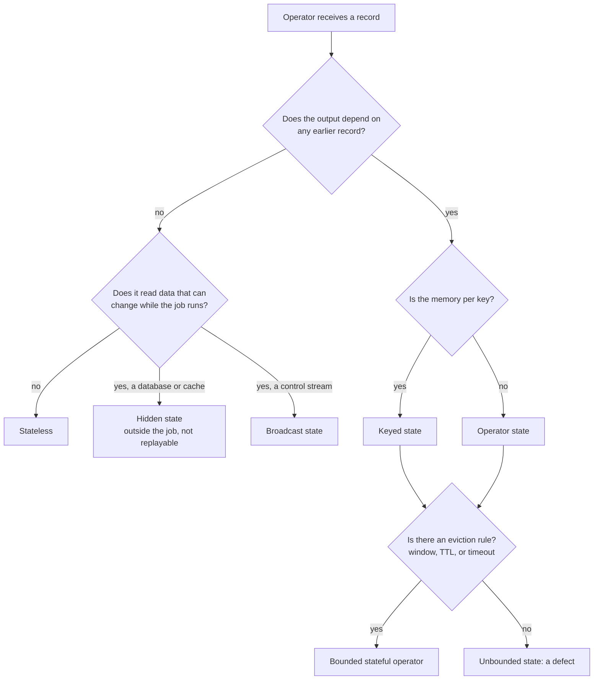

The decision tree classifies any operator, including the grey-zone cases below and the kinds of state described later.

## The Grey Zone

Several things look stateless but are not, or have only moved the state somewhere else:

- **Input position is always state.** Even a pure filter has to remember how far it has read: Kafka consumer offsets, file positions, or CDC log positions. Engines handle this state for you, but it still has to be committed consistently with the output, as described in the delivery-semantics section below.
- **External lookups move the state out of the job.** Enriching each record by querying a database or a cache makes the operator *look* stateless. In fact the state lives in the external system, which the job does not snapshot, cannot replay, and does not version. Reprocessing last month's events will join them against *today's* reference data, not the data as it was at the time.
- **Dynamic configuration is state.** A filter whose rules can change at runtime, for example through a control topic, holds those rules as state. Flink models this as *broadcast state*.
- **Caches are a performance choice, not correctness state.** A local cache in front of a lookup is acceptable only if losing it changes latency and nothing else.
- **Rate limiters and circuit breakers** count events over time, so they are stateful, even when they look like a simple filter.

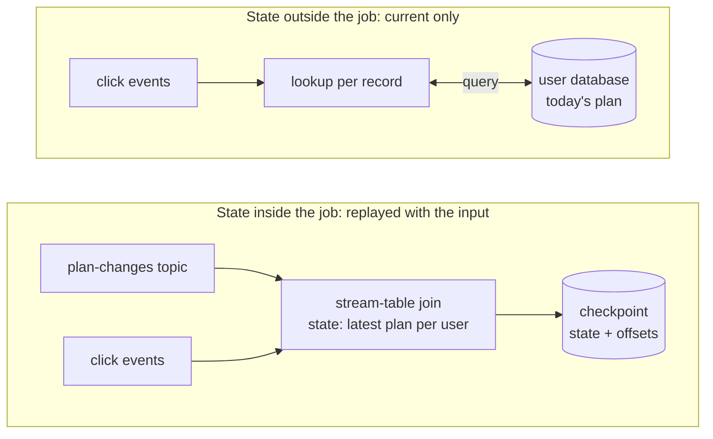

When the job replays last month's clicks, the left design replays the plan changes alongside them and reproduces roughly the original join. The right design joins every old click to today's plan.

## Kinds of State

| Kind | Scope | Example | Engine terms |
| --- | --- | --- | --- |
| **Keyed state** | One value per key, partitioned by key | Count per `card_id` | Flink `ValueState`, `ListState`, `MapState`; Kafka Streams `KeyValueStore`, `WindowStore`, `SessionStore`; Spark state store per grouping key |
| **Operator (non-keyed) state** | One value per parallel instance | Source offsets, buffered sink transactions | Flink operator `ListState` / union list state |
| **Broadcast state** | The same copy on every instance | Rules or thresholds that change at runtime | Flink broadcast state; Kafka Streams `GlobalKTable` |
| **Timers** | Scheduled callbacks per key | Close a session after 30 min of inactivity | Flink timer service; Kafka Streams punctuators; Spark `GroupState` timeouts |

Keyed state is the common case and the one that drives the design. Every record with the same key must reach the same parallel instance, because that is where the key's state lives.

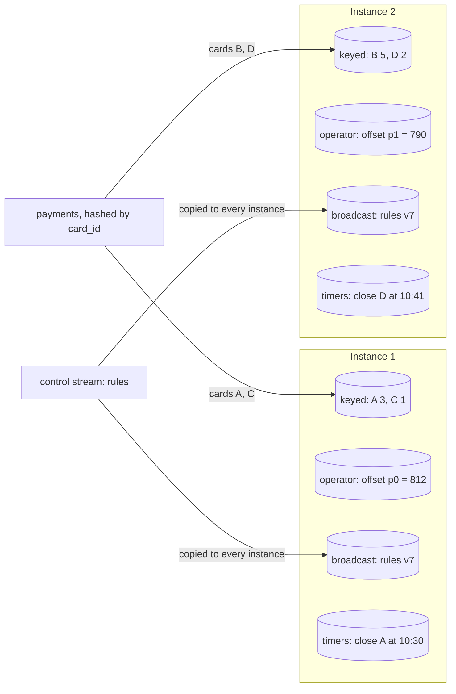

Keyed state and timers are split by key. Operator state belongs to each instance. Broadcast state is the same on every instance.

## Where State Lives

| Option | How it works | Fits | Watch out for |
| --- | --- | --- | --- |
| **In-memory (JVM heap)** | Objects on the heap, snapshotted to durable storage at checkpoints | Small state, lowest latency | GC pauses, and state size limited by heap memory |
| **Embedded RocksDB** | A local on-disk key-value store per instance, with memory as a cache | State far larger than memory: the default choice for big stateful jobs | Serialization cost on every access; local disk speed matters |
| **Changelog-backed local store** | Local store plus a compacted log of every update (Kafka Streams) | Kafka-native jobs | Restore time is replaying the changelog |
| **Disaggregated / remote** | State primarily in object storage, with local caching (Flink 2.x direction) | Very large state; fast rescaling | Access latency; this design is newer |
| **External database** | The job reads and writes a separate system (Redis, Cassandra, a SQL DB) | State shared with other services | Not snapshotted with the input position, so exactly-once is lost unless writes are idempotent |

Embedded RocksDB is a [[concepts/data_structures/lsm_tree|Log-Structured Merge-Tree (LSM Tree)]]. A large stateful job therefore inherits LSM behaviour: fast writes, read amplification across levels, and compaction competing with processing for CPU and disk.

In the reference engines:

- **Flink:** a heap-based backend (`HashMapStateBackend`) and an embedded RocksDB backend. Checkpoints go to a durable filesystem or object store. RocksDB supports *incremental* checkpoints, which upload only changed files.
- **Kafka Streams:** RocksDB stores by default, each backed by a compacted *changelog topic* in Kafka. Every state update is also written to the changelog, and on failover the new owner rebuilds the store by replaying it.
- **Spark Structured Streaming:** a versioned state store per partition, written to the query's checkpoint directory at the end of each micro-batch. The default provider is HDFS-compatible and holds state in memory; a RocksDB provider exists for large state.

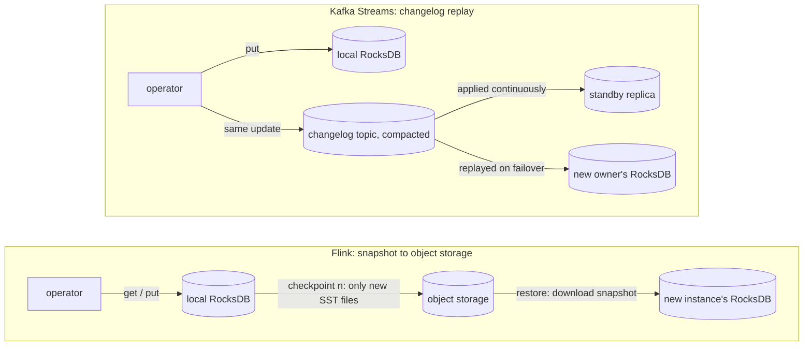

Flink restores by downloading the last snapshot, and Kafka Streams by replaying the changelog. In both, restore time grows with state size, unless a warm standby replica already holds the state.

## Partitioning and Co-location

A stateless operator can run on any instance. A keyed stateful operator needs data *partitioned by key*. This is what turns stateful processing into a distributed-systems problem:

- **Re-keying causes a shuffle.** `keyBy` (Flink), `selectKey`/`groupBy` (Kafka Streams), or `groupBy` (Spark) moves every record across the network to the instance that owns its key. A pipeline with three different keys pays for three shuffles. Kafka Streams turns each shuffle into an internal **repartition topic**, which costs broker storage and adds latency.
- **Joins need co-partitioning.** Both inputs must be partitioned the same way (same key, same partition count, same partitioner), or matching records end up on different instances. Kafka Streams enforces this for stream–stream and stream–table joins. A `GlobalKTable` sidesteps it by copying the whole table to every instance.
- **Hot keys become hot instances.** All state and all traffic for one key go to one instance, so a skewed key distribution makes that instance the bottleneck. Mitigations: two-phase aggregation with a salted key followed by a merge, pre-aggregation before the shuffle, or isolating known heavy keys.
- **Push stateless work before the shuffle.** Filtering and projecting *before* `keyBy` shrinks what crosses the network and what reaches state.

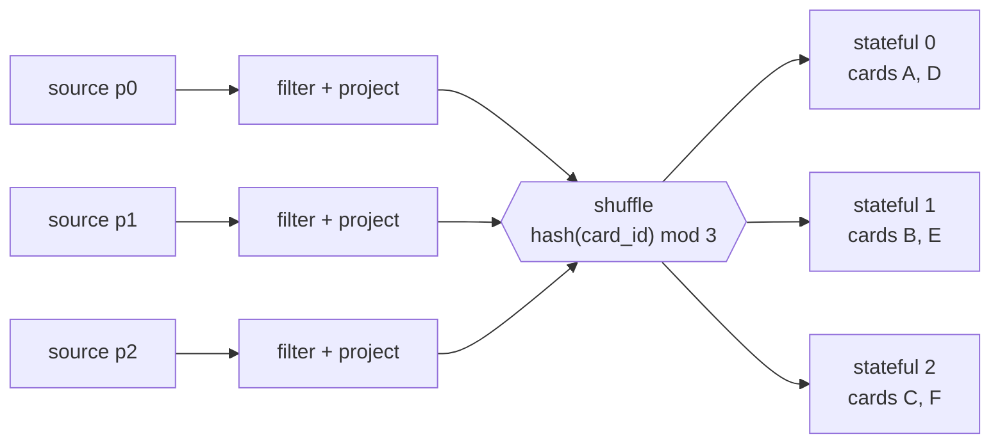

The stateless stage runs wherever the input partition is. The shuffle sends every record for a card to the one instance holding that card's state.

The three join variants differ in what each side keeps and whether the inputs must be co-partitioned:

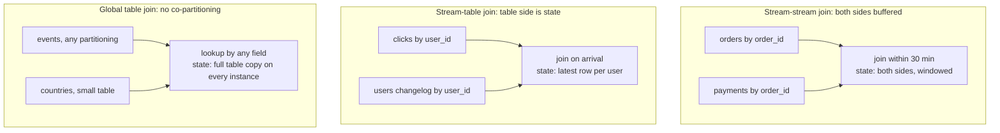

Stream-stream and stream-table joins require both inputs keyed and partitioned identically. A global table removes that requirement by copying the whole table to every instance, which only works for small tables.

For a hot key, two-phase aggregation spreads one key's load before combining it:

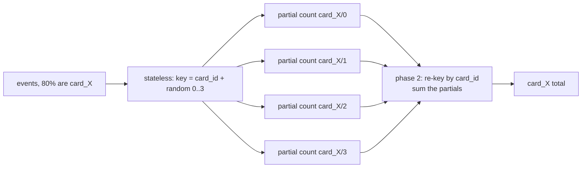

The salted first phase splits the hot key's state and CPU across four instances. The second phase handles only four partial results per window, not every event.

### Rescaling

Changing parallelism on a stateful job means moving state, not just starting more instances:

- **Flink** hashes keys into a fixed number of *key groups*, set by the job's *max parallelism*. Each instance owns a contiguous range of key groups, so rescaling reassigns ranges. Max parallelism caps how far the job can ever scale, and changing it later breaks compatibility with existing state. Set it deliberately on the first deployment.
- **Kafka Streams** creates one task per input partition. Parallelism therefore cannot exceed the partition count, and adding instances moves whole tasks. Each moved task must restore its store from the changelog unless a *standby replica* (`num.standby.replicas`) is already warm on the target.
- **Spark** fixes the number of state partitions to `spark.sql.shuffle.partitions` when the query first starts. Changing it requires a new checkpoint.

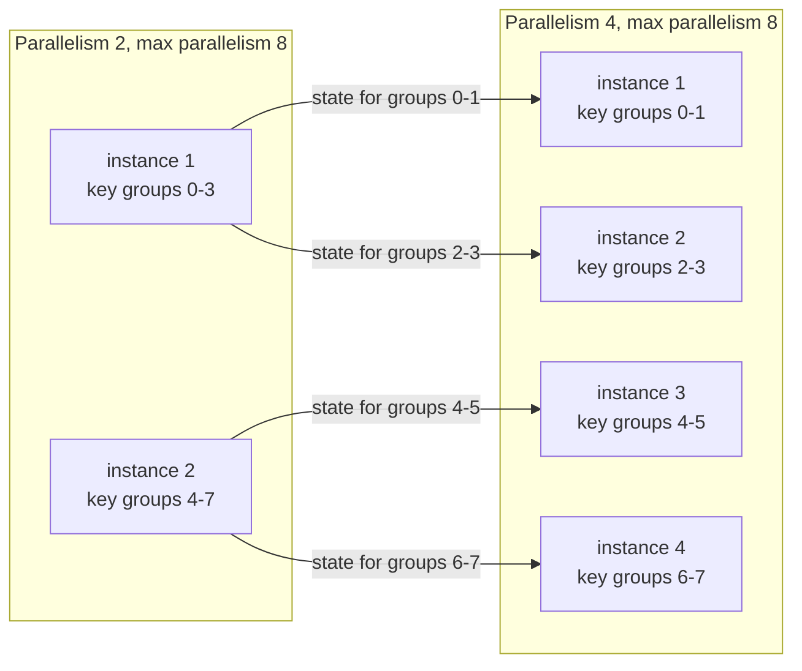

Flink rescaling moves whole key groups between instances, and a key never changes group. With a max parallelism of 8, a ninth instance would get no key group to own.

> [!warning] Partition count is a long-term decision for stateful jobs
> In Kafka Streams the input partition count caps parallelism. In Flink the max parallelism caps it. Neither can be raised casually once state exists. A stateless consumer can be scaled freely; a stateful one has to be sized for future growth at creation.

## Time, Windows, and Watermarks

Stateless operators rarely care about time. Stateful ones almost always do, because time decides *when state can be finalized and dropped*.

- **Event time vs. processing time.** Event time is when the event happened (a timestamp in the record). Processing time is when the operator sees it. Aggregating by processing time is simpler but non-deterministic: replaying the same input gives different results. Event time is deterministic but has to handle out-of-order data.
- **Watermarks** declare "no more events older than *T* are expected". When the watermark passes a window's end, the window is emitted and its state can be freed. A tight watermark loses late records; a loose one holds state longer and delays results. The [[concepts/data_engineering/spark/apache_spark|Apache Spark]] note describes the same trade-off for Structured Streaming.
- **Allowed lateness and late-data handling.** Engines can keep a window's state for a grace period after the watermark, so it can be updated and re-emitted. Data later than that can be dropped or sent to a side output for reconciliation.

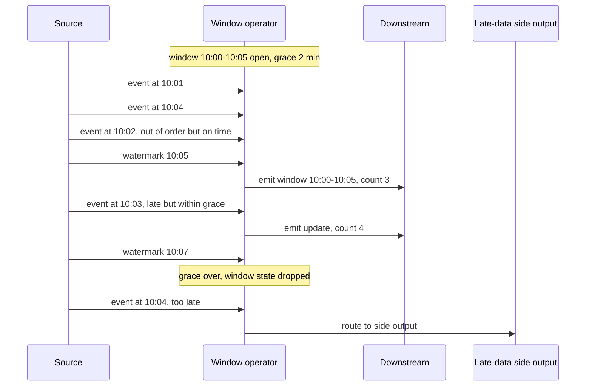

Out-of-order events before the watermark are simply counted. Late events within grace re-emit an updated result. After grace the state is gone, so later events can only be routed aside.

| Window | Shape | State per key |
| --- | --- | --- |
| **Tumbling** | Fixed, non-overlapping (every 5 min) | One open window, plus any still in grace |
| **Hopping / sliding** | Fixed size, overlapping (10 min every 1 min) | Size ÷ slide windows, so one event updates several |
| **Session** | Bounded by inactivity gaps | Variable; windows merge when a gap closes |
| **Global / unwindowed** | One running aggregate forever | Grows with key cardinality and needs a TTL |

```mermaid
gantt
    title One key's events and the windows each variant opens
    dateFormat HH:mm
    axisFormat %H:%M
    todayMarker off
    section Events
    e1 :milestone, 10:01, 0m
    e2 :milestone, 10:03, 0m
    e3 :milestone, 10:06, 0m
    e4 :milestone, 10:14, 0m
    e5 :milestone, 10:16, 0m
    section Tumbling 10 min
    window 1 :10:00, 10m
    window 2 :10:10, 10m
    section Hopping 10 min every 5
    window 0 :09:55, 10m
    window 1 :10:00, 10m
    window 2 :10:05, 10m
    window 3 :10:10, 10m
    window 4 :10:15, 10m
    section Session gap 5 min
    session 1 :10:01, 10m
    session 2 :10:14, 7m
```

For the same five events, tumbling windows hold each event once. Hopping windows hold each event in two windows, so there is twice the state and twice the updates. Session windows follow activity: each session closes 5 minutes after its last event (10:06 + 5 and 10:16 + 5).

> [!warning] Unbounded state is the most common stateful failure
> A global aggregation or deduplication keyed on a high-cardinality ID, with no window and no TTL, grows until checkpoints slow down, then until disks or memory run out. Every stateful operator needs an answer to "when is this key's state deleted?": a window end plus grace, a state TTL (Flink `StateTtlConfig`), a session timeout, or a tombstone.

## Fault Tolerance

The core requirement for a stateful job: **the persisted state and the persisted input position must describe the same moment**. If state is saved after record 1,000 but the offset is saved at record 900, records 901–1,000 are counted twice on recovery.

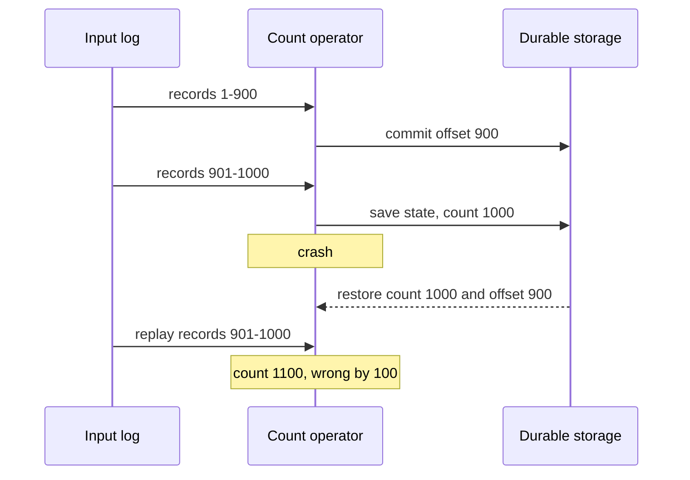

State and offset were saved at different moments, so the replay is counted on top of state that already included it. Consistent snapshots exist to prevent exactly this.

| Concern | Stateless | Stateful |
| --- | --- | --- |
| What must survive a crash | Input position only | Input position *and* all operator state, consistently |
| Recovery | Restart; resume from the committed offset | Restore the state snapshot, rewind input to the matching offset, replay |
| Recovery time | Seconds | Proportional to state size: download a snapshot or replay a changelog |
| Effect of a crash on output | Duplicates of in-flight records (at-least-once) | Without consistent snapshots: wrong aggregates. With them: correct state, though sinks may still see duplicates |

How the reference engines achieve consistency:

- **Flink: asynchronous barrier snapshots.** The coordinator injects *checkpoint barriers* into the sources. Barriers flow with the data. When an operator has received the barrier on all inputs, it snapshots its state and forwards the barrier. The completed checkpoint is a consistent cut of every operator's state and every source's offset, based on the [[concepts/data_engineering/flink/chandy_lamport_algorithm|Chandy–Lamport distributed-snapshot algorithm]]. *Unaligned* checkpoints let barriers overtake buffered data under backpressure, at the cost of storing in-flight records too. *Savepoints* are user-triggered, portable snapshots used for upgrades and rescaling.
- **Kafka Streams: changelogs and transactions.** State updates, output records, and input offset commits are written to Kafka in a single transaction when `processing.guarantee=exactly_once_v2`. On recovery, the store is rebuilt from its changelog up to the last committed transaction.
- **Spark: per-micro-batch commits.** Each micro-batch records its planned offsets in a write-ahead log in the checkpoint directory. When the batch completes, it writes a new state-store version and a commit marker. Recovery reruns the last uncommitted batch from the recorded offsets against the previous state version. This is the same log-before-apply idea as a database [[concepts/databases/write_ahead_log|Write-Ahead Log (WAL)]].

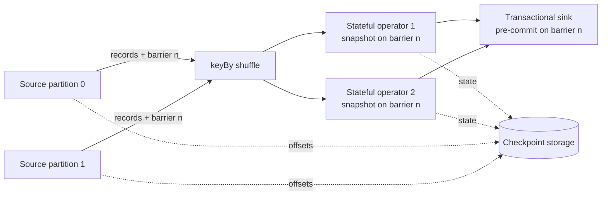

The diagram shows a Flink-style checkpoint: barrier *n* flows with the data, each operator saves its state when barrier *n* reaches it, and checkpoint *n* is complete when every operator and the sink have acknowledged it.

## Delivery Semantics End to End

"Exactly-once" in a stateful engine means **exactly-once effect on state**, an instance of the effectively-once processing described in [[concepts/software_architecture/exactly_once_delivery_and_processing|Exactly-Once Delivery and Processing]]: after recovery, every input record has been counted once in the state. It does *not* automatically mean every output reaches the sink exactly once. As the [[concepts/data_engineering/kafka/apache_kafka|Apache Kafka]] note warns, exactness ends at the system boundary unless the sink cooperates:

| Sink strategy | How | Guarantee |
| --- | --- | --- |
| **Transactional (two-phase commit)** | Pre-commit on checkpoint, commit when the checkpoint completes (Flink's Kafka sink in exactly-once mode, Kafka Streams EOS) | Exactly-once, but output is visible only at checkpoint frequency, which adds latency |
| **Idempotent writes** | Upsert on a deterministic key: aggregate key plus window start | Effectively exactly-once; replays overwrite with the same value |
| **Plain append** | Insert every emitted record | At-least-once; downstream must deduplicate |

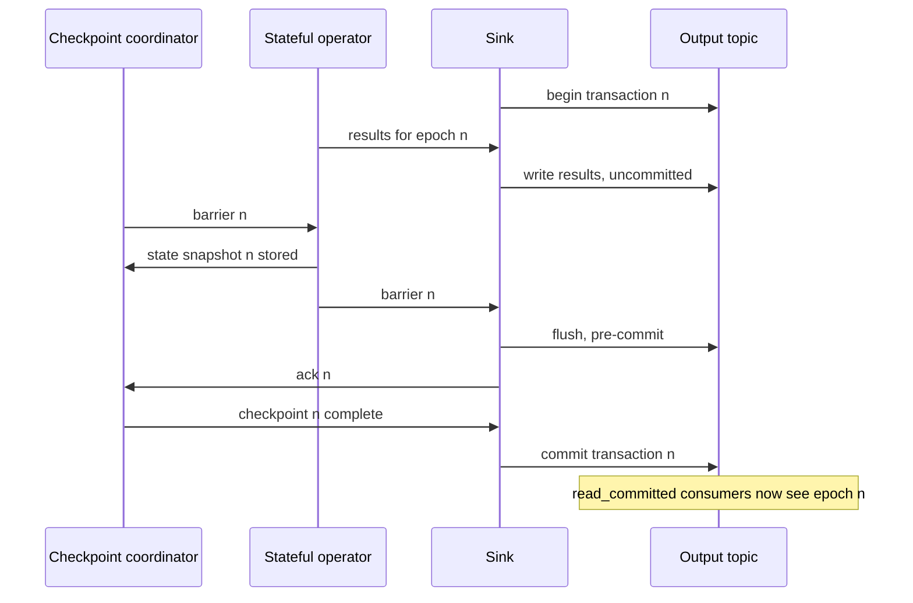

The sequence shows the transactional sink variant. If the job crashes before *commit*, the transaction is aborted and the epoch is replayed from checkpoint *n − 1*. That is why consumers see output only once per checkpoint interval.

[[concepts/software_architecture/idempotency|Idempotency]] is therefore the property that most often turns a stateful job's internal correctness into end-to-end correctness. It is also the reason a stateless job can be correct without any snapshots: if every write is an idempotent upsert, replaying a few records changes nothing.

## Changing a Running Stateful Job

Stateless jobs are deployed like any service: stop the old version, start the new one, resume from the offset. A stateful job carries data across deployments, which brings migration problems similar to a database's:

- **State schema evolution.** The stored state has a serialized format. Adding a field to a state object must be a compatible change for the serializer (Avro and Flink POJO serializers support some evolution; arbitrary Java serialization does not). Otherwise the new version cannot read the old snapshot. This is the streaming version of [[concepts/software_architecture/semantic_versioning|Semantic Versioning (SemVer)]]: compatibility is a promise the state format makes across releases.
- **Topology changes.** Flink maps state to operators by operator UID. Give every stateful operator an explicit, stable `uid`, or a refactor that reorders operators will orphan their state. Kafka Streams names internal stores and topics by position unless you name them explicitly, so adding an operator can rename them. Spark rejects many query changes against an existing checkpoint.
- **Logic changes over existing state.** If the counting rule changes, the existing counts were computed under the old rule. Options: accept the mixed history, rebuild state by replaying the input log from the start (if retention allows), or bootstrap new state offline (Flink's State Processor API can read and write savepoints).

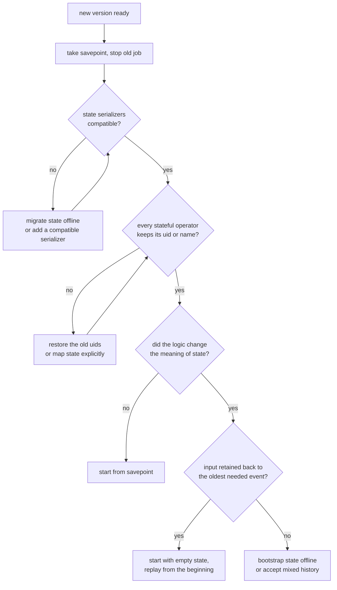

A stateless job skips this whole tree: stop it, deploy, and resume from the committed offset.

> [!tip] Plan reprocessing from day one
> A stateful job is only as rebuildable as its input retention. If the source topic keeps 7 days and a window covers 30, a bug in the aggregation cannot be fixed by replaying. Keep the source long enough to rebuild state, or archive it to object storage that the job can read as a bounded source.

## Cost and Operations

| Dimension | Stateless | Stateful |
| --- | --- | --- |
| Horizontal scaling | Add instances, up to the input partition count | Bounded by partition count or max parallelism; rescaling moves state |
| Latency | Per-record; dominated by I/O | Adds state access (RocksDB reads), shuffles, and, for transactional sinks, checkpoint interval |
| Resource profile | CPU and network | Plus memory, local disk, and checkpoint-storage bandwidth |
| Key metrics | Throughput, consumer lag, error rate | Plus state size, checkpoint duration and size, restore time, backpressure, watermark lag |
| Testing | Unit-test a function | Needs ordered input, simulated time, and restore-from-snapshot tests |
| Deployment | Rolling restart | Savepoint or drain, then compatible restore; topology and schema discipline |
| Failure blast radius | A few duplicate records | Wrong or lost aggregates if snapshots are inconsistent; long outages if restore is slow |

Checkpoint duration is the stateful job's key health signal. When it approaches the checkpoint interval, the job spends its time snapshotting, recovery points fall behind, and a crash means a long replay. The [[concepts/devops/observers|Observers]] note covers the metrics and alerting practice for watching these signals.

## Engine Comparison

| | Apache Flink | Kafka Streams | Spark Structured Streaming |
| --- | --- | --- | --- |
| Shape | A cluster runtime | A JVM library inside your application | A Spark application |
| Execution | Continuous, per-record | Continuous, per-record | Micro-batch by default |
| State backend | Heap or RocksDB; checkpoints to object storage | RocksDB plus compacted changelog topics | Versioned state store (HDFS-backed or RocksDB) in the checkpoint directory |
| Consistency mechanism | Barrier snapshots, savepoints | Kafka transactions (EOS v2) | Offset WAL plus versioned state per batch |
| Sources and sinks | Many | Kafka in, Kafka out | Many |
| Custom stateful logic | `KeyedProcessFunction` with timers | Processor API with punctuators | `flatMapGroupsWithState`; `transformWithState` in Spark 4 |
| Rescaling state | Key groups up to max parallelism | Task migration plus changelog restore | Fixed state partitions per checkpoint |

Judgement, not documentation:

- Choose **Kafka Streams** when everything is already in Kafka and the team wants a library deployed like any other service.
- Choose **Flink** for large state, low latency, complex event-time logic, or many source and sink types.
- Choose **Spark Structured Streaming** when the team and platform are already on Spark and second-level latency is acceptable.

For purely stateless work, any of them, or a plain consumer, will do. Engine choice matters mostly for the stateful part.

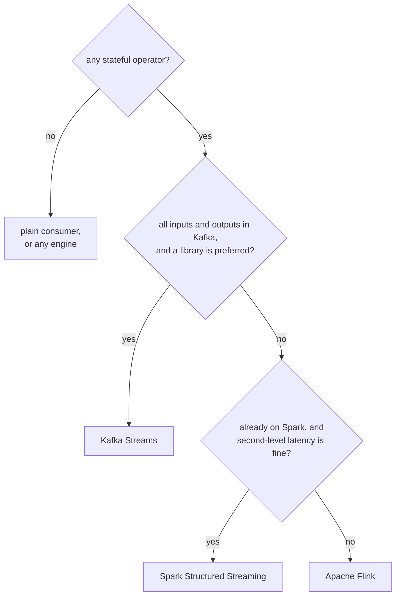

The tree encodes the judgement above; it is not a vendor recommendation.

## Design Guidance

The following is judgement drawn from common practice, not any engine's documentation:

1. **Make the stateful core as small as possible.** Filter, project, validate, and route statelessly first, so the stateful operator sees only the records and fields it needs.
2. **Bound every piece of state.** Each stateful operator has a documented eviction rule: window plus grace, TTL, or session timeout. Treat "it grows with the number of users ever seen" as a defect to fix, not a property.
3. **Choose keys for both correctness and distribution.** The key determines which records share state and how evenly load spreads. Check the cardinality and skew of a candidate key before building on it.
4. **Prefer event time** wherever results must be reproducible on replay, and set watermarks from measured lateness, not guesses.
5. **Do not hide state in external lookups** unless you accept that replays will see current data, not historical data. For reproducible enrichment, ingest the reference data as a changelog stream and join against it as versioned state.
6. **Make sinks idempotent** even when the engine offers transactions. It is the cheapest protection against every duplicate-producing failure.
7. **Consider not keeping the state at all.** If the requirement is an ad-hoc aggregate over long history, a [[concepts/databases/real_time_analytics_database|Real-Time Analytics Database]] can compute it at query time from raw events. The streaming job then stays stateless (ingest and enrich), and the state problem becomes a storage problem.

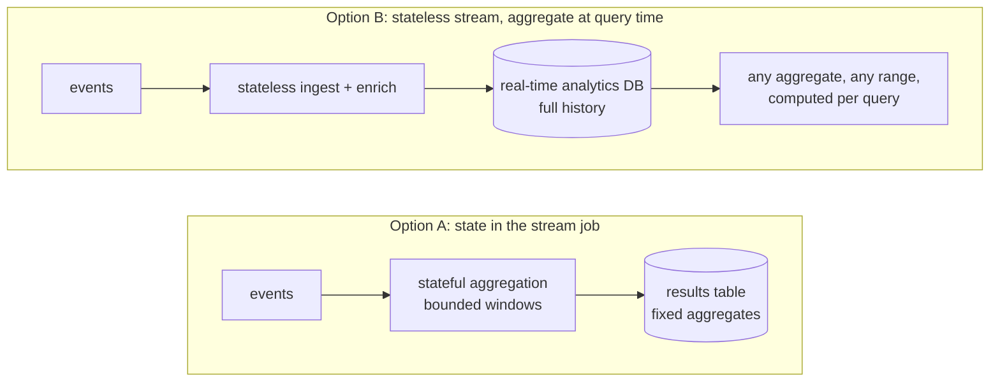

Option A is cheaper per query and gives the lowest latency for a fixed set of aggregates. Option B trades storage and query cost for flexibility, and avoids stream state altogether.

## Worked Example

A card-fraud rule: flag a card that makes more than five approved payments in five minutes.

The **stateless** stages drop declined and zero-amount payments, mask the card number, and re-key the stream by `card_id`. These stages can be scaled freely and restarted at any time. The **stateful** stage counts payments per card in five-minute tumbling windows and emits cards over the threshold. It needs keyed window state, a watermark for late payments, a changelog or checkpoint, and an idempotent alert sink keyed on `(card_id, window_start)`, so that a replay does not page twice.

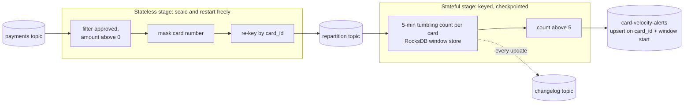

The repartition topic marks the stateless/stateful boundary. Everything before it scales with the source partitions. Everything after it is bound to card IDs and their window state.

```java
// Kafka Streams
StreamsBuilder builder = new StreamsBuilder();
KStream<String, Payment> payments = builder.stream("payments");

// Stateless: per-record filter and re-key; no state store involved
KStream<String, Payment> byCard = payments
    .filter((key, p) -> p.approved() && p.amountCents() > 0)
    .selectKey((key, p) -> p.cardId());   // the next grouping inserts a repartition topic

// Stateful: windowed count per card, held in a RocksDB window store backed by a changelog topic
byCard
    .groupByKey()
    .windowedBy(TimeWindows.ofSizeWithNoGrace(Duration.ofMinutes(5)))
    .count(Materialized.as("approved-payments-per-card-5m"))
    .toStream()
    .filter((windowedCard, count) -> count > 5)
    .to("card-velocity-alerts");
```

The same stateful step in Spark Structured Streaming, using an event-time watermark:

```python
from pyspark.sql.functions import window, col

alerts = (
    payments
    .where(col("approved") & (col("amount_cents") > 0))             # stateless
    .withWatermark("event_time", "10 minutes")                        # bounds how long window state is kept
    .groupBy(window("event_time", "5 minutes"), col("card_id"))      # stateful: per-key window state
    .count()
    .where(col("count") > 5)
)
```

## Related Concepts

- [[concepts/data_engineering/flink/apache_flink|Apache Flink]] — the reference stateful engine in this note: architecture, APIs, state backends, and when to choose it
- [[concepts/data_engineering/flink/asynchronous_barrier_snapshotting|Asynchronous Barrier Snapshotting (ABS)]] — the barrier-snapshot mechanism summarized under Fault Tolerance, in full: alignment, unaligned checkpoints, recovery, savepoints
- [[concepts/data_engineering/flink/chandy_lamport_algorithm|Chandy-Lamport Algorithm]] — the 1985 distributed-snapshot algorithm the barrier mechanism is based on
- [[concepts/data_engineering/kafka/apache_kafka|Apache Kafka]] — the replayable, partitioned log that makes stateful recovery possible, and where Kafka Streams keeps its changelogs and transactions
- [[concepts/data_engineering/spark/apache_spark|Apache Spark]] — Structured Streaming's micro-batch model, watermarks, and checkpoint-based recovery
- [[concepts/software_architecture/idempotency|Idempotency]] — what turns engine-internal exactly-once into end-to-end correctness, and why stateless jobs can be correct without snapshots
- [[concepts/data_structures/lsm_tree|Log-Structured Merge-Tree (LSM Tree)]] — the structure inside RocksDB, and so the performance profile of large local state
- [[concepts/databases/write_ahead_log|Write-Ahead Log (WAL)]] — the log-before-apply principle behind Spark's offset log and changelog-backed state
- [[concepts/databases/real_time_analytics_database|Real-Time Analytics Database]] — the alternative of keeping a stateless stream and computing aggregates at query time over full history
- [[concepts/software_architecture/semantic_versioning|Semantic Versioning (SemVer)]] — compatibility promises, which state schemas must also keep across deployments
- [[concepts/data_governance/data_sanity_check|Data Sanity Check]] — the same stateless-vs-stateful split applied to data checks: absolute assertions vs. comparisons against history
- [[concepts/devops/observers|Observers]] — monitoring checkpoint duration, state size, lag, and backpressure in production

## References

- [Apache Flink: Stateful Stream Processing](https://nightlies.apache.org/flink/flink-docs-stable/docs/concepts/stateful-stream-processing/) — keyed state, key groups, checkpoints, and barriers
- [Kafka Streams: Architecture](https://kafka.apache.org/documentation/streams/architecture) — tasks, state stores, changelogs, and standby replicas
- [Spark Structured Streaming Programming Guide](https://spark.apache.org/docs/latest/streaming/index.html) — watermarks, state stores, and checkpointing
- Carbone et al., "Lightweight Asynchronous Snapshots for Distributed Dataflows" (2015) — the barrier-snapshot algorithm behind Flink checkpoints
