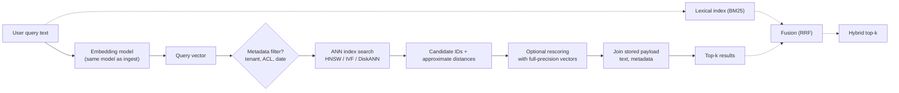
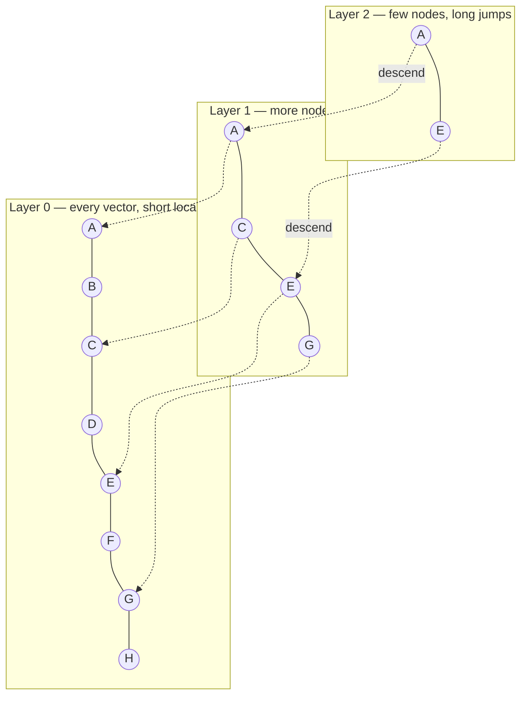
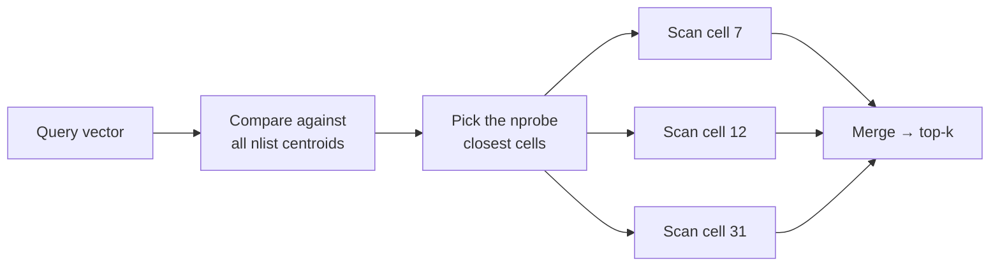

# Vector Database

A vector database stores high-dimensional vectors — almost always
[[concepts/ai_engineering/embeddings|Embeddings]] — alongside their source metadata, and answers
**nearest-neighbour queries**: "give me the $k$ stored vectors closest to this one". It is the
retrieval engine behind semantic search and the dense half of
[[concepts/ai_engineering/retrieval_augmented_generation|Retrieval-Augmented Generation (RAG)]].
What distinguishes it from an ordinary database is not storage but the index: a structure for
**approximate** nearest-neighbour (ANN) search that trades a small, tunable loss of accuracy for
orders-of-magnitude less work per query.

## Why It Matters

- **Exact search does not scale.** Comparing a query against every stored vector costs $O(N \cdot d)$.
  At 100 million 1,024-dimension vectors that is about 10¹¹ multiply-adds per query — fine for a
  batch job, hopeless for an interactive request.
- **Classic indexes do not help.** A [[concepts/data_structures/b_tree|B-Tree]] orders keys along one
  dimension; nearness in hundreds of dimensions has no such ordering. Space-partitioning trees
  (k-d trees) degrade to near brute force above a few dozen dimensions — the *curse of
  dimensionality*, where every point ends up roughly equidistant from every other.
- **Its recall is RAG's recall.** A passage the ANN index fails to return is invisible to the model.
  Index parameters are therefore an answer-quality setting, not just a performance one.
- **Filtering is where systems quietly fail.** Real queries are "nearest *among documents this user
  may see, in this tenant, from this year*". How the engine combines a metadata filter with an ANN
  search decides both correctness and latency.

## Anatomy of a Query



Each stored record is typically `(id, vector, payload)`, where the payload holds the chunk text, its
source document, and filterable fields. Dashed edges are the optional hybrid path.

## Exact vs. Approximate Search

| | Exact (flat / brute force) | Approximate (ANN) |
| --- | --- | --- |
| Work per query | Every vector | A small, guided fraction |
| Recall | 100% by definition | Tunable, typically 90–99% |
| Index build | None | Minutes to hours |
| When to use | Under ~100k vectors, after a filter shrinks the set, or as ground truth for measuring an ANN index | Everything larger and interactive |

**Recall@k** for an ANN index means: of the true $k$ nearest neighbours (found by exact search), what
fraction did the index return? It is the number every ANN parameter is tuned against, always
traded against latency and memory.

## Index Families

### HNSW — Hierarchical Navigable Small World

The dominant in-memory index. It builds a multi-layer proximity graph: every vector is a node in the
bottom layer, linked to its nearest neighbours; a geometrically shrinking random subset is promoted
to each higher layer, so the top layers are sparse "express lanes".



**Search** enters at the top layer, greedily walks to the neighbour closest to the query, drops a
layer when no neighbour is closer, and repeats; at layer 0 it runs a beam search keeping the best
`ef` candidates. It behaves like a skip list generalised to a graph.

| Parameter | Controls | Raising it |
| --- | --- | --- |
| `M` | Links per node (layer 0 usually gets $2M$) | Better recall, more memory, slower build |
| `efConstruction` | Beam width while inserting | Better graph quality, slower build |
| `efSearch` (`ef`) | Beam width while querying | Better recall, higher latency — **the main query-time dial** |

Strengths: excellent recall-latency trade-off, incremental inserts with no training step. Costs: the
graph must sit in RAM, link storage adds substantial per-vector overhead, and **deletes are hard** —
removing a node can disconnect parts of the graph, so engines mark deletions with tombstones and
repair or rebuild later.

### IVF — Inverted File Index

Cluster the vectors with k-means into `nlist` cells, each represented by its centroid. Each cell keeps
an inverted list of its member vectors.



`nprobe` is the query-time dial: scanning more cells raises recall and latency. IVF needs a
**training step** on representative data, and its cells go stale if the data distribution drifts,
but it uses far less memory than HNSW and pairs naturally with compression. A common starting point
sets `nlist` on the order of $\sqrt{N}$.

### Product Quantization (PQ) — compression

PQ splits each $d$-dimensional vector into $m$ sub-vectors and replaces each sub-vector with the ID of
its nearest centroid from a 256-entry codebook trained for that slot. A 1,024-dimension `float32`
vector (4,096 bytes) becomes $m$ bytes — 64 bytes at $m = 64$, a 64× reduction. Distances are
computed approximately from per-query lookup tables without decompressing. **IVF-PQ** combines both
and is the standard way to hold billions of vectors in memory; the usual refinement is to rescore the
top few hundred candidates with full-precision vectors kept on disk.

### Other Families

| Index | Idea | Where it fits |
| --- | --- | --- |
| **DiskANN / Vamana** | A single-layer graph laid out for SSD, with compressed vectors in RAM to guide the walk | Billion-scale on one machine without holding the graph in memory |
| **ScaNN** | Anisotropic quantization that preserves inner-product ranking, plus partitioning | High-throughput maximum-inner-product search |
| **LSH** | Random hash functions that collide for nearby vectors | Theoretical guarantees; generally outperformed by graphs in practice |
| **Scalar / binary quantization** | Fewer bits per dimension (int8, 1-bit) | Cheap memory reduction, often combined with HNSW plus rescoring |

### Choosing an Index

| Situation | Reach for |
| --- | --- |
| < ~100k vectors, or heavy filtering leaves few candidates | Flat (exact) |
| Fits in RAM, needs high recall and low latency, frequent inserts | HNSW |
| Memory-bound, large and fairly static corpus | IVF-PQ with rescoring |
| Billions of vectors, SSD available | DiskANN-style graph |

## Filtering

Combining a metadata predicate with ANN search has three strategies, and the difference is the most
common source of "the vector database returned nothing" incidents:

| Strategy | How | Failure mode |
| --- | --- | --- |
| **Post-filter** | ANN search for top-$k$, then drop non-matching results | With a selective filter, all $k$ results may be filtered out — returning fewer than $k$, or none |
| **Pre-filter** | Apply the filter first, then search only matching vectors | Exact search over the survivors is fine when they are few; on a graph index the matching nodes may be disconnected, breaking traversal |
| **Filtered / in-search** | Evaluate the predicate during graph traversal, skipping or penalising non-matching nodes, and widening the search until $k$ matches are found | Latency spikes on very selective filters; quality depends on engine implementation |

Mature engines choose between these per query, much as a relational query planner chooses a join
strategy from estimated selectivity: a highly selective filter switches to pre-filter plus exact
search, a broad one to in-search filtering.

> [!warning] Access control is a filter, and it must not be a post-filter
> Enforcing row-level permissions by post-filtering leaks result counts and returns empty pages to
> users with narrow access. Push the permission predicate into the search itself, and partition by
> tenant where isolation is a hard requirement — the same obligations as any other access path
> under [[concepts/data_governance/data_security|Data Security]].

## Hybrid Search

Dense vectors miss exact identifiers; lexical BM25 misses paraphrase. Running both and fusing the
lists is the default for production retrieval. The robust, tuning-free fusion is **Reciprocal Rank
Fusion (RRF)**, which ignores raw scores — useful because BM25 scores and cosine similarities live on
unrelated scales — and uses only each document's rank in each list:

$$
\text{RRF}(d) = \sum_{r \in \text{retrievers}} \frac{1}{k + \text{rank}_r(d)}, \qquad k = 60 \text{ by convention}
$$

A document ranked 1st by BM25 and 4th by the dense retriever scores $\frac{1}{61} + \frac{1}{64}
\approx 0.032$; one ranked 1st by only one retriever scores $\frac{1}{61} \approx 0.016$. Agreement
between retrievers is rewarded. The alternative, a weighted sum of normalised scores, can do better
but needs per-corpus tuning.

## Writes, Updates, and Deletes

- **Inserts** are cheap for HNSW (link the new node in) and for IVF (append to the nearest cell),
  but IVF cells and PQ codebooks drift as the data distribution changes and need periodic
  retraining.
- **Updates** are delete-plus-insert; there is no in-place move of a vector.
- **Deletes** are tombstoned and physically removed during background compaction or rebuild — the
  same pattern as an [[concepts/data_structures/lsm_tree|LSM Tree]], and several engines use an
  LSM-like segment architecture for exactly this reason: immutable segments, each with its own
  index, merged in the background.
- **Freshness.** Newly written vectors may be searchable only after a segment is sealed and indexed;
  "eventually searchable" is a consistency property to check, not assume.

## Scaling Out

- **Sharding** spreads vectors across nodes; a query is scattered to every shard and the per-shard
  top-$k$ lists are gathered and merged. Unlike key-value sharding, there is no shard key that routes
  a similarity query to one node, so every query touches every shard unless the data is partitioned
  by a filter field such as tenant.
- **Replication** adds read throughput and fault tolerance, with the usual trade-offs between
  consistency and availability under the [[concepts/databases/cap_theorem|CAP Theorem]].
- **Multi-tenancy** is either a filter field in a shared index (cheap, weaker isolation, filter
  performance matters) or a separate index or namespace per tenant (strong isolation, overhead per
  tenant).
- **Tiered storage** keeps compressed vectors or the graph in RAM and full-precision vectors on SSD
  or object storage for rescoring.

## The Landscape

| Category | Examples | Trade-off |
| --- | --- | --- |
| Purpose-built vector databases | Pinecone, Milvus, Qdrant, Weaviate, Chroma | Best vector features and filtering; one more system to operate and keep consistent with the source of truth |
| Vector support in an existing database | PostgreSQL with pgvector, Elasticsearch / OpenSearch, Redis, MongoDB Atlas, most cloud warehouses | Vectors live beside the data and its transactions and permissions; vector features and scale may trail the specialists |
| Libraries (no server) | FAISS, hnswlib, ScaNN, Annoy | Maximum control and speed; persistence, filtering, replication, and updates are your problem |

A useful default: if the corpus fits comfortably on one database server and the data already lives
in PostgreSQL, start with pgvector; reach for a dedicated engine when scale, filtering performance,
or index features outgrow it.

### Example: pgvector

```sql
CREATE EXTENSION IF NOT EXISTS vector;

CREATE TABLE chunks (
    id         bigserial PRIMARY KEY,
    tenant_id  int        NOT NULL,
    doc_id     bigint     NOT NULL,
    content    text       NOT NULL,
    embedding  vector(1024)          -- dimension must match the embedding model
);

-- HNSW index for cosine distance; m and ef_construction are the build-time knobs
CREATE INDEX ON chunks USING hnsw (embedding vector_cosine_ops)
    WITH (m = 16, ef_construction = 64);

-- Query-time recall dial
SET hnsw.ef_search = 100;

-- Top 5 nearest chunks for one tenant; <=> is cosine distance (smaller = closer)
SELECT id, doc_id, content, 1 - (embedding <=> :query_vec) AS cosine_similarity
FROM chunks
WHERE tenant_id = :tenant
ORDER BY embedding <=> :query_vec
LIMIT 5;
```

pgvector's distance operators are `<->` (Euclidean), `<#>` (negative inner product), and `<=>`
(cosine distance). The `WHERE tenant_id` clause above is applied as the index is scanned, so a very
selective tenant can return fewer than five rows — the post-filter problem in miniature, which recent
versions mitigate with iterative index scans.

## Measuring a Vector Index

- **Recall@k against exact search** on a sample of real queries — the correctness metric.
- **Latency** at p50 and p99, measured with realistic filters and concurrency, not on an idle box.
- **Throughput** (queries per second) at the target recall.
- **Memory per vector**, including index overhead, and **build time** for a full rebuild — the
  number that matters when an embedding-model migration forces one.
- Public comparisons such as ann-benchmarks are useful for relative shape, but run on unfiltered,
  static data that rarely matches production.

## Common Pitfalls

- **Mixing embedding models in one index.** Vectors from different models are incomparable; store
  the model version and never query across it.
- **Tuning for latency with recall unmeasured.** Lowering `ef` or `nprobe` always looks like a win
  until someone measures recall.
- **Post-filtering permissions.** See the warning above.
- **Forgetting rebuild cost.** HNSW rebuilds at hundreds of millions of vectors take hours; plan the
  re-embedding path before it is needed.
- **A second source of truth.** A vector store fed from a primary database drifts unless deletes and
  updates propagate; a deleted document whose chunks are still retrievable is a correctness and a
  compliance defect.
- **Treating the vector database as the retrieval system.** It answers "nearest vectors"; chunking,
  hybrid fusion, reranking, and evaluation still decide answer quality.

## Open Questions & Disagreements

- **Product capabilities move faster than this note.** The landscape table, pgvector's operator set,
  and its iterative-scan behaviour reflect general knowledge as of 2026 rather than a cited source,
  and vendor feature sets change between releases. Verify against current documentation before
  choosing an engine.
- **"Do you need a dedicated vector database at all?" is unsettled.** One camp argues vectors are
  just another index type that every general-purpose database will absorb; the other that
  billion-scale filtered ANN search needs a purpose-built engine. The split appears to track scale
  and filter selectivity; no benchmark settles it in general.

## Related Concepts

- [[concepts/ai_engineering/embeddings|Embeddings]] — the vectors this database stores; their model, dimension, and metric dictate the index configuration
- [[concepts/ai_engineering/retrieval_augmented_generation|Retrieval-Augmented Generation (RAG)]] — the main consumer; index recall bounds RAG recall
- [[concepts/ai_engineering/model_context_protocol|Model Context Protocol (MCP)]] — a common way to expose a vector search to agents as a tool
- [[concepts/data_structures/b_tree|B-Tree]] — the one-dimensional ordered index that does *not* generalise to similarity search, and why ANN structures exist
- [[concepts/data_structures/lsm_tree|Log-Structured Merge-Tree (LSM Tree)]] — the segment-and-compaction pattern many vector engines use to handle inserts and deletes
- [[concepts/data_structures/bloom_filter|Bloom Filter]] — another structure that trades exactness for space, the same bargain ANN indexes make
- [[concepts/databases/cap_theorem|CAP Theorem]] — the consistency trade-offs that apply once the index is sharded and replicated
- [[concepts/data_governance/data_security|Data Security]] — permission filters must be enforced inside the search, not after it

## References

- Malkov and Yashunin (2018). *Efficient and Robust Approximate Nearest Neighbor Search Using Hierarchical Navigable Small World Graphs.* IEEE TPAMI — HNSW.
- Jégou, Douze, and Schmid (2011). *Product Quantization for Nearest Neighbor Search.* IEEE TPAMI — PQ and IVF-ADC.
- Johnson, Douze, and Jégou (2019). *Billion-Scale Similarity Search with GPUs.* IEEE Trans. Big Data — FAISS.
- Subramanya et al. (2019). *DiskANN: Fast Accurate Billion-point Nearest Neighbor Search on a Single Node.* NeurIPS.
- Guo et al. (2020). *Accelerating Large-Scale Inference with Anisotropic Vector Quantization.* ICML — ScaNN.
- Cormack, Clarke, and Büttcher (2009). *Reciprocal Rank Fusion Outperforms Condorcet and Individual Rank Learning Methods.* SIGIR.
- [pgvector](https://github.com/pgvector/pgvector) — PostgreSQL extension documentation.
- [ann-benchmarks](https://ann-benchmarks.com) — public ANN index comparisons.
