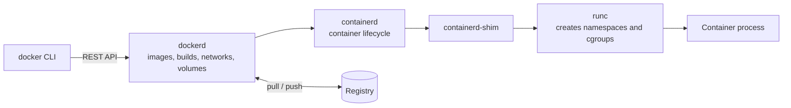

# Docker

Docker is a platform for packaging an application with everything it needs to run into an **image**, and running that image as an isolated process called a **container**. Its images follow the OCI standard, so the same artifact runs on a laptop, in CI, and on orchestrators such as [[concepts/devops/kubernetes/kubernetes|Kubernetes]].

## Why It Matters

- **"Works on my machine" goes away.** The image carries the runtime, libraries, and configuration, so every environment runs the same bits.
- **One artifact through the whole pipeline.** CI builds an image once, tags it, pushes it to a registry, and every later stage deploys that same tag.
- **Fast, cheap isolation.** Containers share the host kernel, so they start in about a second and pack far more densely than virtual machines.
- **A common unit for platforms.** Kubernetes, Cloud Run, ECS, and most CI runners take an OCI image as their input.

## Core Concepts

| Term | Meaning |
| --- | --- |
| **Image** | A read-only template: a stack of filesystem layers plus metadata (entrypoint, environment, exposed ports) |
| **Layer** | The filesystem change produced by one build instruction. Layers are cached and shared between images |
| **Container** | A running (or stopped) instance of an image, with a thin writable layer on top |
| **Dockerfile** | The text recipe that builds an image, one instruction per layer-producing step |
| **Registry** | A server that stores and distributes images: Docker Hub, GitHub Container Registry, ECR, Artifact Registry |
| **Tag / digest** | `name:tag` is a movable label; `name@sha256:…` is an immutable content address |
| **Volume** | Storage managed by Docker that outlives any single container |
| **Network** | A virtual network that containers attach to and use to reach each other |

### Containers vs. virtual machines

| | Container | Virtual machine |
| --- | --- | --- |
| Isolation boundary | Linux namespaces and cgroups on a shared kernel | A hypervisor; each VM has its own kernel |
| Startup | About a second | Tens of seconds to minutes |
| Size | Megabytes to a few hundred megabytes | Gigabytes |
| Security boundary | Weaker; a kernel exploit can reach the host | Stronger |

A container is an ordinary process that the kernel isolates. **Namespaces** give it its own view of process IDs, network interfaces, mounts, and hostname. **cgroups** cap its CPU and memory. A union filesystem (usually `overlay2`) stacks the image layers under a writable layer. On macOS and Windows, Docker Desktop runs these Linux containers inside a small Linux VM.

## Architecture



The CLI talks to the Docker daemon, which hands container lifecycle to containerd, which uses runc to create the isolated process.

containerd is the same runtime Kubernetes uses directly, which is why images built with Docker run unchanged on Kubernetes even though Kubernetes no longer talks to Docker itself. [[concepts/devops/kubernetes/kubernetes_components|Kubernetes Components]] covers that runtime layer and the removal of dockershim. [[concepts/devops/docker/docker_container_techniques|Docker Container Techniques]] follows a single `docker run` through this chain, including the process tree and how stdio and signals travel.

## Writing a Dockerfile

```dockerfile
# syntax=docker/dockerfile:1
FROM python:3.12-slim AS build
WORKDIR /app
COPY requirements.txt .
RUN pip install --no-cache-dir --prefix=/install -r requirements.txt

FROM python:3.12-slim
WORKDIR /app
COPY --from=build /install /usr/local
COPY . .
RUN useradd --create-home appuser
USER appuser
EXPOSE 8000
CMD ["python", "-m", "app"]
```

This is a **multi-stage build**. The first stage installs dependencies, and the final image copies only the result, leaving build tools behind.

| Instruction | Purpose |
| --- | --- |
| `FROM` | The base image; `AS name` names a stage for multi-stage builds |
| `WORKDIR` | Sets, and creates, the working directory for later instructions |
| `COPY` / `ADD` | Copy files into the image. Prefer `COPY`; `ADD` also fetches URLs and unpacks archives |
| `RUN` | Runs a command at build time and records the result as a layer |
| `ENV` / `ARG` | `ENV` sets runtime environment variables; `ARG` is a build-time variable only |
| `EXPOSE` | Documents the port the app listens on; it does not publish it |
| `USER` | The user later instructions and the container run as |
| `ENTRYPOINT` / `CMD` | The executable to run, and its default arguments |
| `HEALTHCHECK` | A command Docker runs to decide whether the container is healthy |

- **Order for the cache.** Docker reuses a layer only if it and every layer before it are unchanged. Copy the dependency manifest and install dependencies *before* copying the source, so a code change does not reinstall every package.
- **`ENTRYPOINT` vs. `CMD`.** Arguments after the image name in `docker run` replace `CMD` but are appended to `ENTRYPOINT`. A common pattern is `ENTRYPOINT ["app"]` with `CMD ["--help"]`.
- **Use the exec form.** `CMD ["python", "-m", "app"]` runs the app as PID 1. The shell form, `CMD python -m app`, runs it under `/bin/sh -c`, which does not forward `SIGTERM`, so `docker stop` waits out its timeout and then kills the app.
- **Add a `.dockerignore`.** Exclude `.git`, local virtual environments, build output, and secrets, so they neither enter the build context nor end up in the image.

## Common Commands

### Images

| Command | What it does |
| --- | --- |
| `docker build -t myapp:1.0 .` | Build an image from the Dockerfile in the current directory |
| `docker build --target build -t myapp:build .` | Build only up to a named stage |
| `docker image ls` | List local images (`docker images` is the short form) |
| `docker pull nginx:1.27` | Download an image from a registry |
| `docker tag myapp:1.0 ghcr.io/acme/myapp:1.0` | Add a registry-qualified name to an image |
| `docker push ghcr.io/acme/myapp:1.0` | Upload an image to a registry |
| `docker image history myapp:1.0` | Show the layers and the instruction that made each |
| `docker image rm myapp:1.0` | Remove an image (`docker rmi` is the short form) |
| `docker login ghcr.io` | Authenticate to a registry |

### Running containers

```bash
# Run a web server in the background, publishing host port 8080 to container port 80
docker run -d --name web -p 8080:80 nginx:1.27

# Throwaway interactive shell, removed on exit, with the current directory mounted
docker run --rm -it -v "$PWD":/app -w /app python:3.12-slim bash

# Environment variables, resource limits, and a restart policy
docker run -d --name api --env-file .env -e LOG_LEVEL=debug \
  --memory 512m --cpus 1.5 --restart unless-stopped myapp:1.0
```

| Flag | Meaning |
| --- | --- |
| `-d` | Run detached, in the background |
| `-it` | Interactive, with a terminal |
| `--rm` | Delete the container when it exits |
| `--name` | Give the container a fixed name instead of a random one |
| `-p host:container` | Publish a container port on the host |
| `-v source:/path` | Mount a volume or a host directory |
| `-e KEY=value` / `--env-file` | Set environment variables |
| `--restart` | `no`, `on-failure`, `always`, or `unless-stopped` |
| `--memory` / `--cpus` | Cap memory and CPU through cgroups |

### Inspecting and managing containers

| Command | What it does |
| --- | --- |
| `docker ps` / `docker ps -a` | List running containers, or all including stopped ones |
| `docker logs -f --tail 100 web` | Follow a container's output, starting from the last 100 lines |
| `docker exec -it web sh` | Open a shell inside a running container |
| `docker stop web` / `docker start web` / `docker restart web` | Stop gracefully (`SIGTERM`, then `SIGKILL` after a timeout), start, or restart; see [[concepts/devops/docker/docker_container_techniques#Stopping vs. Killing a Container\|Stopping vs. Killing a Container]] |
| `docker rm web` / `docker rm -f web` | Remove a stopped container, or force-remove a running one |
| `docker cp web:/etc/nginx/nginx.conf .` | Copy files between a container and the host |
| `docker inspect web` | Full JSON configuration and state; filter with `--format '{{.NetworkSettings.IPAddress}}'` |
| `docker stats` | Live CPU, memory, network, and disk I/O per container |
| `docker top web` | Processes running inside a container |
| `docker port web` | Port mappings of a container |

### Volumes and networks

| Command | What it does |
| --- | --- |
| `docker volume create pgdata` / `docker volume ls` | Create or list named volumes |
| `docker volume inspect pgdata` | Show where a volume lives and who uses it |
| `docker volume rm pgdata` | Delete a volume and its data |
| `docker network create appnet` / `docker network ls` | Create or list networks |
| `docker network connect appnet web` | Attach a running container to a network |

### Cleanup

| Command | What it removes |
| --- | --- |
| `docker system df` | Nothing; shows disk use by images, containers, volumes, and build cache |
| `docker container prune` | Stopped containers |
| `docker image prune` / `docker image prune -a` | Dangling images, or every image no container uses |
| `docker builder prune` | Build cache |
| `docker system prune` | Stopped containers, unused networks, dangling images, and build cache |
| `docker system prune -a --volumes` | All of the above, plus every unused image and every unused volume |

> [!warning] Pruning volumes deletes data
> `--volumes` removes every volume not attached to a container, including a stopped local database's data. Run `docker system df` and `docker volume ls` first, and never prune volumes on a host whose data you have not backed up.

### Multi-platform builds

```bash
docker buildx build --platform linux/amd64,linux/arm64 -t ghcr.io/acme/myapp:1.0 --push .
```

This builds one image for both Intel and ARM machines, such as Apple Silicon laptops and Graviton servers, and pushes it as a single multi-architecture tag.

## Data: Volumes, Bind Mounts, and tmpfs

| Type | Example | Use for |
| --- | --- | --- |
| **Named volume** | `-v pgdata:/var/lib/postgresql/data` | Database files and other state Docker should manage; survives container removal |
| **Bind mount** | `-v "$PWD":/app` | Live-editing source code in development; ties the container to a host path |
| **tmpfs** | `--tmpfs /tmp` | Scratch data kept in memory and never written to disk |

Anything written to the container's own writable layer disappears when the container is removed. State that must persist belongs in a volume.

## Networking

- **Default bridge.** Containers get a private IP on the `docker0` bridge, each connected through a [[concepts/devops/kubernetes/veth_pair|veth pair]], and reach the outside world through NAT. Publishing a port with `-p` is what makes a container reachable from the host.
- **User-defined bridge.** Containers on a network created with `docker network create` can reach each other **by container name** through Docker's built-in DNS. This is what Compose sets up for every project.
- **`--network host`** shares the host's network stack directly. It is fast, but ports can clash, and on Docker Desktop the "host" is the VM, not your machine.
- **`--network none`** gives the container no network at all.

## Docker Compose

Compose describes a multi-container application in one YAML file, so the whole stack starts with one command. It ships as the `docker compose` plugin; the older standalone `docker-compose` binary is legacy.

```yaml
# compose.yaml — local development only
services:
  api:
    build: .
    ports: ["8000:8000"]
    environment:
      DATABASE_URL: postgresql://app:app@db:5432/app
    depends_on:
      db:
        condition: service_healthy
  db:
    image: postgres:16
    environment:
      POSTGRES_USER: app
      POSTGRES_PASSWORD: app
      POSTGRES_DB: app
    volumes:
      - db-data:/var/lib/postgresql/data
    healthcheck:
      test: ["CMD-SHELL", "pg_isready -U app"]
      interval: 5s
      retries: 5
volumes:
  db-data:
```

The `api` service reaches the database at the hostname `db`, the service name, and starts only once the database's health check passes.

| Command | What it does |
| --- | --- |
| `docker compose up -d` | Build if needed, create, and start every service in the background |
| `docker compose up -d --build api` | Rebuild and restart one service |
| `docker compose ps` | List the project's containers |
| `docker compose logs -f api` | Follow one service's logs |
| `docker compose exec api sh` | Open a shell in a running service |
| `docker compose down` | Stop and remove containers and networks, keeping volumes |
| `docker compose down -v` | Also remove the project's volumes, wiping its data |
| `docker compose config` | Print the fully resolved configuration, useful for checking variable substitution |
| `docker compose pull` | Pull the newest versions of the services' images |

## Security and Image Hygiene

- **Run as a non-root user.** Add a `USER` instruction. Root inside a container is root on the host if the container escapes.
- **Keep images small.** Use `-slim` or distroless bases and multi-stage builds. Fewer packages mean fewer vulnerabilities and faster pulls. Alpine is smaller still, but its musl C library breaks some prebuilt binaries and Python wheels.
- **Pin what you deploy.** Use a specific tag, or a digest for full reproducibility, never `latest`. [[concepts/devops/renovate_docs|Renovate]] can keep pinned base images up to date.
- **Never bake secrets into an image.** Every layer is readable by anyone who can pull the image, even if a later layer deletes the file. Pass build-time secrets with `RUN --mount=type=secret`, and runtime secrets through the environment or the platform's secret store.
- **Scan images and Dockerfiles.** [[concepts/devops/trivy|Trivy]] finds vulnerable packages in images and insecure Dockerfile settings, and fits as a CI gate before the push.
- **Treat the Docker socket as root.** Membership in the `docker` group, or mounting `/var/run/docker.sock` into a container, grants root-equivalent control of the host. Rootless mode reduces that risk.

## Alternatives and Licensing

Docker Desktop is free for personal use, education, non-commercial open source, and small businesses, and needs a paid subscription in larger companies (more than 250 employees or more than $10 million in annual revenue). Docker Engine on Linux and the CLI are open source. Common alternatives:

- **Podman.** Daemonless and rootless by default, with a Docker-compatible CLI (`alias docker=podman` works for most commands).
- **Rancher Desktop, Colima, OrbStack.** Desktop runtimes for running containers on macOS and Windows.
- **BuildKit, Buildah, kaniko.** Image builders, the latter two usable in CI without a Docker daemon.

## Related Concepts

- [[concepts/devops/docker/docker_container_techniques|Docker Container Techniques]] — how `docker run` decomposes, interactive TTYs, attach vs. exec, stop vs. kill and why PID 1 can ignore SIGTERM, pause vs. stop, signalling, and exporting filesystems
- [[concepts/devops/kubernetes/kubernetes|Kubernetes]] — the orchestrator that schedules and runs Docker-built images across a cluster
- [[concepts/devops/kubernetes/kubernetes_components|Kubernetes Components]] — containerd, the CRI, and why Kubernetes dropped Docker Engine as a runtime but still runs its images
- [[concepts/devops/kubernetes/veth_pair|Virtual Ethernet (veth) Pair]] — the virtual cable that connects each container on a bridge network to the host
- [[concepts/devops/trivy|Trivy]] — scans images for vulnerabilities and Dockerfiles for misconfigurations
- [[concepts/devops/renovate_docs|Renovate]] — automates updates of pinned base-image tags and digests in Dockerfiles
- [[concepts/data_engineering/dbt/deploy_dbt_cloud_run_github_actions|Deploy dbt and Elementary to Cloud Run with GitHub Actions]] — a worked pipeline that builds a Docker image with Buildx and pushes it to Artifact Registry

## References

- [Docker documentation](https://docs.docker.com/)
- [Dockerfile reference](https://docs.docker.com/reference/dockerfile/)
- [Docker CLI reference](https://docs.docker.com/reference/cli/docker/)
