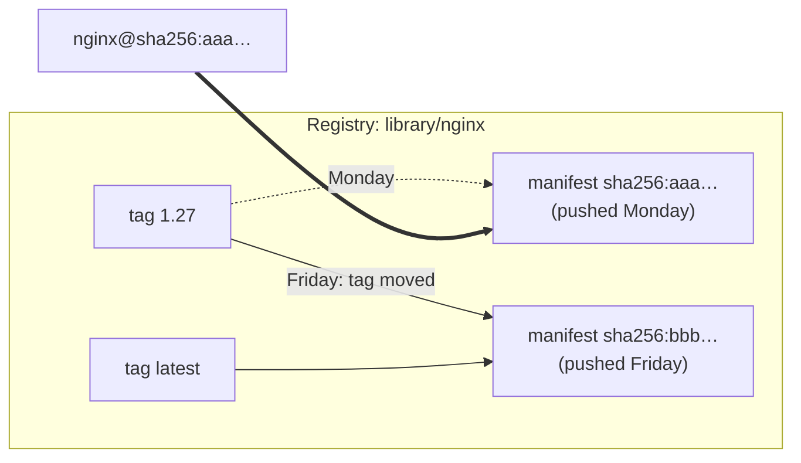
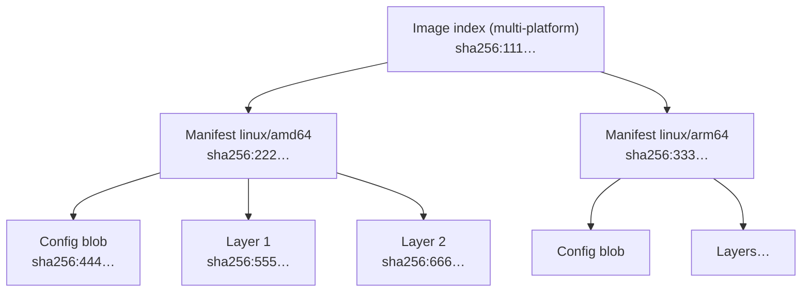
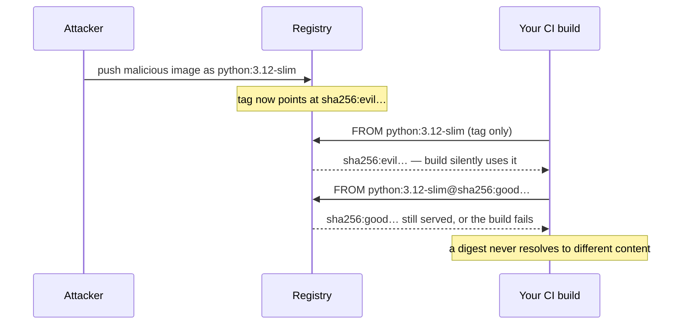
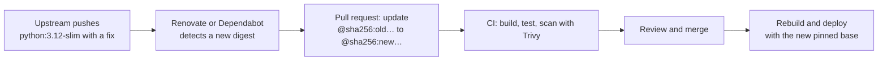

# Docker Image Digest Pinning

Digest pinning means referring to a container image by its content hash, `image:tag@sha256:<digest>`, instead of by a tag alone. A tag is a movable label that the registry can point at different content at any time. A digest is the SHA-256 of the image manifest, so it identifies exactly one image. If anything in the image changes, the digest changes too. Pinning `docker pull`, Kubernetes manifests, and especially the `FROM` base images in a Dockerfile to digests is a basic [[concepts/devops/docker/docker|Docker]] supply-chain control.

## Why It Matters

- **Integrity.** An image can be changed at its source after you first used it: a tag is re-pushed, a maintainer account is compromised, or a registry is tampered with. A digest guarantees that the bytes you pull are exactly the bytes you pinned. If they aren't, the pull fails.
- **Security.** Without a digest, `nginx:1.27` today and `nginx:1.27` tomorrow can be different images. A malicious or broken image pushed under a trusted tag flows silently into every build and deploy that references it.
- **Reproducibility.** The same Dockerfile built twice from a digest-pinned base yields the same base layers. With a tag, a rebuild may pick up a different base without anyone changing a line.
- **Consistency across a fleet.** Every node that pulls a digest runs the same image. With tags, nodes that pulled at different times can run different images under the same name.

## Tags vs. Digests



| Reference | Example | Mutable? | Identifies |
| --- | --- | --- | --- |
| Tag | `nginx:1.27` | Yes; whoever can push can repoint it | Whatever the tag points at *right now* |
| `latest` | `nginx` or `nginx:latest` | Yes; it is just a default tag name | Usually the newest push, by convention only |
| Digest | `nginx@sha256:aaa…` | No; content-addressed | Exactly one manifest |
| Tag + digest | `nginx:1.27@sha256:aaa…` | No | The digest; the tag is kept for humans only |

When a reference contains both a tag and a digest, Docker and Kubernetes use the digest and ignore the tag. Keeping the tag still helps: it tells readers, and update tools such as Renovate, which version the hash corresponds to.

## What the Digest Covers

An image in a registry is a tree of content-addressed objects. The digest you pin is the hash of the top object, and each object lists the hashes of its children, so one digest transitively locks every layer.



- **Image index**, also called a manifest list. For multi-platform images, the tag points at an index that lists one manifest per platform. Pin the **index digest** to keep the reference working on both amd64 and arm64 machines.
- **Platform manifest.** Pinning a platform manifest's digest locks one architecture. A machine with a different architecture then can't use it.
- **Config and layers.** These are referenced by their own digests. The client verifies each blob's hash as it downloads, so a tampered layer fails the pull.

## Pulling by Digest

```bash
# Find the digest a tag currently points at
docker buildx imagetools inspect nginx:1.27          # shows the index digest and per-platform manifests
docker pull nginx:1.27
docker inspect --format '{{index .RepoDigests 0}}' nginx:1.27
docker images --digests nginx

# Pull exactly that image
docker pull nginx:1.27@sha256:<index-digest>
docker run --rm nginx@sha256:<index-digest>
```

Tools that query a registry without pulling, such as `crane digest nginx:1.27` and `skopeo inspect docker://nginx:1.27`, give the same answer.

## Digest-Pinned Base Images

The most important place to pin is the `FROM` line. Every image you build inherits the base image's packages, and through them its vulnerabilities and any malicious changes.

```dockerfile
# Unpinned: the base can change between two builds of the same commit
FROM python:3.12-slim

# Pinned: the base is fixed; the tag documents which version the hash is
FROM python:3.12-slim@sha256:<index-digest> AS build
...
FROM gcr.io/distroless/python3-debian12@sha256:<index-digest>
COPY --from=build /app /app
```

In a multi-stage build, pin every external stage, including builder images, because their tools and libraries end up in your artifact.



## In Kubernetes

```yaml
containers:
  - name: web
    image: registry.example.com/web:1.4.2@sha256:<digest>
```

- **One image per Deployment.** A tag is resolved separately on each node at pull time, so a re-pushed tag can leave old and new nodes running different images. A digest makes every replica identical, and a rollback to the old digest returns exactly the old image.
- **Pull policy.** With a digest, `imagePullPolicy: IfNotPresent` is safe: a cached image with that digest is by definition the right one.
- **Enforcement.** Admission policies, such as Kyverno or Gatekeeper rules, can reject pods whose images are not referenced by digest, or not signed.
- **Resolve at deploy time.** CI can build and push with a tag, then write the resulting digest into the manifest (`kustomize edit set image`, Helm values, or `crane digest`), so humans keep working with tags.

## The Trade-Off: Pinned Means Frozen

A digest never changes, so a pinned image also never receives security fixes. Pinning moves updates from "silent and automatic" to "explicit and reviewable". That is only an improvement if the updates actually happen:



- **Automate digest bumps.** [[concepts/devops/renovate_docs|Renovate]] can add digests to `FROM` lines and open a pull request whenever the digest behind the tag changes. Dependabot does the same for Dockerfiles.
- **Scan what you pin.** A digest proves that the image is *unchanged*, not that it is *safe*. Scan pinned images with [[concepts/devops/trivy|Trivy]] in CI and on a schedule, because new CVEs are found in old images.
- **Mirror what you depend on.** Registries can garbage-collect untagged manifests, so an old digest may stop being pullable upstream. Copying base images into your own registry keeps pinned builds reproducible.

## What Digests Do Not Prove

| Question | Answered by the digest? | Control that answers it |
| --- | --- | --- |
| Is this exactly the image I pinned? | Yes | — |
| Was it built by who I think it was? | No | Image signing and verification (Sigstore cosign, Notary), provenance attestations |
| Does it contain known vulnerabilities? | No | Image scanning (Trivy) |
| Was the pinned image trustworthy in the first place? | No | Trusted publishers, official images, reviewing before pinning |
| Can the registry overwrite it? | Not the digest; tags yes | Tag immutability settings, such as ECR immutable tags, protect tags too |

Pinning a digest that was already malicious when you copied it only pins the malware. Digests lock in a choice; signatures and scanning help make that choice a good one.

## Related Concepts

- [[concepts/devops/docker/docker|Docker]] — images, layers, registries, and the tag-versus-digest distinction; image hygiene practices this note expands
- [[concepts/devops/renovate_docs|Renovate]] — keeps digest-pinned `FROM` lines current by opening update pull requests
- [[concepts/devops/trivy|Trivy]] — scans pinned images for vulnerabilities, the check digests themselves cannot do
- [[concepts/devops/kubernetes/kubernetes|Kubernetes]] — where pinned digests make every replica and rollback identical
- [[concepts/linux/static_vs_dynamic_linking|Static vs. Dynamic Linking]] — why static binaries can run on `scratch` or distroless bases, shrinking what a pinned base must contain
- [[concepts/software_architecture/semantic_versioning|Semantic Versioning (SemVer)]] — tags as human-readable version promises, which digests back with a cryptographic one

## References

- [Docker: Image digests (docker pull)](https://docs.docker.com/reference/cli/docker/image/pull/#pull-an-image-by-digest-immutable-identifier)
- [OCI Image Specification: Descriptors and digests](https://github.com/opencontainers/image-spec/blob/main/descriptor.md)
- [Kubernetes: Images](https://kubernetes.io/docs/concepts/containers/images/)
