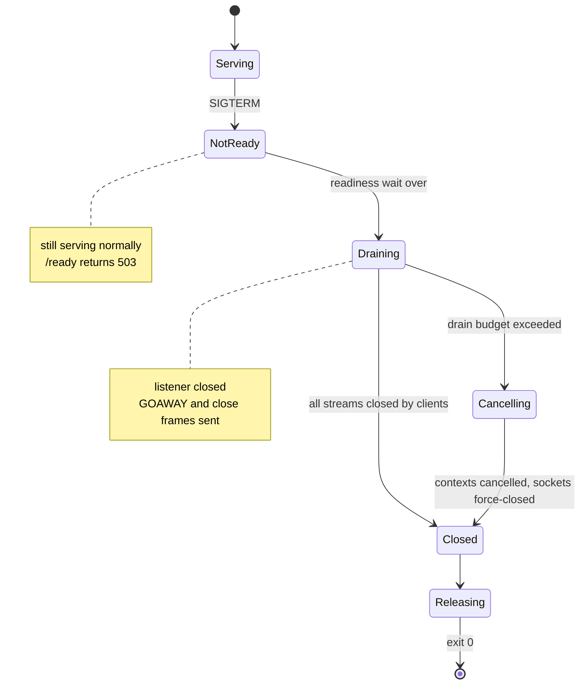
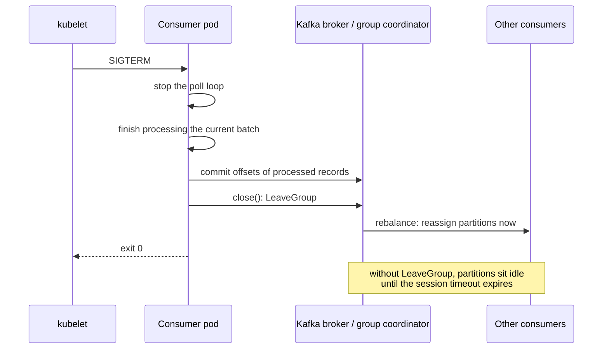

# Graceful Shutdown for Streaming Pods

Graceful shutdown is the sequence a [[concepts/devops/kubernetes/kubernetes|Kubernetes]] pod follows between receiving `SIGTERM` and exiting:

1. Leave the load balancer.
2. Stop taking new work.
3. Finish or hand off the work in flight.
4. Release resources.

All of this has to happen before the kubelet's `SIGKILL`. Streaming workloads make this hard because their work never naturally ends. WebSocket, SSE, and gRPC streams stay open for hours, and stream consumers always have a next batch. So the pod must actively close its streams, rather than wait for them to finish.

## Why It Matters

- **Every rollout is a shutdown.** Rolling updates, scale-downs, node drains, autoscaler consolidation, and spot reclaims all terminate pods. Without a graceful path, each deploy drops connections and loses or duplicates messages.
- **Streams never "finish".** A request-response server drains in milliseconds. A WebSocket or gRPC stream stays open until something closes it, so a server that waits for idle connections simply waits until `SIGKILL`.
- **The kill is abrupt.** `SIGKILL` gives no chance to send close frames, commit offsets, or flush buffers. Clients see resets instead of clean closes, and consumers reprocess everything since their last commit.
- **Reconnect storms.** Thousands of clients cut off at once all reconnect to the remaining pods at the same moment, which can cascade into a wider outage.

## What Kubernetes Does on Termination

When a pod is deleted, the API server marks it `Terminating`. Two independent processes then start at the same time: the kubelet begins shutting the container down, and the endpoint controllers remove the pod from Services. Nothing synchronizes them.

```mermaid
sequenceDiagram
    participant API as API server
    participant EP as EndpointSlice controller
    participant LB as kube-proxy, ingress, cloud LB
    participant KL as kubelet
    participant APP as Container
    participant CL as Streaming clients
    API->>EP: pod Terminating
    API->>KL: pod Terminating
    par endpoint removal
        EP->>LB: remove pod from endpoints
        Note over LB: propagates over seconds;<br/>new connections may still arrive
    and container shutdown
        KL->>APP: run preStop hook, if any
        KL->>APP: SIGTERM
        APP->>CL: close streams (GOAWAY, close frame)
        CL->>LB: reconnect
        LB->>CL: routed to another pod
        APP->>APP: commit, flush, release resources
        APP-->>KL: exit 0
    end
    Note over KL: if still running when<br/>terminationGracePeriodSeconds expires
    KL->>APP: SIGKILL (exit 137)
```

- **`terminationGracePeriodSeconds`** (default 30) is the whole budget, measured from the start of termination. It *includes* the `preStop` hook. If the hook is still running when the period ends, the kubelet grants a single extra 2 seconds, then sends `SIGTERM` and kills the container.
- **Endpoint removal is asynchronous.** kube-proxy on every node, ingress controllers, service meshes, and cloud load balancers each learn about the change on their own schedule, so new connections can still arrive for several seconds after `SIGTERM`.
- **`SIGTERM` reaches only PID 1.** If PID 1 is a shell that doesn't forward signals, the application never hears it, and every shutdown becomes a kill after the full grace period. See [[concepts/devops/docker/docker_container_techniques|Docker Container Techniques]].
- **Exit codes tell the story.** `0` or `143` (128 + 15) means the app exited on `SIGTERM`. `137` (128 + 9) means the grace period ran out and the pod was killed.

## The Shutdown Timeline

![[raw/assets/graceful_shutdown_timeline.png|600]]

The diagram splits shutdown into five phases, with the first four given time budgets. The whole sequence should fit inside about 80% of `terminationGracePeriodSeconds`:

1. **Receive `SIGTERM`.**
2. **Fail the readiness probe (about 5 s).**
3. **Finish ongoing requests and stop accepting connections (up to 10 s).**
4. **Cancel ongoing requests (about 5 s).** This step is drawn dashed, because it runs only when phase 3 doesn't finish in time.
5. **Release resources.**

| Phase | Budget | What the app does | Why |
| --- | --- | --- | --- |
| 1. Receive `SIGTERM` | — | Signal handler flips the app into shutting-down mode | Starts the sequence; work stays fully served |
| 2. Fail readiness | ~5 s | `/ready` returns 503 while the server keeps serving normally | Gives endpoint removal time to reach every load balancer, so no new connections are routed here |
| 3. Drain | ≤ 10 s | Stop the listener; finish in-flight requests; ask streams to close (GOAWAY, close frames, end of SSE stream) | Lets clients finish or reconnect cleanly elsewhere |
| 4. Cancel | ~5 s | Cancel the context of whatever is still running; force-close remaining connections | Bounds the drain, so stragglers can't run into `SIGKILL` |
| 5. Release | Remainder | Commit offsets, flush buffers and telemetry, close database pools, producers, and files | State is left consistent; nothing is lost in a buffer |

```mermaid
gantt
    title Shutdown budget for terminationGracePeriodSeconds = 30
    dateFormat X
    axisFormat %Ss
    section App
    Fail readiness, wait for LB      :a1, 0, 5s
    Drain requests and streams       :a2, after a1, 10s
    Cancel stragglers                :crit, a3, after a2, 5s
    Release resources                :a4, after a3, 4s
    section Kubernetes
    Headroom (~20%)                  :done, h1, after a4, 6s
    SIGKILL                          :milestone, m1, 30, 0s
```



### Why only about 80% of the grace period

The sum of the phase budgets must stay safely below the grace period. Otherwise a slow cleanup turns into a `SIGKILL` in the middle of a commit. The remaining 20% absorbs a slow `preStop`, a GC pause, a slow broker, and the delay between `SIGTERM` and the handler actually running. Size the grace period from the phases, not the other way round:

$$\text{terminationGracePeriodSeconds} \geq \frac{t_{\text{readiness}} + t_{\text{drain}} + t_{\text{cancel}} + t_{\text{release}}}{0.8}$$

For the default 30 seconds, about 24 seconds is usable: 5 + 10 + 5 leaves about 4 seconds to release resources. A stream that needs a minute to drain needs a grace period of about 90 seconds.

### Failing readiness vs. a `preStop` sleep

The 5-second wait solves the asynchronous endpoint removal shown above, and there are two ways to implement it:

- **In the app:** after `SIGTERM`, return 503 from `/ready` and keep serving for 5 seconds, as in the diagram.
- **In Kubernetes:** a `preStop` hook that sleeps, so `SIGTERM` itself arrives 5 seconds later. Use `exec: { command: ["sleep", "5"] }`, or the native `sleep` action in recent versions, which needs no `sleep` binary in the image.

*Outside the source diagram:* Kubernetes removes a terminating pod from ready Service endpoints whether or not its readiness probe fails. The real value of phase 2 is the *wait* itself. Failing readiness additionally helps load balancers that health-check the pod directly instead of watching endpoints. The `preStop` sleep is the more common choice because it keeps the timing out of application code. Don't do both, or you pay the wait twice.

## Draining Streaming Connections

Each streaming protocol has its own way to say "finish up and reconnect elsewhere". Use it instead of dropping the TCP connection.

| Protocol | How to drain gracefully | What the client should do |
| --- | --- | --- |
| **gRPC** | `GracefulStop()`: sends HTTP/2 `GOAWAY`, refuses new RPCs, waits for active RPCs. Fall back to `Stop()` after the drain budget, since long streams never end by themselves | Retry on `UNAVAILABLE` and reconnect; resume the stream from the last acknowledged message |
| **HTTP/2** | Send `GOAWAY`; existing streams finish, no new streams are accepted on the connection | Open a new connection, which the load balancer routes to a live pod |
| **HTTP/1.1 keep-alive** | Respond with `Connection: close` so the client doesn't reuse the socket | New request on a new connection |
| **WebSocket** | Send a close frame with code `1001` (Going Away), then wait briefly for the client's close frame | Reconnect with jittered backoff and resume from the last message ID |
| **SSE** | End the response stream, optionally sending a `retry:` field first | `EventSource` reconnects automatically and sends `Last-Event-ID`, so the new pod resumes |
| **Long polling** | Answer held requests immediately with an empty response | Re-poll, which lands on another pod |

The reconnection mechanics of each protocol are covered in [[concepts/software_architecture/api_integration_protocols|API and Integration Protocols]].



> [!warning] Go's `http.Server.Shutdown` ignores hijacked connections
> `Shutdown` closes listeners and idle connections and waits for active requests, but it "does not attempt to close nor wait for hijacked connections such as WebSockets". Track WebSocket connections yourself and close them through `RegisterOnShutdown` or your own registry, or they survive until `SIGKILL`.

### Avoiding reconnect storms

- **Stagger the close.** Don't close 10,000 sockets in the same millisecond. Spread close frames across the drain window, or close in batches.
- **Jitter on the client.** Reconnect with exponential backoff and random jitter, so clients from one pod don't arrive at the survivors all at once.
- **Have capacity ready first.** A rolling update with `maxSurge` and `maxUnavailable: 0` starts the new pods, and waits for them to become ready, before old ones terminate.
- **Bound concurrent disruption.** A PodDisruptionBudget limits how many pods a node drain or autoscaler evicts at once.

## Draining Stream Consumers

For a pod that consumes a stream, such as [[concepts/data_engineering/kafka/apache_kafka|Apache Kafka]] consumers or streaming jobs, "in-flight work" is the current batch, and "release resources" means committing progress.



- **Stop fetching, finish the batch, commit, close.** Committing after processing keeps at-least-once delivery without gaps. Closing the consumer sends `LeaveGroup`, so partitions move immediately instead of waiting out the session timeout.
- **A kill means reprocessing.** Records processed but not committed before `SIGKILL` are delivered again to the next owner. Sinks must be idempotent or transactional, as explained in [[concepts/software_architecture/exactly_once_delivery_and_processing|Exactly-Once Delivery and Processing]].
- **Reduce rebalance cost.** Cooperative-sticky assignment moves only the departing member's partitions. Static membership (`group.instance.id`) lets a restarted pod reclaim its partitions without a rebalance, as long as it returns within the session timeout.
- **Producers flush.** Call `flush()` or `close()` on producers during release, or buffered records are lost.
- **Stateful stream processors** take a final snapshot instead. Flink jobs are stopped with a savepoint, and Spark Structured Streaming queries are stopped so the last micro-batch commits to the checkpoint.

## Implementation Sketch

A Go service that follows the five phases: HTTP and WebSocket on one server, gRPC on another, and a Kafka consumer.

```go
func main() {
    ctx, stop := signal.NotifyContext(context.Background(), syscall.SIGTERM, syscall.SIGINT)
    defer stop()

    workCtx, cancelWork := context.WithCancel(context.Background()) // parent of all request and stream work
    var ready atomic.Bool
    ready.Store(true)

    httpSrv := newHTTPServer(workCtx, &ready) // /ready returns 503 when ready is false
    grpcSrv := newGRPCServer(workCtx)
    consumer := newConsumer()
    go serveAll(httpSrv, grpcSrv, consumer)

    <-ctx.Done() // 1. SIGTERM received

    ready.Store(false) // 2. fail readiness, keep serving
    time.Sleep(5 * time.Second)

    drainCtx, cancelDrain := context.WithTimeout(context.Background(), 10*time.Second) // 3. drain
    defer cancelDrain()
    consumer.StopPolling()
    closeWebSockets(1001, "going away") // hijacked connections are not covered by Shutdown
    done := make(chan struct{})
    go func() { grpcSrv.GracefulStop(); close(done) }()
    _ = httpSrv.Shutdown(drainCtx)

    select { // 4. cancel stragglers
    case <-done:
    case <-drainCtx.Done():
        cancelWork()
        grpcSrv.Stop()
        time.Sleep(5 * time.Second)
    }

    consumer.CommitAndClose() // 5. release resources
    flushTelemetry()
    closeDBPool()
}
```

The matching pod settings:

```yaml
spec:
  terminationGracePeriodSeconds: 45     # phases sum to ~25 s; ~45 s keeps a wide margin for streams
  containers:
    - name: stream-api
      readinessProbe:
        httpGet: { path: /ready, port: 8080 }
        periodSeconds: 2
        failureThreshold: 1
      # Alternative to failing readiness in code: delay SIGTERM instead.
      # lifecycle:
      #   preStop:
      #     sleep: { seconds: 5 }
```

## Common Pitfalls

- **Signal never arrives.** A shell-form `CMD` or a wrapper script as PID 1 swallows `SIGTERM`. Every stop then takes the full grace period and ends in exit code 137.
- **Exiting immediately on `SIGTERM`.** Requests still routed during endpoint propagation get connection refused. Wait first, then drain.
- **Waiting forever for streams.** Without a drain deadline and a cancel phase, one long-lived stream holds the pod until `SIGKILL`.
- **Grace period shorter than the work.** Phase budgets that add up to more than the grace period guarantee a kill. Keep the sum near 80%.
- **Liveness probe failing during shutdown.** If the liveness endpoint starts failing as the app drains, the kubelet may restart the container mid-drain. Fail readiness only.
- **Committing before processing.** A consumer that commits offsets on receipt loses those messages if killed. Commit after the work is done.
- **Forgetting external load balancers.** Cloud load balancers have their own deregistration delay, often longer than kube-proxy's. Size the readiness wait or `preStop` sleep for the slowest one.

## Related Concepts

- [[concepts/devops/kubernetes/kubernetes|Kubernetes]] — the hub: probes, the pod termination sequence, and the rolling-update settings that decide how many pods shut down at once
- [[concepts/devops/docker/docker_container_techniques|Docker Container Techniques]] — `SIGTERM` vs. `SIGKILL`, why PID 1 ignores unhandled signals, and the exit codes that reveal a forced kill
- [[concepts/software_architecture/api_integration_protocols|API and Integration Protocols]] — the WebSocket, SSE, gRPC, and long-polling protocols whose close and reconnect mechanics a drain relies on
- [[concepts/data_engineering/kafka/apache_kafka|Apache Kafka]] — consumer groups, offset commits, and rebalances, which decide what a killed consumer loses or duplicates
- [[concepts/software_architecture/exactly_once_delivery_and_processing|Exactly-Once Delivery and Processing]] — why an abrupt kill turns at-least-once delivery into duplicates unless sinks are idempotent
- [[concepts/devops/kubernetes/pod_sandbox|Pod Sandbox (Pause Container)]] — what is torn down after the containers exit, including the pod's network namespace and IP

## References

- [Kubernetes: Pod lifecycle, termination of Pods](https://kubernetes.io/docs/concepts/workloads/pods/pod-lifecycle/#pod-termination)
- [Kubernetes: Container lifecycle hooks](https://kubernetes.io/docs/concepts/containers/container-lifecycle-hooks/)
- [Go net/http: Server.Shutdown](https://pkg.go.dev/net/http#Server.Shutdown)
- [gRPC Go: Server.GracefulStop](https://pkg.go.dev/google.golang.org/grpc#Server.GracefulStop)
