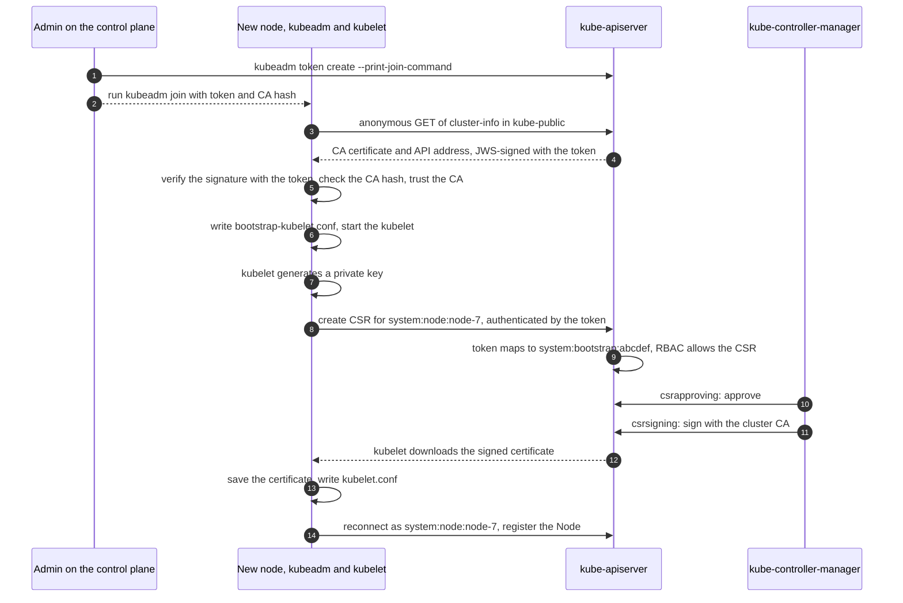
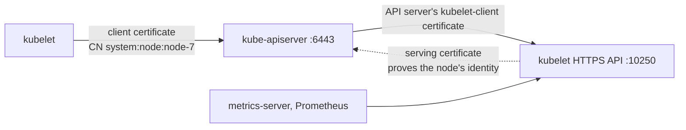

# Kubelet TLS Bootstrapping

Kubelet TLS bootstrapping is how a new node joins a [[concepts/devops/kubernetes/kubernetes|Kubernetes]] cluster and obtains its own identity. The node's kubelet authenticates *once* with a short-lived bootstrap token and submits a certificate signing request (CSR) to the API server. The controller manager approves and signs it with the cluster's certificate authority (CA), and from then on the kubelet authenticates with that client certificate instead of the token. The token is used only for this initial join; later certificate renewals use the certificate itself.

> [!info] Scope of this note
> The join flow, the objects and controllers behind it, certificate rotation, and the difference between the kubelet's *client* and *serving* certificates. Where the kubelet fits among the other components is in [[concepts/devops/kubernetes/kubernetes_components|Kubernetes Components]].

## Why It Matters

- **Every kubelet needs its own identity.** The API server's Node authorizer and the `NodeRestriction` admission plugin limit each kubelet to its own Node object and the pods bound to it. That only works if each kubelet authenticates as a distinct `system:node:<node-name>` user.
- **Manual certificates do not scale.** Without bootstrapping, an operator must create a key and a signed certificate for every node and copy it over, which is slow, error-prone, and impossible for autoscaled node groups that add machines unattended.
- **The CA key stays on the control plane.** Nodes never handle the CA's private key. They prove themselves with a token that expires, and the cluster signs their certificates centrally.

> [!note] The cluster CA still exists
> TLS bootstrapping removes the need to generate and distribute a certificate *per node*. It does not remove the cluster CA: `kubeadm init` generates the CA once, and the controller manager signs every node's certificate with it.

## The Pieces

| Piece | Role |
| --- | --- |
| **Bootstrap token** | A bearer token of the form `abcdef.0123456789abcdef`: a public 6-character ID and a 16-character secret. Stored as a Secret named `bootstrap-token-<id>` of type `bootstrap.kubernetes.io/token` in `kube-system`, with an expiry. kubeadm's default lifetime is 24 hours |
| **API server bootstrap-token authenticator** | Enabled with `--enable-bootstrap-token-auth`. Authenticates a valid token as user `system:bootstrap:<id>` in group `system:bootstrappers` |
| **RBAC bindings** | Let the bootstrappers group create CSRs (`system:node-bootstrapper`) and have node client CSRs auto-approved; let existing nodes renew their own certificates |
| **CertificateSigningRequest** | The API object a kubelet creates. For a kubelet client certificate, its `signerName` is `kubernetes.io/kube-apiserver-client-kubelet` |
| **csrapproving controller** | Part of kube-controller-manager. Auto-approves kubelet client CSRs when the requester has the right permission |
| **csrsigning controller** | Part of kube-controller-manager. Signs approved CSRs with the cluster CA, valid for one year by default (`--cluster-signing-duration`) |
| **bootstrapsigner and tokencleaner controllers** | Sign the public `cluster-info` ConfigMap with each token, and delete expired tokens. Disabled by default in kube-controller-manager; kubeadm enables them |
| **Bootstrap kubeconfig** | A kubeconfig holding the token (`/etc/kubernetes/bootstrap-kubelet.conf` with kubeadm), passed as `--bootstrap-kubeconfig`. Used only while the kubelet has no valid certificate |

## The Join Flow

A kubeadm join, from token to registered node:



Steps 3 to 5 are *discovery*: the node has to trust the API server before it sends anything sensitive. The `cluster-info` ConfigMap is public, but it is signed with the token, so only a party that knows the token could have produced it. The `--discovery-token-ca-cert-hash` (a SHA-256 hash of the CA's public key) pins the CA, so even an attacker who has the token cannot substitute their own CA.

The CSR a kubelet sends for its client certificate always has the same shape:

| Field | Value |
| --- | --- |
| `signerName` | `kubernetes.io/kube-apiserver-client-kubelet` |
| Subject common name (CN) | `system:node:<node-name>` |
| Subject organization (O) | `system:nodes` |
| Key usages | Client authentication |

After the join, the kubelet keeps its credentials in `/var/lib/kubelet/pki/`: dated `kubelet-client-<timestamp>.pem` files, with `kubelet-client-current.pem` a symlink to the newest. `/etc/kubernetes/kubelet.conf` points at that symlink.

## Certificate Rotation

With `rotateCertificates: true` in the kubelet configuration, which kubeadm sets, the kubelet requests a new client certificate on its own once most of the current certificate's lifetime has passed. It sends a new CSR authenticated by the certificate it still holds, and the controller manager approves it through the permission that lets nodes renew their own certificates. No token is involved.

> [!warning] A node offline past its certificate's expiry cannot rejoin by itself
> Rotation needs a valid certificate to authenticate the renewal. A node that was powered off or partitioned until its client certificate expired cannot renew it; it has to be bootstrapped again with a new token.

## Client vs. Serving Certificates

The kubelet takes part in TLS in two directions, so it uses two different certificates:



| | Client certificate | Serving certificate |
| --- | --- | --- |
| **Used when** | The kubelet calls the API server: watching its pods, reporting status, renewing certificates | Others call the kubelet: `kubectl logs`, `exec`, and `port-forward` through the API server; metrics scrapes |
| **Proves** | "I am the kubelet of node-7" to the API server | "This really is node-7's kubelet" to whoever connects |
| **Key usage and names** | Client authentication; the identity is in the subject | Server authentication; must list the node's hostnames and IP addresses as subject alternative names |
| **Signer** | `kubernetes.io/kube-apiserver-client-kubelet` | `kubernetes.io/kubelet-serving` |
| **How it is issued** | TLS bootstrapping, auto-approved, rotated automatically | By default, *self-signed* by the kubelet at startup. With `serverTLSBootstrap: true`, requested through a CSR, which is **not** auto-approved |
| **File, by default** | `/var/lib/kubelet/pki/kubelet-client-current.pem` | `/var/lib/kubelet/pki/kubelet.crt` when self-signed; `kubelet-server-current.pem` when CA-signed |

Why serving CSRs are not auto-approved: a serving certificate asserts which hostnames and IP addresses belong to the node. The built-in approver cannot verify those claims, and a compromised node that obtained a certificate for another node's IP address could impersonate that node's kubelet. Approve serving CSRs manually (`kubectl certificate approve`) or with an approver that checks the claimed addresses against the cloud provider or Node objects.

There is a third certificate in this picture: the API server's own client certificate for calling kubelets (`--kubelet-client-certificate` and `--kubelet-client-key`; `apiserver-kubelet-client.crt` in kubeadm). The kubelet checks it against its `clientCAFile`.

> [!warning] Self-signed serving certificates leave a verification gap
> With the default self-signed serving certificates, the API server cannot verify that it is talking to the real kubelet, and it connects without verification unless `--kubelet-certificate-authority` is set. The same gap is why metrics-server is often deployed with `--kubelet-insecure-tls`. Enabling `serverTLSBootstrap` and setting `--kubelet-certificate-authority` closes it.

### Securing the kubelet API

The kubelet's port 10250 can list pods, read logs, and run commands in containers, so it needs its own authentication and authorization. kubeadm sets these in the kubelet configuration:

```yaml
authentication:
  anonymous:
    enabled: false          # reject unauthenticated callers
  webhook:
    enabled: true           # accept API-server-issued bearer tokens
  x509:
    clientCAFile: /etc/kubernetes/pki/ca.crt   # verify client certificates
authorization:
  mode: Webhook             # ask the API server (SubjectAccessReview) per request
```

A kubelet with anonymous access enabled and authorization mode `AlwaysAllow` lets anyone who can reach port 10250 run commands in every pod on that node.

## Security Notes

- **A bootstrap token is a credential.** Keep its lifetime short, create it only when a join is due (`kubeadm token create`), and delete it afterwards (`kubeadm token delete`).
- **The built-in approver checks the request's shape, not the machine.** It approves any well-formed node client CSR from a holder of the bootstrap permission, whatever node name it claims. Managed services and some installers add approvers that verify the requesting machine's cloud identity.
- **`NodeRestriction` limits the damage.** Even with a valid node certificate, a kubelet can modify only its own Node object and the pods bound to it, and read only the Secrets and ConfigMaps those pods use.
- **Never put a node in `system:masters`.** Node identities belong in `system:nodes`, which RBAC and the Node authorizer treat specially.

## Related Concepts

- [[concepts/devops/kubernetes/kubernetes_components|Kubernetes Components]] — the API server's authentication pipeline and the controller manager that approves and signs CSRs
- [[concepts/devops/kubernetes/static_pod_vs_normal_pod|Static Pod vs. Normal Pod]] — mirror pods, which a kubelet may create only for its own node once it has its node identity
- [[concepts/devops/kubernetes/security/kubernetes_security|Kubernetes Security]] — the cluster's attack surfaces, of which the kubelet API and bootstrap tokens are two
- [[concepts/identity_and_access/authentication|Authentication]] — the general problem the bootstrap token and the node's client certificate solve, one after the other
- [[concepts/identity_and_access/authorization|Authorization]] — RBAC, the Node authorizer, and webhook checks deciding what an authenticated kubelet may do
- [[concepts/devops/kubernetes/kubernetes|Kubernetes]] — the hub: RBAC, ServiceAccounts, and the cluster's wider security model

## References

- [TLS bootstrapping](https://kubernetes.io/docs/reference/access-authn-authz/kubelet-tls-bootstrapping/) — the official description of the flow and its RBAC
- [Authenticating with bootstrap tokens](https://kubernetes.io/docs/reference/access-authn-authz/bootstrap-tokens/) — token format, Secrets, and discovery signing
- [Certificates and certificate signing requests](https://kubernetes.io/docs/reference/access-authn-authz/certificate-signing-requests/) — signers and approval
- [Kubelet authentication and authorization](https://kubernetes.io/docs/reference/access-authn-authz/kubelet-authn-authz/) — securing port 10250
