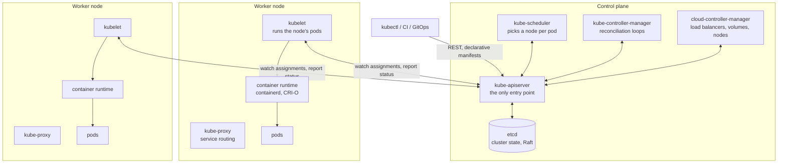
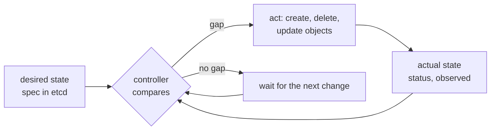
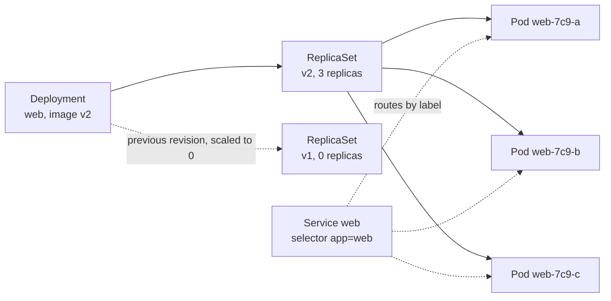
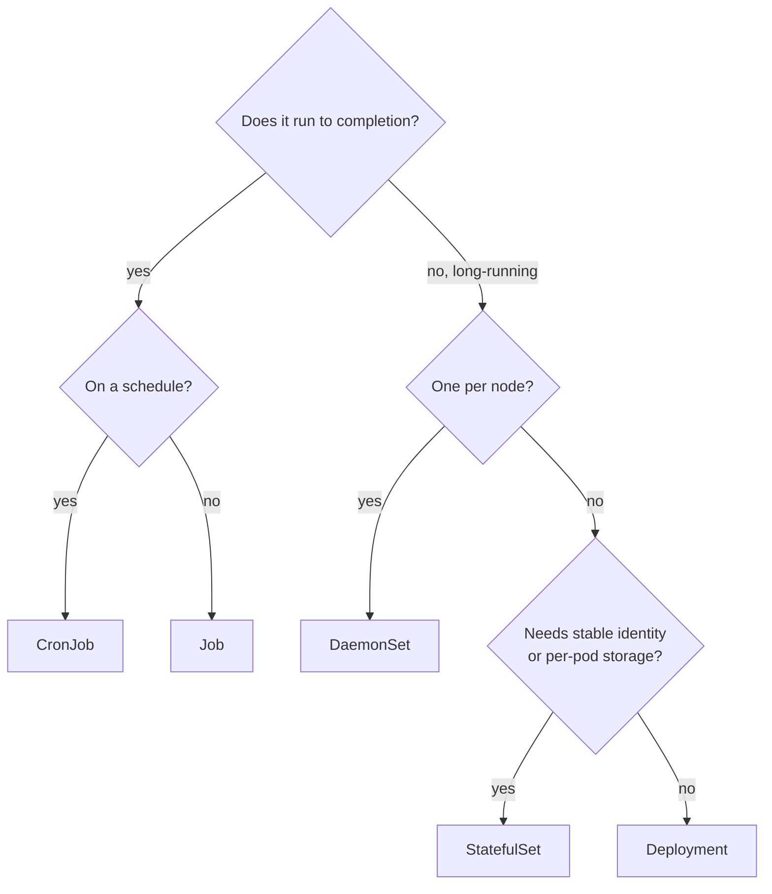
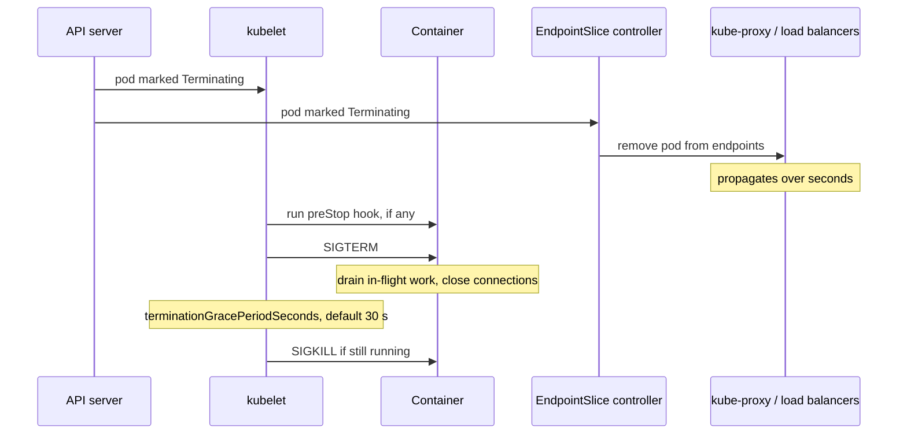
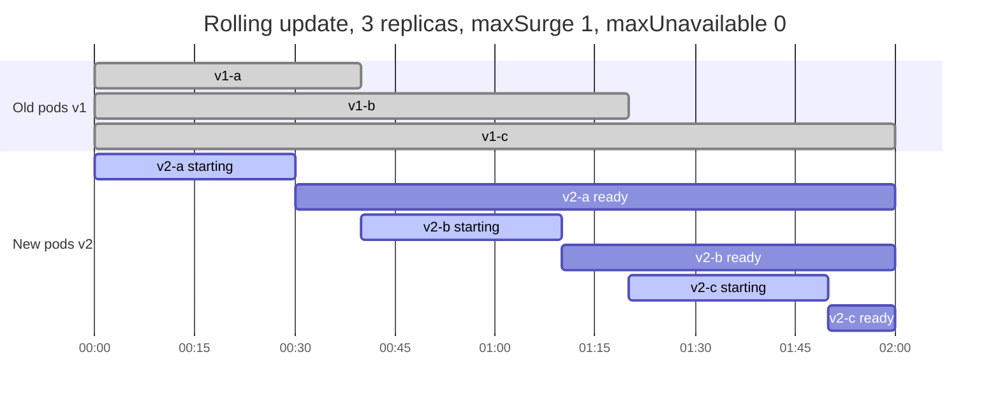

# Kubernetes

Kubernetes (often written K8s) is an open-source container orchestration platform. It runs containerized workloads across a cluster of machines and keeps them in the state you declare: it schedules containers onto nodes, restarts them when they fail, scales them, rolls out new versions, and gives them stable networking and storage. It is the most common runtime for the services that [[concepts/devops/observers|Observers]] watch and that [[concepts/devops/trivy|Trivy]] scans, and it is the hub for the `devops/kubernetes/` folder.

> [!info] Scope of this note
> A hub overview of what Kubernetes is, how it works, and its core objects, written from general knowledge of the upstream project. Deeper topics, such as graceful shutdown, networking, security hardening, and operators, belong in their own notes in this folder. Version-specific details are marked as such.

## Why It Matters

- **Declarative operations.** You state *what* should run (three replicas of this image, with this much memory, behind this address), not *how* to start it. Controllers continuously work to make reality match, which turns many failure-recovery procedures into automatic behaviour.
- **A portable platform API.** The same manifests run on Google GKE, Amazon EKS, Azure AKS, on-premises clusters, or a laptop. The Kubernetes API has become the common operating interface for infrastructure tooling.
- **An ecosystem built on extension.** Monitoring ([[concepts/devops/metrics/prometheus|Prometheus]]), security scanning, databases, stream processors, and ML platforms ship as Kubernetes-native components that extend the API itself.

## Origins

Kubernetes was created at Google, drawing on a decade of running its internal cluster managers Borg and Omega. It was open-sourced in 2014, and version 1.0 was released in July 2015. At the same time Google donated it to the newly formed Cloud Native Computing Foundation (CNCF), as the foundation's first project. The name is Greek for "helmsman"; "K8s" abbreviates the eight letters between the K and the s.

The project releases three minor versions a year. Each minor version receives patches for about 14 months, so clusters must be upgraded regularly to stay supported.

## Architecture



Every component communicates through the API server, and only the API server talks to etcd. Components *watch* the API for changes instead of calling each other directly. Each component's internals, how they cooperate to run a Deployment, and how each one fails are covered in [[concepts/devops/kubernetes/kubernetes_components|Kubernetes Components]].

| Component | Role |
| --- | --- |
| **kube-apiserver** | Validates and stores every object; serves the REST API; runs authentication, authorization, and admission control |
| **etcd** | Strongly consistent key-value store holding all cluster state, replicated with the Raft consensus protocol (see [[concepts/databases/distributed_consensus\|Distributed Consensus]]) |
| **kube-scheduler** | Assigns each new pod to a node, based on resource requests, affinity, taints, and spread constraints |
| **kube-controller-manager** | Runs the built-in controllers: Deployment, ReplicaSet, Node, Job, EndpointSlice, and more |
| **cloud-controller-manager** | Integrates with the cloud provider: load balancers, node lifecycle, routes |
| **kubelet** | The agent on each node; starts and stops containers through the Container Runtime Interface (CRI) and runs health probes |
| **kube-proxy** | Programs node-level rules (iptables, IPVS, or nftables) that route Service traffic to pods; some network plugins, such as Cilium, replace it |
| **Container runtime** | containerd or CRI-O. Direct Docker Engine support (dockershim) was removed in v1.24, though Docker-built images still run unchanged |

> [!important] Reconciliation is the core idea
> Every controller runs the same loop: read the *desired* state from the API, observe the *actual* state, act to close the gap, and repeat. There is no central script for "deploy" or "recover". A crashed pod, a lost node, and a new release are all just gaps that some controller closes.



## Core Objects

Every object has the same shape: `apiVersion`, `kind`, `metadata` (name, namespace, labels, annotations), a `spec` (desired state, which you write), and a `status` (observed state, which controllers write).

### Workloads

| Object | Purpose | Typical use |
| --- | --- | --- |
| **Pod** | The smallest deployable unit: one or more containers sharing a network namespace (one IP) and volumes | Rarely created directly; controllers create them |
| **ReplicaSet** | Keeps *N* identical pods running | Managed by a Deployment |
| **Deployment** | Declarative rollouts and rollbacks of stateless pods through ReplicaSets | Web services, APIs, stateless workers |
| **StatefulSet** | Pods with stable names (`app-0`, `app-1`), stable per-pod storage, and ordered start and stop | Databases, Kafka, ZooKeeper, stateful stream processors |
| **DaemonSet** | Exactly one pod per (matching) node | Log shippers, node exporters, network and storage agents |
| **Job / CronJob** | Run pods to completion, once or on a schedule | Batch processing, migrations, scheduled reports |



The Deployment owns ReplicaSets, one per revision, and each ReplicaSet owns its pods. Keeping old ReplicaSets scaled to zero is what makes `kubectl rollout undo` instant. The Service never references pods directly; it selects them by label.

Which workload controller to choose:



### Networking and configuration

| Object | Purpose |
| --- | --- |
| **Service** | A stable virtual IP and DNS name in front of a changing set of pods. Types: `ClusterIP` (internal, the default), `NodePort`, `LoadBalancer` (cloud load balancer), `ExternalName`; *headless* Services return pod IPs directly, which StatefulSets use |
| **EndpointSlice** | The current list of ready pod addresses behind a Service, maintained by a controller |
| **Ingress / Gateway API** | HTTP(S) routing from outside the cluster by host and path. The Gateway API is the newer, more expressive successor to Ingress |
| **NetworkPolicy** | Firewall rules between pods. Enforced only if the network plugin supports it |
| **ConfigMap** | Non-secret configuration, mounted as files or environment variables |
| **Secret** | Sensitive values. Only base64-encoded by default; enable encryption at rest and restrict access with RBAC, or use an external secret manager |
| **Namespace** | A scope for names, access policies, and resource quotas within one cluster |

### Storage

A **PersistentVolumeClaim** (PVC) is a pod's request for storage. A **StorageClass** says how to provision it dynamically through a Container Storage Interface (CSI) driver, for example a cloud disk. The resulting **PersistentVolume** (PV) outlives the pod. Plain volumes (`emptyDir`, ConfigMap and Secret mounts) live only as long as the pod.

## Scheduling and Resources

- **Requests and limits.** A container's *request* is what the scheduler reserves for it; its *limit* is the most it may use. A container that exceeds its memory limit is OOM-killed; one that exceeds its CPU limit is throttled, not killed.
- **QoS classes.** Kubernetes derives a class from requests and limits. `Guaranteed` means requests equal limits for every container. `Burstable` means some requests are set. `BestEffort` means none are set. Under node memory pressure, BestEffort pods are evicted first and Guaranteed pods last.
- **Placement controls.** *Node selectors and affinity* attract pods to nodes. *Taints and tolerations* repel pods from nodes unless they tolerate the taint, for example to reserve GPU nodes. *Pod anti-affinity and topology spread constraints* spread replicas across nodes and zones.
- **Priority and preemption.** Higher-priority pods can evict lower-priority ones when the cluster is full.

> [!warning] Missing requests break scheduling and autoscaling
> Without CPU and memory requests, the scheduler packs pods blindly, the pods fall into the BestEffort class, and the Horizontal Pod Autoscaler cannot compute utilization. Set requests on every container, based on observed usage.

## Health, Lifecycle, and Rollouts

### Probes

| Probe | Question | Effect when failing |
| --- | --- | --- |
| **Startup** | Has the app finished starting? | Other probes are held off until it passes, which protects slow starters |
| **Liveness** | Is the process stuck beyond recovery? | The kubelet restarts the container |
| **Readiness** | Should this pod receive traffic right now? | The pod is removed from Service endpoints; it is not restarted |

> [!warning] Liveness probes must not check dependencies
> If a liveness probe fails when the database is down, every replica restarts at once, and the outage gets worse. Liveness should test only the process itself. Put dependency checks, if anywhere, in readiness.

### Pod termination

When a pod is deleted, for example during a rollout, a scale-down, or a node drain, two things happen *in parallel*:



Because endpoint removal propagates asynchronously, traffic can still arrive *after* SIGTERM. A common pattern is a short `preStop` sleep, so the pod keeps serving until routers have stopped sending to it. The app should then finish in-flight work well inside the grace period. The full procedure, including draining long-lived and streaming workloads, is in [[concepts/devops/kubernetes/graceful_shutdown|Graceful Shutdown for Streaming Pods]].

### Rolling updates and disruption

- A Deployment's `RollingUpdate` strategy replaces pods gradually, bounded by `maxSurge` (how many extra pods may exist) and `maxUnavailable` (how many may be missing). A pod counts as available only once it is ready, so readiness probes gate the rollout.
- `kubectl rollout undo` returns to the previous ReplicaSet.
- A **PodDisruptionBudget** (PDB) limits how many replicas *voluntary* disruptions, such as node drains and cluster upgrades, may take down at once.



With `maxUnavailable: 0`, capacity never drops below three ready pods. Each old pod is removed only after a new one becomes ready, so a new version that never passes readiness stalls the rollout instead of taking the service down.

## Scaling

| Mechanism | Scales | Signal |
| --- | --- | --- |
| **Horizontal Pod Autoscaler (HPA)** | Replica count | CPU or memory utilization against requests, or custom and external metrics such as queue depth and consumer lag |
| **Vertical Pod Autoscaler (VPA)** | Requests and limits per pod | Observed usage over time |
| **Cluster Autoscaler / Karpenter** | Number of nodes | Pods that cannot be scheduled for lack of capacity; underused nodes |
| **KEDA** | Replicas, including to and from zero | Event sources: Kafka lag, queue length, cron |

## Security

- **RBAC.** *Roles* and *ClusterRoles* grant verbs on resources; *RoleBindings* attach them to users, groups, or *ServiceAccounts* (the identity a pod runs as). Default to least privilege, and avoid granting `cluster-admin` to workloads.
- **Pod Security Standards.** Three levels (`privileged`, `baseline`, `restricted`), enforced per namespace by the built-in Pod Security Admission. It replaced PodSecurityPolicy, which was removed in v1.25.
- **Admission control.** Validating and mutating webhooks, or policy engines such as OPA Gatekeeper and Kyverno, can reject non-compliant manifests at the API server.
- **Supply chain.** Scan images and manifests before deploy, and scan running clusters (`trivy k8s`). Pin images by digest, and run containers as non-root with read-only root filesystems.

The cluster's attack surfaces, and specific attack techniques with how to detect and prevent each, are in [[concepts/devops/kubernetes/security/kubernetes_security|Kubernetes Security]].

## Extending Kubernetes

- **CustomResourceDefinitions (CRDs)** add new object kinds to the API, such as `KafkaTopic`, `FlinkDeployment`, or `ServiceMonitor`.
- **Operators** are controllers that reconcile those custom resources, encoding an expert's operating knowledge. Examples include the Prometheus Operator, Strimzi for Kafka, and the Flink Kubernetes Operator, which runs the stateful jobs described in [[concepts/data_engineering/stateful_vs_stateless_stream_processing|Stateful vs. Stateless Stream Processing]].
- **Packaging.** *Helm* packages templated manifests as versioned charts. *Kustomize*, built into `kubectl`, overlays environment-specific patches on plain YAML.
- **GitOps.** *Argo CD* or *Flux* continuously reconcile the cluster from a Git repository. This is the same desired-versus-actual loop, applied to the whole cluster.

## A Minimal Example

A Deployment with probes, requests, and a graceful-termination window, plus the Service in front of it:

```yaml
apiVersion: apps/v1
kind: Deployment
metadata:
  name: web
spec:
  replicas: 3
  selector:
    matchLabels: { app: web }
  strategy:
    rollingUpdate: { maxSurge: 1, maxUnavailable: 0 }
  template:
    metadata:
      labels: { app: web }
    spec:
      terminationGracePeriodSeconds: 45
      containers:
        - name: web
          image: registry.example.com/web@sha256:<digest>
          ports: [{ containerPort: 8080 }]
          resources:
            requests: { cpu: 250m, memory: 256Mi }
            limits: { memory: 512Mi }
          readinessProbe:
            httpGet: { path: /ready, port: 8080 }
            periodSeconds: 5
          livenessProbe:
            httpGet: { path: /healthz, port: 8080 }
            periodSeconds: 10
            failureThreshold: 3
          lifecycle:
            preStop:
              exec: { command: ["sleep", "5"] }
---
apiVersion: v1
kind: Service
metadata:
  name: web
spec:
  selector: { app: web }
  ports: [{ port: 80, targetPort: 8080 }]
```

## When Not to Use It

The following is judgement, not documentation. Kubernetes trades operational complexity for flexibility. Upgrades every year, networking, RBAC, and dozens of moving parts are a standing cost even on a managed service. For a handful of stateless services, a serverless container platform such as Cloud Run is often the better fit; [[concepts/data_engineering/dbt/deploy_dbt_cloud_run_github_actions|Deploy dbt and Elementary to Cloud Run with GitHub Actions]] is a worked example of that route. Kubernetes pays off when there are many services, mixed workloads (stateful, batch, GPU), multiple teams sharing a platform, or a need to run the same platform across clouds and on-premises.

## Related Concepts

- [[concepts/devops/kubernetes/kubernetes_components|Kubernetes Components]] — the deep dive: API server pipeline, etcd quorums, scheduler plugins, controllers, kubelet, runtimes, kube-proxy, and failure modes
- [[concepts/devops/kubernetes/static_pod_vs_normal_pod|Static Pod vs. Normal Pod]] — file-defined pods that run without the API server, and the mirror pods that make them visible
- [[concepts/devops/kubernetes/security/kubernetes_security|Kubernetes Security]] — attack surfaces and attack techniques, starting with hidden static pods
- [[concepts/devops/kubernetes/graceful_shutdown|Graceful Shutdown for Streaming Pods]] — the phased shutdown timeline, sizing the grace period, and draining WebSocket, SSE, gRPC, and Kafka consumer workloads
- [[concepts/devops/kubernetes/pod_sandbox|Pod Sandbox (Pause Container)]] — the shared namespaces that make a pod's containers one unit with one IP
- [[concepts/devops/kubernetes/kubelet_tls_bootstrapping|Kubelet TLS Bootstrapping]] — how nodes join the cluster and get their client and serving certificates
- [[concepts/devops/kubernetes/veth_pair|Virtual Ethernet (veth) Pair]] — how each pod is wired into its node's network, and the packet paths within and between nodes
- [[concepts/devops/observers|Observers]] — logs, metrics, and traces for the workloads Kubernetes runs; most of that tooling deploys onto the cluster itself
- [[concepts/devops/metrics/prometheus|Prometheus]] — the de facto Kubernetes monitoring system, discovering pods through the Kubernetes API
- [[concepts/devops/trivy|Trivy]] — scans images, manifests, Helm charts, and live clusters for vulnerabilities and misconfiguration
- [[concepts/devops/brainboard|Brainboard]] — infrastructure-as-code design for the clusters and cloud resources Kubernetes runs on
- [[concepts/databases/distributed_consensus|Distributed Consensus]] — Raft, the protocol that keeps etcd, and so the whole control plane, consistent
- [[concepts/data_engineering/stateful_vs_stateless_stream_processing|Stateful vs. Stateless Stream Processing]] — why stateful workloads need StatefulSets, persistent volumes, and careful shutdown
- [[concepts/software_architecture/software_architecture|Software Architecture]] — deployment topology and failure handling as architectural decisions that Kubernetes then implements

## References

- [Kubernetes documentation](https://kubernetes.io/docs/) — concepts, tasks, and API reference
- [Kubernetes components](https://kubernetes.io/docs/concepts/overview/components/) — control plane and node components
- [Pod lifecycle](https://kubernetes.io/docs/concepts/workloads/pods/pod-lifecycle/) — phases, probes, and termination
- [Kubernetes version skew and support policy](https://kubernetes.io/releases/) — release cadence and support windows
