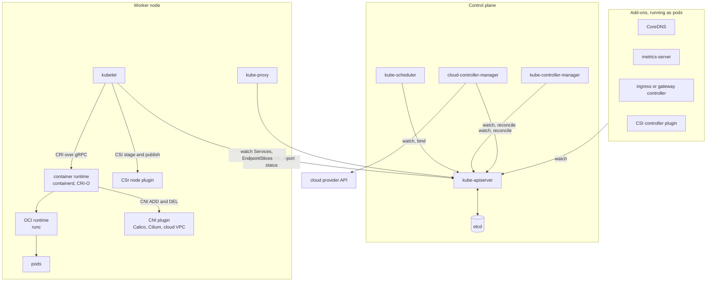
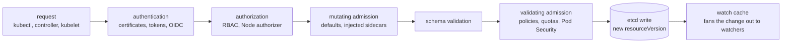
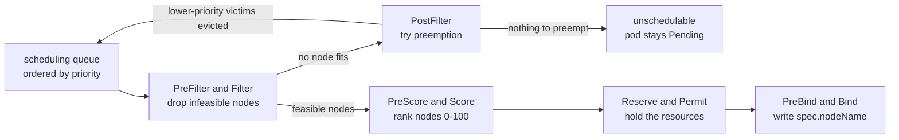
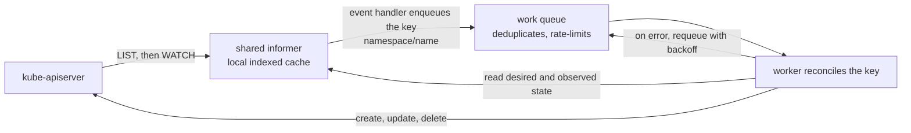
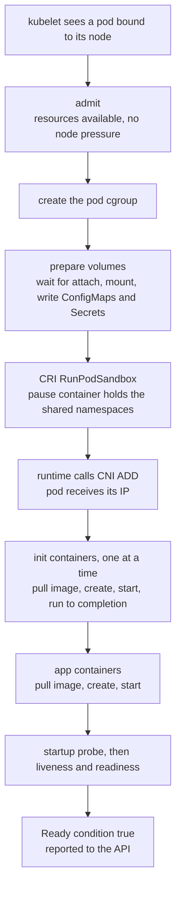
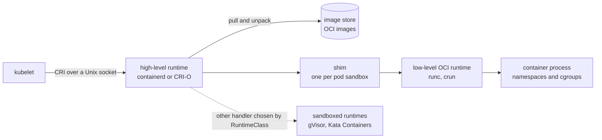
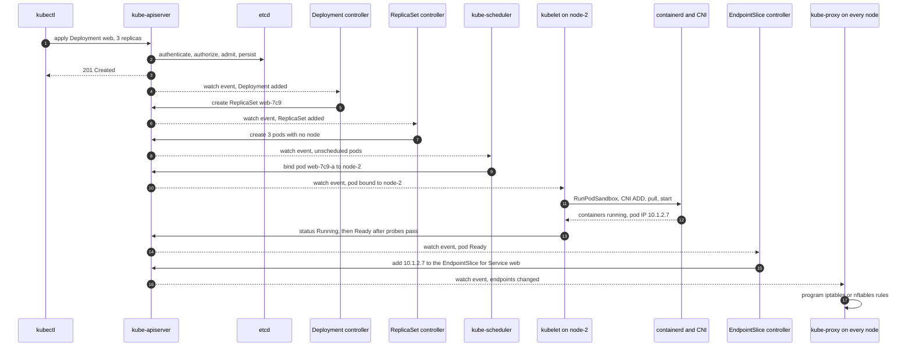
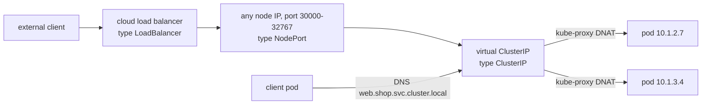
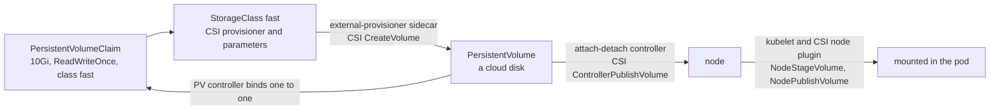
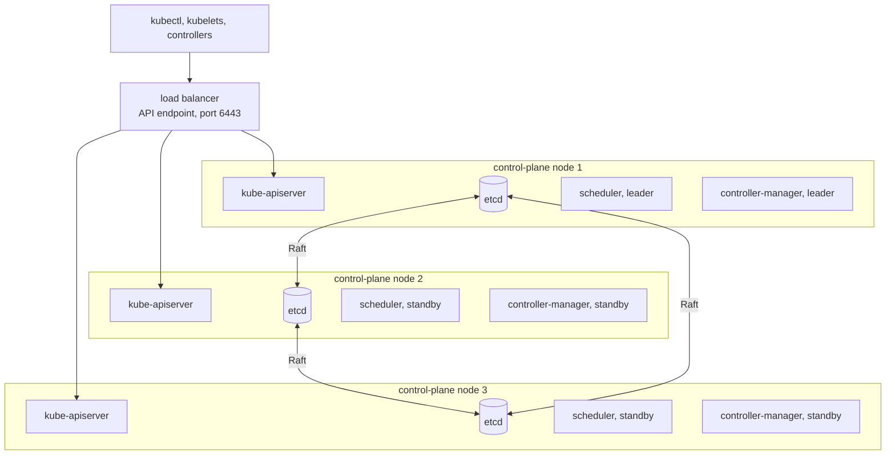

# Kubernetes Components

Kubernetes components are the processes that make up a [[concepts/devops/kubernetes/kubernetes|Kubernetes]] cluster. A *control plane* stores the declared state of the cluster and works to make it real. Every *worker node* runs an agent, a network proxy, and a container runtime, which together run the pods. Add-ons such as cluster DNS and the network plugin complete the platform. Every object you write, whether a Deployment, a Service, or a PersistentVolumeClaim, is only data until one or more of these components acts on it.

> [!info] Scope of this note
> A deep dive into each component: what it does internally, how the components cooperate to turn a manifest into running, reachable pods, and how each one fails. The catalogue of object kinds, probes, rollouts, autoscaling, and security stays in the hub. Written from general knowledge of upstream Kubernetes; version-specific details are marked.

## Why It Matters

- **Debugging follows the component chain.** A pod stuck in `Pending` is a scheduler question. A pod stuck in `ContainerCreating` is a kubelet, network-plugin, or storage-driver question. A Service that returns nothing is an EndpointSlice or kube-proxy question. Knowing which component owns each step turns a vague symptom into one place to look.
- **Each component fails differently.** Losing the scheduler only stops new placements. Losing etcd quorum freezes every change to the cluster. Running pods survive the loss of the entire control plane. Sizing, backups, and on-call runbooks follow from these differences.
- **Managed services split the responsibility.** GKE, EKS, and AKS operate the control plane for you, but node components, add-ons, and their configuration usually remain yours.

## Cluster Anatomy

A **cluster** is a set of machines, called **nodes**, plus a **control plane**. Worker nodes run your pods. The control plane runs either on dedicated control-plane nodes, in self-managed clusters such as those built with kubeadm, or out of sight on the provider's side, in managed clusters.

The core stays vendor-neutral by talking to everything replaceable through three plug-in interfaces:

| Interface | Between | Common implementations |
| --- | --- | --- |
| **CRI**, Container Runtime Interface | kubelet and the container runtime, over gRPC | containerd, CRI-O |
| **CNI**, Container Network Interface | Container runtime and the network plugin, which gives each pod an IP | Calico, Cilium, Flannel, cloud VPC plugins |
| **CSI**, Container Storage Interface | Kubernetes and storage drivers | Cloud disk drivers, Ceph, NFS |

Every arrow into the API server is a client connection. No component calls another component directly, and ==only the API server talks to etcd==.

| Component | Layer | Typically runs as | Default port | Instances |
| --- | --- | --- | --- | --- |
| **kube-apiserver** | Control plane | Static pod (kubeadm) or provider-managed | 6443 | Several, all active behind a load balancer |
| **etcd** | Control plane | Static pod, or on separate hosts | 2379 client, 2380 peer | 3 or 5 members |
| **kube-scheduler** | Control plane | Static pod | 10259 | Several, one active through leader election |
| **kube-controller-manager** | Control plane | Static pod | 10257 | Several, one active through leader election |
| **cloud-controller-manager** | Control plane | Deployment, or provider-managed | 10258 | Several, one active through leader election |
| **kubelet** | Node | A [[concepts/linux/systemd_targets\|systemd service]] on the host, not a pod | 10250 | One per node |
| **kube-proxy** | Node | DaemonSet | 10256 (health) | One per node |
| **Container runtime** | Node | A systemd service on the host | Unix socket | One per node |

A kubeadm cluster runs its control plane as *static pods*. The kubelet on each control-plane node reads manifests from a local directory (`/etc/kubernetes/manifests`) and runs them without asking any API server. That is how the API server can itself be a pod: the kubelet starts it before there is an API to ask.

## Control Plane Components

### kube-apiserver

The API server is the front door of the cluster. kubectl, CI pipelines, controllers, kubelets, and add-ons are all API clients. It is stateless, because all state lives in etcd, so it scales horizontally behind a load balancer.

> [!important] The API server stores and notifies; it does not orchestrate
> The API server never starts a container or picks a node. It authenticates, validates, stores, and broadcasts changes. Every behaviour of the cluster lives in the clients that watch it.

Every write passes the same pipeline:

- **Authentication** establishes *who* is calling: X.509 client certificates (kubelets and administrators), ServiceAccount tokens (pods), OIDC tokens from an identity provider (people), or a webhook. Kubernetes has no user objects; users live outside the cluster.
- **Authorization** decides whether they *may*. RBAC is the norm. The Node authorizer restricts each kubelet to the objects its own pods need. A denial returns `403 Forbidden`.
- **Admission** can change or reject an otherwise valid request. Built-in plugins set defaults, enforce `ResourceQuota` and `LimitRange`, apply Pod Security Standards, and add default tolerations. Webhooks and CEL-based `ValidatingAdmissionPolicy` objects (GA in v1.30) add custom rules. Mutating admission runs before validation, so validators see the final object.
- **Persistence** writes the object to etcd and returns it with a new `resourceVersion`.

Three mechanisms make the rest of the system possible:

- **Watch.** A client lists a collection once, then watches it from that `resourceVersion` and receives a stream of `ADDED`, `MODIFIED`, and `DELETED` events. The API server serves watches from an in-memory watch cache, so thousands of watchers do not load etcd. Components never poll each other; they watch the API.
- **Optimistic concurrency.** Every object carries `metadata.resourceVersion`, derived from etcd's revision counter (see [[concepts/databases/multiversion_concurrency_control|Multiversion Concurrency Control (MVCC)]]). An update that carries a stale `resourceVersion` fails with `409 Conflict`, so two controllers can never silently overwrite each other. The loser re-reads and retries.
- **Subresources.** Parts of an object have their own endpoints and permissions: `/status` (written only by controllers and kubelets), `/scale`, `/binding`, `/eviction`, `/log`, and `/exec`.

The API server is also the extension point. CustomResourceDefinitions add new kinds that the same server validates and stores. The *aggregation layer* proxies a whole API group to another server; metrics-server serves `metrics.k8s.io` this way.

### etcd

etcd is a distributed, strongly consistent key-value store and the cluster's only durable state. Objects live under keys such as `/registry/pods/<namespace>/<name>`. It uses the Raft protocol described in [[concepts/databases/distributed_consensus|Distributed Consensus]]: one elected leader accepts writes and replicates them to the followers, and a write commits once a majority, the *quorum*, has persisted it.

For a cluster of $n$ members, the quorum $q$ and the number of member failures $f$ it survives are:

$$q = \left\lfloor \frac{n}{2} \right\rfloor + 1 \qquad f = n - q = \left\lfloor \frac{n-1}{2} \right\rfloor$$

| Members $n$ | Quorum $q$ | Failures tolerated $f$ |
| --- | --- | --- |
| 1 | 1 | 0 |
| 3 | 2 | 1 |
| 4 | 3 | 1 |
| 5 | 3 | 2 |
| 7 | 4 | 3 |

A fourth member adds a machine without adding tolerance, which is why clusters run three or five. Every extra member also adds an acknowledgement to every write, so seven is rare.

- **Revisions and compaction.** Every write increments a cluster-wide revision. This is the source of `resourceVersion` and what makes "watch from revision X" possible. The API server asks etcd to compact old revisions every five minutes by default. A watcher that falls behind the compacted revision gets `410 Gone` and must list again.
- **Size limits.** etcd's default storage quota is 2 GiB, raisable to about 8 GiB. A single request is limited to about 1.5 MiB, which is why ConfigMaps and Secrets are capped at 1 MiB. When the quota fills, etcd raises a `NOSPACE` alarm and stops accepting writes.
- **Disk latency is the bottleneck.** Every commit is fsynced to etcd's [[concepts/databases/write_ahead_log|Write-Ahead Log (WAL)]]. Slow disks cause missed heartbeats, needless leader elections, and API timeouts, so etcd belongs on dedicated SSDs.
- **Backup and encryption.** A snapshot (`etcdctl snapshot save`) captures the entire cluster definition, and restoring one returns the whole cluster to that moment. Secrets are stored unencrypted unless the API server is configured to encrypt them at rest, ideally through a KMS provider.

> [!warning] Losing etcd quorum freezes the cluster
> With fewer than $q$ healthy members, etcd refuses writes, so the API server cannot persist anything: no deploys, no scaling, no rescheduling. Running pods keep running. Losing the etcd data without a snapshot loses the cluster's entire definition.

### kube-scheduler

The scheduler watches for pods whose `spec.nodeName` is empty, picks a node for each, and records the choice through the `pods/binding` subresource. It starts nothing itself; the kubelet on the chosen node sees the binding and acts. Pods are scheduled one at a time in a *scheduling cycle*, followed by an asynchronous *binding cycle*. Each phase is a set of plugins in the scheduling framework:

| Plugin | Phase | What it checks or prefers |
| --- | --- | --- |
| **NodeResourcesFit** | Filter, Score | The node's allocatable resources minus what other pods request must cover this pod's requests. Scoring spreads load by default (`LeastAllocated`) or bin-packs (`MostAllocated`) |
| **NodeAffinity** | Filter, Score | `nodeSelector` and node affinity rules |
| **TaintToleration** | Filter, Score | The pod tolerates the node's `NoSchedule` taints |
| **InterPodAffinity** | Filter, Score | Affinity and anti-affinity to other pods |
| **PodTopologySpread** | Filter, Score | Replicas stay within `maxSkew` across zones or nodes |
| **VolumeBinding**, **VolumeZone** | Filter | The pod's volumes can be bound and reached from the node's zone |
| **ImageLocality** | Score | Prefers nodes that already hold the image |

- **Requests, not usage.** The scheduler places pods by their declared requests, never by measured consumption. A node at 10% CPU usage can still be "full".
- **Unschedulable pods wait for events.** A pod that fits nowhere gets a `FailedScheduling` event, such as `0/12 nodes are available: 3 Insufficient memory, 9 node(s) had untolerated taint`. It returns to the queue when something changes that might make it fit, such as a new node or a deleted pod.
- **Speed over perfection at scale.** In large clusters the scheduler stops filtering once it has found enough feasible nodes (`percentageOfNodesToScore`), trading an optimal choice for throughput.
- **Bypasses.** A pod created with `spec.nodeName` already set skips the scheduler entirely. DaemonSet pods do go through the default scheduler, pinned to their node by node affinity. A pod can name another scheduler with `spec.schedulerName`.

### kube-controller-manager

The controller manager is one binary that runs dozens of independent controllers, each reconciling one kind of object. The hub describes reconciliation as a concept. In code, every controller follows the same *informer* pattern:

- **Level-triggered, not edge-triggered.** The queue holds object keys, not events. A worker reads the object's *current* state from the cache and reconciles it completely, so a missed or merged event does no harm, and a periodic resync catches drift. Reconciling is designed to be safe to repeat; see [[concepts/software_architecture/idempotency|Idempotency]].
- **Reads from cache, writes to the API.** Informers are shared, so all controllers in the process use one cache per kind and the API server sees one watch, not dozens.
- **Ownership and garbage collection.** Objects a controller creates carry `metadata.ownerReferences` (Pod to ReplicaSet to Deployment). The garbage collector deletes dependents when their owner goes, in the background by default, in the foreground on request, or not at all (`orphan`).
- **Leader election.** Replicas compete for a `Lease` object in `kube-system`. Only the holder runs controllers; a standby takes over when the lease expires.

| Controller | Watches | Does |
| --- | --- | --- |
| **Deployment** | Deployments, ReplicaSets | Creates one ReplicaSet per pod-template revision; scales the new one up and old ones down within `maxSurge` and `maxUnavailable` |
| **ReplicaSet** | ReplicaSets, Pods | Creates or deletes pods matching the selector until the count equals `replicas` |
| **StatefulSet** | StatefulSets, Pods, PVCs | Creates `name-0` to `name-N` in order, each with its own PVC from `volumeClaimTemplates` |
| **DaemonSet** | DaemonSets, Nodes | Creates one pod per matching node |
| **Job** and **CronJob** | Jobs, Pods | Runs pods to completion, retrying up to `backoffLimit`; a CronJob creates a Job on each schedule tick |
| **Node lifecycle** | Nodes, Leases | Marks a node `NotReady` when its heartbeats stop and taints it, which starts pod eviction |
| **EndpointSlice** | Services, Pods | Keeps the list of ready pod IPs behind each Service's selector |
| **Namespace** | Namespaces | Deletes every object inside a namespace that is being deleted |
| **ServiceAccount** | Namespaces | Creates the `default` ServiceAccount in every namespace |
| **PersistentVolume binder**, **attach-detach** | PVCs, PVs, Pods | Binds claims to volumes; attaches volumes to the nodes that need them |
| **Horizontal Pod Autoscaler** | HPAs, metrics APIs | Every 15 seconds, computes the desired replica count and updates the target's `/scale` |
| **ResourceQuota** | Quotas, all counted objects | Tracks each namespace's usage against its quota |
| **Garbage collector** | Every object with owners | Deletes dependents whose owners are gone |

> [!note] ReplicationController is legacy
> Older material lists a "Replication Controller" among the built-in controllers. ReplicationController is the predecessor of ReplicaSet, kept for compatibility; new workloads use Deployments, which manage ReplicaSets.

### cloud-controller-manager

The cloud-controller-manager holds the controllers that need a cloud provider's API, so the core stays cloud-neutral:

- **Node controller.** Labels nodes with their region, zone, and instance type (`topology.kubernetes.io/zone`), and deletes Node objects whose virtual machines no longer exist.
- **Route controller.** Programs cloud network routes so pod address ranges on different nodes can reach each other, in network setups that need it.
- **Service controller.** Provisions a cloud load balancer for every Service of `type: LoadBalancer` and writes its address into the Service's status.

Provider code used to be compiled into Kubernetes itself. Since v1.31 all in-tree cloud providers have been removed, and each provider ships its own cloud-controller-manager. Bare-metal clusters have none, so a tool such as MetalLB fills the LoadBalancer gap.

## Node Components

### kubelet

The kubelet is the node agent and the component that actually makes pods run. It is a host service rather than a pod, because it has to be running before any pod can start.

- **Registers and heartbeats.** It authenticates as `system:node:<node-name>` with a client certificate obtained through [[concepts/devops/kubernetes/kubelet_tls_bootstrapping|Kubelet TLS Bootstrapping]], creates the Node object with the node's capacity (CPU, memory, maximum pods), renews a `Lease` in the `kube-node-lease` namespace every 10 seconds, and reports node conditions (`Ready`, `MemoryPressure`, `DiskPressure`, `PIDPressure`) when they change.
- **Runs pods.** It watches the pods bound to its node, plus static pods from its local manifest directory, and a sync loop drives each pod towards its spec through the container runtime.
- **Checks health.** It runs startup, liveness, and readiness probes, and restarts failed containers according to `restartPolicy` with exponential backoff (`CrashLoopBackOff`, capped at five minutes between attempts).
- **Delivers volumes and configuration.** It mounts volumes and writes ConfigMaps, Secrets, and ServiceAccount tokens into the pod's filesystem.
- **Enforces resources.** It places each pod in a cgroup and evicts pods when the node runs short of memory, disk, or process IDs.
- **Reports and serves.** It writes pod phase, container states, and the pod IP back to the API, and serves `kubectl logs`, `exec`, and `port-forward` on port 10250, proxied through the API server.

What happens between "pod bound to this node" and "pod Ready":

`ContainerCreating` in `kubectl get pods` means the pod is somewhere between the volume and container steps; the Events at the bottom of `kubectl describe pod` say which. An init container with `restartPolicy: Always` is a *native sidecar*: it starts in init order but keeps running alongside the app containers.

Static pods are the kubelet's second source of work. It reads manifests from its local directory, runs them with no API server involved, and creates a read-only *mirror pod* in the API so they stay visible. How they differ from API-managed pods, and how they can be hidden from the API, is in [[concepts/devops/kubernetes/static_pod_vs_normal_pod|Static Pod vs. Normal Pod]].

> [!tip] Containers outlive their kubelet
> If the kubelet crashes or loses the API server, the containers keep running, because the container runtime owns the processes. What stops is supervision: no restarts, no probes, no status updates. This is why control-plane outages and kubelet upgrades do not take workloads down.

### Container runtime

The kubelet speaks CRI, a gRPC API with two services: `RuntimeService` for pod sandboxes and containers, and `ImageService` for pulling and removing images.

- **containerd** (a CNCF project, also what [[concepts/devops/docker/docker|Docker]] Engine uses internally) and **CRI-O** (built only for Kubernetes) are the two common high-level runtimes.
- The **low-level runtime** creates the Linux namespaces and cgroups. A container is an isolated process, not a virtual machine.
- **RuntimeClass** selects an alternative handler, such as gVisor or Kata Containers, to isolate untrusted workloads more strongly.
- Every pod starts with a tiny **pause container** that anchors the pod's shared network, IPC, and UTS namespaces. The app containers join them, which is why containers in one pod share one IP and can reach each other on `localhost`. See [[concepts/devops/kubernetes/pod_sandbox|Pod Sandbox (Pause Container)]].

> [!note] Docker is no longer a Kubernetes runtime
> Kubernetes talked to Docker Engine through a built-in adapter, dockershim, which was removed in v1.24. Docker Engine now works only through the external `cri-dockerd` adapter. Images built with Docker are standard OCI images and run unchanged on containerd or CRI-O.

### kube-proxy

kube-proxy implements Services on each node. It watches Services and EndpointSlices and programs the kernel so that packets sent to a Service's virtual IP are rewritten (DNAT) to the IP of a ready pod. The kernel carries the traffic, not kube-proxy, so restarting kube-proxy drops no connections; only updates pause.

| Mode | How it works | Trade-off |
| --- | --- | --- |
| **iptables** | A chain of NAT rules per Service; a backend is picked at random per connection | The long-standing Linux default; updates slow down with tens of thousands of Services |
| **IPVS** | The kernel's load balancer, with hash tables and several algorithms such as round robin and least connections | Scales better with many Services |
| **nftables** | iptables' successor in the Linux kernel | The newest mode, with faster updates; intended to replace the iptables mode over time |
| **Replaced** | eBPF-based network plugins such as Cilium implement Services themselves | One fewer component, but Service routing now depends on the network plugin |

A ClusterIP is virtual: no network interface holds it. In iptables mode a `ping` to a ClusterIP fails while a TCP connection to its port succeeds, a common source of confusion when debugging.

## Add-ons

Add-ons are ordinary workloads, usually Deployments and DaemonSets in `kube-system`, that provide cluster features. Some are optional in principle but required in practice.

| Add-on | Provides | Without it |
| --- | --- | --- |
| **Network plugin (CNI)** | Pod IPs, pod-to-pod routing, and usually NetworkPolicy enforcement | Nodes report `NotReady` and new pods stay in `ContainerCreating` |
| **CoreDNS** | DNS names for Services and pods; replaced kube-dns as the default | Service discovery by name fails; connections by IP still work |
| **metrics-server** | Current CPU and memory usage through the `metrics.k8s.io` API | `kubectl top` and CPU- or memory-based HPA stop working |
| **Ingress or Gateway controller** | HTTP routing from outside the cluster | Ingress and Gateway objects are accepted but do nothing |
| **CSI drivers** | Provisioning, attaching, and mounting persistent volumes | PersistentVolumeClaims stay `Pending` |
| **Observability agents** | Log shipping, node metrics, and traces, usually as DaemonSets; see [[concepts/devops/observers\|Observers]] | No telemetry beyond what the components expose themselves |

## One Deployment, End to End

What happens after `kubectl apply` of a three-replica Deployment named `web` and its Service, followed for one of the pods:

No component called another one. Each step is a component reacting to a watch event and writing a new object or field. That is why every step can be retried independently, and why a slow or failed step shows up as an object stuck in an intermediate state: a Deployment with no ReplicaSet points at the controller manager, a pod with no node at the scheduler, and a Ready pod missing from its EndpointSlice at its labels or the EndpointSlice controller.

## How Components Implement the Core Objects

The hub lists what each object is for. This section follows each one to the components that give it effect.

### Manifests: YAML and JSON

A manifest is a serialized API object. YAML is for humans; the API speaks JSON, and the components talk to it in protobuf. kubectl converts YAML to JSON before sending it.

- **Client-side apply** (`kubectl apply`) computes a patch on the client and records the last applied manifest in an annotation.
- **Server-side apply** (`kubectl apply --server-side`, GA in v1.22) moves the merge to the API server, which records which *field manager* owns each field in `metadata.managedFields`. When two managers set the same field, such as a GitOps tool and an HPA both setting `replicas`, the server reports a conflict instead of letting them overwrite each other silently.
- **`--dry-run=server`** runs the full pipeline, including admission, without persisting, and `kubectl diff` shows what an apply would change.

Each kind belongs to an API group and version: Pods and Services to the core `v1` group, Deployments to `apps/v1`, Jobs to `batch/v1`. The API server converts between versions, so a manifest written against an older version keeps working until that version is removed.

### Namespaces

A namespace exists only in the API server. It is a name scope for namespaced objects and the unit to which RoleBindings, ResourceQuotas, LimitRanges, Pod Security labels, and NetworkPolicies apply. It also appears in every Service's DNS name.

- **Cluster-scoped kinds** have no namespace: Nodes, PersistentVolumes, StorageClasses, Namespaces themselves, ClusterRoles, and CustomResourceDefinitions.
- **Built-in namespaces:** `default`; `kube-system` for the control plane and add-ons; `kube-public`, readable by everyone; and `kube-node-lease` for node heartbeats.
- **Deletion is a controller's job.** Deleting a namespace marks it `Terminating`, and the namespace controller deletes everything inside. A resource whose finalizer never completes keeps the namespace `Terminating` indefinitely.

> [!warning] A namespace is not a network or node boundary
> Pods in different namespaces share nodes and can reach each other freely unless a NetworkPolicy, enforced by a network plugin that supports it, says otherwise. Namespaces isolate names and permissions only.

### Pods and workload controllers

A **Pod** is the one workload kind with no controller of its own: the scheduler places it and the kubelet runs it. Its containers are always on the same node because the scheduler places the pod, never individual containers, and they share the pause container's network namespace and the pod's volumes.

Every workload kind above the Pod is a controller in the controller manager that creates lower-level objects:

- Deployment → ReplicaSet → Pod
- CronJob → Job → Pod
- StatefulSet → Pod, plus one PVC per pod
- DaemonSet → one Pod per node

A bare Pod, created without a controller, is never recreated if its node dies, which is why pods are almost always created through a controller.

### Services and the networking model

Kubernetes defines the network as three rules and leaves the implementation to the network plugin:

1. Every pod gets its own IP address, unique across the cluster.
2. Every pod can reach every other pod, on any node, without NAT.
3. Agents on a node, such as the kubelet, can reach every pod on that node.

Plugins meet these rules in different ways: *overlays* encapsulate pod traffic between nodes (VXLAN or Geneve, as in Flannel), *routed* networks advertise pod ranges with BGP (as in Calico), *cloud-native* plugins give pods real VPC addresses (AWS VPC CNI, GKE VPC-native clusters), and *eBPF* data planes such as Cilium program the kernel directly. Most of them connect each pod to its node with a [[concepts/devops/kubernetes/veth_pair|Virtual Ethernet (veth) Pair]].

A Service is the cooperation of several components:

| Piece of a Service | Done by |
| --- | --- |
| Allocating the ClusterIP and any NodePort | kube-apiserver |
| Tracking which pods are ready behind the selector | EndpointSlice controller, using readiness reported by kubelets |
| Routing the virtual IP to a pod, on every node | kube-proxy, or an eBPF network plugin |
| The DNS name `web.shop.svc.cluster.local` | CoreDNS |
| An external load balancer for `type: LoadBalancer` | cloud-controller-manager |

The Service types nest. A `LoadBalancer` Service also gets a NodePort, and a NodePort Service also gets a ClusterIP. Two types sit outside this chain:

- **ExternalName** is only a DNS alias (a CNAME), with no proxying.
- A **headless** Service (`clusterIP: None`) has no virtual IP; DNS returns the pod IPs directly. StatefulSets use it to give each pod a stable name, such as `kafka-0.kafka.data.svc.cluster.local`.

Two settings matter at the edges:

- **`externalTrafficPolicy: Local`** sends external traffic only to pods on the node that received it. It preserves the client's source IP and saves a hop, but nodes without a local pod fail the load balancer's health check and receive nothing.
- **Ingress and Gateway API** objects are inert until a controller (ingress-nginx, Traefik, Envoy Gateway, or a cloud provider's controller) watches them and configures a proxy, which is itself usually exposed through a `LoadBalancer` Service. TLS certificates come from Secrets, often issued by cert-manager.

> [!tip] Pod DNS searches before it resolves
> Pods get `ndots:5` and a list of cluster search domains in `/etc/resolv.conf`. A name with fewer than five dots, such as `api.example.com`, is first tried against each cluster suffix before the real lookup. For DNS-heavy workloads, use fully qualified names with a trailing dot (`api.example.com.`) or lower `ndots` in the pod's `dnsConfig`.

> [!warning] NetworkPolicy without a supporting plugin is silently ignored
> The API server accepts NetworkPolicy objects whether or not anything enforces them. Confirm the network plugin implements them before relying on them for isolation.

### Volumes and persistent storage

A **volume** is declared in the pod spec and mounted by the kubelet. Ephemeral types live and die with the pod: `emptyDir` (scratch space shared between the pod's containers; with `medium: Memory` it is a tmpfs counted against the pod's memory), `configMap`, `secret`, `projected`, and `downwardAPI`. A `persistentVolumeClaim` volume connects the pod to storage that outlives it.

- **Two halves of a CSI driver.** The *controller plugin* runs as a Deployment with sidecars (`external-provisioner`, `external-attacher`, `external-resizer`, `external-snapshotter`) that turn API objects into storage-system calls. The *node plugin* runs as a DaemonSet that formats and mounts volumes for the kubelet. The volume plugins once built into Kubernetes have been migrated to CSI.
- **Access modes** describe how a volume may be mounted: `ReadWriteOnce` (read-write by one *node*, so two pods on the same node can share it), `ReadOnlyMany`, `ReadWriteMany` (needs a shared filesystem such as NFS or a cloud file service), and `ReadWriteOncePod` (exactly one pod).
- **Reclaim policy** decides what happens to the disk when its claim is deleted: `Delete`, the default for dynamically provisioned volumes, removes it; `Retain` keeps it for manual recovery.
- **StatefulSets keep their data.** `volumeClaimTemplates` create one PVC per replica, and scaling the StatefulSet down does not delete those claims by default, so a replica that returns finds its data.

> [!tip] Provision zonal disks after scheduling
> A StorageClass with `volumeBindingMode: WaitForFirstConsumer` delays provisioning until the scheduler has picked a node, so the disk is created in that node's zone. With `Immediate`, the disk can land in a zone where the pod cannot run, and the pod stays `Pending`.

### ConfigMaps and Secrets

Both are ordinary objects stored in etcd, limited to 1 MiB, and delivered to containers by the kubelet in one of two ways:

| Delivery | When it updates | Use for |
| --- | --- | --- |
| **Environment variables** | Never; read once at container start | Values that change only with a new rollout |
| **Files in a volume** | Eventually: the kubelet refreshes them on its sync loop, typically within a minute or two; files mounted with `subPath` never update | Configuration the app can reload without restarting |

An app that reads configuration only at startup needs a restart to pick up a change: `kubectl rollout restart`, or a checksum of the configuration in the pod template annotations, as Helm charts often do. Marking a ConfigMap or Secret `immutable: true` stops the kubelets watching it, which protects it from accidental edits and reduces API server load.

A Secret is base64-*encoded*, not encrypted. The protections come from other components:

- The API server can encrypt Secrets at rest in etcd, ideally through a KMS provider.
- RBAC restricts `get`, `list`, and `watch` on Secrets; `list` returns their contents, not only their names.
- The Node authorizer gives each kubelet only the Secrets its own pods use, and the kubelet keeps them on a tmpfs.
- External stores (HashiCorp Vault, cloud secret managers) can be synced in with the External Secrets Operator or mounted with the Secrets Store CSI Driver.

> [!warning] Pod creation rights include Secret read rights
> Anyone who can create a pod in a namespace can mount any Secret in that namespace into it and read it. RBAC on the Secret objects alone does not protect them from users who can create workloads.

### Resource requests and limits

Requests and limits are read by several components, each for a different purpose:

| Component | Reads | Effect |
| --- | --- | --- |
| **kube-scheduler** | Requests | Places a pod only where the requests of all pods on the node fit within its allocatable capacity |
| **kubelet and runtime** | Requests and limits | Write cgroup settings: a CPU request becomes a relative weight, a CPU limit becomes a CFS quota that throttles, and a memory limit becomes a hard cap enforced by the kernel's OOM killer |
| **kubelet eviction** | Requests and QoS class | Under node pressure, evicts pods using more than they requested first, BestEffort before Burstable before Guaranteed |
| **Admission** | Requests and limits | `LimitRange` fills defaults and bounds per container; `ResourceQuota` caps totals per namespace |

What the scheduler can hand out is less than the machine's capacity:

$$\text{allocatable} = \text{capacity} - \text{kube-reserved} - \text{system-reserved} - \text{hard eviction threshold}$$

- **CPU is compressible, memory is not.** A container over its CPU limit is throttled. A container over its memory limit is killed by the kernel (`OOMKilled`, exit code 137) and restarted in place.
- **OOM kill and eviction are different events.** An OOM kill punishes one container for exceeding its own limit. An eviction is the kubelet protecting the whole node when it runs short; the pod ends as `Evicted`, and its controller creates a replacement elsewhere. The kubelet's default hard threshold on Linux is less than 100 MiB of available memory.
- **CPU limits can hurt latency.** The CFS quota is enforced in 100 ms periods, so a busy multi-threaded container can be throttled even on an idle node. Many teams therefore set CPU requests but no CPU limit; others keep limits for predictability. The practice is debated.
- Units: `250m` is a quarter of a CPU core, and `256Mi` is 256 mebibytes. QoS classes are explained in the hub's [[concepts/devops/kubernetes/kubernetes#Scheduling and Resources|Scheduling and Resources]] section.

## High Availability and Failure Modes

A production control plane runs three control-plane nodes, ideally in three zones:

- **API servers are active-active.** They are stateless, so the load balancer spreads clients across all of them.
- **The scheduler and controller manager are active-standby.** Only the lease holder works. A standby takes over within seconds of the lease expiring, so running two active copies, which would fight over the same objects, is avoided.
- **Stacked or external etcd.** The diagram shows *stacked* etcd, on the control-plane nodes themselves: fewer machines, but losing a node loses an API server and an etcd member together. *External* etcd runs on its own hosts: more machines, but the two failure domains are separate.

| When this fails | Running pods | What stops | Notes |
| --- | --- | --- | --- |
| **All API servers** | Keep running; kubelets restart crashed containers locally | Every change: deploys, scaling, rescheduling, kubectl, endpoint updates | Clients reconnect and list again when it returns |
| **etcd quorum** | Keep running | The same as above, because nothing can be persisted | Restore from a snapshot if data was lost |
| **kube-scheduler** | Keep running | New pods stay `Pending` | Nothing else is affected |
| **kube-controller-manager** | Keep running | Replacing failed pods, rollouts, Jobs, endpoint updates, node-failure detection, HPA | Services keep their last endpoint lists, which go stale |
| **cloud-controller-manager** | Keep running | New cloud load balancers, node labelling and cleanup | |
| **kubelet on one node** | Containers keep running, unsupervised | The node turns `NotReady`; after the default 300-second toleration its pods are evicted and controllers replace them elsewhere | The old containers may still be running. A StatefulSet does not create a replacement until the old pod is confirmed gone, which preserves at-most-one semantics |
| **kube-proxy on one node** | Existing rules keep working | Service and endpoint changes on that node | Traffic can still go to deleted pods |
| **CoreDNS** | Keep running | Name lookups; connections by IP still work | Run at least two replicas on different nodes |
| **Network plugin on one node** | Existing pods usually keep their networking | New pods on that node cannot get IPs | The node may report `NotReady` |

> [!important] The data plane outlives the control plane
> A control-plane outage freezes a cluster rather than stopping it. Containers belong to each node's runtime, and Service routing lives in each node's kernel, so traffic keeps flowing while nothing can change. Recovery is about restoring the ability to change, and the one unrecoverable loss is etcd's data without a backup.

## Debugging by Component

| Symptom | Component to suspect | Where to look |
| --- | --- | --- |
| Pod `Pending` | kube-scheduler (no node fits), or an unbound PVC | `kubectl describe pod`: the `FailedScheduling` event and its reasons |
| `ContainerCreating` for minutes | kubelet: volume mount, network plugin, or image pull | Pod events such as `FailedMount` and `FailedCreatePodSandBox`; `journalctl -u kubelet` on the node |
| `ImagePullBackOff` or `ErrImagePull` | Container runtime and registry: wrong name, tag, or credentials | Pod events; `crictl pull` on the node |
| `CrashLoopBackOff` | The application; the kubelet is only restarting it | `kubectl logs <pod> --previous` |
| `OOMKilled` | The kernel, enforcing the container's memory limit | The last state in `kubectl describe pod`; raise the limit or fix the leak |
| `Evicted` | kubelet eviction under node pressure | Node conditions in `kubectl describe node` |
| Service has no endpoints | Selector mismatch, or no pod is Ready | `kubectl get endpointslices -l kubernetes.io/service-name=<svc>` |
| Name does not resolve | CoreDNS, or the pod's DNS settings | `kubectl exec <pod> -- nslookup <svc>`; CoreDNS logs |
| Node `NotReady` | kubelet, container runtime, or network plugin on that node | Conditions in `kubectl describe node`; `systemctl status kubelet containerd` |
| `kubectl` times out or returns 5xx | kube-apiserver or etcd | `kubectl get --raw='/readyz?verbose'`; etcd health and disk latency |
| Deployment not progressing | Controller manager, or new pods never become Ready | `kubectl rollout status`; `kubectl get lease -n kube-system` for the current leaders |

## Related Concepts

- [[concepts/devops/kubernetes/kubernetes|Kubernetes]] — the hub: what each object is for, probes, rollouts, autoscaling, and security; this note explains the machinery underneath
- [[concepts/devops/kubernetes/static_pod_vs_normal_pod|Static Pod vs. Normal Pod]] — the kubelet's file-based pods, the mirror pods that make them visible, and how they can be hidden
- [[concepts/devops/kubernetes/pod_sandbox|Pod Sandbox (Pause Container)]] — what RunPodSandbox actually builds: the shared namespaces and the pause container
- [[concepts/devops/kubernetes/kubelet_tls_bootstrapping|Kubelet TLS Bootstrapping]] — how a kubelet gets the node identity the API server's Node authorizer relies on
- [[concepts/devops/kubernetes/veth_pair|Virtual Ethernet (veth) Pair]] — the per-pod interface pair that the CNI plugin uses to wire pods into the node's network
- [[concepts/databases/distributed_consensus|Distributed Consensus]] — Raft and quorums, which decide when etcd, and so the whole control plane, can accept writes
- [[concepts/databases/multiversion_concurrency_control|Multiversion Concurrency Control (MVCC)]] — the revision model behind etcd, `resourceVersion`, and watch-from-revision
- [[concepts/databases/write_ahead_log|Write-Ahead Log (WAL)]] — why etcd's write latency is bounded by disk fsync
- [[concepts/software_architecture/idempotency|Idempotency]] — the property that lets level-triggered controllers reconcile the same object again and again safely
- [[concepts/devops/observers|Observers]] — the logging, metrics, and tracing agents that run on every node as add-ons
- [[concepts/devops/metrics/prometheus|Prometheus]] — scrapes each component's `/metrics` endpoint and discovers targets through the API server
- [[concepts/data_engineering/stateful_vs_stateless_stream_processing|Stateful vs. Stateless Stream Processing]] — stateful jobs depend on the StatefulSet identity and CSI-backed volumes described here

## References

- [Kubernetes components](https://kubernetes.io/docs/concepts/overview/components/) — the official component list
- [Cluster architecture](https://kubernetes.io/docs/concepts/architecture/) — nodes, controllers, leases, and the CRI
- [Controlling access to the Kubernetes API](https://kubernetes.io/docs/concepts/security/controlling-access/) — authentication, authorization, and admission
- [Scheduling framework](https://kubernetes.io/docs/concepts/scheduling-eviction/scheduling-framework/) — the scheduler's extension points
- [Virtual IPs and service proxies](https://kubernetes.io/docs/reference/networking/virtual-ips/) — kube-proxy modes
- [Persistent volumes](https://kubernetes.io/docs/concepts/storage/persistent-volumes/) — binding, access modes, and reclaim policies
- [Node-pressure eviction](https://kubernetes.io/docs/concepts/scheduling-eviction/node-pressure-eviction/) — eviction signals and thresholds
- [Operating etcd clusters for Kubernetes](https://kubernetes.io/docs/tasks/administer-cluster/configure-upgrade-etcd/) — sizing, backup, and restore
