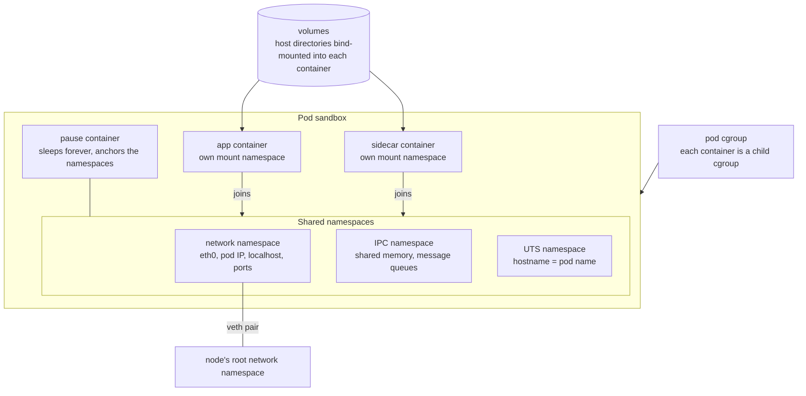
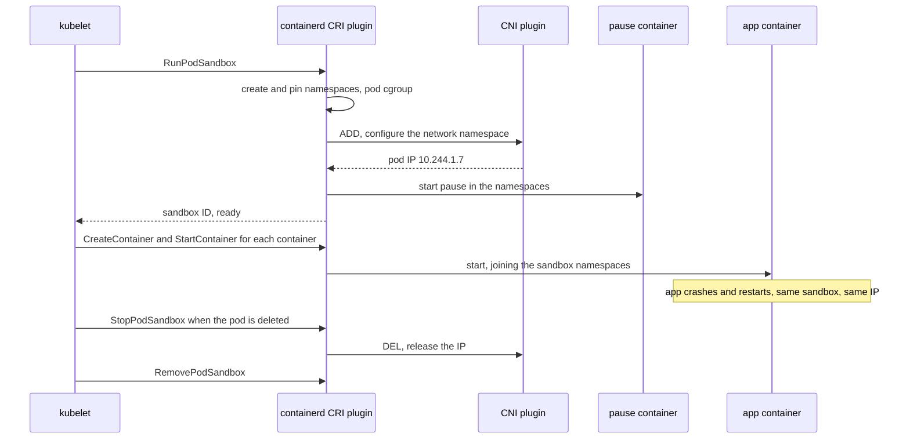

# Pod Sandbox (Pause Container)

A pod sandbox is the isolated environment the container runtime builds for a pod before any of the pod's own containers start: a set of shared Linux namespaces, a pod-level cgroup, and the pod's network interface and IP address. With containerd and CRI-O, the sandbox is anchored by a tiny *pause container*, also called the infra container, which does nothing but hold those namespaces open. Every container in the pod then joins the sandbox. This is what turns a group of separate containers into one [[concepts/devops/kubernetes/kubernetes|Kubernetes]] pod with one IP and a shared `localhost`.

> [!info] Scope of this note
> What the sandbox shares and what it does not, the pause container's job, the sandbox lifecycle, and how to inspect it on a node. How the kubelet drives the runtime through the CRI is in [[concepts/devops/kubernetes/kubernetes_components|Kubernetes Components]].

## Why It Matters

- **It explains pod semantics.** Containers in a pod share an IP, a port space, and a hostname because they share the sandbox's namespaces, not because of any Kubernetes magic.
- **A pod's IP survives container restarts.** The namespaces belong to the sandbox, not to the application container, so a crashing app restarts into the same network identity.
- **It shows up in debugging.** `FailedCreatePodSandBox`, `SandboxChanged`, and an unreachable pause image are common reasons a pod is stuck before its application even starts.

## What the Sandbox Shares



| Namespace or resource | Shared by the pod's containers? | Consequence |
| --- | --- | --- |
| **Network** | Always | One IP and one port space. Two containers in a pod cannot both listen on port 8080; they reach each other on `localhost` |
| **IPC** | Always | System V IPC and POSIX message queues work across containers |
| **UTS** | Always | Every container sees the pod name as its hostname |
| **PID** | Only with `shareProcessNamespace: true` | When shared, the pause process is PID 1 for all containers, which can see and signal each other's processes |
| **Mount** | Never | Each container has its own root filesystem from its image. Sharing files goes through volumes, which the kubelet bind-mounts into each container |
| **User** | Pod-wide when `hostUsers: false` | Container root maps to an unprivileged user on the node |
| **cgroup** | One pod-level cgroup | Each container is a child of it, so pod-level limits and accounting work |

> [!tip] Sharing the PID namespace for debugging and signals
> `shareProcessNamespace: true` lets a sidecar send signals to the main process (for example, to reload configuration) and lets a debugging container see the app's processes. It also exposes each container's filesystem through `/proc/<pid>/root`, so use it deliberately.

## The pause Container

The pause container runs the `pause` binary, a tiny static program from the Kubernetes project, published as the `registry.k8s.io/pause` image. Its whole job:

- **Exist.** It calls `pause()` and sleeps until it receives a termination signal. A Linux namespace is destroyed when nothing references it any more; a long-lived process inside the sandbox keeps the pod's IPC and UTS namespaces alive while application containers come and go.
- **Be PID 1.** When the pod shares its PID namespace, pause is PID 1 and reaps zombie processes left by the other containers, a job most application processes do not do.
- **Cost nothing.** It uses almost no CPU or memory, so one per pod is affordable even on nodes with hundreds of pods.

On containerd, the network namespace is created first and pinned as a bind mount under `/var/run/netns/cni-<id>`, so the network plugin can configure it before any container exists. The pause container then starts inside that namespace.

> [!warning] The pause image must always be pullable
> Every pod on a node needs the pause image before anything else. In air-gapped clusters or behind a private registry, mirror the exact pause image the runtime is configured to use (containerd's `sandbox_image` setting in its 1.x configuration). Otherwise every new pod fails with `FailedCreatePodSandBox`.

## Sandbox Lifecycle

The kubelet manages sandboxes through the CRI. The lifecycle of one pod:



- **Container restarts keep the sandbox.** A liveness-probe restart or a crash replaces only the application container. The pod keeps its IP, and the other containers keep running.
- **Sandbox loss restarts the whole pod.** If the pause container dies or the sandbox's networking breaks, the kubelet kills every container in the pod and creates a new sandbox. The pod gets a new IP, and its events show `SandboxChanged: Pod sandbox changed, it will be killed and re-created`.
- **`hostNetwork: true` pods** skip the network namespace: they use the node's interfaces directly and get the node's IP, so no CNI call or veth pair is involved.
- **Sandboxed runtimes** change what a sandbox *is*. With Kata Containers the sandbox is a lightweight virtual machine and the pod's containers run inside it; with gVisor it is a user-space kernel. The pod-level contract stays the same.

## Inspecting Sandboxes on a Node

`crictl` talks to the runtime through the same CRI the kubelet uses:

```bash
crictl pods                        # every sandbox: ID, name, namespace, state
crictl inspectp <pod-id>           # sandbox details, including the network namespace path and IP
crictl ps --pod <pod-id>           # the containers running in that sandbox
ps -ef | grep '/pause'             # one pause process per sandbox
ip netns list                      # pinned network namespaces (cni-...) on containerd nodes
nsenter --net=/var/run/netns/cni-<id> ip addr   # run a command inside a pod's network namespace
```

`crictl pods` shows what the node is actually running, independent of the API server. Comparing it against `kubectl get pods` is how hidden static pods are found; see [[concepts/devops/kubernetes/security/hidden_static_pods|Hidden Static Pods]].

## Related Concepts

- [[concepts/linux/linux_namespaces|Linux Namespaces]] — every namespace type the sandbox shares or keeps separate, how each one isolates, and the tools to inspect them
- [[concepts/linux/mount_propagation|Mount Propagation]] — how each container's private mount namespace is kept apart from the host's, and the `mountPropagation` field that relaxes it
- [[concepts/devops/kubernetes/veth_pair|Virtual Ethernet (veth) Pair]] — the virtual cable that connects the sandbox's network namespace to the node
- [[concepts/devops/kubernetes/kubernetes_components|Kubernetes Components]] — the kubelet, the CRI, and the container runtime stack beneath the sandbox
- [[concepts/devops/kubernetes/static_pod_vs_normal_pod|Static Pod vs. Normal Pod]] — static pods get sandboxes too, which is how node-side inventories reveal pods the API cannot see
- [[concepts/devops/kubernetes/kubernetes|Kubernetes]] — the hub: the pod as the smallest deployable unit, and the probes that trigger container restarts inside a sandbox

## References

- [Container Runtime Interface (CRI)](https://kubernetes.io/docs/concepts/architecture/cri/) — the API that creates sandboxes and containers
- [Share Process Namespace between Containers in a Pod](https://kubernetes.io/docs/tasks/configure-pod-container/share-process-namespace/) — `shareProcessNamespace`
- [Debugging Kubernetes nodes with crictl](https://kubernetes.io/docs/tasks/debug/debug-cluster/crictl/) — `crictl` commands
- [Linux namespaces](https://man7.org/linux/man-pages/man7/namespaces.7.html) — the kernel feature the sandbox is built from
