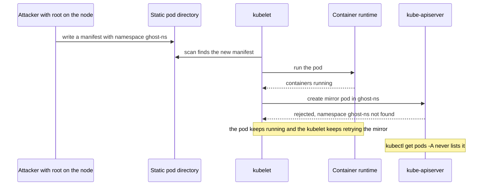

# Hidden Static Pods

A hidden static pod is a [[concepts/devops/kubernetes/static_pod_vs_normal_pod|static pod]] whose manifest names a namespace that does not exist, so it runs on its node but never appears in the Kubernetes API. It is a known persistence technique for an attacker who has already compromised a node, and one of the attack techniques collected under [[concepts/devops/kubernetes/security/kubernetes_security|Kubernetes Security]].

## Why It Matters

- **It defeats API-based visibility.** `kubectl`, dashboards, controllers, and admission policies all read pods from the API, so none of them see this pod.
- **It survives restarts.** The kubelet runs static pods from its manifest directory whenever it starts, so the pod returns after a container, kubelet, or node restart until someone removes the file.
- **Finding it means looking at the node.** The only reliable checks compare what the node actually runs with what the API knows about.

## How It Works

The kubelet runs a static pod straight from a manifest file in its static pod directory (`staticPodPath`, which kubeadm sets to `/etc/kubernetes/manifests`). Only afterwards does it create a read-only *mirror pod* in the API so that the pod can be seen. If the API rejects the mirror, the pod keeps running anyway.

> [!important] Only a static pod can be hidden this way
> A normal pod cannot be created in a namespace that does not exist: the API server's `NamespaceLifecycle` admission plugin rejects the request. The trick works only because a static pod runs first and asks the API afterwards.

## What the Attacker Gains and Needs

- **Gains.** A container that does not appear in `kubectl get pods -A`, in controller-driven tooling, or in anything else that reads pods from the API. It can use host networking or host mounts if the manifest asks for them, and admission policies never see it, because only the rejected mirror pod reached the API server.
- **Needs.** Write access to the static pod directory, which normally means root on the node, or a pod that mounts that directory through a `hostPath` volume. It is a way to *stay* in a cluster, not to get in.

## Detecting Hidden Pods

The idea behind every check is to compare what the node is actually running with what the API knows about.

1. **Open a shell on the node.** `kubectl debug node/<node> -it --profile=sysadmin --image=busybox` starts a privileged debugging pod in the node's host namespaces, with the node's root filesystem mounted at `/host`. `chroot /host` then gives a shell on the node itself. Delete the debugging pod afterwards, since it is a privileged pod.
2. **List what the runtime is running.** `crictl pods` shows every [[concepts/devops/kubernetes/pod_sandbox|pod sandbox]] on the node with its namespace; `ps -ef` in the host PID namespace shows every process. Compare against `kubectl get pods -A --field-selector spec.nodeName=<node>` and `kubectl get namespaces`. A sandbox in a namespace the API does not have is a red flag.
3. **Ask the kubelet.** `kubectl get --raw /api/v1/nodes/<node>/proxy/pods` returns the pods the kubelet itself is managing, including static pods whose mirror was rejected.
4. **Inspect the manifest directory.** Check `staticPodPath` in `/var/lib/kubelet/config.yaml`, then list that directory on every node. Worker nodes should normally have nothing there.
5. **Read the kubelet log.** Repeated failures to create a mirror pod, with a `namespaces "…" not found` error, point straight at the manifest.

Runtime security tools that watch the node's kernel, such as Falco, see the container start and the file write regardless of the API, and can alert on writes to the static pod directory.

## Reducing the Risk

- **Treat the static pod directory as root-equivalent.** Restrict `hostPath` volumes and privileged pods; the Pod Security Standards' `baseline` level already forbids `hostPath` volumes.
- **Turn the feature off where it is not used.** A worker node that runs no static pods does not need `staticPodPath` in its kubelet configuration.
- **Monitor the directory.** File-integrity monitoring or a runtime-security rule on writes to it catches the technique at the moment it is used.

## Related Concepts

- [[concepts/devops/kubernetes/security/kubernetes_security|Kubernetes Security]] — the hub: the cluster's attack surfaces and the other attack techniques
- [[concepts/devops/kubernetes/static_pod_vs_normal_pod|Static Pod vs. Normal Pod]] — how static pods and their mirror pods work, which is what this technique abuses
- [[concepts/devops/kubernetes/pod_sandbox|Pod Sandbox (Pause Container)]] — what `crictl pods` lists: the node-side inventory that detection compares with the API
- [[concepts/devops/observers|Observers]] — node-level telemetry that can surface activity the API does not show

## References

- [Create static Pods](https://kubernetes.io/docs/tasks/configure-pod-container/static-pod/) — manifest location and mirror pods
- [Debugging a Kubernetes node with kubectl](https://kubernetes.io/docs/tasks/debug/debug-cluster/kubectl-node-debug/) — `kubectl debug node`
- [Pod Security Standards](https://kubernetes.io/docs/concepts/security/pod-security-standards/) — the `hostPath` and privilege restrictions
