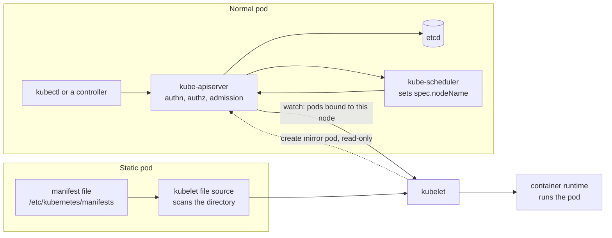

# Static Pod vs. Normal Pod

A *normal pod* is an object stored in the [[concepts/devops/kubernetes/kubernetes|Kubernetes]] API: it is created through the API server, placed by the scheduler, and usually owned by a controller. A *static pod* is defined by a manifest file on one node's disk. The kubelet on that node runs it directly, with no API server, scheduler, or controller involved, and publishes a read-only *mirror pod* to the API so it can be seen. Static pods exist so that the control plane itself can run as pods before there is a control plane.

> [!info] Scope of this note
> How the two kinds of pod are created, run, and managed, and when a static pod is the right tool. How static pods are abused to hide workloads on a compromised node is in [[concepts/devops/kubernetes/security/hidden_static_pods|Hidden Static Pods]]; the kubelet's wider role is in [[concepts/devops/kubernetes/kubernetes_components|Kubernetes Components]].

## Why It Matters

- **The control plane depends on it.** In kubeadm clusters, etcd, the API server, the scheduler, and the controller manager are static pods. Editing their manifests is how you reconfigure them, and how you can break them.
- **The usual tools do not apply.** `kubectl delete`, `kubectl edit`, and rollouts do nothing lasting to a static pod. Operators who do not know this lose time fighting a pod that keeps coming back.
- **It is a security boundary.** Whoever can write to a node's static pod directory can run any container on that node, including one the API server never sees.

## Two Paths to a Running Pod

A normal pod reaches the kubelet through the API server's watch. A static pod reaches it from the kubelet's own file source. Both are then run the same way through the container runtime; the difference is who owns the definition.

## Side-by-Side Comparison

| | Normal pod | Static pod |
| --- | --- | --- |
| **Source of truth** | An object in etcd, through the API server | A manifest file on one node (`staticPodPath`), or a URL (`staticPodURL`) |
| **Created by** | A user or a controller, through the API | The kubelet, when the file appears |
| **Placement** | Chosen by the kube-scheduler | Fixed: the node holding the file. The scheduler is never involved |
| **Supervised by** | A controller (ReplicaSet, StatefulSet, Job, …) recreates it elsewhere if the node dies | Only that node's kubelet; if the node dies, so does the pod |
| **Needs a running API server** | Yes | No; that is the point |
| **Visible in `kubectl get pods`** | Yes | Only through its mirror pod, named `<pod name>-<node name>` |
| **Delete** | `kubectl delete pod` | Remove the file. Deleting the mirror pod only deletes the mirror, and the kubelet recreates it |
| **Change** | Edit the owning controller, which rolls out new pods | Edit the file; the kubelet kills the pod and starts the new version |
| **May reference other API objects** | Yes: ServiceAccounts, ConfigMaps, Secrets | No. The spec cannot refer to ServiceAccounts, ConfigMaps, Secrets, or other API objects |
| **Ephemeral containers (`kubectl debug`)** | Supported | Not supported |
| **Admission control** | Every pod passes it before it exists | Applies only to the mirror pod. The static pod runs whether or not the mirror is accepted |
| **Typical use** | Every application workload | Bootstrapping the control plane; node-level daemons that must run before the API exists |

## How the kubelet Runs Static Pods

- **Where it looks.** The kubelet configuration field `staticPodPath` names the directory (the older `--pod-manifest-path` flag does the same). kubeadm sets it to `/etc/kubernetes/manifests` on every node; on worker nodes the directory is normally empty. `staticPodURL` makes the kubelet fetch manifests over HTTP instead.
- **How it notices changes.** The kubelet watches the directory and also rescans it periodically (every 20 seconds by default). Files whose names start with a dot are ignored; every other file is parsed as a pod manifest.
- **What the mirror pod is.** For each static pod, the kubelet creates a mirror pod in the API. It carries the annotation `kubernetes.io/config.mirror`, is owned by the Node object, and is read-only: changes to it are ignored and deletions are reverted. With the `NodeRestriction` admission plugin enabled, a kubelet may create mirror pods only for its own node.
- **Restarts.** The kubelet restarts failed containers of a static pod as it would for any pod, according to `restartPolicy`. What it cannot do is move the pod to another node.

> [!warning] Backup files in the manifest directory become pods
> The kubelet parses every non-hidden file in the directory, whatever its extension. Copying `kube-apiserver.yaml` to `kube-apiserver.yaml.bak` in the same directory creates a second API server pod with a conflicting name. Keep backups outside the directory.

### Editing the control plane

On a kubeadm control-plane node, changing an API server flag means editing `/etc/kubernetes/manifests/kube-apiserver.yaml`. The kubelet notices, stops the old pod, and starts the new one. A typo in the file means the API server never comes back, and `kubectl` cannot help, because the API server is what is missing. Recovery happens on the node: `crictl ps -a` and `crictl logs` show the failing container, and `journalctl -u kubelet` shows manifest parse errors.

## Static Pods vs. DaemonSets

Both put a pod on specific nodes, but only one is managed through the API:

| | Static pod | DaemonSet |
| --- | --- | --- |
| Defined | Per node, as a file | Once, in the API |
| Rollout and rollback | Edit each node's file | `RollingUpdate`, `kubectl rollout undo` |
| Works without the API server | Yes | No |
| Can use ConfigMaps, Secrets, ServiceAccounts | No | Yes |

Use a DaemonSet for per-node agents such as log shippers and node exporters. Use a static pod only for components that must run before, or without, the API server.

## Hidden Static Pods

Because the kubelet runs a static pod before the API accepts its mirror, a manifest that names a namespace that does not exist produces a pod that runs on its node but never appears in `kubectl get pods -A`. Attackers who already have root on a node use this to stay hidden; how it works, how to detect it, and how to reduce the risk are in [[concepts/devops/kubernetes/security/hidden_static_pods|Hidden Static Pods]].

## Related Concepts

- [[concepts/devops/kubernetes/kubernetes_components|Kubernetes Components]] — the kubelet's two sources of work, and why a kubeadm control plane runs as static pods
- [[concepts/devops/kubernetes/pod_sandbox|Pod Sandbox (Pause Container)]] — what the runtime actually creates for every pod, static or not, and what `crictl pods` lists
- [[concepts/devops/kubernetes/kubelet_tls_bootstrapping|Kubelet TLS Bootstrapping]] — the node identity that `NodeRestriction` uses to limit which mirror pods a kubelet may create
- [[concepts/devops/kubernetes/kubernetes|Kubernetes]] — the hub: workload controllers, which give normal pods the supervision static pods lack
- [[concepts/devops/kubernetes/security/hidden_static_pods|Hidden Static Pods]] — how a static pod in a namespace that does not exist hides from the API, and how to find one

## References

- [Create static Pods](https://kubernetes.io/docs/tasks/configure-pod-container/static-pod/) — manifest location, mirror pods, and restrictions
