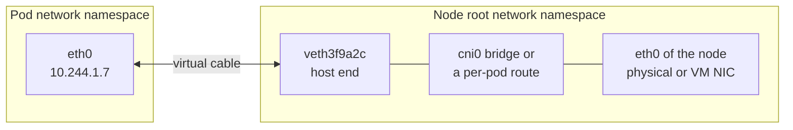
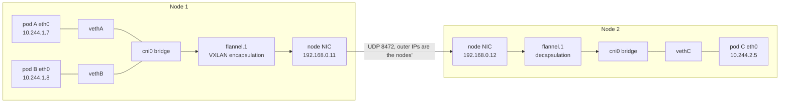

# Virtual Ethernet (veth) Pair

A veth (virtual Ethernet) pair is two Linux virtual network interfaces connected back to back, like the two ends of a cable: a frame sent into one end comes out of the other. Each end can live in a different network namespace. In [[concepts/devops/kubernetes/kubernetes|Kubernetes]], the network plugin creates one veth pair per pod. One end becomes the pod's `eth0` inside its [[concepts/devops/kubernetes/pod_sandbox|Pod Sandbox (Pause Container)]], and the other stays on the node, which is how every packet gets into and out of a pod.

> [!info] Scope of this note
> How a veth pair works, how CNI plugins wire pods with it, the paths packets take within and between nodes, and how to trace a pod to its host interface. The overall networking model and Services are in [[concepts/devops/kubernetes/kubernetes_components|Kubernetes Components]].

## Why It Matters

- **Every pod packet crosses one.** Pod-to-pod, pod-to-Service, and pod-to-internet traffic all leave the pod through its veth pair, unless the pod uses `hostNetwork: true`.
- **It is the best place to capture traffic.** Running `tcpdump` on the host end shows exactly what one pod sends and receives, without installing anything in the pod's image.
- **It explains common failures.** MTU mismatches, a pod that can reach its own node but not others, and leftover interfaces after crashes all trace back to how the pair and its routes were set up.

## How a veth Pair Works



- **Always a pair.** The kernel creates both ends together, and deleting either end deletes both. Destroying a network namespace destroys the end inside it, and with it the peer on the host.
- **Layer 2 only.** A veth pair moves Ethernet frames from one end to the other. Addressing, routing, and bridging are configured separately on each side.
- **Cheap but not free.** Each packet crosses the host's network stack an extra time. eBPF-based plugins can redirect packets between interfaces directly to shorten that path.

You can build the same wiring by hand. This reproduces what the CNI `bridge` plugin does for two pods on one node; run it as root on a scratch virtual machine:

```bash
# The node's bridge, acting as the pods' gateway
ip link add cni0 type bridge
ip addr add 10.244.1.1/24 dev cni0
ip link set cni0 up

# Two "pods": a network namespace each, wired to the bridge with a veth pair
for p in a b; do
  ip netns add pod-$p
  ip link add veth-$p type veth peer name eth0 netns pod-$p
  ip link set veth-$p master cni0 up
  ip -n pod-$p link set lo up
  ip -n pod-$p link set eth0 up
done
ip -n pod-a addr add 10.244.1.2/24 dev eth0
ip -n pod-b addr add 10.244.1.3/24 dev eth0
ip -n pod-a route add default via 10.244.1.1
ip -n pod-b route add default via 10.244.1.1

ip netns exec pod-a ping -c 1 10.244.1.3   # pod-a reaches pod-b through the bridge
```

## How CNI Plugins Use It

When the container runtime creates a pod sandbox, it calls the network plugin with `CNI ADD`. A typical plugin then:

1. Creates a veth pair.
2. Moves one end into the pod's network namespace and renames it `eth0`.
3. Asks its IP address management (IPAM) for an address from the node's pod range and assigns it to `eth0`.
4. Adds a default route inside the pod.
5. Connects the host end: attaches it to a bridge, adds a route to the pod's IP, or attaches eBPF programs to it.

`CNI DEL` reverses this when the sandbox is removed: the IP is released, and deleting the namespace removes the pair.

Plugins differ mostly in step 5:

| Plugin | Host-end name | Host end connected by | Traffic between pods on one node |
| --- | --- | --- | --- |
| **bridge** plugin (used by Flannel) | `veth…` | A Linux bridge, `cni0` | Switched by the bridge |
| **Calico** | `cali…` | Nothing; one `/32` route per pod on the host. Pods use `169.254.1.1` as their gateway, answered by proxy ARP on the host end | Routed by the host kernel |
| **Cilium** | `lxc…` | eBPF programs attached to the interface | Redirected by eBPF, bypassing most of the host stack |
| **AWS VPC CNI** | `eni…` | `/32` routes; the pod IP is a real VPC address | Routed by the host kernel |

## Packet Paths



- **Same node, A to B:** out of pod A's `eth0`, out of `vethA` on the host, across the `cni0` bridge, into `vethB`, and into pod B's `eth0`. The traffic never leaves the machine.
- **Across nodes, A to C:** out through `vethA` to the bridge, where the host's routing table sends `10.244.2.0/24` to the overlay device. The VXLAN device wraps the packet in UDP addressed to node 2, and node 2 unwraps it and delivers it through `vethC`. A routed plugin such as Calico in BGP mode skips the encapsulation: the network itself knows that `10.244.2.0/24` lives on node 2.
- **To a Service:** the packet leaves the pod addressed to a ClusterIP. Rules programmed by kube-proxy (or eBPF) on the host rewrite the destination to a real pod IP as the packet passes through the host, and it then follows one of the two paths above.

> [!warning] Overlays shrink the MTU
> VXLAN adds 50 bytes of headers, so on a 1500-byte network the pod side of the veth pair must use an MTU of 1450 or less. If the pod's MTU is too large, small requests work but large packets are dropped. The typical symptom is a TLS handshake or a large response that hangs while health checks pass.

## Tracing a Pod to Its veth

Inside the pod, `ip link` shows the interface as `eth0@if12`: the `@if12` is the interface index of its peer on the host. Without the `ip` tool, `/sys/class/net/eth0/iflink` holds the same number.

```bash
kubectl exec web-7c9-a -- cat /sys/class/net/eth0/iflink   # prints 12
ip -o link | grep '^12:'                                     # on the node: 12: veth3f9a2c@if2 ...
tcpdump -ni veth3f9a2c                                       # capture only that pod's traffic
```

If the pod's image has no shell, `kubectl debug -it web-7c9-a --image=nicolaka/netshoot` adds an ephemeral container that shares the pod's network namespace and brings its own tools. On the node, `crictl inspectp <pod-id>` gives the pod's network namespace path, and `nsenter --net=<path> ip addr` runs commands inside it.

Pods with `hostNetwork: true` have no veth pair. They share the node's network namespace and appear on the node's own interfaces.

## Related Concepts

- [[concepts/devops/kubernetes/pod_sandbox|Pod Sandbox (Pause Container)]] — owns the network namespace at the pod end of the pair
- [[concepts/devops/kubernetes/kubernetes_components|Kubernetes Components]] — the networking model, CNI plugins, kube-proxy, and Services that sit on top of this wiring
- [[concepts/devops/kubernetes/kubernetes|Kubernetes]] — the hub: Services, NetworkPolicy, and the objects whose traffic crosses these interfaces
- [[concepts/devops/observers|Observers]] — network telemetry and tracing, often collected by agents that hook the same host interfaces

## References

- [The Kubernetes network model](https://kubernetes.io/docs/concepts/services-networking/#the-kubernetes-network-model) — the rules every plugin implements
- [CNI specification](https://www.cni.dev/docs/spec/) — the ADD and DEL operations
- [veth(4)](https://man7.org/linux/man-pages/man4/veth.4.html) — the Linux manual page for veth devices
