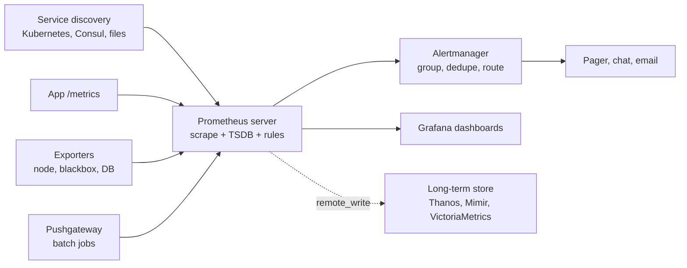

# Prometheus

Prometheus is an open-source monitoring system and time-series database. It *pulls* numeric metrics from the services it monitors over HTTP, stores them locally, queries them with its own language PromQL, and evaluates alerting rules over them. It is the default metrics signal in [[concepts/devops/observers|Observers]] and the de facto standard for monitoring on Kubernetes.

> [!info] Scope of this note
> A tool overview covering the data model, the pull architecture, alerting, and the limits that decide when you need more than one Prometheus server. It is not a PromQL reference.

## Why It Matters

Prometheus started at SoundCloud in 2012 and joined the CNCF in 2016 as its second hosted project, after Kubernetes. Its exposition format is now the common language of infrastructure metrics. Kubernetes components, databases, proxies, and most cloud-native software expose a `/metrics` endpoint in that format, so a single Prometheus server can monitor a heterogeneous estate without a vendor agent on each host.

## Data Model

Every time series is identified by a **metric name** plus a set of key-value **labels**:

```text
http_requests_total{service="checkout", method="POST", status="500"}  1027
```

| Metric type | Meaning | Typical query |
| --- | --- | --- |
| **Counter** | Monotonically increasing total; resets to zero on restart | `rate(http_requests_total[5m])` for per-second throughput |
| **Gauge** | A value that goes up and down: memory, queue depth, temperature | Use directly, or `avg_over_time` |
| **Histogram** | Observations counted into configurable buckets, aggregatable across instances | `histogram_quantile(0.99, sum by (le) (rate(..._bucket[5m])))` for p99 latency |
| **Summary** | Quantiles pre-computed in the client | Cheap to read, but cannot be aggregated across instances |

> [!warning] Labels multiply into time series
> Each unique combination of label values is a separate series in memory. Putting a user ID, request ID, or full URL into a label creates millions of series and can crash the server. Keep labels to bounded sets such as service, method, and status class, and send per-request detail to logs or traces.

## Architecture



- **Pull model.** The server scrapes each target on an interval (commonly 15–60 s). A failed scrape is itself a signal: the built-in `up` metric drops to 0.
- **Service discovery.** Targets are discovered from Kubernetes, cloud APIs, Consul, or files, not hand-listed. The Prometheus Operator adds `ServiceMonitor` and `PodMonitor` resources on Kubernetes.
- **Exporters** translate systems that do not speak the format: `node_exporter` for host metrics, `blackbox_exporter` for probing endpoints from outside, plus exporters for most databases.
- **Pushgateway** exists only for short-lived batch jobs that end before they can be scraped. It is not a general push ingestion path.
- **Rules.** *Recording rules* precompute expensive queries into new series. *Alerting rules* fire when a PromQL expression stays true for a `for:` duration.
- **Alertmanager** receives firing alerts, deduplicates and groups them, applies silences and inhibition, and routes them to receivers.

## Limits and Scaling

- **One server, local disk.** The built-in TSDB is not clustered or replicated. High availability means running two identical servers that scrape the same targets, and letting Alertmanager deduplicate their alerts.
- **Short retention by default** (15 days). For long-term or global views, use `remote_write` to a Prometheus-compatible store such as Thanos, Grafana Mimir, Cortex, or VictoriaMetrics.
- **Metrics only.** Prometheus does not store logs or traces. Exemplars can attach a trace ID to a sample, which links a latency spike to a [[concepts/devops/tracing/jaeger|Jaeger]] trace.
- **OpenTelemetry.** Recent Prometheus releases can accept OTLP metrics directly, and the OpenTelemetry Collector can expose or remote-write to it. Applications can therefore be instrumented with OpenTelemetry while Prometheus stays the backend.

## How to Think About It

The following is judgement, not documentation. Prometheus is the cheapest way to answer "is it broken, and since when?" Use it for the RED/USE and golden-signal metrics described in [[concepts/devops/observers|Observers]], and alert on symptoms tied to an SLO. Do not use it for billing-grade exact counts (scrapes can be missed and counters reset), per-request detail, or anything whose labels are unbounded. Those belong in [[concepts/devops/logging/elasticsearch|Elasticsearch]] or a trace store.

## Related Concepts

- [[concepts/devops/observers|Observers]] — where metrics fit beside logs and traces, and which signals to alert on
- [[concepts/devops/tracing/jaeger|Jaeger]] — the trace a metric exemplar points to when you need to know *which* request was slow
- [[concepts/devops/logging/elasticsearch|Elasticsearch]] — the high-detail log store for questions a bounded-label metric cannot answer
- [[concepts/software_architecture/software_architecture|Software Architecture]] — quality attributes stated as measurable scenarios ("p99 under 200 ms"), which are exactly what PromQL alerts encode

## References

- [Prometheus documentation](https://prometheus.io/docs/) — data model, PromQL, configuration, Alertmanager
- [Prometheus best practices: naming and labels](https://prometheus.io/docs/practices/naming/) — metric and label conventions
