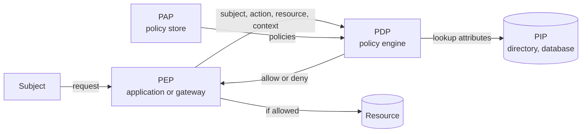

# Authorization

Authorization (often shortened to AuthZ) is the process of deciding whether an already
[[concepts/identity_and_access/authentication|authenticated]] identity may perform a given action
on a given resource. It answers "what are you allowed to do?", typically by evaluating roles,
attributes, relationships, or explicit grants against a policy, under the principle of least
privilege.

## Why It Matters

- **It is the most common serious web flaw.** Broken access control is A01, the top risk, in the
  OWASP Top 10:2025, and OWASP reports some form of it in every application tested.
- **It cannot be bolted on at the edge.** Whether user A may edit invoice 42 depends on data only
  the application holds, so a gateway or login screen alone cannot decide it.
- **Mistakes are silent.** A missing check returns the data successfully; nothing errors, so the
  gap surfaces only in a test, an audit, or a breach.

## Anatomy of a Decision

Every authorization check evaluates the same four inputs: the **subject** (who is asking), the
**action** (read, update, approve), the **resource** (which object), and the **context** (time,
network, device, risk). The standard architecture, from XACML and reused by NIST's ABAC guidance,
separates where a decision is enforced from where it is made:

| Component | Role |
| --- | --- |
| Policy enforcement point (PEP) | Intercepts the request and allows or blocks it; lives in the application, gateway, or database |
| Policy decision point (PDP) | Evaluates the policy against the inputs and returns allow or deny |
| Policy information point (PIP) | Supplies attributes the request does not carry, such as the user's department or the record's owner |
| Policy administration point (PAP) | Where policies are written, reviewed, and versioned |

The PEP sends the decision inputs to the PDP, which pulls missing attributes from the PIP and
evaluates the policies the PAP manages. In a small application all four are one function; the split
matters once several services must share the same policy.

## Access Control Models

| Model | Decision basis | Fits | Cost |
| --- | --- | --- | --- |
| Access control list (ACL) | Per-resource list of who may do what | File systems, object storage, small sharing models | Hard to review across many resources |
| Role-based (RBAC) | Roles the subject holds, each bundling permissions | Organisations with stable job functions | Role explosion as exceptions accumulate |
| Attribute-based (ABAC) | Attributes of subject, resource, action, and environment, evaluated against rules | Fine-grained and contextual policy ("same region, business hours") | Harder to reason about and audit |
| Relationship-based (ReBAC) | A graph of relationships ("viewer of folder that contains doc") | Sharing-heavy products with nested resources | Needs a dedicated relationship store and consistent reads |

NIST SP 800-162 defines ABAC as granting or denying an operation by evaluating subject, object,
operation, and sometimes environment attributes against policy. ReBAC was popularised by Google's
Zanzibar (USENIX ATC 2019), a single global system storing access control lists as relationships
for services such as Drive, Calendar, and YouTube, serving millions of checks per second while
respecting the causal order of users' changes. In practice the models combine: RBAC for coarse
grants, with attribute or relationship checks for ownership and context.

For data platforms, the same models appear as warehouse grants, row- and column-level policies,
and classification-driven policy tags; those mechanisms are covered in
[[concepts/data_governance/data_security|Data Security]].

## Principles

- **Deny by default.** Everything not explicitly allowed is refused, except deliberately public
  resources.
- **Least privilege.** Grant the minimum permissions for the minimum time; prefer grants to
  groups over individuals.
- **Check every request, on the server.** Hiding a button is not access control; the API behind
  it must check again.
- **Check the object, not just the endpoint.** "May this user call `GET /invoices/{id}`" and "may
  this user read invoice 42" are different questions, and the second is where most flaws live.
- **Implement it once.** A shared authorization layer or policy engine avoids the inconsistent
  copies that hand-written checks drift into.
- **Log and test denials.** Log access-control failures, alert on repeated ones, and include
  authorization cases in unit and integration tests.

## Common Failures

The OWASP A01:2025 category lists the recurring patterns:

| Failure | Example |
| --- | --- |
| Insecure direct object reference (IDOR), or broken object-level authorization (BOLA) in APIs | Changing `/accounts/1001` to `/accounts/1002` returns someone else's account |
| Missing function-level checks (BFLA) | A `DELETE` or admin endpoint checks only that the caller is logged in |
| Privilege escalation | Acting as a user without logging in, or as an admin while logged in as a user |
| Metadata tampering | Editing a cookie, hidden field, or unverified JWT claim such as `role` |
| Overly broad CORS | An untrusted origin is allowed to call the API with the user's credentials |
| Forced browsing | Reaching privileged pages by guessing their URLs |

OWASP's 2025 edition also folds server-side request forgery (SSRF) into this category.

## Delegated Authorization

When a third-party application acts for a user, a second question appears: what may *this
application* do on the user's behalf? [[concepts/identity_and_access/oauth|OAuth (Open Authorization)]]
answers it with **scopes** granted at consent time. Scopes cap the client and do not replace the
user's own permissions: a token with a `documents:write` scope still must not edit a document the
user cannot edit, so the resource server checks both.

## Related Concepts

- [[concepts/identity_and_access/authentication|Authentication]] — establishes the identity that authorization decisions are made about; includes the AuthN vs. AuthZ contrast
- [[concepts/identity_and_access/oauth|OAuth (Open Authorization)]] — the standard for delegated authorization through scoped tokens
- [[concepts/identity_and_access/json_web_token|JSON Web Token (JWT)]] — carries the claims many authorization checks read, and must be verified before they are trusted
- [[concepts/data_governance/data_security|Data Security]] — applies these models to data: warehouse grants, row- and column-level security, policy tags
- [[concepts/software_architecture/api_integration_protocols|API and Integration Protocols]] — every endpoint is a policy enforcement point

## References

- [OWASP Top 10:2025, A01 Broken Access Control](https://top10.owasp.org/2025/A01_2025-Broken_Access_Control)
- [NIST SP 800-162, Guide to Attribute Based Access Control (ABAC) Definition and Considerations](https://csrc.nist.gov/pubs/sp/800/162/upd2/final)
- [Zanzibar: Google's Consistent, Global Authorization System](https://research.google/pubs/zanzibar-googles-consistent-global-authorization-system/)
