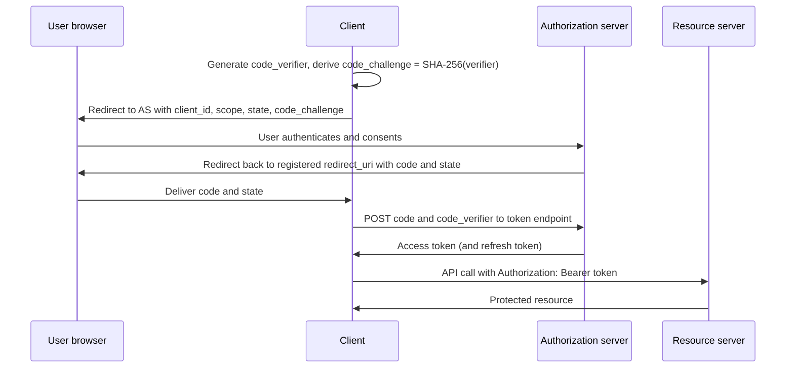

# OAuth (Open Authorization)

OAuth is an open standard for delegated [[concepts/identity_and_access/authorization|Authorization]].
It lets an application access a resource on a user's or a service's behalf through scoped,
expiring access tokens, so the application never handles the account password. OAuth 2.0 is the
version in common use; [[concepts/identity_and_access/openid_connect|OpenID Connect (OIDC)]] builds
authentication on top of it, and the standard secures most of the HTTP APIs in
[[concepts/software_architecture/api_integration_protocols|API and Integration Protocols]].

## Why It Matters

- **It ends the password anti-pattern.** Before OAuth, an app that wanted your calendar asked for
  your password and received full, unrevocable access to the account.
- **Access becomes narrow and revocable.** A token carries specific scopes, targets specific
  APIs, expires, and can be revoked without changing the user's password.
- **It is the default for machine access too.** Services, CI jobs, and AI agents use the same
  token machinery, as the dbt adapters and the Model Context Protocol in this vault show.

## Roles

| Role | Who it is | Example |
| --- | --- | --- |
| Resource owner | The user (or organisation) who can grant access | You, owner of a cloud drive |
| Client | The application requesting access | A photo-printing app |
| Authorization server (AS) | Authenticates the owner, records consent, issues tokens | The drive provider's identity service |
| Resource server (RS) | The API that accepts tokens and serves data | The drive's file API |

Clients are **confidential** (a server-side app that can keep a secret) or **public** (a
single-page or mobile app whose code, and any secret in it, users can read).

## Grant Types

A grant is the way a client obtains a token.

| Grant | Use it for | Status |
| --- | --- | --- |
| Authorization code with PKCE | Any client acting for a user: web, mobile, desktop, CLI with a browser | The default; required for public clients |
| Client credentials | Machine-to-machine calls with no user involved | Current |
| Device authorization (RFC 8628) | Input-constrained devices: TVs, CLIs on headless machines | Current |
| Refresh token | Getting a new access token without the user present | Current; rotate or sender-constrain for public clients |
| Token exchange (RFC 8693) | Swapping one token for another, e.g. a service acting on a user's behalf downstream | Current |
| Implicit | Browser apps receiving the token directly in the redirect | Discouraged by RFC 9700; removed in OAuth 2.1 |
| Resource owner password credentials | The client collects the user's password and trades it for a token | Must not be used (RFC 9700); removed in OAuth 2.1 |

[[concepts/data_engineering/dbt/dbt_databricks_adapter|dbt-databricks Adapter]] works through
both common shapes: authorization code (its "U2M" browser flow) and client credentials (its
"M2M" flow).

## The Authorization Code Flow with PKCE

The code travels through the browser, where it can leak; the token does not. **PKCE** (Proof Key
for Code Exchange, RFC 7636) closes the remaining gap: only the client that generated the secret
`code_verifier` can redeem the code, so a stolen code is useless. The `state` value ties the
response to the request to prevent cross-site request forgery.

## Tokens and Scopes

- **Access token** — short-lived credential sent to the resource server. It may be **opaque**
  (the RS asks the AS about it through introspection, RFC 7662) or a self-contained
  [[concepts/identity_and_access/json_web_token|JSON Web Token (JWT)]] (RFC 9068) that the RS
  verifies locally.
- **Refresh token** — longer-lived, sent only to the authorization server, never to a resource
  server.
- **Scopes** — strings such as `files.read` naming what the client may do. They limit the client;
  the resource server still checks what the *user* may do.
- **Audience** — RFC 9700 recommends restricting each token to the resource server it is meant
  for, and resource servers must refuse tokens issued for someone else; resource indicators
  (RFC 8707) let the client name that target.

**Bearer vs. sender-constrained.** A plain bearer token (RFC 6750) works for whoever holds it.
Sender-constrained tokens are bound to a key the client must prove it holds, through mutual TLS
(RFC 8705) or DPoP (RFC 9449), so a stolen token alone is not enough.

## Versions and the Current Baseline

| Document | Date | What it is |
| --- | --- | --- |
| RFC 6749, RFC 6750 | October 2012 | The OAuth 2.0 framework and bearer-token usage |
| RFC 9700 (BCP 240) | January 2025 | OAuth 2.0 Security Best Current Practice; updates 6749, 6750, and 6819 |
| OAuth 2.1 (`draft-ietf-oauth-v2-1`) | Draft -16, September 2026 | Consolidates 2.0 plus the security BCP into one document; not yet an RFC |

The RFC 9700 baseline every new deployment should meet:

- Use the authorization code grant; avoid the implicit grant, and never use the password grant.
- Public clients must use PKCE, confidential clients should, and servers must support it, using
  the `S256` method.
- Match redirect URIs exactly, with only the port of a `localhost` redirect allowed to vary.
- Restrict tokens to the minimum privileges and to their intended audience.
- Sender-constrain tokens where possible; public clients' refresh tokens must be either
  sender-constrained or rotated on every use.
- Prevent CSRF with `state`, PKCE, or the OIDC `nonce`.

OAuth 2.1 turns most of these into requirements of the core specification: PKCE becomes
mandatory, the implicit and password grants are not specified, and redirect URIs must match
exactly.

## The Extension Ecosystem

| RFC | Adds |
| --- | --- |
| 7009 | Token revocation endpoint |
| 7591 | Dynamic client registration, so clients can register themselves |
| 7662 | Token introspection for opaque tokens |
| 8414 | Authorization server metadata, a discovery document of endpoints |
| 8707 | Resource indicators, naming the API a token is for |
| 9126 | Pushed authorization requests (PAR), sending request parameters over a back channel |
| 9396 | Rich authorization requests (RAR), structured permissions beyond scope strings |

[[concepts/ai_engineering/model_context_protocol|Model Context Protocol (MCP)]] is a recent
example of assembling these pieces: it builds its remote-server authorization from OAuth 2.1,
server metadata discovery, resource indicators, and dynamic registration.

## OAuth Is Not Authentication

An access token says "the bearer may call this API", not "this is Alice". It is meant for the
resource server, its format is unspecified, and a client that treats a valid token as proof of
login can be fooled by a token issued to a different application. Use
[[concepts/identity_and_access/openid_connect|OpenID Connect (OIDC)]], whose ID token is addressed
to the client and states who authenticated, when, and how.

## Related Concepts

- [[concepts/identity_and_access/authorization|Authorization]] — the general problem OAuth solves for delegated, token-based access
- [[concepts/identity_and_access/authentication|Authentication]] — what OAuth alone does not provide
- [[concepts/identity_and_access/openid_connect|OpenID Connect (OIDC)]] — the identity layer on top of OAuth 2.0
- [[concepts/identity_and_access/json_web_token|JSON Web Token (JWT)]] — the usual format for self-contained access tokens
- [[concepts/software_architecture/api_integration_protocols|API and Integration Protocols]] — the interfaces OAuth tokens most often protect
- [[concepts/data_governance/data_security|Data Security]] — OAuth scopes are one implementation of the access-control models described there
- [[concepts/ai_engineering/model_context_protocol|Model Context Protocol (MCP)]] — specifies OAuth 2.1 for authorizing clients against remote servers
- [[concepts/data_engineering/dbt/dbt_databricks_adapter|dbt-databricks Adapter]] — a worked example of the machine-to-machine and user-to-machine flows

## References

- [RFC 9700, Best Current Practice for OAuth 2.0 Security](https://www.rfc-editor.org/rfc/rfc9700.html)
- [The OAuth 2.1 Authorization Framework (Internet-Draft)](https://datatracker.ietf.org/doc/draft-ietf-oauth-v2-1/)
- [RFC 6749, The OAuth 2.0 Authorization Framework](https://www.rfc-editor.org/rfc/rfc6749.html)
- [RFC 7636, Proof Key for Code Exchange (PKCE)](https://www.rfc-editor.org/rfc/rfc7636.html)
