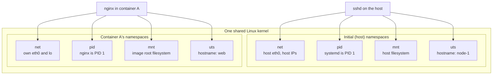
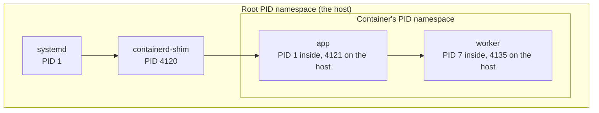
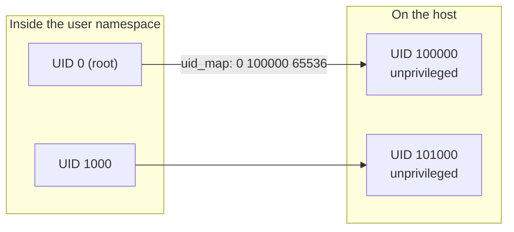

# Linux Namespaces

A Linux namespace wraps a global system resource, such as the network stack, the process ID space, or the mount table, so that the processes inside it see their own isolated instance of that resource. There are eight namespace types. Combined with cgroups, which limit how much CPU and memory processes can use, namespaces are the kernel mechanism that containers are built from. The [[concepts/linux/network_namespace|Network Namespace]] is the most involved type and has its own note.

## Why It Matters

- **A container is just namespaced processes.** There is no "container" object in the kernel. Docker, containerd, and Kubernetes create processes in a set of new namespaces and limit them with cgroups.
- **It explains what is and is not isolated.** Each type isolates exactly one kind of resource. Anything not covered, such as the kernel itself, the system clock, or kernel modules, stays shared with the host.
- **It is the basis for debugging.** Tools like `nsenter` let you step into a container's namespaces with the host's own tools, even when the container's image has no shell.
- **It shapes security.** Namespaces hide resources, but a shared kernel means they are not a full security boundary on their own.

## The Eight Namespace Types

| Namespace | Clone flag | Isolates | Since kernel |
| --- | --- | --- | --- |
| **Mount** | `CLONE_NEWNS` | The mount table: which filesystems are mounted where | 2.4.19 (2002) |
| **UTS** | `CLONE_NEWUTS` | Hostname and NIS domain name | 2.6.19 (2006) |
| **IPC** | `CLONE_NEWIPC` | System V IPC objects and POSIX message queues | 2.6.19 (2006) |
| **PID** | `CLONE_NEWPID` | Process IDs | 2.6.24 (2008) |
| **Network** | `CLONE_NEWNET` | Interfaces, addresses, routes, firewall rules, sockets, ports | 2.6.24, completed in 2.6.29 (2009) |
| **User** | `CLONE_NEWUSER` | User and group IDs, and the capabilities they carry | 3.8 (2013) |
| **Cgroup** | `CLONE_NEWCGROUP` | The view of the cgroup hierarchy | 4.6 (2016) |
| **Time** | `CLONE_NEWTIME` | Offsets for the monotonic and boot-time clocks | 5.6 (2020) |

The mount namespace's flag is just `CLONE_NEWNS`, "new namespace", because it was the first one and nobody expected others to follow.



Every process points to exactly one namespace of each type. Host processes use the initial namespaces, and a container's processes use their own, all running on the same kernel.

## How Namespaces Are Represented

Each process has one entry per namespace type under `/proc/<pid>/ns/`. Each entry is a link whose target names the type and an inode number. Two processes are in the same namespace exactly when those inode numbers match.

```bash
$ ls -l /proc/$$/ns
lrwxrwxrwx 1 dev dev 0 Oct 31 12:00 cgroup -> 'cgroup:[4026531835]'
lrwxrwxrwx 1 dev dev 0 Oct 31 12:00 ipc -> 'ipc:[4026531839]'
lrwxrwxrwx 1 dev dev 0 Oct 31 12:00 mnt -> 'mnt:[4026531841]'
lrwxrwxrwx 1 dev dev 0 Oct 31 12:00 net -> 'net:[4026531840]'
lrwxrwxrwx 1 dev dev 0 Oct 31 12:00 pid -> 'pid:[4026531836]'
lrwxrwxrwx 1 dev dev 0 Oct 31 12:00 time -> 'time:[4026531834]'
lrwxrwxrwx 1 dev dev 0 Oct 31 12:00 user -> 'user:[4026531837]'
lrwxrwxrwx 1 dev dev 0 Oct 31 12:00 uts -> 'uts:[4026531838]'
```

The exact inode numbers differ between systems. A namespace stays alive as long as any of these holds it:

- a process is still a member of it
- a process has one of its `/proc/<pid>/ns/` files open
- one of those files is bind-mounted somewhere, which is how `ip netns add` keeps a namespace with no processes alive under `/run/netns/`
- for user and PID namespaces, a child namespace still refers to it

When the last reference goes, the kernel destroys the namespace and the resources inside it.

## The Kernel Interface

Three system calls cover the whole lifecycle:

| System call | What it does |
| --- | --- |
| `clone(2)` with `CLONE_NEW*` flags | Creates a new process inside one or more new namespaces |
| `unshare(2)` | Moves the calling process into new namespaces |
| `setns(2)` | Moves the calling process into an existing namespace, given a file descriptor for one of its `/proc/<pid>/ns/` files |

Creating most namespace types requires the `CAP_SYS_ADMIN` capability. The exception is the user namespace: an unprivileged user can create one, and becomes root inside it, which then allows creating the other types within it.

## Command-Line Tools

| Tool | Package | Use |
| --- | --- | --- |
| `unshare` | util-linux | Run a program in new namespaces |
| `nsenter` | util-linux | Run a program in the namespaces of an existing process |
| `lsns` | util-linux | List namespaces and the processes in them |
| `ip netns` | iproute2 | Create, name, and enter network namespaces |
| `readlink /proc/<pid>/ns/<type>` | coreutils | Show which namespace a process is in |

```bash
# A shell with its own hostname, process tree, and mount table
sudo unshare --uts --pid --mount --fork --mount-proc bash
hostname sandbox        # changes the hostname only inside the namespace
ps aux                  # shows only bash and ps; bash is PID 1

# List every network namespace on the host and its first process
lsns -t net

# Run the host's tools inside a container's network and mount namespaces
PID=$(docker inspect -f '{{.State.Pid}}' web)
sudo nsenter -t "$PID" -n ip addr            # the container's interfaces
sudo nsenter -t "$PID" -n -m -p ps aux       # its processes, as it sees them
```

`--fork` is needed with `--pid` because `unshare` itself cannot change its own PID namespace. Only its children are created in the new one, and the first child becomes PID 1. `--mount-proc` mounts a fresh `/proc`, so that `ps` shows the new namespace rather than the host's processes.

## Each Type in Detail

### Mount

A mount namespace starts as a copy of its parent's mount table, and after that mounts and unmounts in one copy are independent. Whether later mounts still flow between the copies is decided by [[concepts/linux/mount_propagation|Mount Propagation]]. Containers use a mount namespace to give each container its image's filesystem as `/`, through `pivot_root`.

### UTS

The UTS namespace holds the hostname and the NIS domain name. It is why a container can run `hostname web` without renaming the host. The name comes from the `utsname` structure, which stands for "UNIX Time-sharing System".

### IPC

The IPC namespace isolates System V IPC objects (shared memory segments, semaphore sets, message queues) and POSIX message queues. Processes can only use these objects with other processes in the same IPC namespace, which is why a Kubernetes pod's containers, which share one, can use shared memory with each other.

### PID

A PID namespace gives its processes their own process ID numbers, starting at 1. PID namespaces nest: a process has a different PID in its own namespace and in every ancestor namespace, and it can see processes in its own and descendant namespaces, never in its parent's.



The host sees the container's processes under their host PIDs, while inside the container the app is PID 1 and cannot see anything on the host.

The first process in a new PID namespace becomes its **PID 1**, and inherits init's special duties:

- **It reaps orphans.** Processes whose parent exits are re-parented to it, and it must wait on them, or they linger as zombies.
- **Its death ends the namespace.** When PID 1 exits, the kernel sends SIGKILL to every other process in the namespace.
- **It ignores signals it has no handler for.** That is why a containerized app that does not handle SIGTERM ignores `docker stop` until the SIGKILL arrives, as explained in [[concepts/devops/docker/docker_container_techniques#Why a graceful stop can still take the full timeout|Docker Container Techniques]].

### Network

A network namespace is a separate copy of the whole network stack: interfaces, IP addresses, routing tables, firewall rules, sockets, and port numbers. A new one contains only a loopback interface, which is down, and needs a virtual interface such as a veth pair to reach anything. The details are in [[concepts/linux/network_namespace|Network Namespace]].

### User

A user namespace gives its processes their own user and group IDs. A **mapping** in `/proc/<pid>/uid_map` and `gid_map` translates IDs inside the namespace to IDs outside. Each line has the form `inside-start outside-start count`:



With the mapping `0 100000 65536`, root inside the namespace is the unprivileged UID 100000 on the host, so a process that escapes the namespace has no special rights there.

- **Capabilities are scoped.** Root inside a user namespace has full capabilities, but only over resources owned by that namespace, such as the network and mount namespaces it created. It cannot load kernel modules or change the host's clock.
- **It enables rootless containers.** Podman, Docker's rootless mode, and Kubernetes pods with `hostUsers: false` run containers whose root is an unprivileged user on the host. The ranges available to each user are listed in `/etc/subuid` and `/etc/subgid`.
- **It widens the kernel's attack surface.** Unprivileged users can reach kernel code that once required root, so some distributions restrict unprivileged user namespaces through a sysctl or a security module.

### Cgroup

A cgroup namespace changes how the cgroup hierarchy *looks*. Inside it, the process's own cgroup appears as the root in `/proc/self/cgroup` and in a cgroup filesystem mounted inside it, which hides the host's cgroup layout. It does not set any limits: limiting CPU, memory, and I/O is the job of cgroups themselves, a separate kernel feature.

### Time

A time namespace lets its processes see different values for the monotonic and boot-time clocks, `CLOCK_MONOTONIC` and `CLOCK_BOOTTIME`. It exists mainly so that a container can be checkpointed and restored on another machine, with tools such as CRIU, without its monotonic clocks jumping. The wall clock, `CLOCK_REALTIME`, cannot be namespaced and is always shared with the host.

## How Containers Combine Them

| Namespace | Docker default | Share with the host | Kubernetes pod |
| --- | --- | --- | --- |
| Mount | New per container | Not possible | Per container |
| UTS | New | `--uts host` | Shared by the pod's containers |
| IPC | New, private | `--ipc host` | Shared by the pod's containers |
| PID | New | `--pid host` | Per container, or shared with `shareProcessNamespace: true` |
| Network | New, with a veth pair to the `docker0` bridge | `--network host` | Shared by the pod's containers; the host's with `hostNetwork: true` |
| User | Host's, unless user-namespace remapping or rootless mode is configured | `--userns host` | Host's, or a new one with `hostUsers: false` |
| Cgroup | New, on cgroup v2 hosts | `--cgroupns host` | New |
| Time | Not used | — | Not used |

Docker can also join a container to *another container's* namespaces, with `--network container:web` or `--pid container:web`. A Kubernetes pod works this way: its containers join the namespaces held by the pod's pause container, as described in [[concepts/devops/kubernetes/pod_sandbox|Pod Sandbox (Pause Container)]].

> [!warning] Namespaces alone are not a security boundary
> Every container shares the host's kernel, so a kernel vulnerability reachable from inside a namespace can compromise the whole host. Container runtimes layer cgroups, dropped capabilities, seccomp system-call filters, and AppArmor or SELinux on top of namespaces. Workloads that need a stronger boundary use a sandboxed runtime such as gVisor or a micro-VM such as Kata Containers.

## Related Concepts

- [[concepts/linux/network_namespace|Network Namespace]] — the deep dive into the network stack's namespace: interfaces, routing, NAT, DNS, and container networking modes
- [[concepts/linux/mount_propagation|Mount Propagation]] — how mounts flow, or don't, between mount namespaces
- [[concepts/devops/kubernetes/pod_sandbox|Pod Sandbox (Pause Container)]] — which namespaces a pod's containers share, and the pause process that holds them
- [[concepts/devops/docker/docker_container_techniques|Docker Container Techniques]] — PID 1 signal handling, `docker exec` joining a container's namespaces, and the process tree of a running container
- [[concepts/devops/docker/docker|Docker]] — the platform that assembles namespaces, cgroups, and an image into a container
- [[concepts/linux/systemd_targets|Systemd Targets]] — systemd, PID 1 of the host's initial PID namespace

## References

- [namespaces(7)](https://man7.org/linux/man-pages/man7/namespaces.7.html) — the namespace types, `/proc/<pid>/ns`, and lifetimes
- [user_namespaces(7)](https://man7.org/linux/man-pages/man7/user_namespaces.7.html) and [pid_namespaces(7)](https://man7.org/linux/man-pages/man7/pid_namespaces.7.html)
- [unshare(1)](https://man7.org/linux/man-pages/man1/unshare.1.html), [nsenter(1)](https://man7.org/linux/man-pages/man1/nsenter.1.html), [lsns(8)](https://man7.org/linux/man-pages/man8/lsns.8.html)
