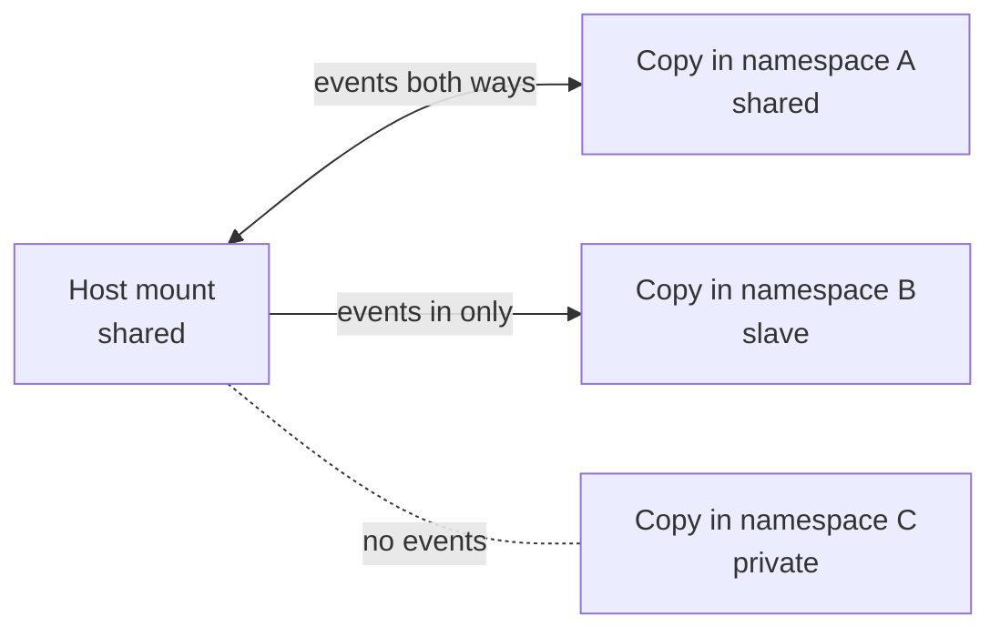

# Mount Propagation

Mount propagation is the Linux kernel feature that decides whether a mount or unmount made under one mount point is replicated to its copies elsewhere, such as in another mount namespace or at the other end of a bind mount. Every mount has a propagation type (**shared**, **private**, **slave**, or **unbindable**), and that type is what lets a container see a disk the host mounts later, or stops a container's mounts from leaking onto the host.

## Why It Matters

- **Containers depend on it.** Each container has its own mount namespace, a copy of the host's mount table. Propagation decides whether later mounts flow between the two copies.
- **Storage plugins need it.** A CSI driver or a FUSE daemon running in a container mounts volumes that the host and other containers must see. Without the right propagation, those mounts stay invisible outside the container.
- **The wrong setting is a security and stability risk.** Mounts that propagate back to the host can leak host paths, pile up mounts that are never cleaned up, or let a container change what the host sees.
- **It explains confusing behaviour.** "I mounted a USB disk on the host, why can't the container see it?" and "Why did unmounting inside my namespace unmount it on the host?" are both propagation questions.

## The Four Propagation Types

| Type | Receives mount events from peers or master | Sends mount events to others | Notes |
| --- | --- | --- | --- |
| **shared** | Yes | Yes | Joins a **peer group**; a mount or unmount under any member appears under all of them |
| **private** | No | No | Fully isolated; the kernel default for a new mount, though systemd changes it (below) |
| **slave** | Yes, from its master | No | One-way: events flow in from the master's peer group, never back out |
| **unbindable** | No | No | Private, and also cannot be the source of a bind mount; prevents mount trees from multiplying recursively |

A **peer group** is the set of mounts that share events with each other. Copies of a shared mount, made by bind-mounting it or by creating a new mount namespace, join the same peer group. A slave mount has a **master**, a peer group it receives events from.



When the host mounts something new under its shared mount, it appears in namespace A and namespace B, but not in namespace C. When namespace A mounts something, it appears on the host. When namespace B mounts something, only namespace B sees it.

## Seeing and Changing Propagation

### Inspecting

```bash
findmnt -o TARGET,PROPAGATION          # propagation type of every mount
findmnt -o TARGET,PROPAGATION /mnt     # one mount
cat /proc/self/mountinfo               # raw form, with peer group IDs
```

In `/proc/self/mountinfo`, the optional fields encode the type: `shared:N` means the mount is in peer group N, `master:N` means it is a slave of peer group N, and no tag means private. `unbindable` is marked as such.

### Changing

```bash
sudo mount --make-shared /mnt
sudo mount --make-private /mnt
sudo mount --make-slave /mnt
sudo mount --make-unbindable /mnt

sudo mount --make-rshared /       # recursive: the mount and every mount below it
sudo mount --make-rprivate /mnt
```

The `r` forms apply the type to an entire subtree, which is usually what you want, because a container's root contains many mounts.

### Defaults to know

- **The kernel** creates new mounts as private.
- **systemd** marks every mount shared at boot, so on most modern distributions `/` and the mounts under it are shared.
- **`unshare --mount`** makes the new namespace's mounts private by default, so experiments in it do not leak back to the host. `--propagation slave` or `--propagation unchanged` override this.

> [!warning] Shared roots make namespaces leak by default
> Because systemd makes `/` shared, a new mount namespace created with a raw `unshare(CLONE_NEWNS)` system call, without changing propagation, is a peer of the host. Mounts made inside it appear on the host. Container runtimes and the `unshare` command make the copy private or slave for exactly this reason.

## A Worked Example

Run as root on a scratch machine:

```bash
mkdir -p /tmp/prop/src /tmp/prop/dst
mount --bind /tmp/prop/src /tmp/prop/src     # make src a mount point
mount --make-shared /tmp/prop/src
mount --bind /tmp/prop/src /tmp/prop/dst     # dst joins src's peer group

mkdir /tmp/prop/src/disk
mount -t tmpfs tmpfs /tmp/prop/src/disk      # mount under src...
findmnt /tmp/prop/dst/disk                   # ...and it appears under dst too

mount --make-slave /tmp/prop/dst             # now one-way
mkdir /tmp/prop/dst/other
mount -t tmpfs tmpfs /tmp/prop/dst/other     # mount under dst...
findmnt /tmp/prop/src/other                  # ...does not appear under src
```

Clean up with `umount -R /tmp/prop/dst /tmp/prop/src`.

## In Containers

### Docker

A bind mount's propagation is set with an option on `-v` or `--mount`:

```bash
docker run -v /mnt/data:/data:rslave myimage
docker run --mount type=bind,source=/mnt/data,target=/data,bind-propagation=rshared myimage
```

| Option | Effect |
| --- | --- |
| `rprivate` (default) | No mount events flow in either direction |
| `rslave` / `slave` | Mounts the host makes later under the source appear in the container |
| `rshared` / `shared` | Mounts flow both ways, so the container can mount things the host sees |

Shared propagation needs the source mount itself to be shared on the host. A container that mounts filesystems also needs the `CAP_SYS_ADMIN` capability, usually through `--privileged`. These options are covered alongside volumes in [[concepts/devops/docker/docker#Data: Volumes, Bind Mounts, and tmpfs|Docker]].

### Kubernetes

A container's `volumeMounts` entry takes `mountPropagation`:

| Value | Linux equivalent | Use |
| --- | --- | --- |
| `None` (default) | `rprivate` | Normal workloads |
| `HostToContainer` | `rslave` | A container that must see mounts the host or another pod makes later, such as a node agent watching `/var/lib/kubelet` |
| `Bidirectional` | `rshared` | A container that mounts volumes for the host and other pods, such as a CSI node plugin; allowed only in privileged containers |

```yaml
volumeMounts:
  - name: kubelet-dir
    mountPath: /var/lib/kubelet
    mountPropagation: Bidirectional
```

> [!warning] Clean up after `Bidirectional`
> Mounts a `Bidirectional` container creates persist on the host after the container exits unless it unmounts them. A crash-looping storage plugin can leave stale mounts behind on the node.

## Related Concepts

- [[concepts/linux/linux_namespaces|Linux Namespaces]] — the mount namespace among the eight namespace types, and the `unshare` and `nsenter` tools that create and enter them
- [[concepts/devops/docker/docker|Docker]] — bind mounts and volumes, where the `rslave` and `rshared` options are set
- [[concepts/devops/kubernetes/pod_sandbox|Pod Sandbox (Pause Container)]] — the namespaces a pod shares and the one, the mount namespace, each container keeps for itself
- [[concepts/devops/docker/docker_container_techniques|Docker Container Techniques]] — the mount, PID, and network namespaces a container's processes run in
- [[concepts/linux/systemd_targets|Systemd Targets]] — systemd, the init system that marks every mount shared at boot

## References

- [mount_namespaces(7)](https://man7.org/linux/man-pages/man7/mount_namespaces.7.html) — propagation types, peer groups, and `mountinfo` fields
- [Linux kernel: Shared Subtrees](https://docs.kernel.org/filesystems/sharedsubtree.html) — the original design of mount propagation
- [Kubernetes: Volumes, mount propagation](https://kubernetes.io/docs/concepts/storage/volumes/#mount-propagation)
- [Docker: Bind mounts, configure bind propagation](https://docs.docker.com/engine/storage/bind-mounts/)
