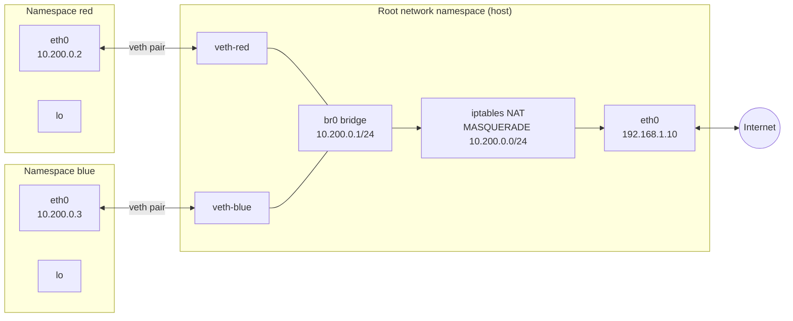
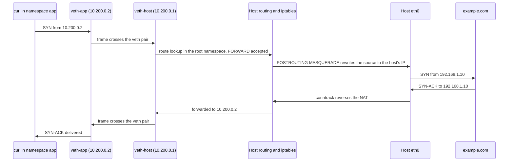

# Network Namespace

A network namespace is a separate copy of the Linux network stack, with its own interfaces, IP addresses, routing tables, firewall rules, sockets, and port numbers. Processes in different network namespaces cannot see each other's interfaces and can each bind the same port. It is one of the eight [[concepts/linux/linux_namespaces|Linux Namespaces]], and it is what gives every container and every Kubernetes pod its own IP address.

## Why It Matters

- **It is how containers get their own network.** Every Docker container in bridge mode and every Kubernetes pod runs in its own network namespace, connected to the host by a virtual interface.
- **It explains most container networking problems.** "Works on the host but not in the container" usually means a route, a DNS server, or a firewall rule that exists in one namespace and not the other.
- **It is useful outside containers.** Network namespaces can run one application through a VPN while the rest of the host doesn't, test routing setups on a single machine, or reproduce a multi-host network on a laptop.
- **Debugging needs it.** Entering a container's network namespace with the host's own tools is the fastest way to inspect a container whose image has no `ip`, `ss`, or `tcpdump`.

## What a Network Namespace Isolates

| Resource | Per namespace |
| --- | --- |
| Network interfaces | Each interface, physical or virtual, belongs to exactly one namespace |
| IP addresses | Assigned to interfaces, so they move with them |
| Routing tables and rules | `ip route` and `ip rule` show only the namespace's own |
| ARP and neighbour tables | Separate |
| Firewall | Separate iptables and nftables rule sets, and a separate connection-tracking table |
| Sockets and ports | A socket belongs to the namespace it was created in; two namespaces can both listen on port 80 |
| `/proc/net` and `/sys/class/net` | Show the current namespace's view |
| Network sysctls | Most `net.*` settings, such as `net.ipv4.ip_forward`, are per namespace |
| Unix domain sockets | Abstract-namespace sockets are per network namespace; path-based ones follow the filesystem instead |

The host's original stack is the **initial**, or root, network namespace. A newly created namespace contains only a loopback interface, `lo`, and even that is down until someone brings it up.

## A Typical Topology



Each namespace's `eth0` is one end of a veth pair whose other end is attached to a bridge on the host. The bridge acts as the namespaces' default gateway, and NAT rewrites their private addresses to the host's address on the way out. This is exactly the shape of Docker's default `docker0` network and of the CNI bridge plugin.

## Lifecycle

- **Creation.** `unshare --net`, `clone(CLONE_NEWNET)`, or `ip netns add NAME`. The `ip netns` variant also bind-mounts the namespace at `/run/netns/NAME`, so it survives with no processes in it and can be referred to by name.
- **Moving interfaces.** `ip link set DEV netns NAME` moves an interface into a namespace. Its IP addresses are lost in the move and must be reassigned inside.
- **Destruction.** When the last process leaves and no bind mount or open file holds it, the namespace is destroyed. Virtual interfaces in it, such as a veth end, are deleted, taking their peer with them. Physical interfaces are returned to the root namespace.
- **Sockets stay put.** A socket keeps belonging to the namespace it was created in, even if its process later moves to another namespace with `setns`. A process can open a socket in one namespace, switch, and keep using it.

## Working with `ip netns`

| Command | What it does |
| --- | --- |
| `ip netns add red` | Create a named namespace |
| `ip netns list` | List named namespaces, those under `/run/netns/` |
| `ip netns exec red CMD` | Run a command inside the namespace |
| `ip -n red addr` | Shorthand for running one `ip` command inside the namespace |
| `ip netns identify PID` | Name the namespace a process is in |
| `ip netns pids red` | List the processes in a namespace |
| `ip link set eth1 netns red` | Move an interface into the namespace |
| `ip netns attach web PID` | Give a name to the network namespace of an existing process |
| `ip netns delete red` | Remove the name, and the namespace once nothing else holds it |

Container runtimes do not register their namespaces under `/run/netns/`. Docker keeps them under `/var/run/docker/netns/`, so `ip netns list` does not show containers. To use `ip netns` on one, name it first with `ip netns attach web $(docker inspect -f '{{.State.Pid}}' web)`, or use `nsenter` instead.

> [!tip] Per-namespace `/etc` files
> `ip netns exec red` also bind-mounts any files in `/etc/netns/red/` over their counterparts in `/etc`. Putting a `resolv.conf` there gives the namespace its own DNS servers without touching the host's.

## Connecting a Namespace to the World

| Method | How it works | Typical use |
| --- | --- | --- |
| **veth pair** | Two virtual interfaces joined like a cable, one end in each namespace | The default for containers and pods; details in [[concepts/devops/kubernetes/veth_pair\|Virtual Ethernet (veth) Pair]] |
| **veth pair plus bridge** | Host ends of many veth pairs attached to one Linux bridge | Many namespaces on one subnet: `docker0`, `cni0` |
| **macvlan** | A sub-interface of a physical NIC with its own MAC address, moved into the namespace | The namespace appears as a separate machine on the physical LAN |
| **ipvlan** | Like macvlan but sharing the parent's MAC address, in layer 2 or layer 3 mode | Networks that limit MAC addresses per port, such as many cloud networks |
| **Physical interface** | Move a real NIC into the namespace | Dedicate a NIC or an SR-IOV virtual function to one workload |
| **WireGuard or tun interface** | Create a VPN interface in the root namespace and move it into the namespace | Route one application through a VPN; the encrypted traffic still leaves from the root namespace |

> [!warning] macvlan hides the host from its children
> By default a host cannot reach its own macvlan sub-interfaces through the parent NIC, and they cannot reach the host. Add a macvlan interface for the host itself if the two must talk.

## Hands-On: A Namespace with Internet Access

This builds the simplest useful setup: one namespace, one veth pair, a route, and NAT. Run it as root on a scratch virtual machine:

```bash
# 1. The namespace and its loopback
ip netns add app
ip -n app link set lo up

# 2. A veth pair: one end stays on the host, the other moves into the namespace
ip link add veth-host type veth peer name veth-app
ip link set veth-app netns app

# 3. Addresses on both ends, and a default route inside the namespace
ip addr add 10.200.0.1/24 dev veth-host
ip link set veth-host up
ip -n app addr add 10.200.0.2/24 dev veth-app
ip -n app link set veth-app up
ip -n app route add default via 10.200.0.1

# 4. Let the host forward and NAT the namespace's traffic
sysctl -w net.ipv4.ip_forward=1
iptables -t nat -A POSTROUTING -s 10.200.0.0/24 ! -o veth-host -j MASQUERADE
iptables -A FORWARD -i veth-host -j ACCEPT
iptables -A FORWARD -o veth-host -m conntrack --ctstate RELATED,ESTABLISHED -j ACCEPT

# 5. DNS for the namespace only
mkdir -p /etc/netns/app
echo 'nameserver 1.1.1.1' > /etc/netns/app/resolv.conf

# 6. Test
ip netns exec app ping -c 1 1.1.1.1
ip netns exec app curl -sI https://example.com
```

Clean up with `ip netns delete app`, which also removes the veth pair, then delete the three iptables rules by repeating them with `-D` in place of `-A`.

The two `FORWARD` rules matter on hosts where Docker is installed, because Docker sets the `FORWARD` chain's default policy to `DROP`.

### The packet's path



The outgoing packet leaves the namespace through the veth pair, is routed and NATed in the root namespace, and leaves through the host's NIC. Connection tracking remembers the translation, so the reply is rewritten back and forwarded into the namespace.

## In Containers and Pods

### Docker network modes

| Mode | Network namespace | Result |
| --- | --- | --- |
| `bridge` (default) | New, with a veth pair to the `docker0` bridge | Private IP; outbound traffic NATed; inbound only through ports published with `-p`, which Docker implements as DNAT rules |
| `host` | The host's root namespace | No isolation; the container binds the host's ports directly |
| `none` | New, with only `lo` | No network at all |
| `container:NAME` | Joins another container's namespace | Shared IP and `localhost`, exactly like containers in a Kubernetes pod |
| `macvlan` / `ipvlan` | New, with a macvlan or ipvlan interface | The container gets an address on the physical network |

User-defined bridge networks add an embedded DNS server, so containers on them can reach each other by name.

### Kubernetes pods

Each pod gets one network namespace, created with the pod sandbox and held open by its pause container. All of the pod's containers join it, so they share one IP address and one port space and talk over `localhost`, as described in [[concepts/devops/kubernetes/pod_sandbox|Pod Sandbox (Pause Container)]]. The CNI plugin wires the namespace to the node, usually with a veth pair. A pod with `hostNetwork: true` skips all of this and runs in the node's root namespace.

## Debugging

```bash
# Which network namespaces exist, and which process holds each
lsns -t net

# Enter a container's network namespace with the host's tools
PID=$(docker inspect -f '{{.State.Pid}}' web)
sudo nsenter -t "$PID" -n ip addr
sudo nsenter -t "$PID" -n ss -tlnp            # what it is listening on
sudo nsenter -t "$PID" -n ip route
sudo nsenter -t "$PID" -n tcpdump -ni eth0

# Or attach a tools container to the same namespace
docker run --rm -it --network container:web nicolaka/netshoot
```

On Kubernetes, `kubectl debug -it POD --image=nicolaka/netshoot` adds an ephemeral container that shares the pod's network namespace. Capturing on the pod's host-side veth interface is covered in [[concepts/devops/kubernetes/veth_pair#Tracing a Pod to Its veth|Tracing a Pod to Its veth]].

## Common Pitfalls

- **Loopback left down.** A new namespace's `lo` is down, so anything that connects to `127.0.0.1` fails until `ip link set lo up` runs inside it.
- **No forwarding on the host.** Traffic from the namespace dies at the host unless `net.ipv4.ip_forward` is 1 and the `FORWARD` chain accepts it.
- **DNS pointing at `127.0.0.53`.** On hosts using systemd-resolved, `/etc/resolv.conf` points at a stub resolver on the host's loopback. Inside a namespace, `127.0.0.53` is the namespace's own loopback, where nothing listens. Use `/etc/netns/NAME/resolv.conf` with a real server, as Docker does by copying the upstream resolvers.
- **Firewall rules in the wrong namespace.** A rule added on the host does not filter traffic between two processes inside one namespace, and a rule added inside a container does not protect the host. Traffic is only filtered by the rules of the namespace it is passing through.
- **Expecting `ip netns list` to show containers.** It lists only namespaces bind-mounted under `/run/netns/`.

## Related Concepts

- [[concepts/linux/linux_namespaces|Linux Namespaces]] — the other seven namespace types, the system calls behind them, and how containers combine them
- [[concepts/devops/kubernetes/veth_pair|Virtual Ethernet (veth) Pair]] — the virtual cable between namespaces, with how CNI plugins use it and the packet paths between pods
- [[concepts/devops/kubernetes/pod_sandbox|Pod Sandbox (Pause Container)]] — the network namespace a pod's containers share, and the pause process that holds it open
- [[concepts/devops/docker/docker|Docker]] — bridge, host, and user-defined networks built from network namespaces
- [[concepts/linux/mount_propagation|Mount Propagation]] — the equivalent sharing question for mount namespaces

## References

- [network_namespaces(7)](https://man7.org/linux/man-pages/man7/network_namespaces.7.html)
- [ip-netns(8)](https://man7.org/linux/man-pages/man8/ip-netns.8.html) — named namespaces, `/run/netns`, and `/etc/netns`
- [Docker: Networking overview](https://docs.docker.com/engine/network/)
- [WireGuard: Routing and network namespace integration](https://www.wireguard.com/netns/)
