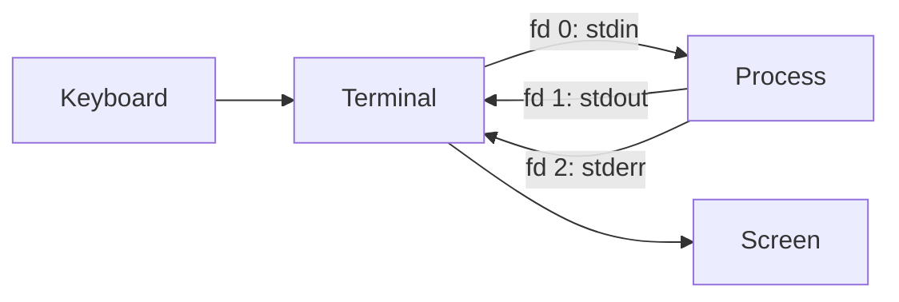
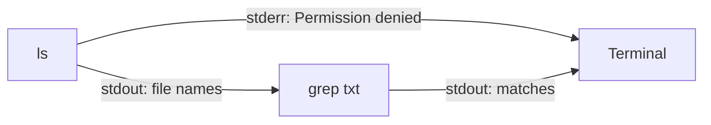

# Standard Streams (stdin, stdout, stderr)

The standard streams are the three channels every Unix process starts with: **stdin** for reading input, **stdout** for normal output, and **stderr** for errors and diagnostics. They are simply file descriptors 0, 1, and 2, inherited from the parent process, which is what lets a shell redirect them to files and connect programs with pipes without the programs knowing.

## Why It Matters

- **Pipelines depend on the split.** Keeping errors off stdout means the next program in a pipe receives only data.
- **Redirection is how scripts capture, silence, or log output.** Getting `2>&1` in the wrong place is one of the most common shell mistakes.
- **Buffering explains "missing" output.** A program whose output appears late, out of order, or not at all in a log or a container is usually being fully buffered because stdout is not a terminal.
- **Containers and services log through them.** Docker, Kubernetes, and systemd collect a process's stdout and stderr as its logs, so writing logs to these streams, not to files, is the convention.

## The Three Streams

### stdin (standard input)

- **File descriptor:** `0`.
- **Purpose:** the stream from which the program **reads** input data.
- **Default source:** the **keyboard**, through the terminal.
- **Common C functions:** `scanf()`, `fgets()`, `getchar()`.
- **Redirection:** read from a file instead of the keyboard with `<`, for example `./program < input.txt`.

### stdout (standard output)

- **File descriptor:** `1`.
- **Purpose:** the stream where the program **writes** its normal operational data.
- **Default destination:** the **terminal screen**.
- **Common C functions:** `printf()`, `puts()`, `putchar()`.
- **Buffering:** **line-buffered when connected to a terminal**, so text appears once a newline (`\n`) is written or the buffer fills. When stdout is redirected to a file or a pipe, it becomes **fully buffered** and is written out only in blocks of several kilobytes.
- **Redirection:** save the output to a file with `>`, for example `./program > output.txt`.

### stderr (standard error)

- **File descriptor:** `2`.
- **Purpose:** a separate stream specifically for **error messages** and diagnostics.
- **Default destination:** also the **terminal screen**.
- **Common C function:** `fprintf(stderr, "Error message\n");`.
- **Buffering:** **unbuffered**. Errors are written immediately, because after a crash an error message stuck in a buffer that never gets flushed would be lost.
- **Redirection:** redirect errors separately from normal output with `2>`, for example `./program 2> errors.log`.

### Comparison

| Feature | stdin | stdout | stderr |
| --- | --- | --- | --- |
| Full name | Standard input | Standard output | Standard error |
| Direction | Into the program | Out of the program | Out of the program |
| File descriptor | `0` | `1` | `2` |
| Standard use | Receiving user or piped data | Normal program results | Errors, warnings, progress, diagnostics |
| Default connection | Terminal (keyboard) | Terminal (screen) | Terminal (screen) |
| C buffering | Line-buffered on a terminal | Line-buffered on a terminal; fully buffered to a file or pipe | Unbuffered |
| Device paths | `/dev/stdin` | `/dev/stdout` | `/dev/stderr` |

The device paths are links to `/proc/self/fd/0`, `1`, and `2`, so a program that only accepts a filename can still be pointed at a stream.

## How They Work

By default all three descriptors point at the same terminal device, which is why stdout and stderr look identical on screen even though they are separate streams.

A file descriptor is just an index into the process's table of open files. When the shell starts a program, it forks, rearranges descriptors 0, 1, and 2 to point at files, pipes, or the terminal (using the `dup2` system call), and then runs the program, which inherits them. The program writes to descriptor 1 without knowing whether it leads to a screen, a file, or another program.

## Redirection in the Shell

| Syntax | Effect |
| --- | --- |
| `cmd < in.txt` | stdin reads from a file |
| `cmd > out.txt` | stdout to a file, truncating it |
| `cmd >> out.txt` | stdout appended to a file |
| `cmd 2> err.txt` | stderr to a file |
| `cmd > out.txt 2> err.txt` | Each stream to its own file |
| `cmd > all.txt 2>&1` | stdout to the file, then stderr to wherever stdout points: both in the file |
| `cmd &> all.txt` | Bash shorthand for the line above |
| `cmd 2> /dev/null` | Discard errors |
| `cmd > /dev/null 2>&1` | Discard everything |
| `cmd 2>&1 \| grep x` | Send both streams into the pipe |
| `cmd \|& grep x` | Bash shorthand for the line above |
| `cmd \| tee out.txt` | Show stdout on screen and save it |
| `cmd <<'EOF' … EOF` | A here-document: inline text as stdin |
| `cmd <<< "text"` | A here-string: one string as stdin |

> [!warning] Order matters with `2>&1`
> Redirections are applied left to right, and `2>&1` means "make descriptor 2 point where descriptor 1 points *right now*". `cmd > out.txt 2>&1` puts both streams in the file. `cmd 2>&1 > out.txt` points stderr at the terminal first, then moves only stdout to the file, so errors still appear on screen.

## Why Separate stdout and stderr?

The biggest reason is **piping**. When the output of program A feeds program B, error messages must not be mixed into the data.

In `ls | grep "txt"`, only the file names travel through the pipe to `grep`. If `ls` hits an error, such as a permission problem, the message goes to stderr and prints on the terminal instead of being fed into `grep` as if it were a file name.

The same split lets scripts keep clean data and logs apart. `./export > data.csv 2> export.log` produces a CSV that contains only data, while the progress messages and warnings go to the log. Progress bars and prompts conventionally go to stderr for the same reason.

The exit status is a separate, fourth channel: it reports success (0) or failure (non-zero), regardless of what was written to either output stream.

## Buffering Pitfalls

Because stdout switches to full buffering when it is not a terminal, a program's output can appear late or in a surprising order when it is piped, redirected, or running in a container:

- **Interleaving changes.** On a terminal, stdout and stderr lines appear in the order they were written. Redirected to one file, unbuffered stderr lines can appear *before* stdout lines written earlier but still sitting in the buffer.
- **Output is lost on a crash.** A process killed with SIGKILL, or one that exits without flushing, loses whatever was still in its stdout buffer.
- **Logs arrive in bursts.** A long-running service writing to stdout through a pipe may show nothing in `docker logs` for minutes, then several kilobytes at once.

Fixes, depending on the program:

- Flush explicitly in code with `fflush(stdout)`, or `print(..., flush=True)` in Python.
- Disable buffering at start: `python -u`, or `PYTHONUNBUFFERED=1` in a container image.
- Force line buffering from outside with `stdbuf -oL cmd` for programs that use C stdio.

## In Containers and Services

- **Docker** captures a container's stdout and stderr separately through its log driver, and `docker logs` replays them. Running with `-t` merges them into one stream, as described in [[concepts/devops/docker/docker_container_techniques|Docker Container Techniques]].
- **Kubernetes** collects each container's stdout and stderr into node log files, which `kubectl logs` reads.
- **systemd** sends a service's stdout and stderr to the journal by default, readable with `journalctl -u SERVICE`.
- **The convention**, popularised as the Twelve-Factor App's logging rule, is that applications write logs as an event stream to stdout and let the platform route and store them, rather than managing log files themselves.

## Related Concepts

- [[concepts/devops/docker/docker_container_techniques|Docker Container Techniques]] — how the CLI, daemon, and shim carry a container's stdin, stdout, and stderr, and why `-t` merges the output streams
- [[concepts/linux/linux_namespaces|Linux Namespaces]] — the process isolation within which a container's PID 1 inherits these three descriptors from its runtime shim
- [[concepts/linux/systemd_targets|Systemd Targets]] — systemd, which connects a service's output streams to the journal

## References

- [stdin(3)](https://man7.org/linux/man-pages/man3/stdin.3.html) — the standard streams and their buffering in C
- [Bash Reference Manual: Redirections](https://www.gnu.org/software/bash/manual/html_node/Redirections.html)
- [The Twelve-Factor App: Logs](https://12factor.net/logs)
