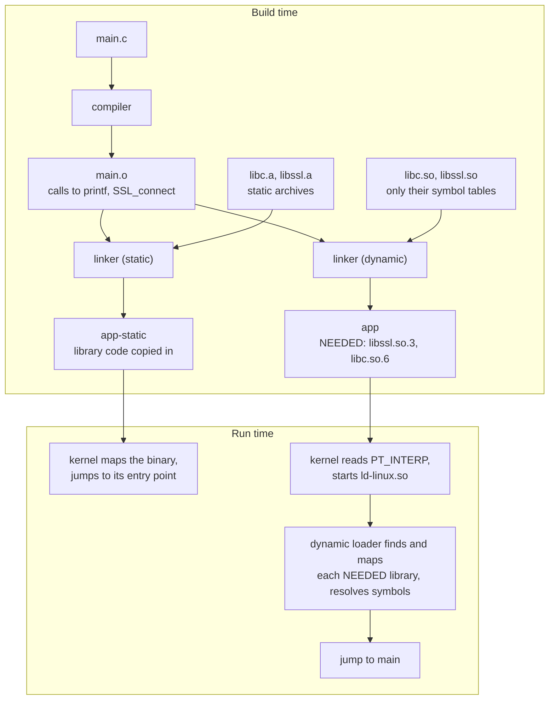
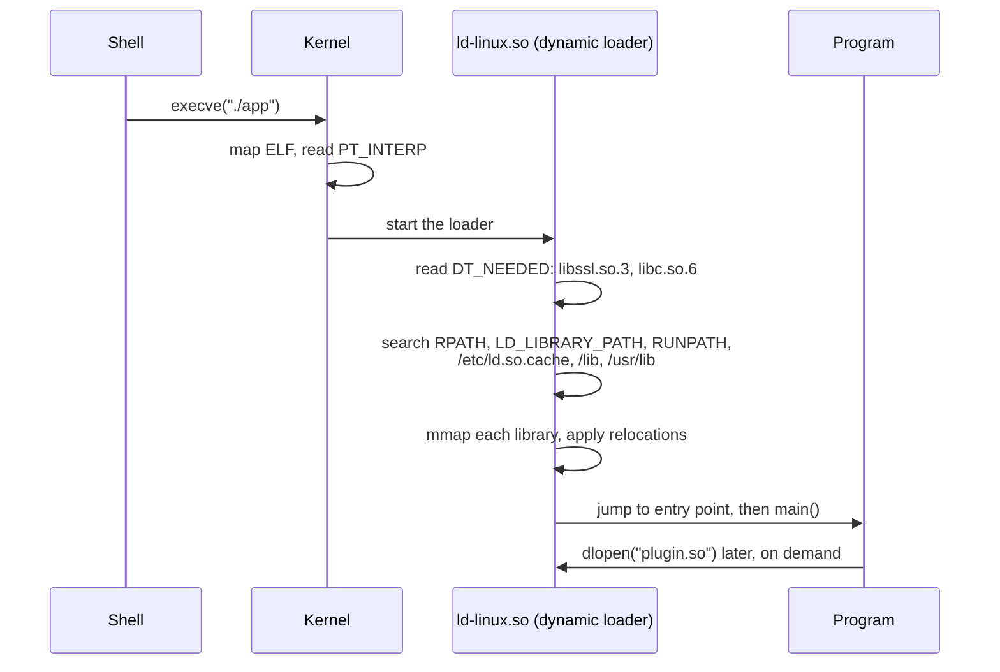
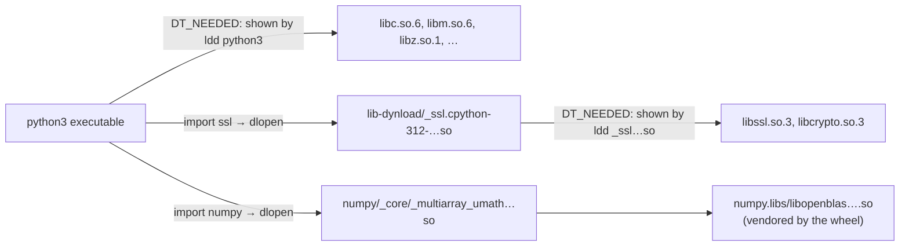

# Static vs. Dynamic Linking

Linking is the build step that connects a program's calls to library functions with the code that implements them:

- **Static linking** copies the needed library code into the executable at build time, producing one self-contained binary.
- **Dynamic linking** records only the *names* of the shared libraries (`.so` files) the program needs. The **dynamic loader** finds and maps those libraries into memory each time the program starts.

The choice decides how big a binary is, whether it runs on another machine, how security patches reach it, and what a container image like those built with [[concepts/devops/docker/docker|Docker]] has to contain.

## Why It Matters

- **"Works on my machine."** A dynamically linked binary depends on the exact libraries installed on the host. `version 'GLIBC_2.34' not found` is the classic failure when a binary built on a new distribution runs on an older one.
- **Patching.** Fixing a vulnerability in a shared `libssl.so` fixes every dynamically linked program on the machine at once. A statically linked program carries its own copy and must be rebuilt.
- **Container size.** A static binary can run in a `scratch` or distroless image with nothing else in it. A dynamic one needs a base image that provides the right C library and every `.so` it loads.
- **Debugging.** `ldd`, `LD_LIBRARY_PATH`, and "cannot open shared object file" errors only make sense once you know what the dynamic loader does.

## How Each Works



### Static linking

The linker pulls the object files it needs out of static archives (`.a` files) and copies them into the executable. Symbol addresses are fixed at build time. The binary has no `NEEDED` entries and no interpreter, so the kernel can run it directly.

### Dynamic linking

The linker checks that every symbol exists in some shared object, then writes:

- a list of required libraries, the `DT_NEEDED` entries such as `libc.so.6`;
- the path of the dynamic loader in the `PT_INTERP` header, for example `/lib64/ld-linux-x86-64.so.2`.

At startup:



- **Search order.** In order: `DT_RPATH` (deprecated), `LD_LIBRARY_PATH`, `DT_RUNPATH`, the cache `/etc/ld.so.cache` built by `ldconfig`, then the default directories `/lib` and `/usr/lib`. A library missing from all of them fails with `error while loading shared libraries: libfoo.so.1: cannot open shared object file`.
- **Sharing.** The read-only code pages of a shared library are mapped once and shared by every process using it, which saves memory when hundreds of processes use `libc`.
- **Lazy binding.** By default, functions are resolved on their first call through the PLT and GOT tables. Setting `LD_BIND_NOW=1`, or linking with `-z now`, resolves everything at startup. This is part of the RELRO hardening that makes the GOT read-only.
- **`dlopen`.** Programs can load libraries at run time, which is how plugins and Python extension modules work. These libraries are not listed in `DT_NEEDED`, so tools that read only the ELF headers don't see them.
- **sonames and versions.** A library's soname, such as `libssl.so.3`, carries its ABI major version, so incompatible versions can be installed side by side. glibc also versions individual symbols, so `memcpy@GLIBC_2.14` must exist on the target system.

## Comparison

| Aspect | Static linking | Dynamic linking |
| --- | --- | --- |
| Library code | Copied into each executable | Loaded from shared `.so` files at start |
| Binary size | Larger | Smaller |
| Memory across processes | Each process has its own copy | Code pages shared between processes |
| Startup | No loader work; slightly faster | Loader searches, maps, and relocates libraries |
| Portability | Runs on any kernel with a compatible syscall ABI | Needs compatible library versions on the host |
| Security patches | Rebuild and redeploy every binary | Update the library once; restart the processes |
| Vulnerability scanning | Bundled libraries are hard for scanners to see | Package manager knows each library version |
| Plugins (`dlopen`) | Awkward or unsupported | Natural |
| Licensing | LGPL libraries impose extra obligations when linked statically | LGPL is satisfied more easily |
| Container base | `scratch` or distroless static | Base image with libc and all needed `.so` files |
| Typical | Go with `CGO_ENABLED=0`, Rust with the musl target, BusyBox | Most distribution packages, Python, Node.js, Java runtimes |

### glibc, musl, and fully static binaries

- **glibc resists full static linking.** Name resolution (`getaddrinfo`, `getpwnam`) goes through NSS, which still `dlopen`s modules at run time even in a "static" glibc binary, and the linker warns about it. Statically linked glibc binaries can therefore misbehave on other systems.
- **musl** (Alpine Linux) is designed to link statically, which is why `x86_64-unknown-linux-musl` is the usual Rust target for static binaries.
- **musl is not glibc.** Binaries and Python wheels built against glibc fail on Alpine, which is why Python wheels come tagged `manylinux` (glibc) and `musllinux` (musl).
- **Go** produces fully static binaries when cgo is disabled (`CGO_ENABLED=0`). That's why Go services often ship in `FROM scratch` images.

```dockerfile
FROM golang:1.23 AS build
WORKDIR /src
COPY . .
RUN CGO_ENABLED=0 go build -o /app .

FROM scratch                       # no libc, no shell, nothing but the binary
COPY --from=build /app /app
ENTRYPOINT ["/app"]
```

In a real Dockerfile, pin both `FROM` images by digest, as described in [[concepts/devops/docker/docker_image_digest_pinning|Docker Image Digest Pinning]].

## Inspecting a Binary

```bash
gcc main.c -o app                  # dynamic by default
gcc -static main.c -o app-static   # static

file app app-static
# app:        ELF 64-bit LSB pie executable, x86-64, dynamically linked, interpreter /lib64/ld-linux-x86-64.so.2, ...
# app-static: ELF 64-bit LSB executable, x86-64, statically linked, ...

ldd app-static                     # "not a dynamic executable"
readelf -d app | grep NEEDED       # libraries named in the ELF header, without running anything
readelf -l app | grep interpreter  # the dynamic loader path
LD_DEBUG=libs ./app                # watch the loader search for each library
ldconfig -p | grep ssl             # what the loader cache knows about
```

### `ldd`

`ldd` prints the shared libraries a program needs, *including* the libraries those libraries need, and where the loader would find each one:

```text
$ ldd ./app
    linux-vdso.so.1 (0x00007ffc...)
    libssl.so.3 => /lib/x86_64-linux-gnu/libssl.so.3 (0x00007f...)
    libcrypto.so.3 => /lib/x86_64-linux-gnu/libcrypto.so.3 (0x00007f...)
    libc.so.6 => /lib/x86_64-linux-gnu/libc.so.6 (0x00007f...)
    /lib64/ld-linux-x86-64.so.2 (0x00007f...)
```

- **`linux-vdso.so.1`** has no path because the kernel maps it into every process. It makes calls such as `gettimeofday` fast without entering the kernel.
- **`=> not found`** marks a library the loader can't locate, the cause of "cannot open shared object file" errors.
- **`ldd` runs the loader.** With glibc it works by starting the program through the dynamic loader in a trace mode (`LD_TRACE_LOADED_OBJECTS=1`), so on some binaries it can execute code. The `ldd` man page warns against running it on untrusted executables. Use `readelf -d` or `objdump -p` for those, which only read the file.

## Shared Libraries and Python

### `ldd` on the interpreter

```text
$ ldd "$(command -v python3)"
    linux-vdso.so.1 (0x00007ffd...)
    libm.so.6 => /lib/x86_64-linux-gnu/libm.so.6 (0x00007f...)
    libz.so.1 => /lib/x86_64-linux-gnu/libz.so.1 (0x00007f...)
    libexpat.so.1 => /lib/x86_64-linux-gnu/libexpat.so.1 (0x00007f...)
    libc.so.6 => /lib/x86_64-linux-gnu/libc.so.6 (0x00007f...)
    /lib64/ld-linux-x86-64.so.2 (0x00007f...)
```

The output is illustrative and varies by build. Some distributions build the interpreter against a shared `libpython3.X.so.1.0`, which then appears in this list. Others link `libpython` statically into the `python3` executable. Python itself reports which:

```bash
python3 -c 'import sysconfig as s; print(s.get_config_var("Py_ENABLE_SHARED"), s.get_config_var("LDLIBRARY"))'
# 0 libpython3.12.a       -> libpython is built into the executable
# 1 libpython3.12.so      -> libpython is a shared library the interpreter loads
```

### Why `ldd python3` misses most libraries

Most of Python's compiled code lives in **extension modules**: shared objects such as `_ssl.cpython-312-x86_64-linux-gnu.so`. Python loads them with `dlopen` when you `import` the module. They aren't in the interpreter's `DT_NEEDED` list, so `ldd python3` never shows them, nor the libraries *they* depend on, such as OpenSSL behind `_ssl`.



To see them, inspect the modules themselves:

```bash
# Where a module's shared object lives, and what it links against
python3 -c 'import _ssl; print(_ssl.__file__)'
ldd "$(python3 -c 'import _ssl; print(_ssl.__file__)')"

# Every standard-library extension module and its dependencies
DYNLOAD="$(python3 -c 'import sysconfig; print(sysconfig.get_path("platstdlib"))')/lib-dynload"
for so in "$DYNLOAD"/*.so; do echo "== $so"; ldd "$so"; done
```

Or ask a running interpreter which shared objects are actually mapped into it, which also covers libraries loaded through `dlopen` and `ctypes`:

```python
import ssl, sqlite3, ctypes  # importing triggers dlopen of their extension modules

with open("/proc/self/maps") as maps:
    libs = sorted({line.split()[-1] for line in maps if ".so" in line})
print("\n".join(libs))
```

For another process, read `/proc/<pid>/maps`, or run `lsof -p <pid> | grep '\.so'`. `ctypes.util.find_library("ssl")` shows which library name the loader would resolve for a `ctypes` load.

### Wheels bundle their own libraries

Binary wheels from PyPI built to the `manylinux` standard *vendor* their non-standard shared libraries. `auditwheel repair` copies them into a directory such as `numpy.libs/`, with hashed names, and rewrites `RPATH` so the extension module finds them there. A `pip install` therefore doesn't need system packages like OpenBLAS. It also means those copies are patched only when the wheel is upgraded, not by the operating system's package updates, the same trade-off as static linking.

## Related Concepts

- [[concepts/devops/docker/docker|Docker]] — base image choice (`scratch`, distroless, Alpine, slim) is largely a decision about which shared libraries the image must provide
- [[concepts/devops/docker/docker_image_digest_pinning|Docker Image Digest Pinning]] — pinning the base images whose C library and shared objects a dynamic binary depends on
- [[concepts/devops/trivy|Trivy]] — finds vulnerable shared libraries through the package database, and why statically bundled copies are harder to see
- [[concepts/linux/linux_namespaces|Linux Namespaces]] — a container's mount namespace is why it sees its image's `/lib`, not the host's, when the loader searches for libraries
- [[concepts/linux/standard_streams|Standard Streams (stdin, stdout, stderr)]] — `ldd` and loader errors are written to these streams; "cannot open shared object file" arrives on stderr

## References

- [ld.so(8)](https://man7.org/linux/man-pages/man8/ld.so.8.html) — the dynamic loader, its search order, and its environment variables
- [ldd(1)](https://man7.org/linux/man-pages/man1/ldd.1.html) — including the security warning about untrusted executables
- [PEP 600: manylinux wheels](https://peps.python.org/pep-0600/) and [auditwheel](https://github.com/pypa/auditwheel)
