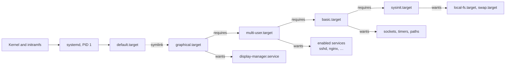

# Systemd Targets

A systemd target is a unit, with a `.target` extension, that groups other units and serves as a **synchronization point** the system works towards, such as "multi-user with networking" or "graphical desktop". Targets replace the runlevels of the older SysVinit init system as the way a Linux machine defines its operating states, and they are managed with `systemctl`.

## Why It Matters

- **It decides what a machine runs.** The default target is the difference between a headless server and a desktop with a login screen.
- **It is how you repair a system that won't boot.** Booting into `rescue.target` or `emergency.target` is the standard way back in after a broken service, a bad `/etc/fstab`, or a corrupted filesystem.
- **Enabling a service means joining a target.** `systemctl enable` works by hooking a service into a target, so understanding targets explains what "enabled" actually means.
- **One wrong command can lock you out.** Switching a remote machine to a target without networking ends your SSH session.

## From SysVinit Runlevels to Targets

### SysVinit runlevels

Modern Linux distributions have largely adopted systemd as their init system, the first process the kernel starts (PID 1), replacing SysVinit. In SysVinit, **runlevels** defined discrete operating states. At boot the system entered one runlevel, set by the `initdefault` line in `/etc/inittab`, and that runlevel determined which services were started or stopped:

| Runlevel | Meaning |
| --- | --- |
| **0** | Halt (system shutdown) |
| **1** (or **S**) | Single-user mode, for maintenance |
| **2** | Multi-user without networking services such as NFS (the Red Hat convention; rarely used on modern systems) |
| **3** | Full multi-user mode with networking: text-based login, common for servers |
| **4** | User-definable, often unused |
| **5** | Full multi-user mode with a graphical display manager: graphical login, common for desktops |
| **6** | Reboot |

The meaning of 2 to 5 varied between distributions. Debian and Ubuntu, for example, treated runlevels 2 to 5 identically, as full multi-user mode, and used 2 as the default.

Each runlevel had a directory such as `/etc/rc3.d/` of scripts named `S20apache2` or `K80nfs`. Switching runlevels ran the `K` (kill) scripts to stop the old services and then the `S` (start) scripts, in the order of their numbers, one at a time.

### What targets change

Systemd replaces this rigid, sequential system with targets. A target is a unit file that groups other units, such as services, sockets, mount points, and other targets, and serves as a synchronization point.

Instead of the system being *in* a single runlevel, systemd works towards a set of desired targets. Targets can depend on other targets, several are active at once, and systemd starts every unit whose dependencies are satisfied in parallel, not in a numbered sequence.

### Runlevel compatibility targets

For compatibility, systemd ships targets named after the old runlevels. They are symbolic links, in `/usr/lib/systemd/system/`, to the functionally equivalent targets:

| SysVinit runlevel | Compatibility link | Functional target | Description |
| --- | --- | --- | --- |
| **0** | `runlevel0.target` | `poweroff.target` | Shuts down the system |
| **1** | `runlevel1.target` | `rescue.target` | Sets up a rescue shell |
| **2** | `runlevel2.target` | `multi-user.target` | Multi-user, non-graphical |
| **3** | `runlevel3.target` | `multi-user.target` | Multi-user, non-graphical |
| **4** | `runlevel4.target` | `multi-user.target` | Multi-user, non-graphical |
| **5** | `runlevel5.target` | `graphical.target` | Multi-user, graphical |
| **6** | `runlevel6.target` | `reboot.target` | Reboots the system |

The functional targets used most often for normal operation are `multi-user.target` and `graphical.target`. The old commands still work as compatibility shims: `runlevel` and `who -r` print the current equivalent runlevel, and `telinit 3` or `init 3` switch to `runlevel3.target`.

## Key Targets

| Target | What it provides | Typical use |
| --- | --- | --- |
| `poweroff.target` | The system is powered off | Shutdown |
| `reboot.target` | The system is ready to reboot | Restart |
| `halt.target` | The system is halted but not powered off | Rarely needed |
| `rescue.target` | A rescue shell with local filesystems mounted and basic services running, but no networking or other services | Repair when the system cannot reach `multi-user.target` |
| `emergency.target` | The most minimal shell possible, often without even mounting the root filesystem read-write | Critical troubleshooting when `rescue.target` itself fails |
| `multi-user.target` | Multiple users, networking, and non-graphical logins on text consoles and over SSH | The common default for servers |
| `graphical.target` | Everything in `multi-user.target`, plus a display manager for a graphical login and desktop | The common default for desktops |
| `default.target` | Whatever systemd reaches at boot; a symbolic link, usually to `graphical.target` or `multi-user.target` | Set with `systemctl set-default` |

### Rescue vs. emergency

| | `rescue.target` | `emergency.target` |
| --- | --- | --- |
| Filesystems | All local filesystems mounted | Root only, usually read-only; nothing else mounted |
| Services | Basic system initialization (`sysinit.target`) | None |
| Login | Root password | Root password |
| Use when | A service or configuration error stops a normal boot | `/etc/fstab` is broken, a filesystem is corrupted, or rescue mode fails |
| Kernel argument | `systemd.unit=rescue.target`, or `rescue`, `single`, `1` | `systemd.unit=emergency.target`, or `emergency` |

In emergency mode, remount root read-write with `mount -o remount,rw /` before editing files.

### Building-block targets

Some targets are not destinations but milestones that others depend on:

| Target | Reached when |
| --- | --- |
| `local-fs.target` | Local filesystems from `/etc/fstab` are mounted |
| `sysinit.target` | Early system initialization is complete: filesystems, swap, kernel settings |
| `basic.target` | Sockets, timers, and paths are set up; a basic system is ready for services |
| `network.target` | The network management stack has started. It does **not** mean the network is up |
| `network-online.target` | The configured network is actually up, for services that need connectivity at start |

> [!warning] `network.target` is not "the network is up"
> A service ordered `After=network.target` can start before any interface has an address. A service that must connect somewhere at start-up needs `Wants=network-online.target` together with `After=network-online.target`.

## How Boot Reaches a Target



At boot, systemd resolves `default.target` and pulls in its whole dependency tree, starting every unit in parallel as soon as the units it is ordered after are ready.

## Anatomy of a Target Unit

On a typical system, `systemctl cat multi-user.target` shows:

```ini
[Unit]
Description=Multi-User System
Documentation=man:systemd.special(7)
Requires=basic.target
Conflicts=rescue.service rescue.target
After=basic.target rescue.service rescue.target
AllowIsolate=yes
```

| Directive | Meaning |
| --- | --- |
| `Requires=` | Pull in these units; if one fails to start, this unit fails too |
| `Wants=` | Pull in these units, but carry on if they fail; the usual, more forgiving dependency |
| `After=` / `Before=` | Ordering only: start after or before these units, if both are being started |
| `Conflicts=` | Starting this unit stops those, and the reverse |
| `AllowIsolate=yes` | This target may be used with `systemctl isolate` |

Dependency and ordering are independent. `Wants=` alone starts two units in parallel. `After=` alone sets an order but pulls nothing in. Most relationships need both.

### How services join a target

A service declares in its `[Install]` section which target should pull it in:

```ini
[Install]
WantedBy=multi-user.target
```

`systemctl enable nginx` reads that line and creates a symbolic link, `/etc/systemd/system/multi-user.target.wants/nginx.service`, pointing at the unit file. Every link in a target's `.wants/` directory is an implicit `Wants=`. `systemctl disable` removes the link, and `systemctl enable --now` enables and starts the service in one step.

## Managing Targets with `systemctl`

### Default target

```bash
systemctl get-default                       # show the boot target
sudo systemctl set-default multi-user.target
sudo systemctl set-default graphical.target
```

`set-default` replaces the `/etc/systemd/system/default.target` symbolic link, so the change takes effect at the next boot.

### Switching targets now

```bash
sudo systemctl isolate multi-user.target    # leave the desktop, keep text logins
sudo systemctl isolate graphical.target     # start the display manager again
```

`isolate` switches to the specified target immediately, starting the units it needs and stopping every unit it does not need. This is the equivalent of changing runlevels in SysVinit. Only targets with `AllowIsolate=yes` can be isolated; others are refused.

> [!warning] Isolating a remote machine can disconnect you
> `systemctl isolate rescue.target` over SSH stops `sshd` and the network along with everything else. Only isolate a remote host to a target that keeps networking and SSH, or have console access ready.

Shortcuts exist for the common transitions:

| Command | Equivalent |
| --- | --- |
| `systemctl rescue` | Isolate `rescue.target` |
| `systemctl emergency` | Isolate `emergency.target` |
| `systemctl default` | Isolate `default.target` |
| `systemctl poweroff` / `reboot` / `halt` | Start the matching target |
| `systemctl suspend` / `hibernate` | Sleep states |

### Booting into a different target once

To boot into another target a single time, without changing the default, add it to the kernel command line. At the GRUB menu, press `e`, append `systemd.unit=rescue.target` (or `emergency.target`, or `multi-user.target`) to the line that starts with `linux`, and boot with Ctrl-X. The legacy runlevel numbers also work there: `3` boots `runlevel3.target`.

### Inspecting targets

| Command | What it shows |
| --- | --- |
| `systemctl list-units --type=target` | Active targets; add `--all` for inactive ones too |
| `systemctl list-unit-files --type=target` | Every installed target file |
| `systemctl list-dependencies graphical.target` | The tree of units a target pulls in |
| `systemctl list-dependencies --reverse nginx.service` | Which targets pull a unit in |
| `systemctl cat multi-user.target` | The target's unit file, with any overrides |
| `systemctl show -p Wants,Requires,After multi-user.target` | Specific dependency properties |
| `systemctl is-active graphical.target` | Whether a target is currently active |
| `systemd-analyze critical-chain` | The chain of units that determined how long boot took |
| `systemd-analyze blame` | Units sorted by how long they took to start |

## Creating a Custom Target

A custom target groups services that should run together, for example a maintenance mode that keeps a server reachable but stops its application:

```ini
# /etc/systemd/system/maintenance.target
[Unit]
Description=Maintenance mode
Requires=multi-user.target
After=multi-user.target
AllowIsolate=yes
```

Services that belong only to normal operation would stay `WantedBy=` a different target, and services needed in maintenance mode would add `WantedBy=maintenance.target`. After `sudo systemctl daemon-reload`, `sudo systemctl isolate maintenance.target` switches to it.

## Advantages over SysVinit Runlevels

- **Dependency-based activation.** Units start when their dependencies are met, rather than in a fixed order within a runlevel.
- **Parallelism.** Systemd starts many services concurrently based on dependencies, which shortens boot. SysVinit runlevels ran their scripts largely one at a time.
- **Flexibility.** Targets can depend on other targets, and several targets are active at once, which allows finer-grained system states than seven numbers.
- **Clearer relationships.** Unit files declare their dependencies and ordering explicitly, which makes the boot process easier to understand and to inspect with `list-dependencies` and `systemd-analyze`.

## Related Concepts

- [[concepts/devops/kubernetes/kubernetes_components|Kubernetes Components]] — the kubelet and container runtime run as systemd services on every node, so `systemctl status kubelet containerd` is the first node-level check
- [[concepts/devops/docker/docker_container_techniques|Docker Container Techniques]] — `dockerd` and `containerd` run as systemd services, and a container's PID 1 faces the same signal-handling duties as systemd does on the host

## References

- [systemd.special(7)](https://www.freedesktop.org/software/systemd/man/latest/systemd.special.html) — the standard targets and what each means
- [systemd.target(5)](https://www.freedesktop.org/software/systemd/man/latest/systemd.target.html) — target unit configuration
- [bootup(7)](https://www.freedesktop.org/software/systemd/man/latest/bootup.html) — the boot dependency chain
- [systemctl(1)](https://www.freedesktop.org/software/systemd/man/latest/systemctl.html) — `isolate`, `set-default`, `list-dependencies`, and the shortcuts
