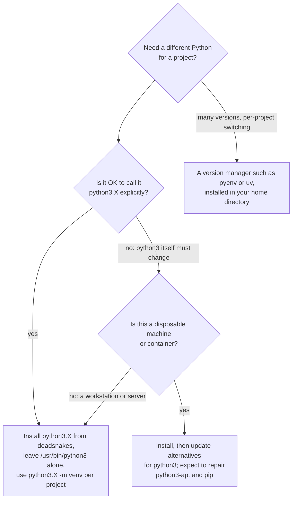
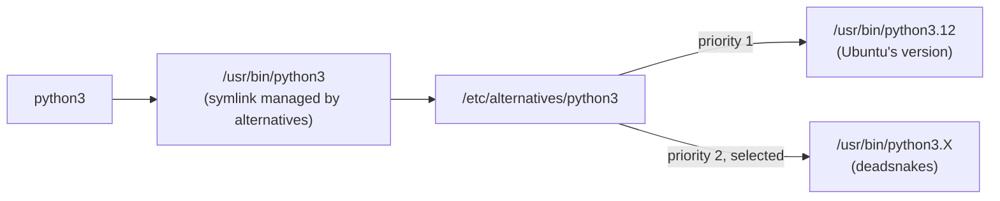
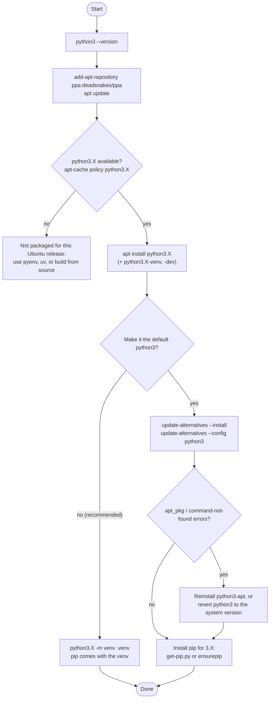

# Upgrade or Downgrade Python on Ubuntu

This procedure installs a specific Python version (newer or older than the one Ubuntu ships) from the deadsnakes PPA, optionally makes it the default `python3`, repairs `pip` and `python3-apt` afterwards, and removes a version again. Ubuntu's own tools are written against the distribution's Python, so the safest variant leaves `/usr/bin/python3` alone and calls the new interpreter by its versioned name. The sections below cover both variants.

Throughout, replace `3.X` with the version you want, for example `3.11` or `3.9`.

## Why It Matters

- **Projects pin Python versions.** A project may need a version that Ubuntu doesn't ship: newer for new syntax, or older for a legacy dependency.
- **The system interpreter is shared.** `apt`, `command-not-found`, `add-apt-repository`, and other system scripts run on `/usr/bin/python3`. Repointing it to another version can break them, which is the cause of the errors in the repair section below.
- **Leftovers are confusing.** Several interpreters, several `pip` installations, and alternatives entries make it unclear which Python a command actually runs.

## Check the Current Version

```bash
python3 --version          # the default python3
ls /usr/bin/python*        # every interpreter installed in the default location
which -a python3           # every python3 on PATH, in lookup order
```

## Choosing an Approach



## Step 1: Add the deadsnakes PPA

The deadsnakes PPA packages older and newer Python versions for supported Ubuntu LTS releases. It doesn't repackage the version your Ubuntu release already ships.

```bash
sudo add-apt-repository ppa:deadsnakes/ppa
sudo apt update
```

Check that the version is available:

```bash
apt list 'python3.X*'          # quoted, so the shell doesn't expand the *
apt-cache policy python3.X     # candidate version and which repository provides it
```

## Step 2: Install Python 3.X

```bash
sudo apt install python3.X
sudo apt install python3.X-venv python3.X-dev   # optional: venv support and headers for building C extensions
python3.X --version
```

The new interpreter is installed as `/usr/bin/python3.X`, next to the system one. Nothing else changes yet.

## Step 3: Make Python 3.X the Default `python3`

> [!warning] Changing `/usr/bin/python3` can break system tools
> Ubuntu's own packages expect `/usr/bin/python3` to be the distribution's Python version. Compiled modules such as `apt_pkg` (from `python3-apt`) exist only for that version, so repointing `python3` makes `command-not-found`, `add-apt-repository`, and parts of `apt` fail. Prefer calling `python3.X` directly, or using a virtual environment. Do this step only if you accept the repairs below, and keep the revert command at hand.

Register both versions as alternatives for `/usr/bin/python3`. The highest priority wins in automatic mode:

```bash
sudo update-alternatives --install /usr/bin/python3 python3 /usr/bin/python3.<system-version> 1
sudo update-alternatives --install /usr/bin/python3 python3 /usr/bin/python3.X 2
```

Choose interactively, if the one you want is not selected by default:

```bash
sudo update-alternatives --config python3
python3 --version              # should now print Python 3.X
```



To undo the change, select the system version again with `--config python3`, or remove the entry with `sudo update-alternatives --remove python3 /usr/bin/python3.X`.

## Step 4: Fix `python3-apt` and `pip`

### `No module named 'apt_pkg'`

After repointing `python3`, scripts that import `apt_pkg` fail, for example `command-not-found` when you type an unknown command:

```text
Traceback (most recent call last):
  File "/usr/lib/command-not-found", line 28, in <module>
    from CommandNotFound import CommandNotFound
  File "/usr/lib/python3/dist-packages/CommandNotFound/CommandNotFound.py", line 19, in <module>
    from CommandNotFound.db.db import SqliteDatabase
  File "/usr/lib/python3/dist-packages/CommandNotFound/db/db.py", line 5, in <module>
    import apt_pkg
ModuleNotFoundError: No module named 'apt_pkg'
```

The common fix is to reinstall `python3-apt`:

```bash
sudo apt remove --purge python3-apt
sudo apt autoclean
sudo apt install python3-apt
```

`apt_pkg` is a compiled extension module built for one Python version. Its file is named for that version, for example `apt_pkg.cpython-312-x86_64-linux-gnu.so`. Reinstalling `python3-apt` repairs a damaged installation, but it still provides the module only for Ubuntu's own Python, so the error comes back whenever `python3` points at another version. The reliable fix is to point `python3` back at the system version (Step 3's revert). See [[concepts/linux/static_vs_dynamic_linking|Static vs. Dynamic Linking]] for how Python loads such `.so` extension modules.

### `pip: command not found`

Each interpreter needs its own `pip`. Install it for the new version:

```bash
sudo apt install python3.X-distutils      # only for Python 3.11 and older; distutils was removed in 3.12
curl -sS https://bootstrap.pypa.io/get-pip.py -o get-pip.py
python3.X get-pip.py --user               # or: sudo python3.X get-pip.py, for a system-wide pip
python3.X -m pip --version
```

- **Use `python3.X -m pip`.** It always installs into the interpreter you name, whereas a bare `pip` runs whichever `pip` script comes first on `PATH`.
- **`distutils` is gone in Python 3.12.** PEP 632 removed it from the standard library, so `python3.12-distutils` doesn't exist. Modern `pip` and `setuptools` don't need it.
- **Prefer a virtual environment.** `python3.X -m venv .venv` creates an environment with its own `pip`, and touches neither the system Python nor its packages.

## Complete Flow



## Remove a Python Version

> [!warning] Never remove Ubuntu's own Python
> Removing the distribution's default `python3` package, such as `python3.12` on Ubuntu 24.04, takes a large part of the system with it, because many packages depend on it. Remove only versions you installed yourself, and check what `--auto-remove` and `purge` plan to delete before you confirm.

```bash
ls /usr/bin/python*                               # list installed interpreters

sudo apt-get remove python3.X                     # remove the package only
sudo apt-get remove --auto-remove python3.X       # also remove dependencies nothing else needs
sudo apt-get purge python3.X                      # remove the package and its configuration and data files
sudo apt-get purge --auto-remove python3.X        # both: configuration files and unneeded dependencies

sudo update-alternatives --remove python3 /usr/bin/python3.X   # drop a leftover alternatives entry
sudo add-apt-repository --remove ppa:deadsnakes/ppa            # optional: drop the PPA
```

| Command | Package | Its config and data files | Dependencies nothing else needs |
| --- | --- | --- | --- |
| `apt-get remove` | Removed | Kept | Kept |
| `apt-get remove --auto-remove` | Removed | Kept | Removed |
| `apt-get purge` | Removed | Removed | Kept |
| `apt-get purge --auto-remove` | Removed | Removed | Removed |

Run `apt-get -s` (simulate) with any of these first to see exactly what would be removed.

## Related Concepts

- [[concepts/linux/static_vs_dynamic_linking|Static vs. Dynamic Linking]] — Python extension modules like `apt_pkg` are version-specific shared objects, which is why repointing `python3` breaks them
- [[concepts/linux/standard_streams|Standard Streams (stdin, stdout, stderr)]] — the tracebacks above arrive on stderr, and `python -u` unbuffers stdout in scripts and containers
- [[concepts/devops/docker/docker|Docker]] — for isolated, reproducible environments, a `python:3.X-slim` image avoids changing the host interpreter at all

## References

- [deadsnakes PPA](https://launchpad.net/~deadsnakes/+archive/ubuntu/ppa)
- [update-alternatives(1)](https://manpages.ubuntu.com/manpages/noble/man1/update-alternatives.1.html)
- [pip installation](https://pip.pypa.io/en/stable/installation/)
- [PEP 632: Deprecate distutils module](https://peps.python.org/pep-0632/)
