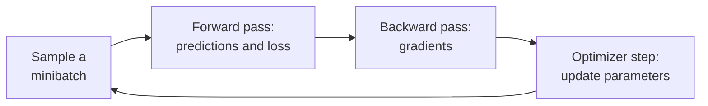

# Gradient Descent

Gradient descent minimizes a differentiable function by repeatedly taking a small step against
its gradient, the direction in which the function falls fastest. In machine learning the function
is a model's loss over its training data and the steps adjust the model's parameters. Its
stochastic, minibatch form trains almost every neural network, from
[[concepts/machine_learning/word2vec|Word2Vec]] to today's large language models.

## Why It Matters

- **It only needs gradients.** Any model built from differentiable operations can be trained the
  same way, whatever its architecture. Backpropagation computes the gradient for about the cost of
  a couple of forward passes.
- **It scales.** Each step costs time proportional to the number of parameters. Methods that need
  second derivatives (Newton's method) need a Hessian with $n^2$ entries, which is out of reach for
  millions or billions of parameters.
- **It works on minibatches.** A gradient estimated from a few dozen or a few thousand examples is
  enough to make progress. Training never has to see the whole dataset at once.
- **Its settings decide whether training works.** The learning rate, batch size, optimizer, and
  schedule are often the difference between a model that converges and one that diverges or stalls.

## The Update Rule

For parameters $\theta$, loss $L(\theta)$, and learning rate (step size) $\eta > 0$, each step is

$$
\theta_{t+1} = \theta_t - \eta \, \nabla L(\theta_t)
$$

The gradient $\nabla L$ points uphill, so subtracting it moves downhill. Near a minimum the gradient
shrinks, so the steps shrink too even when $\eta$ stays fixed. Cauchy proposed the method in 1847.

> [!example] Minimizing $f(x) = x^2$
> The gradient is $f'(x) = 2x$, so each step multiplies $x$ by $(1 - 2\eta)$. From $x_0 = 4$:
>
> - $\eta = 0.1$: $x$ goes 4, 3.2, 2.56, 2.05, … and shrinks by a factor of 0.8 each step towards 0.
> - $\eta = 0.5$: $x_1 = 0$, the exact minimum in one step.
> - $\eta = 1.0$: $x$ goes 4, −4, 4, −4, … and bounces forever.
> - $\eta = 1.5$: $x$ goes 4, −8, 16, … and diverges.

The example generalizes. On a quadratic whose sharpest curvature is $L$ (the largest Hessian
eigenvalue), plain gradient descent is stable only when $\eta < 2/L$. A step size that is too large
overshoots and diverges. One that is too small wastes steps.

### Ill-Conditioning

When the loss curves sharply in one direction and gently in another, the safe step size is set by
the sharp direction. Progress along the gentle direction is then slow, and the iterates zigzag
across the narrow valley. The ratio $\kappa = L / \mu$ of largest to smallest curvature, the
*condition number*, measures how bad this is. Standardizing input features, normalization layers,
momentum, and adaptive optimizers all reduce its effect.

## How Fast It Converges

Classical results, with step size $\eta = 1/L$ on an $L$-smooth function:

| Function class | Guarantee after $t$ steps | Meaning |
| --- | --- | --- |
| Convex | $L(\theta_t) - L^{*} \le \frac{L \lVert \theta_0 - \theta^{*} \rVert^2}{2t}$ | Error falls like $1/t$ |
| $\mu$-strongly convex | $L(\theta_t) - L^{*} \le \left(1 - \frac{\mu}{L}\right)^{t} \left(L(\theta_0) - L^{*}\right)$ | Error falls geometrically; slower when $\kappa$ is large |
| Non-convex | $\min_{s < t} \lVert \nabla L(\theta_s) \rVert^2 \le \frac{2L \left(L(\theta_0) - L^{*}\right)}{t}$ | Only reaches a *stationary point*, not necessarily a minimum |

Neural network losses are non-convex, so the guarantees there are weak. In practice gradient
descent still finds parameters that fit and generalize well, which is an active research question
rather than a settled result.

## Batch, Stochastic, and Minibatch

The training loss is an average over $N$ examples, $L(\theta) = \frac{1}{N}\sum_{i=1}^{N} \ell_i(\theta)$.
The variants differ in how much of that average each step computes.

| Variant | Gradient per step | Cost per step | Behaviour |
| --- | --- | --- | --- |
| Batch (full) | All $N$ examples | $O(N)$ | Exact and smooth, but each step is expensive and it uses memory poorly |
| Stochastic (SGD) | 1 random example | $O(1)$ | Very noisy; cheap steps; noise can help escape poor regions |
| Minibatch | $B$ random examples, typically 32 to several thousand | $O(B)$ | The default: noise is reduced by a factor of $B$ and the batch fills a GPU |

In current usage "SGD" usually means minibatch SGD. Each minibatch gradient is an unbiased estimate
of the full gradient, so on average a step goes downhill. The method descends from Robbins and
Monro's stochastic approximation (1951). For convergence to an exact minimum, the step sizes must
shrink so that $\sum_t \eta_t = \infty$ but $\sum_t \eta_t^2 < \infty$. That is the formal reason
learning rates are decayed.



One training step: sample a batch, compute the loss, backpropagate the gradient, and update. An
*epoch* is one pass over the whole dataset, usually with the examples reshuffled each time.

### Batch Size and Learning Rate

A larger batch gives a less noisy gradient, so it can take a larger step. Goyal et al. (2017)
trained ImageNet models with batches up to 8,192 using a *linear scaling rule*: multiply the
learning rate by $k$ when the batch grows by $k$, with a short warmup at the start. The rule stops
holding beyond some batch size that depends on the problem.

## Computing the Gradient: Backpropagation

A neural network is a composition of simple functions, so its gradient follows from the chain rule.
**Backpropagation** applies the chain rule from the loss backwards through the network, reusing
each layer's intermediate results. It is the reverse mode of *automatic differentiation*. It yields
the gradient for every parameter at a cost of a small constant multiple of one forward pass,
regardless of how many parameters there are. Rumelhart, Hinton, and Williams (1986) popularized it
for training multi-layer networks. Frameworks such as PyTorch and JAX implement it automatically.

## Optimizers Beyond Plain SGD

Modern optimizers change *how* the gradient becomes a step. They keep the basic loop.

### Momentum

Momentum keeps a running velocity that accumulates past gradients, like a ball rolling downhill
(Polyak, 1964):

$$
v_{t+1} = \beta v_t + \nabla L(\theta_t), \qquad \theta_{t+1} = \theta_t - \eta \, v_{t+1}
$$

With $\beta$ around 0.9, the velocity builds up along directions where gradients agree and cancels
along directions where they flip sign. That damps the zigzag of an ill-conditioned valley.
**Nesterov momentum** (1983) evaluates the gradient at the look-ahead point
$\theta_t - \eta \beta v_t$. On smooth convex functions this improves the rate from $1/t$ to
$1/t^2$, the best possible for first-order methods.

### Adaptive Step Sizes

Adaptive methods give each parameter its own effective learning rate, scaled by the history of its
gradients:

- **AdaGrad** (Duchi et al., 2011) divides by the square root of the sum of all past squared
  gradients. Rarely updated parameters get large steps. Its steps shrink forever, which can stall
  long training runs.
- **RMSProp** (Hinton, 2012 lecture notes) replaces the sum with an exponential moving average, so
  step sizes stop shrinking.
- **Adam** (Kingma and Ba, 2015) combines momentum (a moving average of the gradient, $m$) with
  RMSProp's scaling (a moving average of the squared gradient, $v$), plus a bias correction for
  their zero start:

$$
\hat{m}_t = \frac{m_t}{1 - \beta_1^t}, \quad \hat{v}_t = \frac{v_t}{1 - \beta_2^t}, \quad
\theta_{t+1} = \theta_t - \eta \, \frac{\hat{m}_t}{\sqrt{\hat{v}_t} + \epsilon}
$$

The usual defaults are $\eta = 10^{-3}$, $\beta_1 = 0.9$, $\beta_2 = 0.999$, $\epsilon = 10^{-8}$.

- **AdamW** (Loshchilov and Hutter, 2019) applies weight decay directly to the parameters instead
  of adding an L2 term to the gradient. Inside Adam the two are not equivalent, because the L2
  gradient gets rescaled by $\sqrt{\hat{v}}$. AdamW is the common default for training Transformers.

| Optimizer | State per parameter | Typical use |
| --- | --- | --- |
| SGD | None | Convex problems, simple baselines |
| SGD with momentum | 1 (velocity) | Convolutional vision models, where it often generalizes well |
| Adam / AdamW | 2 ($m$, $v$) | Transformers, language models, and most new architectures |

> [!tip] Optimizer state costs memory
> Adam keeps two extra numbers per parameter, so its state alone is twice the size of the model's
> weights. For large models the optimizer state, not the weights, often sets the memory budget.

## Learning-Rate Schedules

A schedule changes $\eta$ during training: large early to move fast, small late to settle.

| Schedule | Shape | Where it shows up |
| --- | --- | --- |
| Step decay | Divide by a constant (e.g. 10) at fixed epochs | Classic image classification |
| Linear decay | Fall linearly to near zero | Word2Vec's original code |
| Cosine annealing | Follow half a cosine from the peak to near zero | Common default for large models |
| Linear warmup | Ramp up from near zero over the first steps, then hand over to another schedule | Transformers and large-batch training, where full-size early steps are unstable |
| Inverse square root | Warmup, then decay as $1/\sqrt{t}$ | The original Transformer (Vaswani et al., 2017) |

## Pitfalls

- **Divergence.** The loss rises or becomes `NaN`. The usual cause is a learning rate too large for
  the current curvature. Lower it, add warmup, or clip gradients.
- **Exploding and vanishing gradients.** In deep or recurrent networks, the chain rule multiplies
  many factors, so gradients can grow or shrink exponentially with depth. Gradient clipping
  (Pascanu et al., 2013), careful initialization, normalization layers, and residual connections
  are the standard fixes.
- **Saddle points and plateaus.** In high dimensions most critical points are saddles, not local
  minima (Dauphin et al., 2014). Plain gradient descent slows to a crawl near them, while
  minibatch noise and momentum help it move on.
- **Unscaled features.** Inputs on very different scales make the loss ill-conditioned. Standardize
  them before training.
- **Optimizing the wrong thing.** Gradient descent minimizes exactly the loss it is given. Any gap
  between that loss and the real goal is exploited, a theme of
  [[concepts/ai_engineering/alignment/ai_alignment|AI Alignment]].

## Worked Example: Linear Regression with Minibatch SGD

Mean squared error $\frac{1}{n}\lVert Xw - y \rVert^2$ has gradient $\frac{2}{n} X^{\top}(Xw - y)$.
This loop recovers the true weights from noisy data:

```python
import numpy as np

rng = np.random.default_rng(0)
X = rng.normal(size=(1000, 3))
true_w = np.array([2.0, -1.0, 0.5])
y = X @ true_w + 0.1 * rng.normal(size=1000)

w = np.zeros(3)
lr, batch_size = 0.1, 32
for epoch in range(20):
    perm = rng.permutation(len(X))                    # reshuffle every epoch
    for start in range(0, len(X), batch_size):
        idx = perm[start:start + batch_size]
        Xb, yb = X[idx], y[idx]
        grad = 2 * Xb.T @ (Xb @ w - yb) / len(idx)    # gradient of mean squared error
        w -= lr * grad                                # the update rule
print(w)  # close to [2.0, -1.0, 0.5]
```

Linear regression also has a closed-form answer, the normal equations. Gradient descent is still
used when the data is too large to form $X^{\top}X$, or when the same loop has to work for models
with no closed form.

## Related Concepts

- [[concepts/machine_learning/word2vec|Word2Vec]] — a classic model trained with SGD and a linearly decayed learning rate; negative sampling exists to make each gradient step cheap
- [[concepts/ai_engineering/embeddings|Embeddings]] — modern embedding models are trained by gradient descent on contrastive losses
- [[concepts/ai_engineering/alignment/ai_alignment|AI Alignment]] — an optimizer pursues the literal objective, so the training loss must capture what is actually wanted

## References

- Cauchy (1847). *Méthode générale pour la résolution des systèmes d'équations simultanées.* — the original method of steepest descent.
- Robbins and Monro (1951). *A Stochastic Approximation Method.* Annals of Mathematical Statistics.
- Polyak (1964). *Some methods of speeding up the convergence of iteration methods.* — heavy-ball momentum.
- Nesterov (1983). *A method for solving the convex programming problem with convergence rate O(1/k²).*
- Rumelhart, Hinton, and Williams (1986). *Learning representations by back-propagating errors.* Nature.
- Duchi, Hazan, and Singer (2011). *Adaptive Subgradient Methods for Online Learning and Stochastic Optimization.* JMLR — AdaGrad.
- Pascanu, Mikolov, and Bengio (2013). *On the difficulty of training recurrent neural networks.* ICML — gradient clipping.
- Dauphin et al. (2014). *Identifying and attacking the saddle point problem in high-dimensional non-convex optimization.* NeurIPS.
- Kingma and Ba (2015). *Adam: A Method for Stochastic Optimization.* ICLR.
- Goyal et al. (2017). *Accurate, Large Minibatch SGD: Training ImageNet in 1 Hour.*
- Loshchilov and Hutter (2019). *Decoupled Weight Decay Regularization.* ICLR — AdamW.
