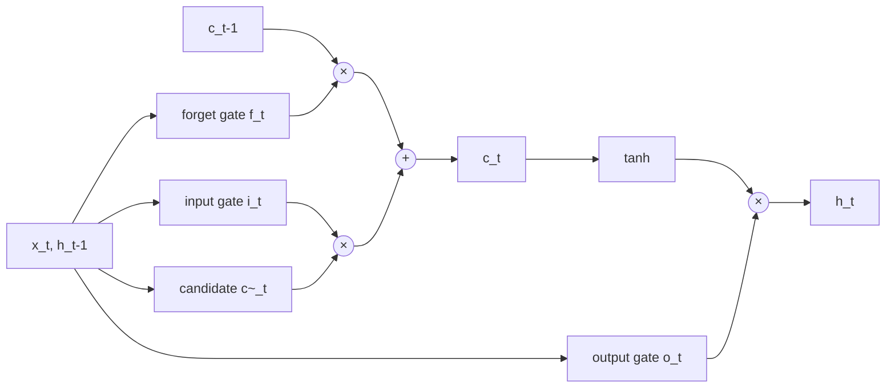

# Long Short-Term Memory (LSTM)

A long short-term memory network is a recurrent neural network that carries a separate memory
cell through time, with learned gates deciding what to write into it, keep, and read out. This
design lets it learn dependencies across hundreds of time steps, where a plain RNN's gradients
vanish during [[concepts/machine_learning/gradient_descent|Gradient Descent]]. Hochreiter and
Schmidhuber introduced it in 1997.

## Why It Matters

- **It made recurrent networks trainable on long sequences.** The additive cell update gives
  gradients a path back through time that does not shrink at every step.
- **It led sequence modelling for about two decades.** LSTMs powered speech recognition,
  handwriting recognition, machine translation (including Google's production system in 2016), and
  language models until Transformers replaced them from 2017.
- **It is still a sensible tool.** For streaming input, small time-series models, and devices
  where memory must stay constant in sequence length, an LSTM is cheap and effective.

## The Problem: Vanishing Gradients in RNNs

A plain RNN updates its hidden state as $h_t = \tanh(W h_{t-1} + U x_t + b)$. Training uses
backpropagation through time (BPTT): unroll the network over the sequence and backpropagate through
every step. The gradient reaching step $t-k$ contains a product of $k$ Jacobians:

$$
\frac{\partial h_t}{\partial h_{t-k}} = \prod_{s=t-k+1}^{t} \operatorname{diag}\!\left(\tanh'(\cdot)\right) W
$$

When these factors are mostly smaller than 1 the product shrinks exponentially, so the network
cannot learn from events many steps back. When they are larger than 1 it explodes. Hochreiter's
1991 thesis and Bengio, Simard, and Frasconi (1994) analysed the problem.

## The LSTM Cell

At each step the cell reads the input $x_t$ and the previous hidden state $h_{t-1}$, and updates two
states: the cell state $c_t$ (long-term memory) and the hidden state $h_t$ (the output). With
$\sigma$ the logistic sigmoid and $\odot$ element-wise multiplication:

$$
\begin{aligned}
f_t &= \sigma(W_f x_t + U_f h_{t-1} + b_f) && \text{forget gate} \\
i_t &= \sigma(W_i x_t + U_i h_{t-1} + b_i) && \text{input gate} \\
\tilde{c}_t &= \tanh(W_c x_t + U_c h_{t-1} + b_c) && \text{candidate values} \\
c_t &= f_t \odot c_{t-1} + i_t \odot \tilde{c}_t && \text{cell update} \\
o_t &= \sigma(W_o x_t + U_o h_{t-1} + b_o) && \text{output gate} \\
h_t &= o_t \odot \tanh(c_t) && \text{hidden state}
\end{aligned}
$$

Each gate is a vector of values between 0 and 1, one per memory unit, acting as a soft switch.

| Gate | Decides | Near 0 | Near 1 |
| --- | --- | --- | --- |
| Forget $f_t$ | How much old memory to keep | Erase the cell | Keep the cell unchanged |
| Input $i_t$ | How much new content to write | Ignore this input | Write the candidate in full |
| Output $o_t$ | How much memory to expose as $h_t$ | Hide the cell | Output the whole cell |



The cell state runs along the top as an almost straight line. It is changed only by an
element-wise multiplication and an addition, never squashed by a matrix and a nonlinearity.

### Why the Gradient Survives

Along the cell path, $\partial c_t / \partial c_{t-1} = \operatorname{diag}(f_t)$, ignoring the
smaller indirect paths through the gates. The network can learn to hold $f_t$ near 1 for as long
as a fact must be remembered, and the error then flows back almost unchanged. The original paper
called this the *constant error carousel*. The original 1997 LSTM had no forget gate and its cell
never decayed; Gers, Schmidhuber, and Cummins (2000) added the forget gate so the cell could reset
itself.

> [!warning] Exploding gradients still happen
> The cell path fixes vanishing gradients, not exploding ones through the hidden state. Clip the
> gradient norm when training LSTMs, as the Pitfalls in
> [[concepts/machine_learning/gradient_descent#Pitfalls|Gradient Descent]] describe.

### Size

A layer with input size $d$ and hidden size $n$ has four gate blocks, each with an $n \times d$ input
matrix, an $n \times n$ recurrent matrix, and a bias, so $4(nd + n^2 + n)$ parameters. That is four
times a plain RNN of the same width.

## Training in Practice

- **Truncated BPTT.** Long streams are cut into windows of, say, 100 to 200 steps. The hidden state
  is carried from one window to the next, but gradients stop at the window boundary.
- **Forget-gate bias.** Initializing $b_f$ to 1 or more makes the cell remember by default early in
  training, which helps on long dependencies (Jozefowicz, Zaremba, and Sutskever, 2015).
- **Dropout.** Apply it between layers or with the same mask at every time step (variational
  dropout, Gal and Ghahramani, 2016). A fresh mask on the recurrent connection at every step
  damages the memory.
- **Optimizer.** Adam or RMSProp with gradient clipping is the usual choice.

```python
import torch
from torch import nn

class SequenceClassifier(nn.Module):
    def __init__(self, vocab_size, embed_dim=128, hidden=256, classes=2):
        super().__init__()
        self.embed = nn.Embedding(vocab_size, embed_dim)
        self.lstm = nn.LSTM(embed_dim, hidden, num_layers=2,
                            batch_first=True, dropout=0.2, bidirectional=True)
        self.head = nn.Linear(2 * hidden, classes)

    def forward(self, tokens):                    # tokens: (batch, seq_len)
        out, (h_n, c_n) = self.lstm(self.embed(tokens))
        last = torch.cat([h_n[-2], h_n[-1]], dim=1)  # final forward and backward states
        return self.head(last)

model = SequenceClassifier(vocab_size=10_000)
loss = nn.functional.cross_entropy(model(torch.randint(0, 10_000, (8, 50))),
                                   torch.randint(0, 2, (8,)))
loss.backward()
torch.nn.utils.clip_grad_norm_(model.parameters(), max_norm=1.0)  # guard against exploding gradients
```

## Variants and Architectures

| Variant | Idea |
| --- | --- |
| Peephole LSTM (Gers and Schmidhuber, 2000) | Gates also read the cell state, which helps with precise timing |
| GRU (Cho et al., 2014) | Merges cell and hidden state and uses two gates (update, reset); fewer parameters and often similar accuracy |
| Bidirectional LSTM (Graves and Schmidhuber, 2005) | One LSTM reads forwards and one backwards, so every position sees its whole context; not usable for streaming |
| Stacked LSTM | Several layers, each reading the hidden states of the layer below |
| Sequence-to-sequence (Sutskever, Vinyals, and Le, 2014) | An encoder LSTM compresses the input, and a decoder LSTM generates the output from it |
| Attention over LSTM states (Bahdanau, Cho, and Bengio, 2014) | The decoder looks back at every encoder state instead of one fixed vector; the step that led to the Transformer |
| ELMo (Peters et al., 2018) | A bidirectional LSTM language model whose hidden states serve as contextual word vectors |

## Compared with Transformers

| | LSTM | Transformer |
| --- | --- | --- |
| Reading a sequence | One step at a time | All positions at once |
| Parallelism in training | None across time steps | Full across positions |
| Distant tokens | Reached through many cell updates | Reached directly by attention |
| Cost per step at inference | Constant | Grows with context length |
| Memory for long inputs | Constant | Grows with length (the KV cache) |

The Transformer (Vaswani et al., 2017) won because training on GPUs parallelizes over the whole
sequence. Its constant per-step inference cost keeps the recurrent idea alive in newer designs
such as xLSTM (Beck et al., 2024), which revisits the LSTM with exponential gates and a matrix
memory.

## Related Concepts

- [[concepts/machine_learning/gradient_descent|Gradient Descent]] — LSTMs are trained by gradient descent through time, and their gating is a fix for that procedure's vanishing gradients
- [[concepts/machine_learning/word2vec|Word2Vec]] — static word vectors were a common input layer for LSTMs, and the bidirectional-LSTM model ELMo succeeded them with contextual vectors
- [[concepts/machine_learning/xgboost|XGBoost]] — the usual alternative for tabular and feature-engineered time-series data, where an LSTM's sequence handling buys little
- [[concepts/machine_learning/beam_search|Beam Search]] — the standard way to decode an output sequence from an LSTM sequence-to-sequence model
- [[concepts/ai_engineering/context_window|Context Window]] — Transformers trade an LSTM's fixed-size memory for a bounded window of directly visible tokens

## References

- Hochreiter (1991). *Untersuchungen zu dynamischen neuronalen Netzen.* Diploma thesis, TU Munich — first analysis of vanishing gradients.
- Bengio, Simard, and Frasconi (1994). *Learning Long-Term Dependencies with Gradient Descent is Difficult.* IEEE Transactions on Neural Networks.
- Hochreiter and Schmidhuber (1997). *Long Short-Term Memory.* Neural Computation.
- Gers, Schmidhuber, and Cummins (2000). *Learning to Forget: Continual Prediction with LSTM.* Neural Computation.
- Graves and Schmidhuber (2005). *Framewise Phoneme Classification with Bidirectional LSTM and Other Neural Network Architectures.* Neural Networks.
- Sutskever, Vinyals, and Le (2014). *Sequence to Sequence Learning with Neural Networks.* NeurIPS.
- Cho et al. (2014). *Learning Phrase Representations using RNN Encoder–Decoder for Statistical Machine Translation.* EMNLP.
- Jozefowicz, Zaremba, and Sutskever (2015). *An Empirical Exploration of Recurrent Network Architectures.* ICML.
- Gal and Ghahramani (2016). *A Theoretically Grounded Application of Dropout in Recurrent Neural Networks.* NeurIPS.
- Beck et al. (2024). *xLSTM: Extended Long Short-Term Memory.* NeurIPS.
