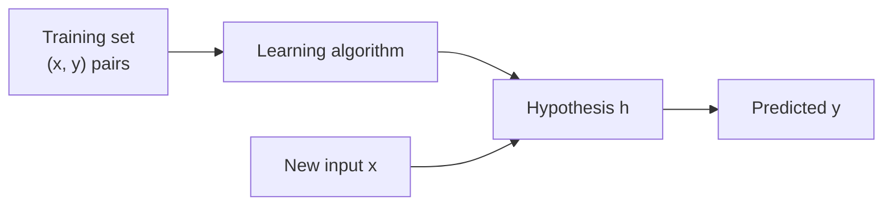

# Supervised Learning

Supervised learning fits a function from inputs to outputs using examples where the correct output
is given. Training finds the function that best reproduces those labels, by minimizing a
[[concepts/machine_learning/cost_function|Cost Function]], so that it predicts well on new inputs.
Its counterpart, [[concepts/machine_learning/unsupervised_learning|Unsupervised Learning]], has
inputs but no labels.

## Why It Matters

- **It is the most widely used form of machine learning.** Spam filters, credit scoring, demand
  forecasting, medical image diagnosis, and speech recognition are all supervised problems.
- **Its success is easy to measure.** Held-out labels give a direct score for how good the
  predictions are.
- **Labels are the bottleneck.** Collecting them is often slower and more expensive than training
  the model, which is why self-supervised and unsupervised methods matter.

## The Setup

| Term | Notation | Meaning |
| --- | --- | --- |
| Input features | $x^{(i)} \in \mathcal{X}$ | What is known about example $i$, e.g. a house's living area and number of bedrooms |
| Target (label) | $y^{(i)} \in \mathcal{Y}$ | What should be predicted, e.g. the house's price |
| Training example | $(x^{(i)}, y^{(i)})$ | One input with its label; the superscript is an index, not a power |
| Training set | $\{(x^{(i)}, y^{(i)})\}_{i=1}^{n}$ | The $n$ labelled examples the model learns from |
| Hypothesis | $h : \mathcal{X} \to \mathcal{Y}$ | The learned function, chosen from a family such as linear functions or trees |

The goal is not to fit the training set as closely as possible but to predict well on examples the
model has never seen, which is called *generalization*.

## Regression and Classification Problems

The type of the target decides the kind of problem.

| | Regression | Classification |
| --- | --- | --- |
| Target $y$ | A continuous number | One of a finite set of classes |
| Example | Predict a house's price from its size | Predict whether a house is a house or an apartment; whether an email is spam |
| Model output | A number | A class, usually with a probability for each class |
| Typical cost | Squared error ([[concepts/machine_learning/least_squares\|Least Squares]]), absolute error, Huber | Cross-entropy (log loss), hinge |
| Typical metrics | RMSE, MAE, $R^2$ | Accuracy, precision and recall, F1, ROC AUC |
| Classic first model | Linear regression | Logistic regression |

Classification comes in several forms:

- **Binary:** two classes, written $y \in \{0, 1\}$; the class with $y = 1$ is called the positive
  class.
- **Multiclass:** one of $k > 2$ classes, such as which digit a handwritten image shows.
- **Multilabel:** any subset of the classes can apply at once, such as the topics of an article.

> [!note] The line between them can blur
> Many classifiers predict a continuous probability and then apply a threshold. Ordinal targets
> (star ratings) and counts can be treated either way, and the choice changes the cost function.

## Training, Validation, and Test Data

- **Training set:** fits the parameters.
- **Validation set:** chooses hyperparameters and decides when to stop training.
- **Test set:** touched once at the end, for an unbiased estimate of performance on new data.

A model that scores far better on training data than on validation data is *overfitting*: it has
learned noise in the training set. One that scores poorly on both is *underfitting*: the hypothesis
family is too simple. Regularization, more data, and simpler or more complex models move between
the two.

## Common Algorithms

| Algorithm | Problem type | Note |
| --- | --- | --- |
| Linear regression | Regression | Fit by [[concepts/machine_learning/least_squares\|least squares]] |
| Logistic regression | Classification | A linear model passed through the sigmoid, fit by cross-entropy |
| Decision trees and boosting | Both | [[concepts/machine_learning/xgboost\|XGBoost]] is the common choice for tabular data |
| Support vector machines | Both, mostly classification | Maximize the margin between classes |
| k-nearest neighbours | Both | Predict from the labels of the closest training examples |
| Neural networks | Both | Any architecture, e.g. an [[concepts/machine_learning/long_short_term_memory\|LSTM]] for sequences |

## Related Concepts

- [[concepts/machine_learning/unsupervised_learning|Unsupervised Learning]] — the same data without labels, where the goal is to find structure instead of predicting a target
- [[concepts/machine_learning/cost_function|Cost Function]] — how a supervised model measures its disagreement with the labels
- [[concepts/machine_learning/least_squares|Least Squares]] — the standard worked example of supervised regression
- [[concepts/machine_learning/gradient_descent|Gradient Descent]] — how most supervised models are fitted

## References

- Ng, A. *CS229 Lecture Notes: Supervised Learning.* Stanford University.
- Hastie, Tibshirani, and Friedman (2009). *The Elements of Statistical Learning*, 2nd ed. Springer.
