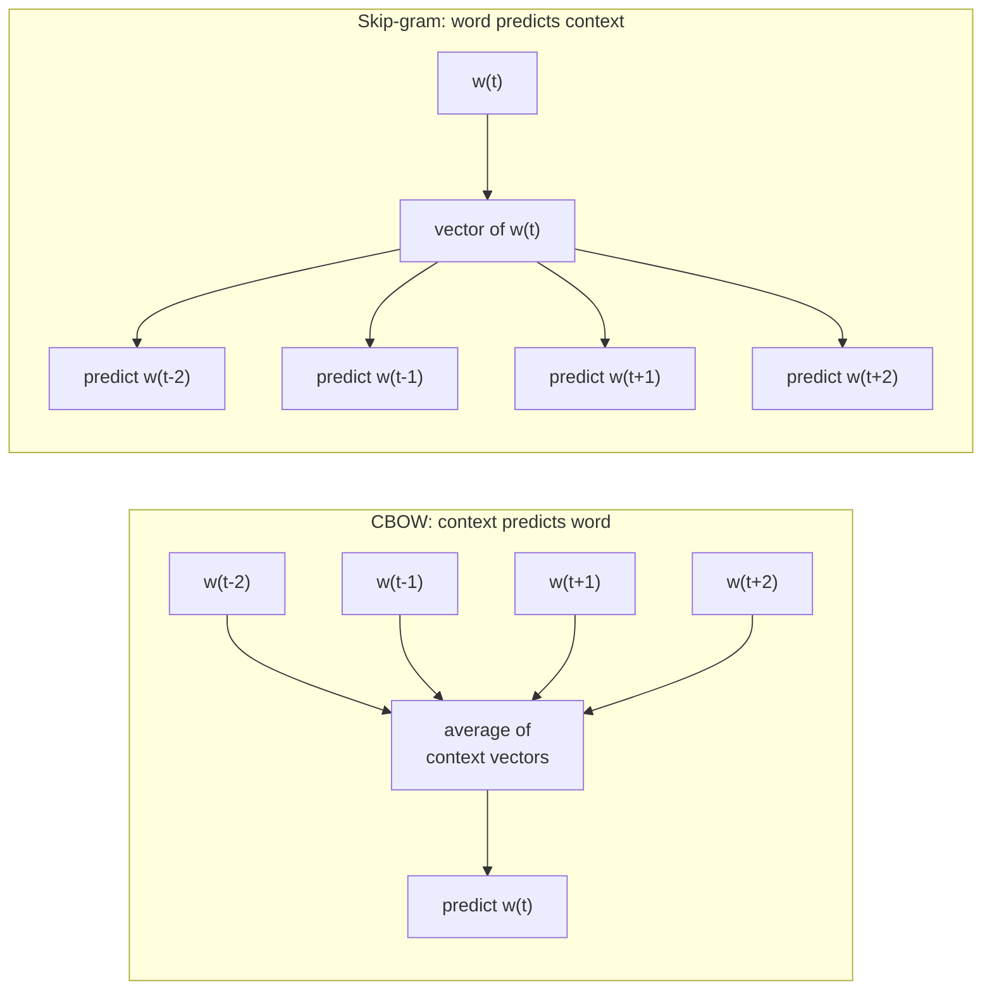

# Word2Vec

Word2Vec is a family of shallow neural-network training methods, published by Tomas Mikolov and
colleagues at Google in 2013. It learns one dense vector per vocabulary word by predicting a word
from its neighbours, or the neighbours from the word. Words that appear in similar contexts end up
close together. It made learned [[concepts/ai_engineering/embeddings|Embeddings]] cheap enough to
train on billions of words, and it is the ancestor of today's sentence and passage embeddings.

## Why It Matters

- **Dense instead of sparse.** Before it, a word was usually a one-hot or count vector as long as
  the vocabulary (tens of thousands to millions of dimensions), and every pair of distinct words
  was equally dissimilar. Word2Vec compresses each word into about 100–300 dimensions where
  distance carries meaning.
- **Cheap at scale.** It drops the hidden non-linearity of earlier neural language models and
  replaces the full softmax with approximations. That made training on corpora of about 100
  billion words practical: Google released 300-dimensional vectors for 3 million words and phrases
  trained on Google News.
- **Transfer learning for words.** Pre-trained vectors became a standard input layer for NLP models
  (classification, tagging, translation) until contextual models such as BERT replaced them.
- **A reusable recipe.** The same skip-gram objective works on any sequence of discrete tokens.
  DeepWalk and node2vec apply it to random walks on graphs, and item2vec applies it to purchase or
  listening sessions.

## The Distributional Hypothesis

Word2Vec puts into practice an old idea from linguistics: words that occur in similar contexts
tend to have similar meanings (Harris, 1954). Firth (1957) put it as "you shall know a word by the
company it keeps." The model never sees a definition. It only sees which words co-occur within a
small window, so *coffee* and *tea* end up close because both appear near *cup*, *drink*, and
*hot*.

## The Two Architectures

Both architectures use the same two weight matrices: an **input** (word) matrix $W$ of size
$V \times d$ and an **output** (context) matrix $W'$ of size $d \times V$, where $V$ is the
vocabulary size and $d$ the vector dimension. There is no hidden activation function. Looking up a
row of $W$ is the whole "hidden layer". Once training ends, the rows of $W$ are the word vectors
people use. Some implementations average $W$ and $W'^{\top}$ instead.



In CBOW, the averaged vector of the surrounding words predicts the centre word. In skip-gram, the
centre word's vector predicts each surrounding word separately.

### Continuous Bag-of-Words (CBOW)

CBOW averages the input vectors of the $2c$ context words and predicts the centre word from that
average. It is a "bag" because averaging throws away word order inside the window. Each centre word
gives one prediction per step, so CBOW trains faster. Averaging smooths over rare words, so it
tends to do well on frequent ones.

### Skip-Gram

Skip-gram turns the window around: the centre word $w_t$ predicts each context word
$w_{t+j}$ separately. Over a corpus of $T$ words with window radius $c$, it maximizes

$$
\frac{1}{T} \sum_{t=1}^{T} \sum_{\substack{-c \le j \le c \\ j \ne 0}} \log p(w_{t+j} \mid w_t),
\qquad
p(o \mid i) = \frac{\exp(u_o^{\top} v_i)}{\sum_{w=1}^{V} \exp(u_w^{\top} v_i)}
$$

where $v_i$ is the input vector of the centre word and $u_o$ the output vector of a context word.
Each centre word yields up to $2c$ training pairs, so skip-gram is slower per epoch. It gives rare
words more updates of their own and is usually preferred for smaller corpora and rare-word quality.

> [!example] Training pairs from one sentence
> With window radius $c = 2$ and the sentence *the quick brown fox jumps*, the centre word *brown*
> produces the skip-gram pairs (brown, the), (brown, quick), (brown, fox), (brown, jumps). CBOW
> instead produces one example: the average of {the, quick, fox, jumps} predicts *brown*.

| | CBOW | Skip-gram |
| --- | --- | --- |
| Predicts | Centre word from averaged context | Each context word from the centre word |
| Examples per position | 1 | Up to $2c$ |
| Training speed | Faster | Slower |
| Strength | Frequent words, large corpora | Rare words, smaller corpora |
| Typical window | Around 5 | Around 5–10 |

## Making Training Tractable

The softmax denominator sums over the whole vocabulary, so a naive update costs $O(V)$ for every
training pair. With a million-word vocabulary that is prohibitive. Word2Vec offers two
alternatives.

### Hierarchical Softmax

The vocabulary becomes the leaves of a binary tree. Word2Vec uses a Huffman tree, so frequent words
sit near the root. The probability of a word is the product of binary sigmoid decisions along its
root-to-leaf path. Each update then touches about $\log_2 V$ inner-node vectors instead of $V$
output vectors.

### Negative Sampling

Negative sampling, introduced in the second 2013 paper, replaces "which of $V$ words is the
context?" with a binary task: tell the real (word, context) pair apart from $k$ randomly drawn
*noise* pairs. For a centre word $i$ and a true context word $o$, skip-gram with negative sampling
(SGNS) maximizes

$$
\log \sigma(u_o^{\top} v_i) + \sum_{n=1}^{k} \mathbb{E}_{w_n \sim P_n(w)} \left[ \log \sigma(-u_{w_n}^{\top} v_i) \right]
$$

where $\sigma$ is the logistic function. The paper recommends $k$ = 5–20 for small datasets and
2–5 for large ones. The noise distribution is the unigram distribution raised to the power 3/4,
$P_n(w) \propto f(w)^{3/4}$. The paper found this exponent worked better than both the raw unigram
and the uniform distribution: it samples rare words a little more often than their frequency would
suggest. This is the ancestor of the contrastive objectives behind modern embedding models (see
[[concepts/ai_engineering/embeddings#How Embedding Models Learn Similarity|How Embedding Models Learn Similarity]]).

| | Full softmax | Hierarchical softmax | Negative sampling |
| --- | --- | --- | --- |
| Cost per pair | $O(V)$ | $O(\log V)$ | $O(k)$ |
| Output parameters | One vector per word | One vector per inner tree node | One vector per word |
| Better for | Small vocabularies only | Rare words | Frequent words, low-dimensional vectors |

### Subsampling Frequent Words

Words such as *the* and *of* co-occur with nearly everything and say little about their neighbours.
Before training, each occurrence of word $w$ is dropped with probability

$$
P(\text{discard } w) = 1 - \sqrt{\frac{t}{f(w)}}
$$

where $f(w)$ is the word's relative frequency and $t$ a threshold, around $10^{-5}$. This speeds up
training and improves the vectors of rarer words, because dropping frequent words effectively widens
the window around what is left.

### Phrases

Idioms such as *New York Times* mean something their parts do not. The second paper merges
frequent bigrams into single tokens (`new_york`) before training. It scores each bigram as

$$
\text{score}(w_i, w_j) = \frac{\text{count}(w_i w_j) - \delta}{\text{count}(w_i) \times \text{count}(w_j)}
$$

where the discount $\delta$ keeps very rare pairs from forming phrases. Running several passes with
a falling threshold builds longer phrases.

## What the Vectors Capture

### Similarity

Similar words get a high cosine similarity (see
[[concepts/ai_engineering/embeddings#Measuring Closeness|Measuring Closeness]]). "Similar" means
*used in similar contexts*. That includes synonyms, but also co-hyponyms (*cat* and *dog*) and,
notably, antonyms (*hot* and *cold* fill the same slots in a sentence).

### Analogies

Some relations show up as roughly constant vector offsets. The famous example:

$$
\vec{\text{king}} - \vec{\text{man}} + \vec{\text{woman}} \approx \vec{\text{queen}}
$$

Mikolov et al. evaluated this with an analogy test set of 19,544 questions: 8,869 semantic
(capital–country, currency, family) and 10,675 syntactic (plurals, tenses, comparatives).

> [!warning] Analogy results exclude the question words
> The standard evaluation (3CosAdd) takes the nearest neighbour of $b - a + a^{*}$ **after excluding
> $a$, $b$, and $a^{*}$ from the candidates**. Without that exclusion, the nearest vector to
> *king − man + woman* is often *king* itself. Analogy scores therefore overstate how cleanly
> relations are encoded as offsets.

## Hyperparameters

| Parameter | Typical values | Effect |
| --- | --- | --- |
| Dimension $d$ | 100–300 | More capacity, more memory; gains flatten past a few hundred |
| Window radius $c$ | 2–10 | Small windows favour syntactic, interchangeable neighbours; large windows favour topical relatedness |
| Minimum count | 5 | Drops words too rare to learn a reliable vector |
| Negative samples $k$ | 5–20 (small data), 2–5 (large data) | More negatives means a better gradient estimate at higher cost |
| Subsampling $t$ | $10^{-5}$ to $10^{-3}$ | Lower values drop frequent words more aggressively |
| Epochs | 1–5 on large corpora | More passes help small corpora |

Levy, Goldberg, and Dagan (2015) showed that much of Word2Vec's reported edge over count-based
methods came from these choices (subsampling, the smoothed noise distribution, dynamic windows)
rather than from the neural architecture. Once the same tricks were applied, older methods closed
most of the gap.

## Word2Vec as Matrix Factorization

Levy and Goldberg (2014) showed that SGNS implicitly factorizes a word–context matrix. At the
optimum, $u_o^{\top} v_i$ equals the pointwise mutual information of the pair shifted by $\log k$:

$$
u_o^{\top} v_i = \text{PMI}(i, o) - \log k
$$

This ties Word2Vec to classical count-based distributional semantics. It also explains why GloVe,
which factorizes global co-occurrence statistics directly, produces vectors of similar quality.

## Using It in Practice

The original C tool is still available. Most people use the Python library gensim, whose defaults
(100 dimensions, window 5, minimum count 5, CBOW, 5 negative samples) follow the original settings.

```python
from gensim.models import Word2Vec

sentences = [["the", "quick", "brown", "fox", "jumps"], ["the", "lazy", "dog", "sleeps"]]  # tokenized corpus

model = Word2Vec(
    sentences,
    vector_size=100,  # d
    window=5,         # c
    min_count=1,      # keep every word in this toy corpus
    sg=1,             # 1 = skip-gram, 0 = CBOW
    negative=5,       # k negative samples; hs=1 switches to hierarchical softmax
    workers=4,
)

model.wv["fox"]                                    # the 100-dim vector
model.wv.most_similar("fox", topn=5)               # nearest neighbours by cosine
model.wv.most_similar(positive=["king", "woman"], negative=["man"], topn=1)  # analogy, on a real corpus
```

At inference time a trained model is just a lookup table from word to vector. Finding neighbours
across a large vocabulary is a nearest-neighbour search, the job a
[[concepts/databases/vector_database|Vector Database]] does at scale.

## Limitations

- **One vector per word type.** *Bank* (river) and *bank* (finance) share a single vector that
  blends both senses. Contextual models (ELMo, BERT) give each occurrence its own vector.
- **Out-of-vocabulary words.** A word not seen in training, or seen fewer times than the minimum
  count, gets no vector. fastText fixes this by building words from character n-grams.
- **No word order beyond the window.** Vectors encode co-occurrence, not syntax. Averaging word
  vectors into a sentence vector loses negation and word order (*dog bites man* versus *man bites
  dog*).
- **Relatedness is not similarity.** Antonyms and topically related words land close together,
  which hurts tasks that need true synonymy.
- **Learned bias.** Vectors reproduce stereotypes in the training text. Bolukbasi et al. (2016)
  found analogies such as *man : computer programmer :: woman : homemaker* in Google News vectors.

## Successors

| Model | Year | Change from Word2Vec |
| --- | --- | --- |
| Paragraph Vector (Doc2Vec) | 2014 | Adds a trainable vector per document alongside the word vectors |
| GloVe | 2014 | Fits vectors to global co-occurrence counts with a weighted least-squares objective |
| fastText | 2016–2017 | Represents a word as the sum of its character n-gram vectors, so it handles rare and unseen words |
| ELMo | 2018 | Contextual vectors from a bidirectional LSTM language model |
| BERT and sentence encoders | 2018 onward | Contextual Transformer vectors; sentence-level models are trained contrastively, a descendant of negative sampling |

## Related Concepts

- [[concepts/ai_engineering/embeddings|Embeddings]] — the general idea Word2Vec started; modern sentence and passage embeddings replace its static word vectors with contextual ones
- [[concepts/machine_learning/gradient_descent|Gradient Descent]] — the SGD training loop and decaying learning rate that fit Word2Vec's vectors; negative sampling exists to make each step cheap
- [[concepts/machine_learning/long_short_term_memory|Long Short-Term Memory (LSTM)]] — the recurrent network that commonly consumed Word2Vec vectors, and the basis of ELMo's contextual vectors that succeeded them
- [[concepts/databases/vector_database|Vector Database]] — nearest-neighbour search over vectors, the same lookup as Word2Vec's `most_similar` at production scale
- [[concepts/ai_engineering/retrieval_scoring|Retrieval Scoring and Ranking]] — how cosine and dot-product scores like Word2Vec's are used and combined when ranking results

## References

- Mikolov, Chen, Corrado, and Dean (2013). *Efficient Estimation of Word Representations in Vector Space.* ICLR Workshop — introduces CBOW and skip-gram.
- Mikolov, Sutskever, Chen, Corrado, and Dean (2013). *Distributed Representations of Words and Phrases and their Compositionality.* NeurIPS — negative sampling, subsampling, and phrases.
- Levy and Goldberg (2014). *Neural Word Embedding as Implicit Matrix Factorization.* NeurIPS — SGNS as shifted-PMI factorization.
- Levy, Goldberg, and Dagan (2015). *Improving Distributional Similarity with Lessons Learned from Word Embeddings.* TACL — hyperparameters versus algorithm.
- Pennington, Socher, and Manning (2014). *GloVe: Global Vectors for Word Representation.* EMNLP.
- Bojanowski, Grave, Joulin, and Mikolov (2017). *Enriching Word Vectors with Subword Information.* TACL — fastText.
- Bolukbasi et al. (2016). *Man is to Computer Programmer as Woman is to Homemaker? Debiasing Word Embeddings.* NeurIPS.
- [Original word2vec code archive](https://code.google.com/archive/p/word2vec/)
