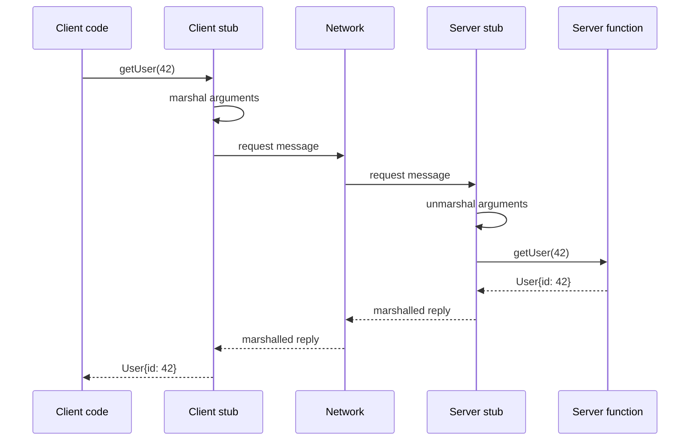
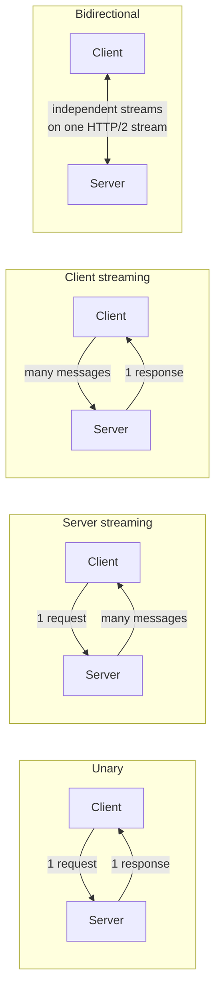
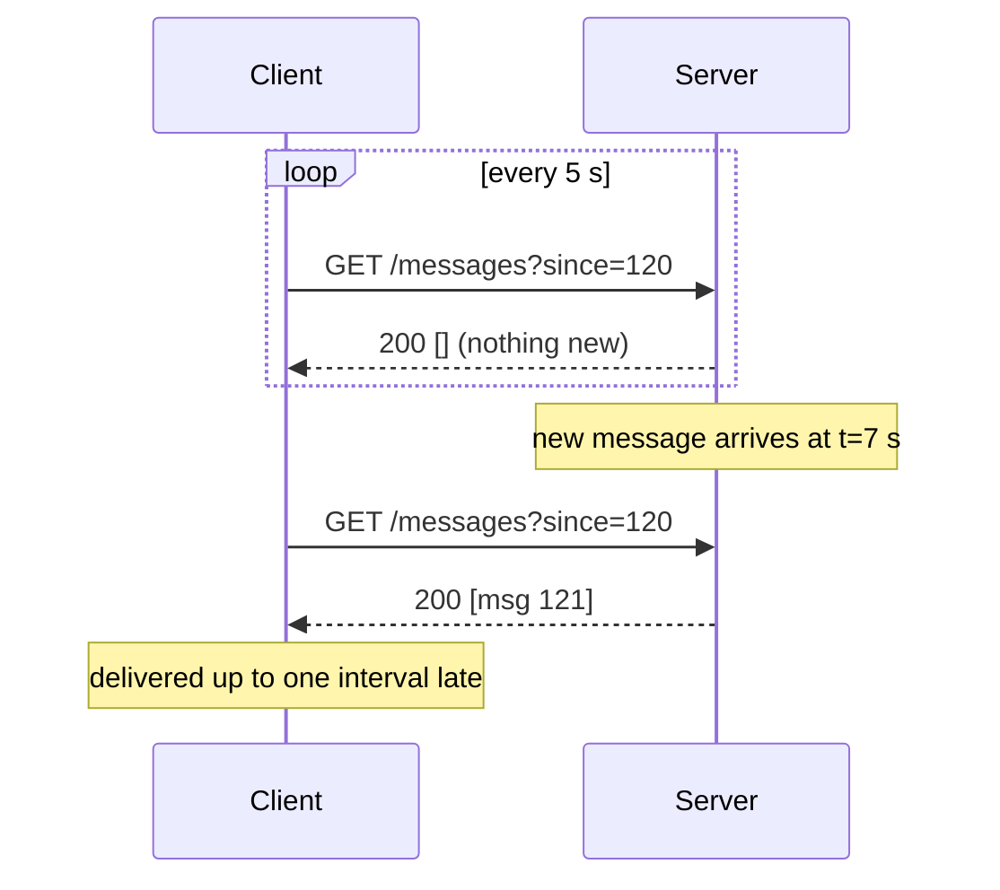
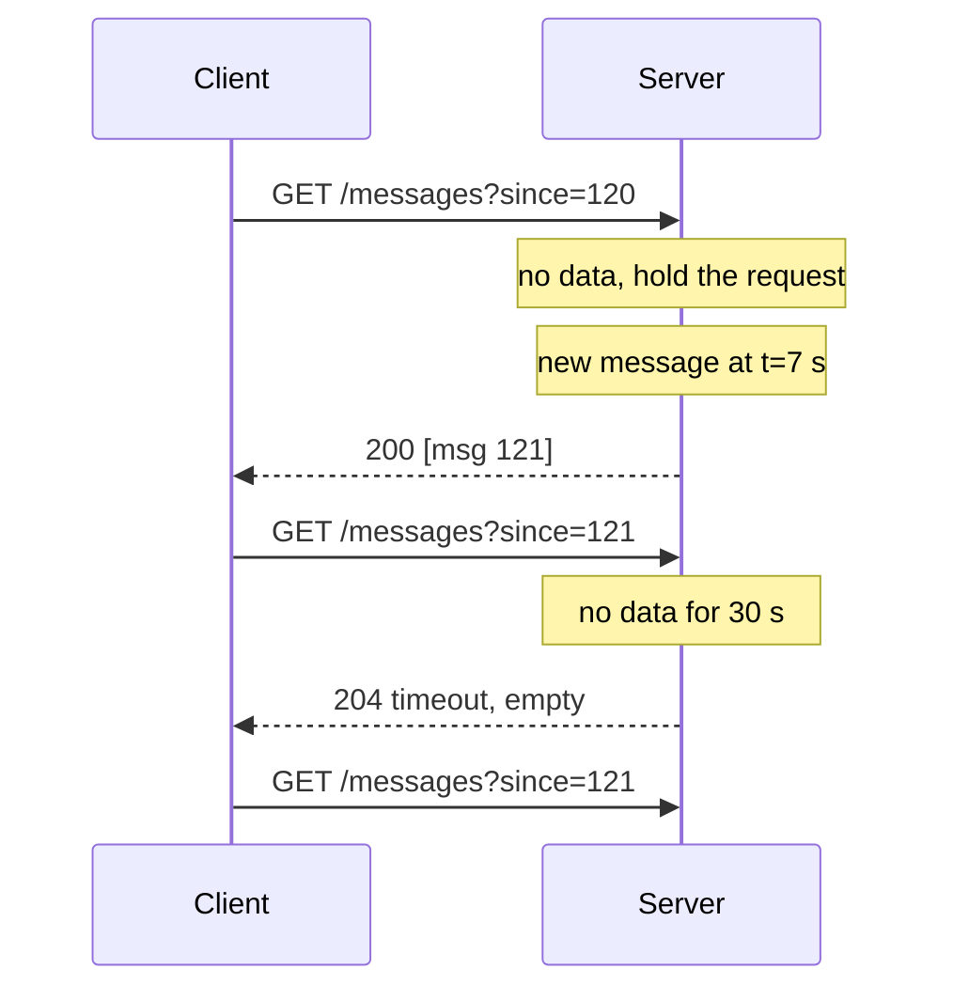
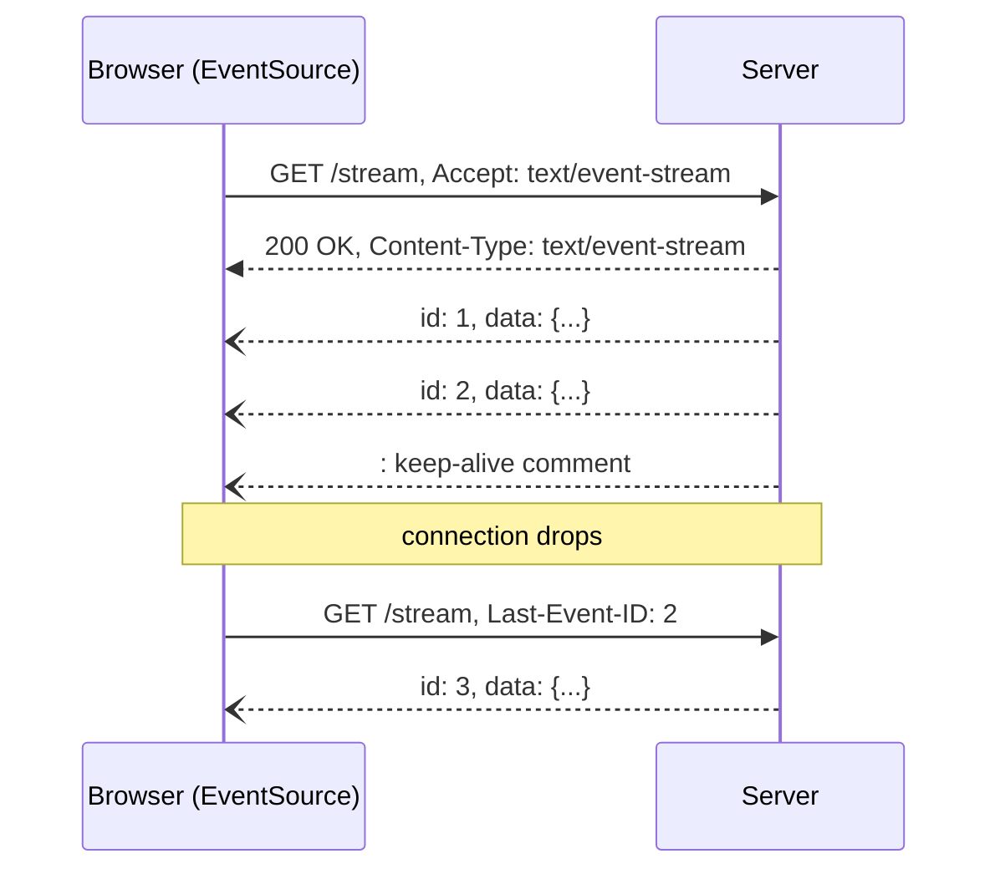
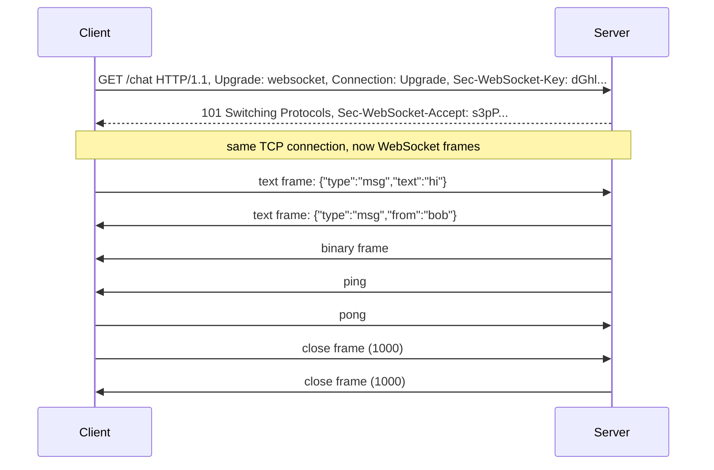
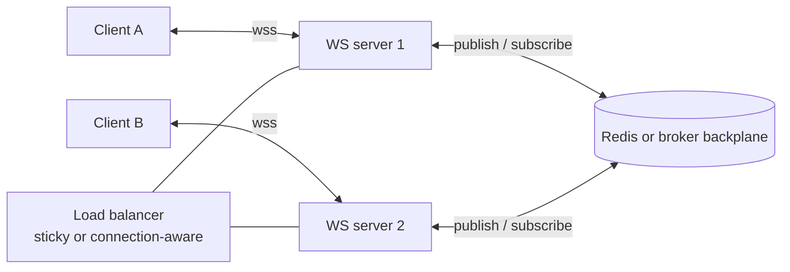
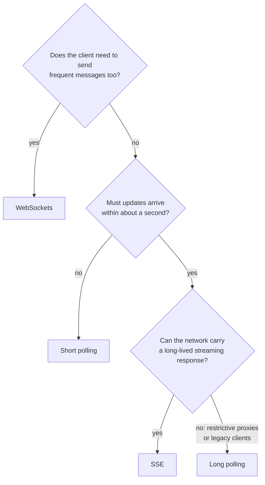

# API and Integration Protocols

API and integration protocols are the agreed conventions — transport, message format, and interaction pattern — that let one system exchange data with another. The choice of protocol is a software-architecture decision that shapes latency, coupling, scalability, and operability, and one that [[concepts/data_architecture/data_architecture|Data Architecture]] inherits wholesale at every boundary where a platform ingests or publishes data.

## Why It Matters

- **Coupling:** A synchronous call binds the caller's availability to the callee's; an event on a broker does not.
- **Latency and freshness:** Polling a REST endpoint every five minutes and subscribing to a push stream produce very different data freshness.
- **Cost of change:** Protocols with rigid contracts (SOAP, EDI) are expensive to evolve; flexible ones (GraphQL) move that cost to governance and monitoring.
- **Operability:** Retries, ordering, deduplication, and back-pressure are either provided by the protocol or become your problem.
- **Governance surface:** Every integration is a place where [[concepts/data_governance/data_security|Data Security]] controls.

## Three Interaction Styles

Almost every protocol below is a variation on one of three styles:

| Style | Who initiates | Coupling | Typical protocols |
| --- | --- | --- | --- |
| Request–response | Client, on demand | Tight (caller waits) | REST, GraphQL, gRPC, SOAP |
| Server push / streaming | Server, after a subscription | Medium | Webhooks, SSE, WebSockets, gRPC streaming; simulated by short and long polling |
| Message-brokered | Producer, asynchronously | Loose (broker in between) | MQTT, AMQP |

Pick the style first, then the protocol. Most integration mistakes are style mistakes, not protocol mistakes.

## Request–Response Protocols

### REST

REST (Representational State Transfer) is an architectural style over HTTP that models the domain as **resources** addressed by URLs and manipulated with standard verbs (`GET`, `POST`, `PUT`, `PATCH`, `DELETE`). Responses are usually JSON, and HTTP status codes carry the outcome.

- **Strengths:** ubiquitous tooling, cacheable via HTTP semantics, stateless and easy to scale horizontally, low learning curve.
- **Weaknesses:** *over-fetching* (the endpoint returns more fields than you need) and *under-fetching* (one screen needs three round trips), no built-in schema, versioning is a manual discipline (`/v2/...`).
- **Use when:** you are exposing CRUD-shaped resources to many unknown consumers and want maximum interoperability.

### GraphQL

GraphQL is a query language and runtime for APIs. The server publishes a strongly typed **schema**; the client sends a query describing exactly the fields it wants, and receives a response with that exact shape. Typically a single `POST /graphql` endpoint serves everything.

- **Strengths:** eliminates over- and under-fetching, one round trip for nested data, introspectable schema, additive evolution instead of versioning.
- **Weaknesses:** HTTP caching no longer works out of the box, arbitrary client queries can be expensive (needs depth/complexity limits), authorization must be enforced per field, and per-endpoint rate limiting is meaningless.
- **Use when:** clients are diverse (mobile, web, partners) and their data needs vary and change faster than the backend.

### RPC (Remote Procedure Call)

RPC is the idea of calling a function that runs in another process, usually on another machine, as if it were a local call. The caller invokes `getUser(42)`. Generated **stubs** hide everything else: serializing the arguments (*marshalling*), sending them over the network, and turning the reply back into a return value. REST models the API as resources and verbs. RPC models it as **actions**: `CreateInvoice`, `TransferFunds`.



- **The contract is an IDL.** An interface definition language (`.proto`, Thrift IDL, WSDL, OpenRPC) describes procedures and message types, and code generators produce the stubs for each language.
- **A long lineage.** Sun RPC and ONC RPC (the basis of NFS), DCE RPC, CORBA, Java RMI, and XML-RPC came first. JSON-RPC, Apache Thrift, and gRPC are the common choices today. SOAP is RPC with an XML envelope.
- **The network is not a local call.** A remote call can be slow, can time out, or can fail *after* the server did the work. The caller cannot tell "never ran" from "ran, but the reply was lost". So every RPC needs a deadline, and only [[concepts/software_architecture/idempotency|idempotent]] calls are safe to retry blindly. Hiding this behind a function signature is the classic criticism of RPC.
- **JSON-RPC 2.0** is the minimal form: a JSON object with `jsonrpc`, `method`, `params`, and `id`, over any transport. It is the wire format of the [[concepts/ai_engineering/model_context_protocol|Model Context Protocol (MCP)]] and the Language Server Protocol.

```json
{"jsonrpc": "2.0", "method": "getUser", "params": {"id": 42}, "id": 1}
{"jsonrpc": "2.0", "result": {"id": 42, "name": "Ada"}, "id": 1}
```

| Aspect | RPC | REST |
| --- | --- | --- |
| Models the API as | Procedures (verbs) | Resources (nouns) plus HTTP verbs |
| Contract | IDL with generated, typed stubs | Optional (OpenAPI) |
| Typical payload | Binary (Protobuf, Thrift) or JSON-RPC | JSON |
| HTTP caching | Usually none, since everything is `POST` | Built in for `GET` |
| Coupling | Tighter; client and server share generated types | Looser; clients follow representations |
| Best fit | Internal service calls, action-heavy APIs | Public, resource-shaped APIs |

### gRPC

gRPC is the most widely used modern RPC framework: you define services and messages in a `.proto` file, and the toolchain generates strongly typed client and server code in a dozen languages. Messages travel as binary **Protocol Buffers** over HTTP/2, so calls look like ordinary local function invocations to the developer.

- **Four call types:** unary (one request, one response), server streaming, client streaming, and bidirectional streaming — which is why gRPC appears in both the request–response and streaming rows above.

```proto
service Orders {
  rpc GetOrder (GetOrderRequest) returns (Order);                  // unary
  rpc WatchOrders (WatchRequest) returns (stream OrderEvent);      // server streaming
  rpc UploadLines (stream OrderLine) returns (UploadSummary);      // client streaming
  rpc Trade (stream TradeRequest) returns (stream TradeUpdate);    // bidirectional
}
```



- **Strengths:** compact binary payloads and HTTP/2 multiplexing give it the best throughput and latency of the HTTP-family protocols; the `.proto` file is an enforced contract with generated stubs; first-class deadlines, cancellation, and streaming; field-number-based schema evolution keeps old and new clients compatible.
- **Weaknesses:** not human-readable on the wire (you need `grpcurl` or reflection to debug), no native browser support without a gRPC-Web proxy, HTTP caching and plain load balancers do not understand it, and the toolchain must be part of the build.
- **Use when:** internal service-to-service traffic in a microservice or polyglot estate, low-latency or high-volume internal calls, and streaming RPCs. Prefer REST or GraphQL at the public edge where reach matters more than speed.

### SOAP

SOAP (Simple Object Access Protocol) is an XML-based messaging protocol with a formal contract in **WSDL** and a family of WS-\* extensions (WS-Security, WS-ReliableMessaging, WS-AtomicTransaction). It is transport-agnostic but almost always runs over HTTP.

- **Strengths:** machine-readable contract enabling code generation, built-in standards for message-level signing/encryption and distributed transactions, strict validation.
- **Weaknesses:** verbose payloads, heavyweight tooling, poor fit for browsers and mobile.
- **Use when:** you integrate with banking, insurance, telecom, or government systems where the standard is mandated, or you genuinely need message-level security and formal transactions.

## Push and Streaming Protocols

A browser or client that needs fresh data from a server has four common options, in rough order of sophistication: short polling, long polling, SSE, and WebSockets. Plain HTTP only lets the client speak first, so the first two *simulate* push with requests, and the last two keep a connection open so the server can send whenever it has something.

### Short Polling

The client sends a normal request on a fixed interval, for example every 5 seconds, and the server answers immediately with whatever it has, often nothing new.



- **Strengths:** trivial on both sides, works through any proxy or firewall, stateless, and cacheable.
- **Weaknesses:** a trade-off between latency and waste. Average delay is about half the interval, and most requests return nothing while still paying for headers, TLS, authentication, and a database query. Cost grows with the number of clients times the polling rate, not with the number of actual updates.
- **Use when:** updates are infrequent, a delay of seconds to minutes is fine, or the client can't hold connections open, such as a cron job checking a job's status. Add `ETag` with `If-None-Match` so unchanged polls return a cheap `304 Not Modified`.

### Long Polling

The client sends a request, and the server **holds it open** until it has new data or a timeout, typically 20–60 seconds, expires. As soon as a response arrives, the client sends the next request.



- **Strengths:** near-real-time delivery over plain HTTP, with no special protocol or client library. It works anywhere a normal request works. It was the basis of early web chat and Comet-style apps, and of some message queue APIs, such as SQS long polling with `WaitTimeSeconds`.
- **Weaknesses:**
  - Each held request occupies a connection, and a thread on blocking servers, so the server needs an asynchronous, event-driven runtime to scale.
  - Every message still costs a full request and response.
  - A burst of messages arrives one round trip at a time unless the server batches them.
  - Proxies and load balancers with short idle timeouts cut held requests.
- **Correctness:** the client must send a cursor (`since=121`, or a last event ID) so that messages that arrive between one response and the next request aren't lost.
- **Use when:** you need push-like latency but cannot use SSE or WebSockets, for example because of restrictive proxies or legacy clients. It is also the classic fallback inside libraries such as Socket.IO.

### Server-Sent Events (SSE)

SSE is a **one-way, server-to-client** stream over a single long-lived HTTP response with content type `text/event-stream`. The browser's `EventSource` API reconnects automatically and resumes via a `Last-Event-ID` header.



The wire format is plain UTF-8 text. Each event is a group of `field: value` lines ending in a blank line:

```text
retry: 5000
id: 42
event: price
data: {"symbol": "ACME", "price": 101.25}

: comment lines like this one keep idle proxies from closing the stream

```

| Field | Meaning |
| --- | --- |
| `data` | The payload; several `data:` lines are joined with newlines |
| `event` | A named event type, delivered to `addEventListener("price", …)` instead of `onmessage` |
| `id` | The event's ID, which the browser sends back as `Last-Event-ID` on reconnect |
| `retry` | Reconnection delay in milliseconds |

```javascript
const es = new EventSource("/stream");
es.addEventListener("price", (e) => render(JSON.parse(e.data)));
```

- **Strengths:** plain HTTP (proxies, auth, and compression just work), automatic reconnection, very simple server implementation.
- **Weaknesses:**
  - Text only, server-to-client only.
  - Browsers allow about six connections per domain on HTTP/1.1, so several tabs can exhaust them. HTTP/2 multiplexes streams and removes that limit.
  - `EventSource` cannot set custom headers, so authentication relies on cookies or a token in the URL, or on a `fetch`-based client instead.
  - Buffering proxies must be told not to buffer, for example with `X-Accel-Buffering: no` on nginx.
- **Use when:** live dashboards, notification feeds, progress indicators, or streaming LLM responses — anything where the client only ever listens. LLM APIs stream generated tokens this way, and an MCP Streamable HTTP response can be an SSE stream.

### WebSockets

WebSockets upgrade an HTTP connection into a persistent, **full-duplex**, bidirectional channel (`ws://` / `wss://`) carrying text or binary frames with minimal per-message overhead. The protocol is RFC 6455.



- **Handshake.** The client sends a normal HTTP `GET` with `Upgrade: websocket` and a random `Sec-WebSocket-Key`. The server proves it understands WebSockets by returning `101 Switching Protocols` with `Sec-WebSocket-Accept`, a hash derived from that key. From then on the TCP connection carries frames, not HTTP.
- **Frames.** Each message is one or more frames with a 2–14 byte header and an opcode: text, binary, continuation, close, ping, or pong. Frames from client to server are masked, a defence against cache poisoning of intermediaries. `Sec-WebSocket-Protocol` negotiates an application subprotocol such as STOMP or MQTT over WebSocket.
- **Strengths:** lowest latency for two-way traffic, efficient for high message rates, binary-capable.
- **Weaknesses:**
  - **Stateful connections complicate load balancing and scaling.** Each server holds its clients' sockets, so a message for user X must reach the server holding X's socket, usually through a pub/sub backplane such as Redis or a broker.
  - **No built-in reconnection or message semantics.** Reconnection, resume, acknowledgements, and heartbeats are the application's job, or a library's, such as Socket.IO.
  - **Authentication happens only at the handshake**, and some corporate proxies interfere.
- **Use when:** chat, collaborative editing, multiplayer state, or trading screens — cases where the client also sends frequently.



### Polling, SSE, and WebSockets Compared

| Aspect | Short polling | Long polling | SSE | WebSockets |
| --- | --- | --- | --- | --- |
| Direction | Client pulls | Client pulls, server answers when ready | Server → client | Both ways |
| Connection | New request each interval | Request held open, then reissued | One long-lived HTTP response | One upgraded TCP connection |
| Latency | Up to one interval | About one round trip | Immediate | Immediate |
| Overhead per message | Full request, even when empty | Full request and response | A few bytes of framing | 2–14 bytes of framing |
| Server cost | CPU and database per poll | One held connection per client | One open connection per client | One open, stateful connection per client |
| Reconnection | Not needed | Built into the loop | Automatic, with `Last-Event-ID` | Manual |
| Binary data | Yes | Yes | No (text) | Yes |
| Works through proxies | Always | Usually; watch idle timeouts | Usually; disable buffering | Mostly; some proxies block upgrades |
| Typical use | Job status, infrequent updates | Fallback push, legacy clients | Feeds, dashboards, LLM tokens | Chat, collaboration, games, trading |



> [!tip] SSE or WebSockets?
> If the client never needs to push, choose SSE. Reaching for WebSockets "just in case" buys you the operational cost of stateful connections for no benefit.

Webhooks solve the same problem between servers rather than between a server and a browser: the provider pushes to an endpoint the consumer exposes.

### Webhooks

A webhook is a **reverse API call**: the consumer registers a callback URL, and the provider issues an HTTP `POST` to that URL when an event occurs. It is the simplest way to avoid polling.

- **Strengths:** trivial to implement on both sides, works with existing HTTP infrastructure, near-real-time.
- **Weaknesses:** the receiver must be publicly reachable and highly available; delivery is at-least-once at best, so receivers must be **idempotent**; ordering is not guaranteed; failures need retries with exponential backoff and a dead-letter path.
- **Security essentials:** verify an HMAC signature on every payload, validate timestamps to block replay, and allowlist source IP ranges. Never trust webhook body contents without verification.

## Message-Brokered Protocols

### MQTT

MQTT (Message Queuing Telemetry Transport) is a lightweight **publish/subscribe** protocol built for constrained devices and unreliable networks. Clients publish to hierarchical **topics** (`factory/line3/sensor7/temp`) on a broker; subscribers use wildcards (`+` single level, `#` multi-level).

- **Quality of Service:** QoS 0 (at most once), QoS 1 (at least once, duplicates possible), QoS 2 (exactly once, most expensive).
- **Other features:** retained messages give new subscribers the last known value, *Last Will and Testament* announces unexpected disconnects, and headers are only a couple of bytes.
- **Use when:** IoT telemetry, connected vehicles, and sensor fleets on low-bandwidth or intermittent links.

### AMQP

AMQP (Advanced Message Queuing Protocol) is a full enterprise messaging protocol. In the widely deployed 0-9-1 model, producers publish to an **exchange**, which routes to **queues** by binding rules (direct, topic, fanout, headers), and consumers read from queues with explicit acknowledgements.

- **Strengths:** rich routing, durable queues, transactions, per-message acknowledgement and redelivery, flow control, dead-letter queues.
- **Weaknesses:** heavier than MQTT, and the broker becomes critical infrastructure to operate and secure.
- **Use when:** reliable inter-service work distribution, task queues, and order-processing style workflows inside an enterprise.

## Event-Driven Architecture (EDA)

EDA is not a protocol but an **architectural style** in which services communicate by emitting and reacting to immutable *events* — factual records of something that already happened (`OrderPlaced`, `MeterReadingRecorded`). Producers do not know their consumers.

- **Building blocks:** event producers, an event broker or log (AMQP brokers, MQTT brokers, log-based platforms), and independent consumers.
- **Patterns:** event notification (thin event, consumer calls back for detail), event-carried state transfer (fat event, no callback needed), event sourcing (the event log *is* the system of record), and CQRS.
- **Benefits:** loose coupling, independent scaling and deployment, natural fan-out to analytics, and a replayable audit trail.
- **Costs:** eventual consistency, harder debugging and end-to-end tracing, duplicate and out-of-order delivery to design around, and schema governance becomes essential — event schemas belong in the catalog described by [[concepts/data_governance/metadata_management|Metadata Management]].

## Electronic Data Interchange (EDI)

EDI is the decades-old standard for exchanging **structured business documents** — purchase orders, invoices, shipping notices, healthcare claims — directly between organizations in a fixed, machine-readable format.

- **Standards:** ANSI X12 (predominantly North America) and UN/EDIFACT (international); common transaction sets include 850 (purchase order), 810 (invoice), and 856 (advance ship notice).
- **Transports:** AS2 over HTTPS, SFTP, or a VAN (Value-Added Network).
- **Character:** rigid positional or delimited segments, trading-partner agreements that specify every field, and mandatory acknowledgements (997/CONTRL).
- **Use when:** you have no choice — retail, logistics, healthcare, and automotive supply chains still run on it. EDI is usually translated into JSON or a warehouse schema at the edge, and its trading-partner identifiers are a classic source of [[concepts/data_governance/master_data_management|Master Data Management (MDM)]] work.

Capital markets have their own equivalent: the [[concepts/software_architecture/fix_protocol|FIX Protocol (Financial Information eXchange)]], a session-oriented tag=value standard for orders, executions, and market data that is likewise adopted because counterparties mandate it rather than on technical merit.

## Comparison at a Glance

| Protocol | Direction | Transport | Payload | Delivery guarantee | Typical use |
| --- | --- | --- | --- | --- | --- |
| REST | Request–response | HTTP | JSON | None (retry is the caller's job) | Public and internal CRUD APIs |
| GraphQL | Request–response | HTTP | JSON | None | Client-shaped queries across varied consumers |
| gRPC | Request–response and streaming | HTTP/2 | Protocol Buffers (binary) | None (deadlines, retries, and idempotency are the caller's job) | Internal service-to-service and polyglot microservices |
| SOAP | Request–response | HTTP, JMS, SMTP | XML | WS-ReliableMessaging (optional) | Regulated enterprise integration |
| JSON-RPC | Request–response | Any (HTTP, WebSocket, stdio) | JSON | None | Lightweight RPC, MCP, language servers |
| Short polling | Client pulls on an interval | HTTP | Any | None; a cursor avoids gaps | Infrequent status checks |
| Long polling | Client pulls, server holds | HTTP | Any | None; a cursor avoids gaps | Push fallback over plain HTTP |
| Webhooks | Server → client | HTTP | JSON | At-least-once, provider-dependent | SaaS event notifications |
| SSE | Server → client | HTTP | Text | Resume via `Last-Event-ID` | Live feeds, dashboards, token streams |
| WebSockets | Bidirectional | TCP (HTTP upgrade) | Text or binary | None (application's job) | Chat, collaboration, live trading |
| MQTT | Pub/sub | TCP, WebSocket | Binary | QoS 0 / 1 / 2 | IoT and telemetry |
| AMQP | Pub/sub, queueing | TCP | Binary | Acknowledged, durable | Enterprise messaging and task queues |
| EDI | Document exchange | AS2, SFTP, VAN | X12, EDIFACT | Functional acknowledgement | B2B trading-partner documents |

## Choosing a Protocol

1. **Does the consumer need data on demand, or when something happens?** On demand → request–response. On an event → push or broker.
2. **Is there exactly one consumer, or many unknown ones?** Many → put a broker or event log between them.
3. **How bad is a lost message?** Tolerable → REST or webhooks with retries. Unacceptable → AMQP or MQTT QoS 1+ with durable storage and idempotent consumers.
4. **How constrained is the network or device?** Severely → MQTT.
5. **Does a browser need live updates?** Listening only → SSE. Two-way and chatty → WebSockets. Infrequent → short polling. Streaming blocked by the network → long polling.
6. **Who is the consumer — your own services or the outside world?** Internal and performance-sensitive → gRPC. Public, browser-facing, or partner-facing → REST or GraphQL.
7. **Does an external standard already dictate the answer?** Partner mandates SOAP, EDI, or FIX → that discussion is over.
8. **Who owns the contract?** Whatever you choose, the schema is a governed asset: version it, publish it, and monitor breaking changes.

## Governance and Security Considerations

- **Authentication and authorization** at every entry point — OAuth 2.0 / OIDC for HTTP APIs, mTLS or SAS tokens for brokers. See [[concepts/data_governance/data_security|Data Security]].
- **Transport encryption** everywhere (`https://`, `wss://`, `mqtts://`, AS2 over TLS); message-level encryption where intermediaries must not read payloads.
- **Rate limiting and quotas**, including query-complexity limits for GraphQL, which plain request-count limits cannot cover.
- **Schema and contract registry** so producers cannot break consumers silently; treat API and event schemas as catalogued metadata.
- **Validation at the boundary.** Contracts constrain structure, not truth — apply [[concepts/data_governance/data_quality|Data Quality]] rules to inbound payloads.
- **Idempotency and replay protection** for anything delivered at-least-once: webhooks, MQTT QoS 1, AMQP redelivery.
- **Auditability.** Log every exchange with a correlation ID so lineage across systems remains traceable.

## Related Concepts

- [[concepts/software_architecture/software_architecture|Software Architecture]] — the parent discipline; protocol choice is the component-communication decision at the centre of it
- [[concepts/software_architecture/fix_protocol|FIX Protocol (Financial Information eXchange)]] — the capital-markets protocol worked through in detail, and a case study in session-stateful, dialect-ridden industry standards
- [[concepts/data_architecture/data_architecture|Data Architecture]] — the protocols chosen here become structural commitments of the data platform
- [[concepts/data_governance/data_security|Data Security]] — every API and broker is an access point that must be authenticated, encrypted, and rate limited
- [[concepts/data_governance/metadata_management|Metadata Management]] — API and event schemas are governed metadata that belong in the catalog
- [[concepts/data_governance/master_data_management|Master Data Management (MDM)]] — cross-system integration is where identifier mismatches surface and golden records are reconciled
- [[concepts/data_governance/data_governance|Data Governance]] — sets the policy for who may expose or consume which data over which interface
- [[concepts/software_architecture/idempotency|Idempotency]] — the property that decides which calls, deliveries, and webhook retries are safe to repeat
- [[concepts/identity_and_access/oauth|OAuth (Open Authorization)]] — the delegated-authorization standard securing most HTTP APIs
- [[concepts/ai_engineering/model_context_protocol|Model Context Protocol (MCP)]] — a current protocol built from the pieces above: JSON-RPC 2.0 messages over stdio, or over Streamable HTTP, whose responses may be SSE streams
- [[concepts/software_architecture/exactly_once_delivery_and_processing|Exactly-Once Delivery and Processing]] — why at-least-once retries over webhooks, polling, and brokers need idempotent receivers or deduplication
- [[concepts/identity_and_access/openid_connect|OpenID Connect (OIDC)]] — the identity layer on OAuth 2.0 behind the OIDC half of "OAuth 2.0 / OIDC"
