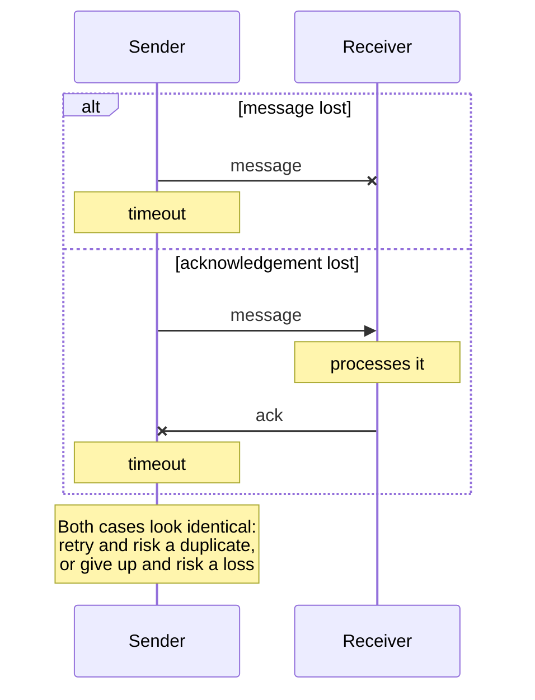

# Exactly-Once Delivery and Processing

Exactly-once is the guarantee that a message's effect happens one time, never zero and never twice, despite crashes and an unreliable network. Exactly-once *delivery* over an unreliable channel cannot be guaranteed in every failure scenario. Exactly-once *processing*, where duplicates may arrive but are applied only once, can be built from at-least-once delivery plus [[concepts/software_architecture/idempotency|Idempotency]] or deduplication.

## Why It Matters

Every system that passes messages between machines must pick what happens when a send fails ambiguously. Losing a payment instruction is a bug, and so is executing it twice. Vendors advertise "exactly-once" under very different meanings, so knowing what the guarantee can and cannot mean is what lets an engineer check where duplicates can still get through.

## The Three Delivery Guarantees

| Guarantee | Sender behaviour | Failure outcome | Typical use |
| --- | --- | --- | --- |
| **At most once** | Send once, never retry | Messages can be lost, never duplicated | Metrics, telemetry, anything where a gap is cheaper than a retry |
| **At least once** | Retry until acknowledged | Messages are never lost, but can be duplicated | The practical default for queues, webhooks, and streams |
| **Exactly once** | Retry, and make the receiver suppress duplicates | Neither loss nor duplicate *effect* | Payments, counters, ledgers, anything non-idempotent |

The last row is not a third kind of network behaviour. In practice it is always at-least-once delivery with something at the receiver that makes repeats harmless.

## Delivery vs. Processing

The term covers two different claims:

- **Exactly-once delivery:** the message crosses the network and reaches the receiver exactly one time.
- **Exactly-once processing** (also called *effectively-once*): the message may arrive several times, but its effect on the receiver's state is applied once.

The first is impossible to guarantee over an unreliable channel, for the reasons below. The second is achievable and is what real systems mean when they say "exactly-once". Kafka's transactions, Flink's checkpoints, and MQTT's QoS 2 all deliver effectively-once processing within a defined boundary.

## Why Exactly-Once Delivery Is Impossible

### The acknowledgement problem

To know a message was processed, the sender needs an acknowledgement, and any of the three parties can fail around it:

- **The sender crashes** after sending but before the acknowledgement arrives. On restart it does not know whether the message got through, so it must either resend (risking a duplicate) or not (risking loss).
- **The receiver crashes** after receiving but before processing finishes or the acknowledgement is sent. The sender times out and retransmits, and the recovered receiver may process the message again.
- **The network loses or delays** the message or the acknowledgement. The sender sees a timeout either way.

In both branches the sender sees only a timeout. It cannot tell a lost message from a lost acknowledgement, or from a receiver that is merely slow. With no global clock, a timeout is a guess, not proof of failure. Every retry policy therefore picks a side: retry and accept duplicates (at-least-once) or don't and accept loss (at-most-once).

### Two Generals and FLP

Two classic results formalize the uncertainty.

- **The Two Generals Problem.** Two generals must agree on a time to attack and can only send messengers through enemy territory, where any messenger may be captured. Each acknowledgement needs its own acknowledgement, so no finite exchange leaves both sides certain the other will attack. The sender and receiver of a message are in the same position over a lossy link: no number of round trips makes both certain the message was processed.
- **The FLP impossibility result** (Fischer, Lynch, and Paterson, 1985). In a fully asynchronous system, no deterministic consensus protocol can guarantee that it always terminates if even one process may crash, even when links are reliable. Deciding whether a message was processed is a question every participant must agree on, which is why FLP is cited alongside Two Generals.

The two results start from different assumptions. Two Generals blames lossy links, while FLP blames crashes combined with unbounded delays. Practical systems escape both the same way: they assume the network is *eventually* timely, use timeouts, and accept that a run may stall or retry rather than give a wrong answer. [[concepts/databases/distributed_consensus|Distributed Consensus]] protocols such as Raft and Paxos make exactly this trade.

## Achieving Effectively-Once Processing

All of these techniques start from at-least-once delivery and remove the *effect* of duplicates.

| Technique | How it works | Limit |
| --- | --- | --- |
| **Idempotent operations** | Design the operation so that repeating it changes nothing: `SET balance = 100` rather than `balance = balance - 10`, an upsert on a natural key, a `PUT` of a full resource | Not every operation can be made naturally idempotent |
| **Deduplication by message ID** | The sender attaches a unique ID, and the receiver records the IDs it has applied and drops repeats | The ID record must be written atomically with the effect, and it is usually kept only for a retention window, after which a late duplicate gets through |
| **Atomic progress and result** | Store the consumer's position (offset, sequence number) in the same transaction as the result it produced, so a crash rolls back both | Requires the result store to be transactional, or the engine to snapshot both together |
| **Transactional outbox** | Write the state change and the outgoing message to an outbox table in one local database transaction, then a relay publishes the outbox | Fixes the *dual write*, a state change without its message or the reverse. The relay itself is at-least-once, so consumers still deduplicate |
| **Replicated logs and consensus** | Keep the log and the deduplication state on a quorum, through a consensus protocol, so they survive node loss | Adds latency and operational cost, and still relies on timeouts |

> [!important] Exactly-once is a property of a boundary
> Every guarantee above holds only inside the system that owns the deduplication state. When a message leaves that boundary, for example a consumer calling an external API, sending an email, or charging a card, exactness becomes the target's problem. Pass the target a stable idempotency key, or accept at-least-once there.

## Where Real Systems Draw the Line

| System | What its "exactly-once" covers | Covered in |
| --- | --- | --- |
| Apache Kafka | Idempotent producer plus transactions plus `read_committed` consumers: exactly-once from Kafka topics to Kafka topics | [[concepts/data_engineering/kafka/apache_kafka#Delivery semantics\|Apache Kafka]] |
| Apache Flink | Checkpoints give exactly-once effect on operator *state*; output needs a transactional or idempotent sink | [[concepts/data_engineering/flink/chandy_lamport_algorithm#Delivery Modes\|Chandy-Lamport Algorithm in Apache Flink]] |
| Stream processors in general | Exactly-once state, with end-to-end exactness depending on the sink strategy | [[concepts/data_engineering/stateful_vs_stateless_stream_processing#Delivery Semantics End to End\|Stateful vs. Stateless Stream Processing]] |
| MQTT QoS 2 | A four-step handshake between one client and one broker, so a message is delivered once on that hop | [[concepts/software_architecture/api_integration_protocols#MQTT\|API and Integration Protocols]] |

## Common Pitfalls

- **Trusting the label.** "Exactly-once" in a product's documentation names a boundary. Find where it ends before relying on it.
- **Side effects outside the transaction.** A stream job that sends an email inside an operator will resend it on every replay, however exactly-once its state is.
- **Non-deterministic processing.** Replaying a message only produces the same result if processing is deterministic. Reading the wall clock, a random number, or a mutable external table during processing breaks that.
- **Deduplication windows that are too short.** A retry that arrives after the receiver has forgotten the ID is applied twice.
- **Checking and applying in separate steps.** Checking "have I seen this ID?" and then applying the effect in a second write leaves a gap. A crash between the two, or a concurrent duplicate, undoes the guarantee.

## Related Concepts

- [[concepts/software_architecture/idempotency|Idempotency]] — the property that turns at-least-once delivery into effectively-once processing
- [[concepts/data_engineering/kafka/apache_kafka|Apache Kafka]] — the best-known exactly-once implementation, and an example of a guarantee that ends at the system boundary
- [[concepts/data_engineering/flink/chandy_lamport_algorithm|Chandy-Lamport Algorithm in Apache Flink]] — how consistent snapshots plus source replay give exactly-once state in a streaming engine
- [[concepts/data_engineering/stateful_vs_stateless_stream_processing|Stateful vs. Stateless Stream Processing]] — the sink strategies (transactional, idempotent, plain append) that decide end-to-end delivery semantics
- [[concepts/databases/distributed_consensus|Distributed Consensus]] — the agreement problem FLP constrains, and the protocols that keep deduplication state and logs consistent across nodes
- [[concepts/software_architecture/api_integration_protocols|API and Integration Protocols]] — the delivery guarantees of webhooks, MQTT, and AMQP, and why their receivers must be idempotent
- [[concepts/databases/base_consistency|BASE (Basically Available, Soft State, Eventual Consistency)]] — the eventually consistent systems where at-least-once delivery and dedup keys are the application's job

## References

- [Exactly Once in Distributed Systems](https://serverless-architecture.io/blog/exactly-once-in-distributed-systems/) — Serverless Architecture blog, cited in the user's draft
- M. J. Fischer, N. A. Lynch, and M. S. Paterson, "Impossibility of Distributed Consensus with One Faulty Process," *Journal of the ACM*, 1985.
