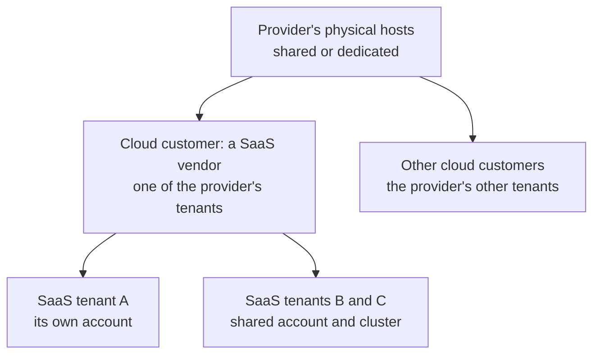
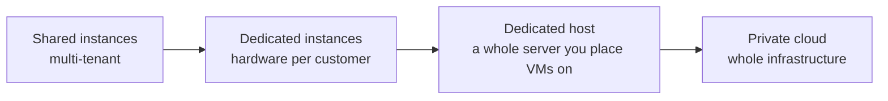
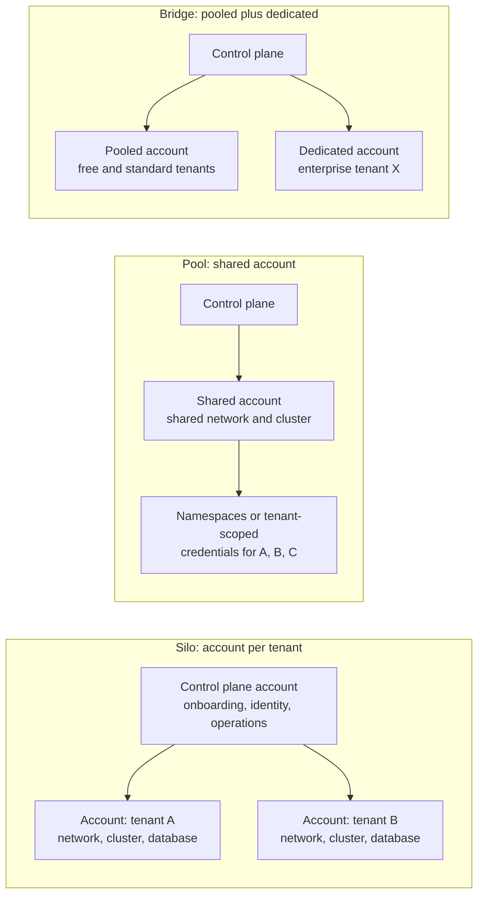
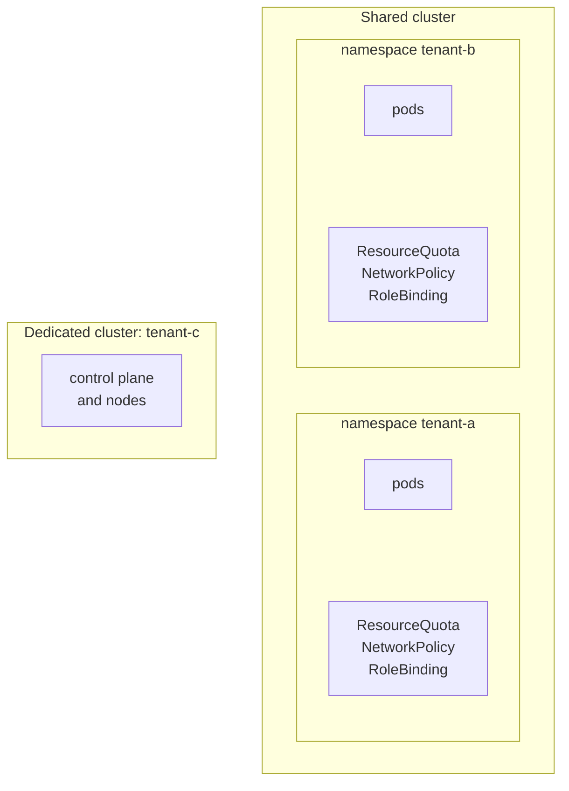
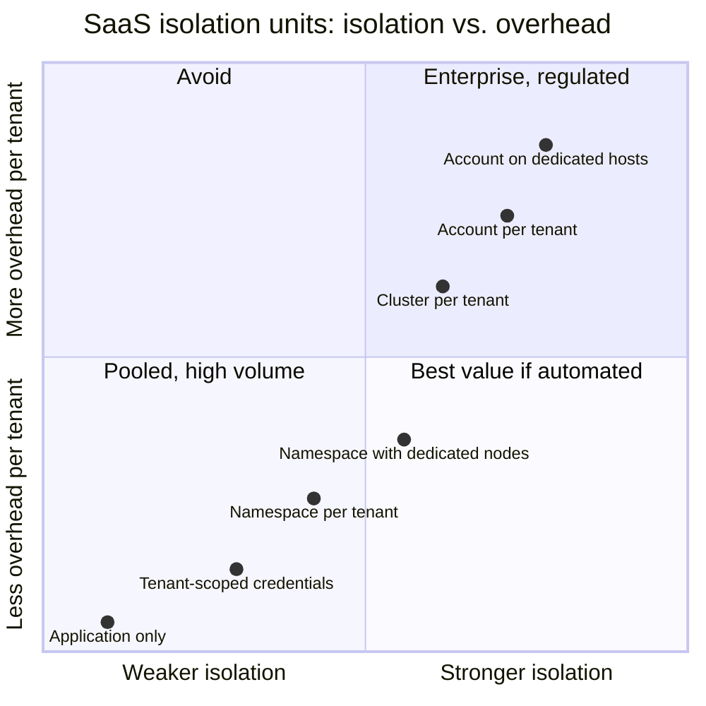

# Cloud Tenancy

Cloud tenancy works at two levels, both of which apply [[concepts/software_architecture/tenancy/tenancy_models|Tenancy Models]] to infrastructure.

- **Provider level.** A public cloud is itself multi-tenant: it runs many customers' virtual machines and managed services on shared hardware. Dedicated hosts and private cloud are its single-tenant options.
- **SaaS level.** A product built on the cloud maps its own tenants onto cloud constructs: accounts, networks, clusters, namespaces, or tenant-scoped credentials to shared resources.

## Why It Matters

- **Isolation boundaries differ in strength.** A cloud account separates identity, quotas, billing, and network by default. A Kubernetes namespace separates only what the cluster's policies are configured to separate.
- **Quotas are shared within a boundary.** Service limits apply per account, subscription, or project, so tenants that share one also share its limits. One tenant that exhausts a shared resource's request rate gets everyone on it throttled.
- **Cost attribution follows the boundary.** A tenant with its own account appears on the bill as its own line. Tenants on shared resources need tagging and metering to be costed.
- **Licensing and compliance can require dedicated hardware.** Some software is licensed per physical socket or core, and some regulations or contracts forbid sharing hardware with other customers.

## Two Levels of Tenancy



The first level of edges is provider tenancy: who shares the hardware. The second level is SaaS tenancy: how the vendor divides what it rents among its own customers. The two are chosen independently. A vendor can pool its tenants on dedicated hosts, or give every tenant its own account on shared hardware.

## Provider Level: Shared or Dedicated Hardware

**Multi-tenant is the default.** Virtual machines from different customers run on the same physical hosts, separated by the hypervisor. Managed services such as serverless functions, managed databases, and warehouses are multi-tenant services that the provider operates. For most workloads the hypervisor is treated as an adequate boundary. Kubernetes' own guidance, for example, reserves dedicated hardware for cases where "VMs are not considered an adequate security boundary".

| Option | What is dedicated | Typical reason |
| --- | --- | --- |
| Shared instances (default) | Nothing: hosts are shared across customers | Most workloads |
| AWS Dedicated Instances | Hardware dedicated to one AWS account, though it may also run that account's other instances; AWS controls placement and gives no host visibility | A rule against sharing hardware with other customers |
| Dedicated host: AWS Dedicated Hosts, Azure Dedicated Host, Google Cloud sole-tenant nodes | A whole physical server reserved for one account, subscription, or project, with visibility of its sockets and cores and control over which VMs go where | Per-socket or per-core licences (bring your own licence), compliance, control over placement |
| Private cloud | The whole infrastructure, on premises or hosted | Full control, regulation, data sovereignty |



The chain runs from most shared to most isolated. Cost per unit of compute rises left to right, and so does the work of planning capacity yourself.

On EC2 this is the instance's *tenancy* setting: `default` (shared), `dedicated`, or `host`. As the [[concepts/cloud_computing/aws/ec2/amazon_ec2|Amazon EC2 (Elastic Compute Cloud)]] note records, Savings Plans discounts apply whatever an instance's tenancy.

### Two Meanings of Hybrid

At the provider level, "hybrid" can mean either of two things:

- **Mixed tenancy within one cloud.** Regulated or licence-bound workloads run on dedicated hosts, and everything else on shared instances.
- **Hybrid cloud.** A private cloud or on-premises estate is connected to one or more public clouds, and workloads are placed by sensitivity, data location, latency, or cost. The private side is single-tenant and the public side is multi-tenant, so hybrid cloud is a hybrid tenancy model at the level of whole infrastructures.

## SaaS Level: Mapping Tenants onto Cloud Constructs

A SaaS vendor chooses which cloud construct is each tenant's boundary. AWS's *SaaS Tenant Isolation Strategies* whitepaper names the two strongest options *account silo* and *VPC silo* isolation. With a VPC per tenant, VPC tags can attribute cost to each tenant. The ladder below runs from strongest to weakest isolation:

| Boundary per tenant | AWS | Azure | Google Cloud | What it separates | Watch out for |
| --- | --- | --- | --- | --- | --- |
| Account | AWS account in AWS Organizations | Subscription | Project, under a folder | Identity and access, quotas, billing, network, blast radius | Account quotas per organization; needs automated account creation; operations across all accounts |
| Network | VPC | Virtual network | VPC network | Network paths and firewall rules | Address ranges; peering and per-network quotas |
| Cluster | EKS cluster | AKS cluster | GKE cluster | Control plane and worker nodes | Cost and upgrades for every cluster |
| Namespace | Kubernetes namespace with RBAC, quotas, and network policies | Same | Same | API objects and the policies scoped to them | Shared kernel and nodes unless also isolated |
| Tenant-scoped credentials | IAM role assumed with a tenant session tag; policy conditions on that tag | Role assignments with conditions | IAM Conditions | Per-request access to one tenant's data in shared stores | Policy correctness; every service must use the scoped credentials |
| Application only | Shared everything | Same | Same | Whatever the code enforces | One bug leaks across tenants |



> [!important] Silo still shares a control plane
> Even with an account per tenant, onboarding, identity, deployment, and operations run through one shared control plane. Without one, each account becomes a separately operated installation, a managed service rather than SaaS.

## Kubernetes: Namespace, Node, or Cluster per Tenant

Kubernetes has no built-in concept of a tenant, but it provides the building blocks for one. Kubernetes distinguishes two cases:

- **Multi-team tenancy.** Teams in one organization share a cluster, with partial trust between them.
- **Multi-customer tenancy.** A SaaS vendor runs workloads for customers who never touch the cluster, and strong isolation between them is expected.

Isolation is described on a spectrum from *soft* to *hard* multi-tenancy. The data plane, where tenant workloads run, has the larger attack surface, so hard multi-tenancy needs extra care there.

| Level | What it isolates | Relative cost | Fits |
| --- | --- | --- | --- |
| Namespace per tenant | API objects; RBAC roles and network policies are namespace-scoped; resource quotas per namespace | Lowest | Multiple teams; trusted tenants |
| Namespace plus dedicated nodes or sandboxed containers | Also the node and kernel a tenant's pods run on | Moderate | Untrusted workloads in a shared cluster |
| Cluster per tenant | Control plane and data plane | High; managed Kubernetes reduces it | Hard multi-tenancy; regulated customers |
| Cluster on dedicated hardware | Also the physical host | Highest | When VMs are not trusted as a boundary |



The most important control-plane control is authorization. A tenant that can modify another namespace's objects can switch off every other policy, so each tenant's RBAC must be limited to its own namespaces. [[concepts/devops/kubernetes/kubernetes|Kubernetes]] covers the objects involved, and [[concepts/devops/kubernetes/security/kubernetes_security|Kubernetes Security]] covers how a cluster's boundaries are attacked.

## Pooled Isolation with Tenant-Scoped Credentials

When tenants share cloud resources, the code's tenant filter can be backed up by the cloud's own access control. AWS's whitepaper calls this *run-time, policy-based isolation*: a service holds broad permissions but, for each request, obtains narrowly scoped credentials for the caller's tenant and uses only those. One way to implement it on AWS is to assume an IAM role and pass the tenant as a session tag. The role's policy then allows access only to that tenant's items or objects:

```json
{
  "Effect": "Allow",
  "Action": ["dynamodb:GetItem", "dynamodb:Query", "dynamodb:PutItem"],
  "Resource": "arn:aws:dynamodb:*:*:table/orders",
  "Condition": {
    "ForAllValues:StringEquals": {
      "dynamodb:LeadingKeys": ["${aws:PrincipalTag/tenant_id}"]
    }
  }
}
```

Here a DynamoDB table is partitioned by tenant, and the credentials can read or write only items whose partition key equals the tenant in the session tag. A missing filter in the code now produces an access-denied error instead of a leak. The same approach works for object storage, using a per-tenant key prefix in the policy condition.

## Quotas, Noisy Neighbours, and Cost

- **Shared boundaries share quotas.** A single storage account, database, or API used by every tenant is throttled for everyone once it reaches its request limit. Spread tenants across several resource instances, accounts, or subscriptions before any one of them reaches its limit.
- **Account-per-tenant has quotas of its own.** AWS Organizations, for example, allows 10 accounts per organization by default. The quota is adjustable on request, but it shows that the account boundary must be planned for. Accounts, subscriptions, and projects per tenant also need automated creation, baseline guardrails, and tear-down.
- **Cost attribution.** An account per tenant gives per-tenant cost directly. Pooled resources need consistent tenant tags, plus metering inside the application for shared components that cannot be tagged per tenant.

## Comparison

| Dimension | Account per tenant | Network or cluster per tenant | Namespace per tenant | Tenant-scoped credentials | Application only |
| --- | --- | --- | --- | --- | --- |
| Isolation | Strongest cloud boundary | Strong for network and compute | Policy-dependent | Enforced by cloud access control per request | Code only |
| Blast radius | One tenant | One tenant's network or cluster | Shared cluster and nodes | Shared resources | Everything |
| Quotas | Per tenant | Partly shared | Shared, plus per-namespace quotas | Shared | Shared |
| Cost attribution | Native on the bill | Through tags | Through namespace metrics | Through metering | Through metering |
| Onboarding | Create and baseline an account | Provision infrastructure | Create a namespace | Insert a record | Insert a record |
| Operational overhead | Highest | High | Low to moderate | Low | Lowest |
| Scales to many tenants | Only with automation and raised quotas | With automation | Well | Very well | Very well |



The positions show qualitative ordering only; they are not measurements, and they shift with the provider, the managed services used, and the level of automation.

## Choosing

- **Start from the tenants' requirements, not the technology.** Contractual isolation, data residency, and per-tenant billing push toward accounts. Large numbers of small tenants push toward pooling.
- **Pool by default, and keep a dedicated tier.** A shared account and cluster, with namespaces and tenant-scoped credentials, serves most tenants. An account per tenant serves those who pay for or require it.
- **Buy dedicated hardware for a stated reason.** Software licensed per socket or core, or a regulation that forbids shared hosts, justifies it. Without such a reason, an account boundary on shared hardware is usually enough.
- **Automate before you silo.** Accounts, networks, and clusters per tenant are only workable when created, baselined, and upgraded from code such as [[concepts/devops/infrastructure_as_code/terraform|Terraform]].

## Common Pitfalls

- **Treating a namespace as a hard boundary.** Without network policies, quotas, tight RBAC, and node isolation, tenants in one cluster can reach or starve each other.
- **One shared account for everything.** Every tenant shares its quotas, its blast radius, and one cloud bill that is hard to split.
- **Account per tenant by hand.** Accounts created manually drift in guardrails, logging, and network configuration.
- **Tenant-scoped credentials used by only some services.** One service using broad credentials undoes the guarantee for every store it can reach.
- **Untagged shared resources.** Without consistent tenant tags, the cloud bill cannot be split per tenant.
- **Confusing the two kinds of hybrid.** "Hybrid" may mean hybrid cloud or a mix of shared and dedicated tenancy. State which one is meant.

## Related Concepts

- [[concepts/software_architecture/tenancy/tenancy_models|Tenancy Models]] — the silo, pool, and bridge spectrum this note applies to infrastructure
- [[concepts/software_architecture/tenancy/database_tenancy|Database Tenancy]] — the data-tier layout that runs inside these accounts, networks, and clusters
- [[concepts/software_architecture/tenancy/data_platform_tenancy|Data Platform Tenancy]] — the same account, project, and workspace boundaries used for analytics
- [[concepts/cloud_computing/aws/ec2/amazon_ec2|Amazon EC2 (Elastic Compute Cloud)]] — where instance tenancy (shared, dedicated, host) is set, and how it interacts with Savings Plans
- [[concepts/devops/kubernetes/kubernetes|Kubernetes]] — the namespaces, nodes, and clusters that container-level tenancy is built from
- [[concepts/devops/kubernetes/security/kubernetes_security|Kubernetes Security]] — how the shared cluster boundary is attacked, and why the data plane needs extra isolation for hostile tenants
- [[concepts/identity_and_access/authorization|Authorization]] — tenant-scoped credentials and conditional role assignments are attribute-based access control applied to tenancy
- [[concepts/devops/infrastructure_as_code/terraform|Terraform]] — the infrastructure as code that makes accounts, networks, and clusters per tenant repeatable

## References

- Kubernetes documentation: [Multi-tenancy](https://kubernetes.io/docs/concepts/security/multi-tenancy/)
- Microsoft, Azure Architecture Center: [Tenancy models for a multitenant solution](https://learn.microsoft.com/en-us/azure/architecture/guide/multitenant/considerations/tenancy-models)
- Amazon Web Services, Well-Architected SaaS Lens: [Silo, pool, and bridge models](https://docs.aws.amazon.com/wellarchitected/latest/saas-lens/silo-pool-and-bridge-models.html)
- Amazon Web Services: [SaaS Tenant Isolation Strategies](https://d1.awsstatic.com/whitepapers/saas-tenant-isolation-strategies.pdf) (whitepaper)
- Amazon EC2 User Guide: [Dedicated Instances](https://docs.aws.amazon.com/AWSEC2/latest/UserGuide/dedicated-instance.html) and [Dedicated Hosts](https://docs.aws.amazon.com/AWSEC2/latest/UserGuide/dedicated-hosts-overview.html)
- Google Cloud: [Sole-tenant nodes](https://cloud.google.com/compute/docs/nodes/sole-tenant-nodes)
- Microsoft Azure: [Azure Dedicated Host](https://learn.microsoft.com/en-us/azure/virtual-machines/dedicated-hosts/overview)
- AWS Organizations: [Quotas](https://docs.aws.amazon.com/organizations/latest/userguide/orgs_reference_limits.html)
