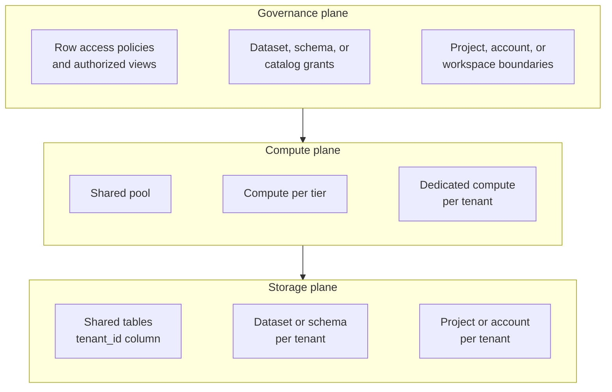
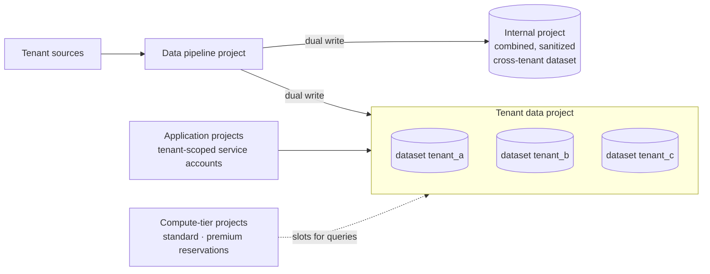
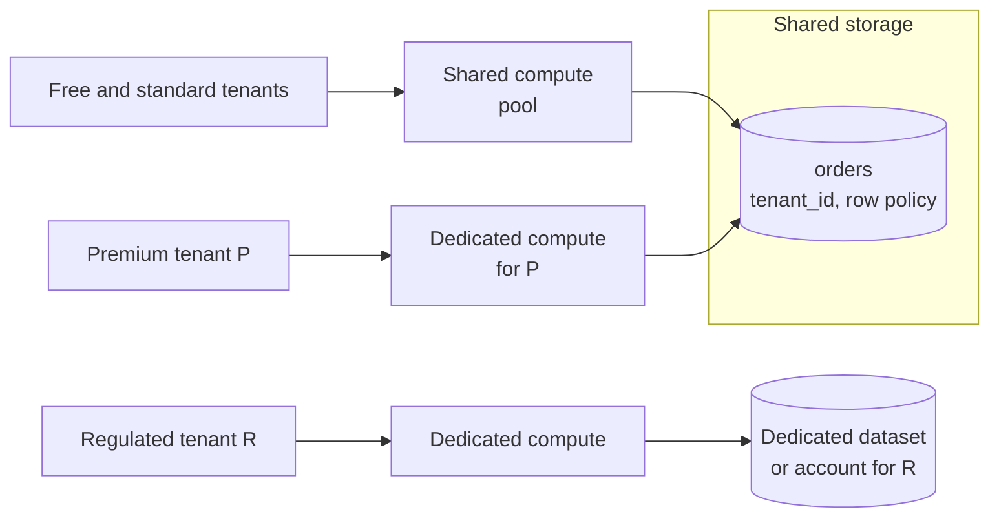
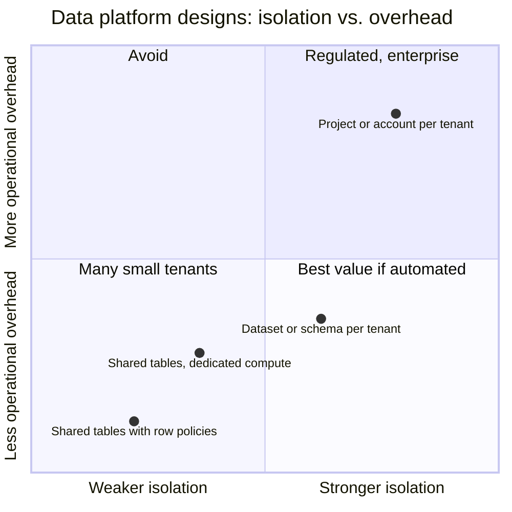

# Data Platform Tenancy

Data platform tenancy is how a warehouse, lakehouse, or analytics platform keeps its tenants' data, compute, and costs apart. The tenants are either a SaaS product's external customers, whose analytics run on the platform, or the internal business units and teams that share one company platform. It applies [[concepts/software_architecture/tenancy/tenancy_models|Tenancy Models]] to analytics:

- **Single-tenant** gives each tenant its own project, account, or workspace.
- **Multi-tenant** keeps every tenant in shared tables, filtered by row-level policies.
- **Hybrid** gives each tenant its own dataset or schema on shared infrastructure.

## Why It Matters

- **The warehouse undoes upstream isolation.** Even when each tenant has its own operational database (see [[concepts/software_architecture/tenancy/database_tenancy|Database Tenancy]]), pipelines often copy every tenant into one warehouse. The isolation has to be rebuilt there.
- **Cross-tenant analysis is often the point.** Fleet-wide reporting, benchmarking, and machine learning need data from every tenant together, which pulls against strict separation.
- **Compute is shared by default.** One tenant's heavy query or badly written dashboard can use up the slots or warehouse that every other tenant's queries run on.
- **Cost must be attributed.** Analytics spend has to be traced to the customer or business unit that caused it, for pricing, chargeback, or simply knowing who to call.

## Two Kinds of Tenant

| | Customer tenants | Internal tenants |
| --- | --- | --- |
| Who | A SaaS vendor's customers, served through embedded analytics or data exports | Business units, lines of business, and domain teams of one company |
| Trust between tenants | None; a leak is a breach | Partial; a leak is a policy violation |
| Main goals | Strict isolation, consistent performance, cost per customer | Shared, governed core data, team autonomy, chargeback |
| Typical number | Hundreds to tens of thousands | Tens to hundreds |
| Typical design | Shared tables, or a dataset or project per tenant | A central core-data project, with team projects that consume it |

## Three Planes to Isolate

Warehouses and lakehouses separate storage from compute, so tenancy can be chosen separately for each plane. Storage can be shared while compute is dedicated, or the reverse.



Each row runs from most shared on the left to most isolated on the right. A design picks one point on each plane.

## Single-Tenant: Project, Account, or Workspace per Tenant

Each tenant gets its own top-level container: a Google Cloud project (grouped under a tenant folder), a Snowflake account, or a Databricks workspace. Storage, compute, and billing are all separate. On Databricks the governance layer can still be shared, because one Unity Catalog metastore serves many workspaces. By default every workspace attached to the metastore can reach every catalog, so **workspace-catalog binding** is what limits a tenant's catalog to that tenant's workspace. A binding overrides even explicit privilege grants.

In Google's dedicated-tenant design, the tenant's BigQuery datasets live in the same project as the compute dedicated to that tenant, and pipelines write directly into them. A separate networking project routes each tenant's requests to its dedicated backend. At this scale VPC Service Controls perimeters may not fit within project limits, so Google instead recommends strict IAM and disabling service-account key creation.

- **Strengths:** the strongest isolation; cost per tenant comes straight from the bill; per-tenant configuration, region, and release timing.
- **Costs:** the number of accounts or projects grows with the tenants, along with their quotas and automation; cross-tenant analysis needs data copied or shared out of every container; onboarding means provisioning.

## Multi-Tenant: Shared Tables

All tenants' rows sit in the same tables with a `tenant_id` column. A row-level policy, or a view that filters on the caller's tenant, decides which rows each principal sees. Partitioning or clustering the tables on `tenant_id` keeps each tenant's queries from scanning other tenants' data.

**Example: a Snowflake row access policy driven by a mapping table**

```sql
CREATE TABLE security.tenant_role_map (role_name STRING, tenant_id STRING);

CREATE ROW ACCESS POLICY security.tenant_rows
  AS (row_tenant_id STRING) RETURNS BOOLEAN ->
    EXISTS (
      SELECT 1 FROM security.tenant_role_map m
      WHERE m.role_name = CURRENT_ROLE()
        AND m.tenant_id = row_tenant_id
    );

ALTER TABLE analytics.orders
  ADD ROW ACCESS POLICY security.tenant_rows ON (tenant_id);
```

A single policy reads the mapping table, so onboarding a tenant adds a row rather than another policy. Snowflake evaluates a row access policy at query time, much like a dynamic secure view. BigQuery (row-level access policies) and Databricks Unity Catalog (row filters and column masks, or attribute-based policies driven by governed tags) offer the same idea.

- **Strengths:** the fewest objects and the lowest storage overhead; a schema change is applied once; fleet-wide analysis is a plain query.
- **Costs:** isolation rests on every policy being attached and correct. Every extract, BI cache, and derived table must keep the filter. Shared compute brings noisy neighbours. Per-tenant cost needs query-level attribution.

## Hybrid: Dataset or Schema per Tenant

Each tenant gets its own container inside a shared project or account: a BigQuery dataset, a Snowflake database or schema, or a Unity Catalog catalog or schema. Grants on the container replace row filters, and compute is shared by tier.

Google recommends this layout as the default for a SaaS vendor hosting thousands of tenants on BigQuery, because it keeps the number of projects and cloud resources fixed as tenants are added. Its reference layout has these parts:

- **One data project** holds a dataset per tenant.
- **A data pipeline project** ingests incoming data and writes it twice: into each tenant's dataset, and into a combined, sanitized dataset for internal analytics. It writes full tables rather than using authorized views, which avoids hitting authorized-view limits as tenants grow.
- **Compute-tier projects** map tenant queries to BigQuery reservations. Tenants in a tier share its slots through fair scheduling, and unused slots in any tier are reused by other tiers. A tenant with strict timing needs gets its own project and reservation.
- **Tenant-scoped service accounts** in the application projects read each tenant's dataset, and VPC Service Controls perimeters keep tenant datasets from being reached outside the organization.



- **Strengths:** a simple, auditable grant per tenant; offboarding drops one container; a tenant's container can be placed in its required region; compute tiers can be sold.
- **Costs:** the pipeline fans out to every tenant, so every schema change is applied once per tenant; there are many objects to monitor; fleet-wide analysis needs the separate combined dataset.

## Hybrid by Plane and by Tier

The most common production designs mix the models per plane or per customer tier rather than picking one model for everything:

- **Shared storage with dedicated compute for premium tenants**, for example a dedicated BigQuery reservation or a dedicated Snowflake virtual warehouse running over the shared tables.
- **Shared tables for small tenants, with a dataset or project for each large or regulated one**, chosen per tenant through a tenant catalog, as in the tiered mix in [[concepts/software_architecture/tenancy/database_tenancy|Database Tenancy]].



## Internal Tenants: The Governed Data Mart

For tenants that are teams of one company, Google's BigQuery guidance describes a central pattern:

- **A core data project** holds the governed data. It shares that data with teams through authorized views, authorized UDFs, and column policies, keeping control of access with the core data team.
- **Teams query from their own projects** with their own slots and can build derived datasets there. Google recommends against stacking many layers of views on top of the core views.
- **Reservations are two-tier.** A small reservation at the organization level covers general use, and teams with heavier needs get reservations at project or folder level. This tier split is also how business-unit costs are attributed, measured as in [[concepts/data_engineering/bigquery_cost_monitoring|BigQuery Usage and Cost Monitoring]].
- **Multi-region copies.** BigQuery does not run queries across regions, so a data mart that must exist in several regions is copied there, for example with the BigQuery Data Transfer Service, instead of being sliced with authorized views.

## Platform Mapping

| Isolation unit | BigQuery | Snowflake | Databricks |
| --- | --- | --- | --- |
| Shared tables with row filtering | Row-level access policies; authorized views | Row access policies; secure views | Unity Catalog row filters and column masks; ABAC policies on governed tags, which Databricks recommends over per-table filters |
| Container per tenant inside shared infrastructure | Dataset per tenant | Database or schema per tenant | Catalog or schema per tenant |
| Top-level container per tenant | Project per tenant, under a tenant folder | Account per tenant | Workspace per tenant, with the tenant's catalog bound to that workspace |
| Compute isolation | Reservations assigned to projects or folders | Virtual warehouse per tenant or tier | Cluster or SQL warehouse per tenant or tier |
| Cost attribution | Per project and reservation; job labels | Per warehouse; per account | Per workspace; compute tags |

## Choosing a Design



The positions show qualitative ordering only; they are not measurements.

- **Thousands of customer tenants, cost-sensitive:** shared tables with row policies, or a dataset per tenant if per-tenant grants and offboarding matter more than object count.
- **Tenants with residency, contractual-isolation, or billing requirements:** a project or account per tenant for those tenants, with the rest pooled.
- **Internal business units:** a central core-data project that shares governed views, while each team queries from its own project with its own compute. Google calls this a data mart with a central authority.

## Common Pitfalls

- **A policy that does not travel.** Extracts, BI tool caches, notebooks, and derived tables built from a filtered table can drop the row filter. Treat every copy as a new access path.
- **One policy per tenant.** Writing a separate row policy or view for each tenant grows linearly with tenants and is easy to get wrong. Prefer one policy that reads a tenant-to-principal mapping table.
- **Platform-wide service accounts.** A pipeline or BI service account that can read every tenant's dataset is effectively a shared table with no filter.
- **No compute isolation.** Without reservations, warehouses, or quotas per tier, one tenant's heavy queries slow every other tenant on the shared compute.
- **Unattributed spend.** Without tenant labels or a compute container per tenant, analytics costs cannot be priced or charged back.
- **The cross-tenant dataset as a back door.** The combined internal dataset holds every tenant's data together, so it needs de-identification and access controls at least as strict as the tenant datasets.

## Related Concepts

- [[concepts/software_architecture/tenancy/tenancy_models|Tenancy Models]] — the silo, pool, and bridge spectrum this note applies to analytics
- [[concepts/software_architecture/tenancy/database_tenancy|Database Tenancy]] — the operational layout that the platform's pipelines read from, and whose isolation must be rebuilt here
- [[concepts/software_architecture/tenancy/cloud_tenancy|Cloud Tenancy]] — the accounts, projects, and networks that the single-tenant designs here are built from
- [[concepts/data_architecture/data_architecture|Data Architecture]] — the platform layers and reference patterns that tenancy cuts across
- [[concepts/data_engineering/databricks/databricks|Databricks]] — Unity Catalog's catalogs, workspaces, and row filters are its tenancy building blocks
- [[concepts/data_engineering/bigquery_cost_monitoring|BigQuery Usage and Cost Monitoring]] — how to measure the per-project and per-reservation spend that tenant cost attribution depends on
- [[concepts/data_governance/data_security|Data Security]] — row- and column-level security and authorized views are the controls that shared-table tenancy relies on

## References

- Google Cloud: [Best practices for multi-tenant workloads on BigQuery](https://cloud.google.com/bigquery/docs/best-practices-for-multi-tenant-workloads-on-bigquery)
- Snowflake documentation: [Understanding row access policies](https://docs.snowflake.com/en/user-guide/security-row-intro) and [Virtual warehouses](https://docs.snowflake.com/en/user-guide/warehouses-overview)
- Databricks documentation: [Row filters and column masks](https://docs.databricks.com/aws/en/data-governance/unity-catalog/filters-and-masks), [Workspace-catalog binding](https://docs.databricks.com/aws/en/data-governance/unity-catalog/access-control/workspace-catalog-binding), and [ABAC policies](https://docs.databricks.com/aws/en/data-governance/unity-catalog/abac/)
