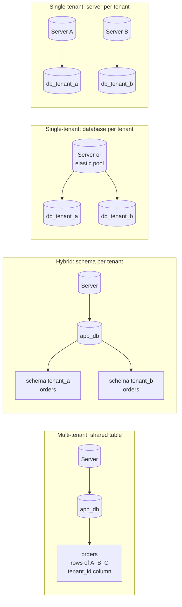
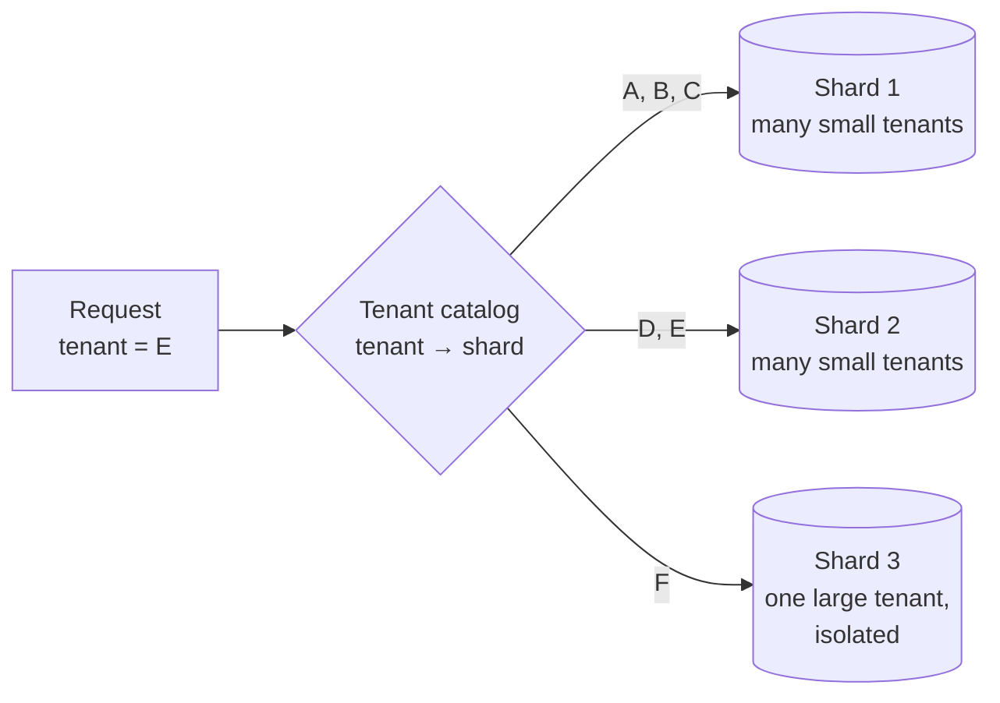
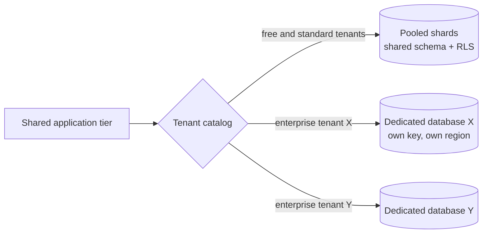
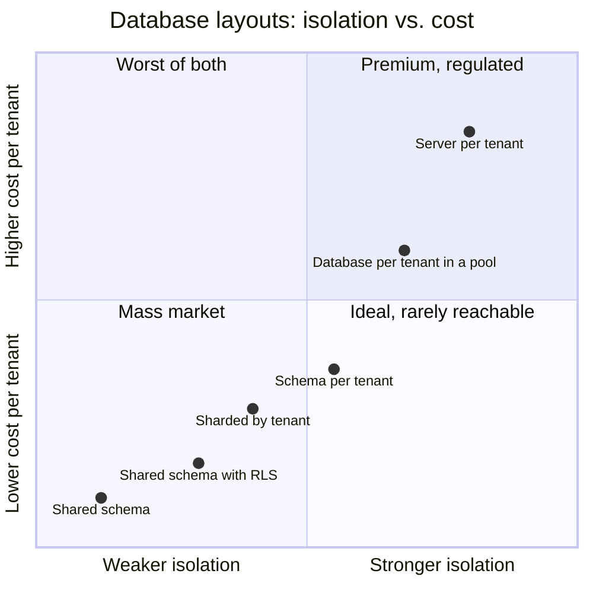
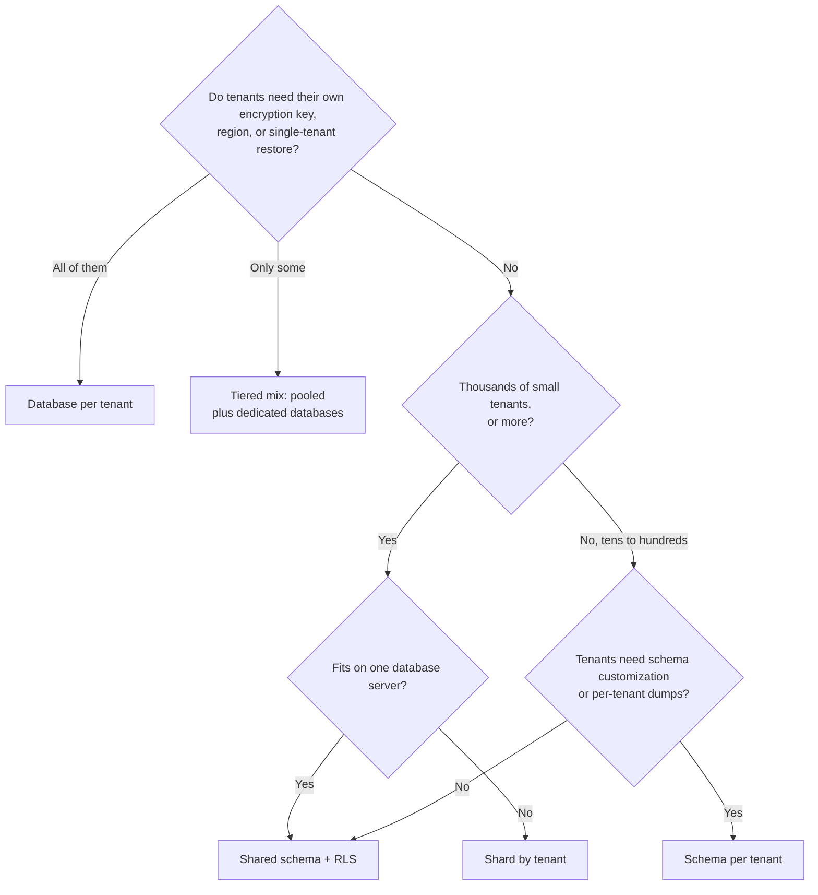

# Database Tenancy

Database tenancy is how a multi-customer product lays out its tenants' data across database servers, databases, schemas, and tables. It applies [[concepts/software_architecture/tenancy/tenancy_models|Tenancy Models]] to the data tier:

- **Single-tenant** gives each tenant its own database.
- **Multi-tenant** keeps every tenant in shared tables, keyed by a tenant identifier.
- **Hybrid** sits between the two, or mixes them by customer tier.

The layout decides how strongly tenant data is kept apart, what each tenant costs, and how hard schema changes, backups, and scaling become.

## Why It Matters

- **Data is what leaks.** Customers and regulators ask where their rows live and who else can reach them. The data tier is where a tenancy promise is kept or broken.
- **Noisy neighbours show up here first.** The database usually carries most of the load, so one tenant's heavy query is felt by every tenant on the same server.
- **The layout is the hardest part to change.** Moving a tenant to a different layout means moving data, not just redeploying code.
- **It sets per-tenant operations.** Restoring one tenant, using a tenant's own encryption key, keeping data in a given region, and deleting everything when a tenant leaves are all easy in some layouts and very hard in others.

> [!note] Tenant isolation is not transaction isolation
> "Isolation" here means keeping one tenant's data away from another. It is unrelated to [[concepts/databases/isolation_levels|Transaction Isolation Levels]], which control what concurrent transactions see of each other's changes.

## The Layouts at a Glance

Each layout draws the tenant boundary at a different level of the database hierarchy: the row, the shard, the schema, the database, or the server.



| Tenant boundary | Layout | Tenancy model |
| --- | --- | --- |
| Row | Shared database, shared schema, `tenant_id` on every table | Multi-tenant (pool) |
| Shard | Shared schema, tenants spread across several databases | Multi-tenant, partitioned |
| Schema | Shared database, one schema per tenant | Hybrid (bridge) |
| Database | One database per tenant, on a shared server or pool | Single-tenant data on shared compute |
| Server | One database server or instance per tenant | Single-tenant (silo) |

## Single-Tenant: Database per Tenant

Each tenant has its own database, and a shared, multi-tenant application connects to the right one. The databases can share a server or a resource pool (Azure SQL elastic pools, for example, share compute and cost across many databases), or each tenant can get a server of its own for full isolation.

- **Strengths:**
  - The strongest data isolation.
  - Backup, point-in-time restore, and retention per tenant.
  - Customer-managed encryption keys per tenant.
  - Each tenant's database can be placed in that tenant's region.
  - Tuning and scaling per tenant.
  - Offboarding is a single `DROP DATABASE`.
- **Costs:**
  - Every database adds fixed overhead (minimum size, connections, monitoring).
  - Schema migrations fan out across every database.
  - Reporting across all tenants needs the data copied into a central warehouse, as described in [[concepts/software_architecture/tenancy/data_platform_tenancy|Data Platform Tenancy]].
  - Provisioning has to be automated, or the fleet becomes unmanageable.

> [!tip] Keep `tenant_id` even when the database is the boundary
> A `tenant_id` column looks redundant in a single-tenant database. It pays off when tenants are loaded into a shared warehouse, when two tenants are consolidated, or when a tenant moves back into a pooled layout.

## Multi-Tenant: Shared Schema

Every tenant-owned table carries a `tenant_id` column, and every query filters on it. This layout packs the most tenants onto the least infrastructure, so it is the cheapest per tenant. There is also only one database to manage, back up, and secure.

**Design rules**

- **Lead with the tenant.** Put `tenant_id` first in primary keys and indexes, so that a tenant's rows sit together and lookups never scan other tenants.
- **Scope uniqueness to the tenant.** An email address or invoice number is unique *within* a tenant, so the constraint is `UNIQUE (tenant_id, email)`.
- **Make foreign keys composite.** Including `tenant_id` in every foreign key makes it impossible for a row to reference another tenant's row.
- **Enforce the filter in the database, not just in the code.** An ORM's global tenant filter is easy to bypass with one raw query. Row-level security (RLS) makes the database itself apply the filter.

**Example: row-level security in PostgreSQL**

```sql
CREATE TABLE orders (
    tenant_id    uuid           NOT NULL,
    order_id     bigint         NOT NULL,
    customer_id  bigint         NOT NULL,
    total        numeric(12,2)  NOT NULL,
    PRIMARY KEY (tenant_id, order_id),
    FOREIGN KEY (tenant_id, customer_id) REFERENCES customers (tenant_id, customer_id)
);

ALTER TABLE orders ENABLE ROW LEVEL SECURITY;
ALTER TABLE orders FORCE ROW LEVEL SECURITY;   -- apply the policy to the table owner too

CREATE POLICY tenant_isolation ON orders
    USING      (tenant_id = current_setting('app.tenant_id')::uuid)   -- rows it can read
    WITH CHECK (tenant_id = current_setting('app.tenant_id')::uuid);  -- rows it can write

-- Per request, after authenticating the caller: transaction-scoped tenant context
BEGIN;
SELECT set_config('app.tenant_id', :tenant_id, true);   -- true = local to this transaction
SELECT order_id, total FROM orders;                      -- only this tenant's rows
COMMIT;
```

When RLS is on and a table has no policy, PostgreSQL denies every row by default. If the tenant setting is missing, `current_setting` raises an error rather than returning nothing, so a request with no tenant fails instead of seeing everything.

> [!warning] Who bypasses row-level security
> Superusers and roles with the `BYPASSRLS` attribute always bypass RLS. Table owners bypass it too, unless the table has `FORCE ROW LEVEL SECURITY`. Run the application as a separate, non-owner role, and remember that migrations and admin jobs run as privileged roles and see every tenant.

> [!warning] Tenant context can leak through pooled connections
> A session-level `SET app.tenant_id` stays on the connection after the request ends, so the next request served from the pool can inherit another tenant's context. Set the tenant per transaction (`SET LOCAL`, or `set_config(…, true)`), and set it on every request.

**Strengths:** the lowest cost and highest density of tenants; one schema to migrate; onboarding is a single `INSERT`; queries across tenants are easy for internal analytics.

**Costs:**

- One missing filter leaks data, unless RLS is enforced.
- Noisy neighbours.
- One very large tenant skews the database's statistics and index sizes for everyone.
- Restoring a single tenant means restoring the whole database somewhere else and copying that tenant's rows back.
- Per-tenant encryption keys and per-tenant data location are hard.
- Removing a tenant means deleting its rows from every table.

## Scaling Multi-Tenant: Sharding by Tenant

When one database can no longer hold every tenant, the shared schema is split across several databases, called *shards*, with `tenant_id` as the shard key. A **tenant catalog** records which shard holds each tenant, and the application or a routing layer looks it up on every request. Because all of a tenant's rows live on one shard, its joins and transactions stay on a single node.



- **Native support.** Citus, a PostgreSQL extension, distributes tables by `tenant_id` and co-locates each tenant's rows across related tables. Its `isolate_tenant_to_new_shard` function moves one large tenant onto a shard of its own. Azure Cosmos DB partitions natively by a partition key. Azure SQL needs separate sharding tools, and building the routing yourself is significant work.
- **Strengths:** it scales to very large numbers of tenants while keeping density high, and it works around the size and throughput limits of a single database.
- **Costs:** you must route each request to the right shard and rebalance hot shards. Restoring a shard still affects every tenant on it. Per-tenant configuration and customer-managed keys are hard to support.

## Hybrid: Schema per Tenant

Each tenant gets the same set of tables in its own schema inside a shared database. The application selects the tenant's schema, for example with `SET search_path TO tenant_a` in PostgreSQL, or uses schema-qualified names.

- **Strengths:**
  - Name-level separation means a query cannot reach another tenant's tables by accident.
  - Grants can be set per schema.
  - One tenant can be dumped or restored on its own (`pg_dump --schema=tenant_a`).
  - Removing a tenant is a single `DROP SCHEMA … CASCADE`.
  - Tenant-specific extensions are possible.
- **Costs:**
  - The server is still shared, so noisy neighbours remain.
  - Every migration runs once per schema.
  - The system catalog grows with tenants × tables, which slows tooling and backups as the tenant count rises.
  - A pooled connection's `search_path` can leak between requests in the same way a session variable can.

> [!warning] Table per tenant is an antipattern
> Creating separate tables per tenant inside one schema (`orders_tenant_a`, `orders_tenant_b`) does not scale to large numbers of tenants and makes querying, managing, and updating data increasingly difficult. Use shared tables with a tenant column, or a separate schema or database per tenant.

## Hybrid: Tiered Mix

The other common hybrid mixes layouts by customer tier. Most tenants live in pooled, shared-schema shards. Premium, regulated, or very large tenants get a dedicated database, and the tenant catalog routes each request to the right place. This is often how a product's tenancy grows: start pooled, and promote tenants to dedicated databases when they pay for it or need it.



The cost is two code paths and a migration process: the application must work against both layouts, and moving a tenant from the pool to a dedicated database must be a repeatable, tested operation, not a one-off project.

## Comparison

| Dimension | Shared schema | Sharded shared schema | Schema per tenant | Database per tenant | Server per tenant |
| --- | --- | --- | --- | --- | --- |
| Isolation boundary | Row (filter or RLS) | Row, within a shard | Schema and grants | Database and credentials | Server |
| Tenants per server | Very many | Very many, per shard | Moderate | Fewer | One |
| Cost per tenant | Lowest | Low | Low to moderate | Moderate to high | Highest |
| Noisy neighbours | Every tenant affected | Limited to the shard | Shared server | Limited with pools; none on dedicated servers | None |
| Restore one tenant | Restore elsewhere, copy rows | Same, per shard | Per-schema dump | Native | Native |
| Per-tenant encryption key | Hard | Hard | Hard | Native | Native |
| Data residency per tenant | No | By shard placement | No | Yes | Yes |
| Schema migration | Once | Once per shard | Once per tenant | Once per tenant | Once per tenant |
| Cross-tenant queries | Easy | Distributed query | Union across schemas | Copy to a warehouse | Copy to a warehouse |
| Offboard a tenant | Delete rows everywhere | Delete rows | `DROP SCHEMA` | `DROP DATABASE` | Decommission |



The positions show qualitative ordering only; they are not measurements. Real costs depend on the engine, the managed service, and how evenly tenants use it.

## Choosing a Layout



## Schema Migrations Across Tenants

Every layout except the single shared schema multiplies migrations. The practices that keep a fleet consistent:

- **Never change schemas by hand,** even on a single database. Run every change through an automated pipeline.
- **Record each tenant's schema version** in a lookup table, so the application and the tooling know which version each tenant is on.
- **Stay compatible with the previous schema version.** Different tenants will be upgraded at different times, so split destructive changes across releases: add, backfill, switch, then remove.
- **Roll out in waves.** Migrate a few canary tenants first, then the rest. For a large fleet, consider having the application tier detect a database's version and trigger its own upgrade.
- **Avoid columns for a single tenant.** Store per-tenant custom fields in a dedicated extension table (or a document column) rather than adding columns that only one tenant uses.

## Common Pitfalls

- **Trusting the ORM alone.** A raw SQL report, a background job, or a support tool skips the ORM filter. RLS or a schema or database boundary catches what the code forgets.
- **Running the application as the table owner.** Without `FORCE ROW LEVEL SECURITY`, the owner silently bypasses every policy.
- **Session-scoped tenant context in a connection pool.** See the warning above.
- **Isolation that stops at the primary database.** Read replicas, caches, search and [[concepts/databases/vector_database|Vector Database]] indexes, exports, and warehouse copies all need the same tenant scoping.
- **No planned single-tenant restore.** In a shared database, finding out how to restore one tenant's data during an incident is too late.
- **Choosing database per tenant without automation.** Hand-provisioned databases drift in schema, configuration, and backup policy.

## Related Concepts

- [[concepts/software_architecture/tenancy/tenancy_models|Tenancy Models]] — the application-wide choice between single-tenant, multi-tenant, and hybrid that this note applies to the data tier
- [[concepts/software_architecture/tenancy/cloud_tenancy|Cloud Tenancy]] — where these databases run: shared or dedicated hardware, and an account, network, or cluster per tenant
- [[concepts/software_architecture/tenancy/data_platform_tenancy|Data Platform Tenancy]] — the analytics copy of tenant data, which needs isolation of its own once it leaves the operational database
- [[concepts/data_governance/data_security|Data Security]] — row-level security, grants, and encryption are the controls a shared layout depends on
- [[concepts/identity_and_access/authorization|Authorization]] — the tenant check that has to reach the database with every query, whichever layout is used
- [[concepts/databases/vector_database|Vector Database]] — the same choice between a shared index and an index per tenant, inside a retrieval store
- [[concepts/databases/isolation_levels|Transaction Isolation Levels]] — a different meaning of "isolation", not to be confused with tenant isolation

## References

- Microsoft, Azure Architecture Center: [Architectural approaches for storage and data in multitenant solutions](https://learn.microsoft.com/en-us/azure/architecture/guide/multitenant/approaches/storage-data)
- PostgreSQL documentation: [Row Security Policies](https://www.postgresql.org/docs/current/ddl-rowsecurity.html)
- Citus documentation: [Multi-tenant applications](https://docs.citusdata.com/en/stable/use_cases/multi_tenant.html)
