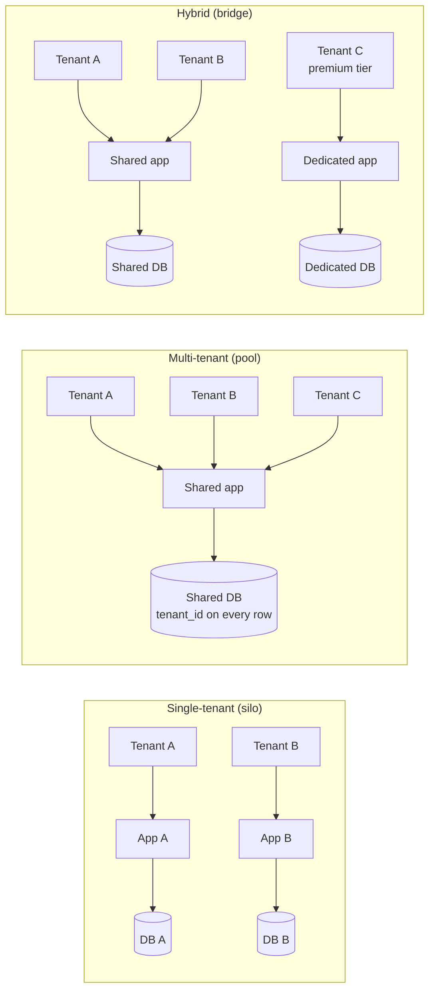
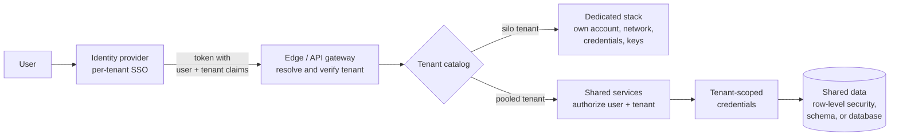
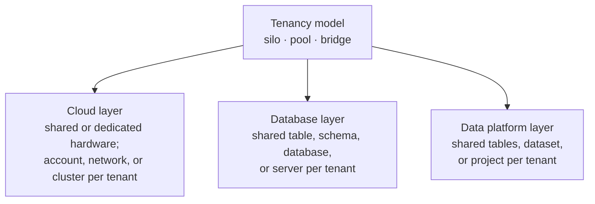

# Tenancy Models

A tenancy model decides how a software product, usually SaaS, maps its **tenants**, meaning the customers whose users and data must be kept apart, onto infrastructure. **Single-tenant** gives each tenant a dedicated stack. **Multi-tenant** has every tenant share one stack. **Hybrid** mixes the two, by customer tier or by component. Tenancy is one of the early, hard-to-reverse decisions of [[concepts/software_architecture/software_architecture|Software Architecture]], because it sets the trade-off between how strongly tenants are isolated and what each tenant costs to serve.

## Why It Matters

- **It is a commercial decision as much as a technical one.** The model sets the cost to serve each tenant, which customers you can sell to (a regulated buyer may refuse shared infrastructure), and how many tenants an operations team can run.
- **It is expensive to change later.** A shared model puts a tenant identifier into every table, cache key, message, and log line. Adding one to a codebase built for a single customer touches nearly everything.
- **It sets the blast radius.** In a shared stack, one bad deploy, one exhausted database, or one heavy customer affects every tenant at once.

## Tenants, Users, and Deployments

- **Tenant:** the unit of isolation and usually of billing. In B2B it is normally one customer organization with many users. A customer can also need several tenants, for example separate development and production instances, or divisions in different countries with different rules. In B2C a tenant may be one person, a family, or a club.
- **User:** an identity that belongs to a tenant. Authorization has to check both who the user is and which tenant they act for.
- **Deployment:** one set of infrastructure, also called a *stamp* or *cell*. A **tenant mapping** (a catalog of tenant → deployment) lets the system route each request to the deployment that holds that tenant's data, and lets operators move tenants between deployments. A deployment holds either many tenants or exactly one.

## The Isolation Spectrum

Isolation is a spectrum, not a yes-or-no choice. It runs from *shared nothing* (separate compute, databases, networks, and domain names) to *shared everything*, and each tier of one architecture can sit at a different point. The AWS SaaS Lens names the three positions **silo** (dedicated resources), **pool** (shared resources), and **bridge** (a mix).

> [!info] A single-tenant SaaS still shares its control plane
> Even when every tenant has a dedicated stack, onboarding, identity, and operations run through one shared system. That shared control plane is the difference between single-tenant SaaS and a managed-service model, in which each customer runs its own version of the product with its own onboarding and operations.

## Single-Tenant (Silo)

Each tenant gets a dedicated set of infrastructure, provisioned automatically from one codebase. This only stays manageable with infrastructure as code, such as [[concepts/devops/infrastructure_as_code/terraform|Terraform]].

**Strengths**

- The strongest data isolation and the simplest compliance story. Accidental cross-tenant leakage is far less likely, because no tenant's data is reachable from another's stack.
- No noisy neighbours. One tenant's load cannot slow another down.
- Changes roll out tenant by tenant, which limits the blast radius of a bad release. Configuration and maintenance windows can differ per tenant.
- Each tenant's infrastructure cost is directly visible.

**Costs**

- Cost grows linearly. If one tenant needs a given amount of infrastructure, 100 tenants need roughly 100 times that, and much of it sits idle.
- The operations team has to patch, monitor, and upgrade a fleet of deployments, and versions drift unless the rollout is automated.
- Reporting or analytics across all tenants means querying and combining many separate stores.
- Onboarding a tenant means provisioning a whole stack.

## Multi-Tenant (Pool)

All tenants share one set of infrastructure, and isolation is enforced in software. Every request and every record carries a tenant identifier.

**Strengths**

- The lowest cost per tenant. Pooled resources absorb the peaks of many tenants, so even a larger shared deployment usually costs less than many small dedicated ones.
- There is one deployment to maintain and upgrade.
- Onboarding is fast: a new tenant is a row, not a stack.
- Moving or merging tenant data can mean updating identifiers instead of migrating between deployments.

**Costs**

- Isolation depends on the code being right everywhere. A query, cache key, or background job that omits the tenant is a cross-tenant data leak.
- Noisy neighbours. A large tenant running a heavy operation slows everyone else.
- A bad change or an outage of a shared component reaches the whole customer base at once.
- A single deployment eventually hits scale limits, and the cost of scaling it, such as buying more throughput for one large database, can rise nonlinearly.
- Attributing cost to each tenant needs explicit metering, and per-tenant customization is hard.

> [!warning] In a shared model, a missing tenant filter is a breach
> When tenants share storage, every query, cache key, search index, export, and job that does not filter by tenant can serve one customer's data to another. Treat it as a security defect, not an ordinary bug, and enforce the filter in a layer developers cannot forget.

## Hybrid (Bridge)

Most real systems end up between the extremes. There are two ways to mix the models.

- **By tenant (vertical partitioning).** Most tenants share pooled deployments, while some customers get their own: premium, regulated, or very large ones. Deployments can also be split by region, with each tenant mapped to one. This model supports pricing tiers: trial and free tenants run on the cheapest shared infrastructure, and customers pay more for dedicated infrastructure.
- **By component (horizontal partitioning).** Some tiers are shared and others are dedicated, for example a shared application tier in front of a database per tenant. The AWS SaaS Lens describes the same idea at service level: a service whose data is heavily regulated, or that is prone to noisy neighbours, is siloed, while a service where agility and cost matter more is pooled.

**Costs.** The codebase must support both shared and dedicated deployments. You need a migration path for a tenant that moves from a shared deployment to a dedicated one. You also need to know which tenants run on which deployment, so you can route requests, roll out upgrades, and tell the right customers about an incident.

> [!note] Hybrid tenancy is not hybrid cloud
> "Hybrid" here means mixing dedicated and shared tenant infrastructure. *Hybrid cloud*, which splits a workload between private and public cloud infrastructure, is a different idea that happens to share the name. [[concepts/software_architecture/tenancy/cloud_tenancy|Cloud Tenancy]] covers both meanings.

## Comparison

| Dimension | Single-tenant (silo) | Multi-tenant (pool) | Hybrid (bridge) |
| --- | --- | --- | --- |
| Isolation | Physical: separate infrastructure | Logical: enforced in code by tenant ID | Physical for some tenants or tiers, logical for the rest |
| Cost per tenant | Highest; grows linearly | Lowest; economies of scale | Between, set by the mix |
| Noisy neighbours | None | The main performance risk | Limited to the pooled part |
| Blast radius of a bad change | One tenant | All tenants | The pooled tenants or the shared tier |
| Onboarding | Provision a stack | Insert a record | Depends on the tier |
| Upgrades | Many deployments; versions can drift | One deployment; everyone at once | Both paths to maintain |
| Per-tenant customization | Easy | Hard | Possible in dedicated tiers |
| Cross-tenant analytics | Hard; query many stores | Easy | Mixed |
| Typical fit | Few, large, or regulated customers | Many small, self-service customers | Tiered pricing, mixed customer base |

## Choosing a Model

Answer these questions before choosing:

- **Business goal:** does strategy favour lower cost per tenant, or the best experience for each tenant?
- **Compliance:** will your customers, and their regulators, accept shared infrastructure?
- **Scale:** how many tenants do you expect? A dedicated fleet that works for ten tenants rarely works for ten thousand.
- **Automation:** how large is the operations team, and how much of provisioning and upgrades is automated?
- **Service levels:** do customers expect contractual SLAs, or are you targeting internal SLOs?

As a rule of thumb, many tenants call for shared infrastructure, and a few large or high-isolation customers can justify dedicated stacks despite the cost. A common path is to start pooled and add dedicated deployments as a premium tier.

## Security and Access Control

Every tenancy model has to answer the same two questions: *who is this user*, and *which tenant's data may they reach*. The models differ in where the second answer is enforced. A single-tenant model enforces it with infrastructure boundaries. A multi-tenant model enforces it in code and policy on every request. A hybrid model must enforce it both ways, and the two ways must agree.

The diagram shows where the tenant is checked on the way in. In a silo, the boundary is the dedicated stack itself. In a pool, the tenant is checked again at each layer, and the database is the last line of defence.

### Shared Foundations

These controls apply whatever the model:

- **Tenant-aware identity.** Every user belongs to a tenant, and authorization considers both the user's identity and the tenant's. Business customers usually expect to bring their own identity provider through [[concepts/identity_and_access/single_sign_on|Single Sign-On (SSO)]], and to manage their own users and roles through a tenant administrator.
- **Resolve the tenant once, at the edge.** Take it from a verified claim, such as a tenant claim in a [[concepts/identity_and_access/json_web_token|JSON Web Token (JWT)]], never from a parameter the client can change. Check that any tenant named in the URL or body matches that claim.
- **Authorize on the tenant as well as the user.** Every [[concepts/identity_and_access/authorization|Authorization]] decision should confirm that the resource belongs to the caller's tenant, not only that the user holds the right role.
- **Control the vendor's own access.** Support engineers and operators can reach every tenant, whatever the model. Give them least-privilege, time-limited, audited access, use break-glass procedures for production data, and let tenants see when their data was accessed.
- **Protect the control plane.** Onboarding, identity, the tenant catalog, and the deployment pipeline are shared even in a silo model. Whoever compromises them can reach every tenant, so they deserve the strictest controls in the system.
- **Audit per tenant.** Every security-relevant event records the tenant, so each customer's activity can be reported and investigated on its own.

### Single-Tenant Security

Isolation comes from separate infrastructure. A defect in application code cannot expose another tenant's data, because that data is not reachable from this stack.

- **Separate boundaries per tenant.** Each tenant gets its own account or subscription, network, database credentials, and secrets. A credential leaked from one stack opens only that stack.
- **Per-tenant encryption keys** are straightforward, including customer-managed keys that a tenant can revoke.
- **Tenant-specific security requirements** are possible: network allow-lists, private connectivity, regional placement, and custom retention.
- **Main risks.** The control plane and the deployment pipeline hold credentials for every stack, so they are the real cross-tenant attack path. Fleet drift leaves some stacks unpatched or misconfigured. A routing error can still send a user to the wrong tenant's stack.

### Multi-Tenant Security

Isolation is logical and is enforced on every request. A defect anywhere in the path can leak across tenants, so the aim is defence in depth.

- **Carry the tenant context everywhere.** Service calls, queue messages, scheduled jobs, tenant-prefixed cache keys, search and vector indexes, and every log line and trace all need it.
- **Enforce the filter as low in the stack as possible.** Let the database apply the tenant filter, through row-level security, a schema per tenant, or a database per tenant, instead of relying on every query to include `WHERE tenant_id = ?`. [[concepts/software_architecture/tenancy/database_tenancy|Database Tenancy]] covers the options.
- **Use tenant-scoped credentials.** Services obtain credentials limited to the current tenant for each request, so that a missing filter produces an access-denied error instead of a leak. [[concepts/software_architecture/tenancy/cloud_tenancy|Cloud Tenancy]] shows an example.
- **Encrypt per tenant where it is required.** Giving each tenant its own data key, wrapped by a key-management service, allows per-tenant revocation even in shared storage. It costs extra key management and makes some queries harder.
- **Treat noisy neighbours as an availability risk.** Per-tenant rate limits, quotas, and throttling stop one tenant, whether careless or malicious, from denying service to the rest.
- **Test the isolation.** Automate cross-tenant access tests that try to read another tenant's data through every API, and load-test that noisy-neighbour effects stay within acceptable limits.

### Hybrid Security

A hybrid inherits both sets of controls, and it adds risks of its own where the two paths meet.

- **One authorization model, two enforcement paths.** Permissions must mean the same thing whether a tenant is pooled or siloed. Keep policies in one place, rather than maintaining separate code paths that drift apart.
- **The tenant catalog is security-critical.** It decides which stack serves each tenant, so tampering with it or misrouting through it is a cross-tenant breach. Restrict who can write to it, and audit every change.
- **Migrations move data across boundaries.** When a tenant is promoted from the pool to a dedicated stack, copy its data under the new keys and credentials, verify the copy, and then delete the pooled data and any cached copies, so that nothing is left behind.
- **Shared tiers keep pooled risks.** In a hybrid split by component, a shared application tier in front of per-tenant databases still needs full tenant context and authorization, because the shared tier can reach every database.

### Security Comparison

| Security dimension | Single-tenant (silo) | Multi-tenant (pool) | Hybrid (bridge) |
| --- | --- | --- | --- |
| Where isolation is enforced | Infrastructure boundaries | Code, policy, and database on every request | Both, depending on the tenant or tier |
| Main leak vector | Control plane, pipeline, or misrouting | A missing tenant filter or context | Disagreement between the two paths; the tenant catalog |
| Blast radius of a stolen credential | One tenant | Potentially all tenants | The pooled tenants, or one dedicated tenant |
| Per-tenant encryption keys | Native | Possible with per-tenant data keys | Native for dedicated tenants |
| Per-tenant network controls | Native | Hard | For dedicated tenants |
| Compliance evidence | Simplest: show the separate stack | Must demonstrate logical isolation and testing | Per tier |
| Vendor operator access | Spread across many stacks | One system, so easier to audit | Both |

## Applying the Model Layer by Layer

A product rarely sits at one point on the spectrum throughout. Each layer of the stack makes its own choice between single-tenant, multi-tenant, and hybrid, and each has its own detail note:

- [[concepts/software_architecture/tenancy/database_tenancy|Database Tenancy]]: the operational data tier. It covers shared schemas with row-level security, sharding by tenant, schema per tenant, database per tenant, and the tiered mix, plus schema migrations across a fleet.
- [[concepts/software_architecture/tenancy/cloud_tenancy|Cloud Tenancy]]: tenancy at two levels. First, the provider's tenancy: shared or dedicated hardware, and private, public, or hybrid cloud. Second, how a SaaS maps its tenants onto accounts, networks, clusters, and namespaces.
- [[concepts/software_architecture/tenancy/data_platform_tenancy|Data Platform Tenancy]]: the analytics tier, for both customer and internal tenants. It covers row access policies, a dataset or schema per tenant, a project or account per tenant, and compute isolation through reservations and warehouses.

The layers can differ. A common, reasonable combination is a shared cloud account and cluster, a shared operational database for most tenants with dedicated databases for a premium tier, and a dataset per tenant in the warehouse.

## Common Pitfalls

- **A single-tenant fleet without automation.** Hand-built deployments drift apart and become a set of unrelated systems: a managed service rather than SaaS.
- **Adding tenancy late.** The tenant identifier belongs in the data model from the first table. Adding it later touches every query, index, and unique constraint.
- **Trusting a tenant ID supplied by the client.** This is a classic broken-access-control flaw. Derive the tenant from the authenticated identity instead.
- **Isolating only the main database.** Leaks often happen in caches, search indexes, file storage, exports, analytics copies, and [[concepts/databases/vector_database|Vector Database]] indexes that were never scoped by tenant.
- **No way to move a tenant.** Without a tenant mapping and a migration process, a customer cannot move from a shared tier to a dedicated one, and a hot shard cannot be rebalanced.
- **No per-tenant observability.** If metrics and traces lack a tenant dimension, a slowdown cannot be traced to the tenant causing it.

## Related Concepts

- [[concepts/software_architecture/software_architecture|Software Architecture]] — tenancy is one of its cross-cutting decisions, trading isolation and reliability against cost
- [[concepts/software_architecture/tenancy/database_tenancy|Database Tenancy]] — the model applied to the operational data tier, where tenant data actually leaks or stays put
- [[concepts/software_architecture/tenancy/cloud_tenancy|Cloud Tenancy]] — the model applied to infrastructure: the provider's shared and dedicated hardware, and an account, network, or cluster per tenant
- [[concepts/software_architecture/tenancy/data_platform_tenancy|Data Platform Tenancy]] — the model applied to warehouses and lakehouses, where every tenant's data is often copied into one place
- [[concepts/identity_and_access/authorization|Authorization]] — every access decision in a shared system must check the tenant as well as the user
- [[concepts/identity_and_access/json_web_token|JSON Web Token (JWT)]] — a common, verifiable carrier of the tenant claim that the rest of the request trusts
- [[concepts/identity_and_access/single_sign_on|Single Sign-On (SSO)]] — how business tenants bring their own identity provider, so that each tenant's users are authenticated by that tenant's directory
- [[concepts/data_governance/data_security|Data Security]] — the controls that shared-model isolation relies on, such as row-level security, encryption, and classification
- [[concepts/databases/vector_database|Vector Database]] — the same choice between a shared index filtered by tenant and an index per tenant, inside a retrieval system
- [[concepts/devops/infrastructure_as_code/terraform|Terraform]] — infrastructure as code is what makes automated single-tenant and dedicated-tier deployments workable
- [[concepts/devops/observers|Observers]] — per-tenant metrics and traces are how a noisy neighbour is found

## References

- Microsoft, Azure Architecture Center: [Tenancy models for a multitenant solution](https://learn.microsoft.com/en-us/azure/architecture/guide/multitenant/considerations/tenancy-models)
- Amazon Web Services, Well-Architected SaaS Lens: [Silo, pool, and bridge models](https://docs.aws.amazon.com/wellarchitected/latest/saas-lens/silo-pool-and-bridge-models.html)
- Amazon Web Services: [SaaS Tenant Isolation Strategies](https://d1.awsstatic.com/whitepapers/saas-tenant-isolation-strategies.pdf) (whitepaper)
